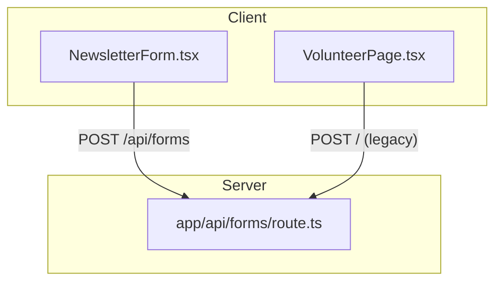
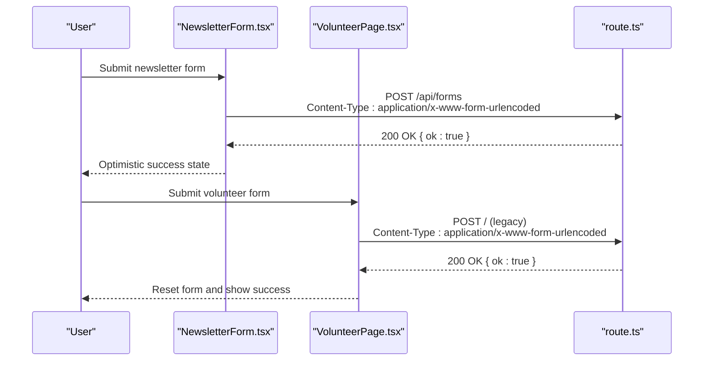
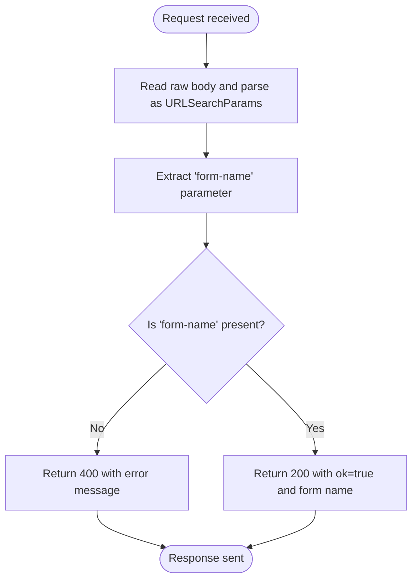
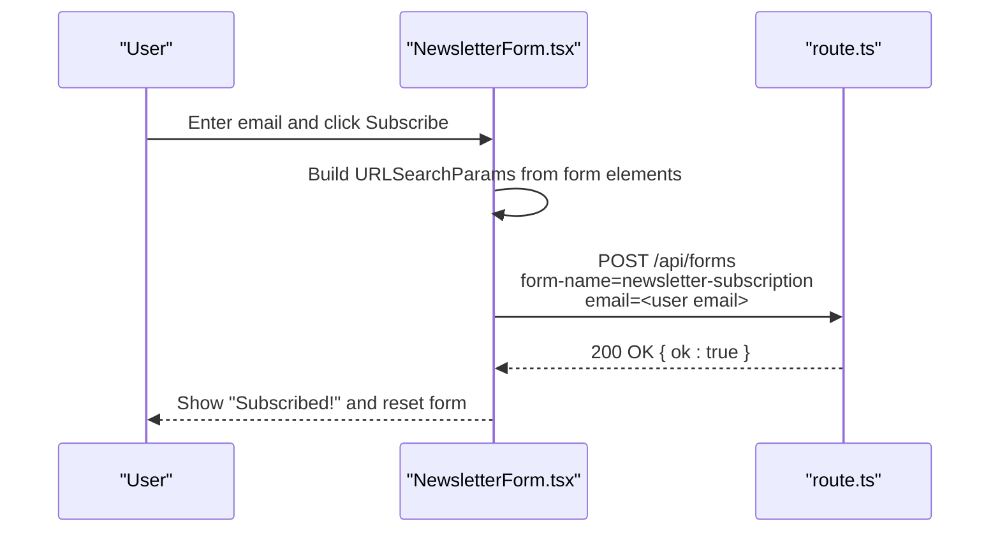
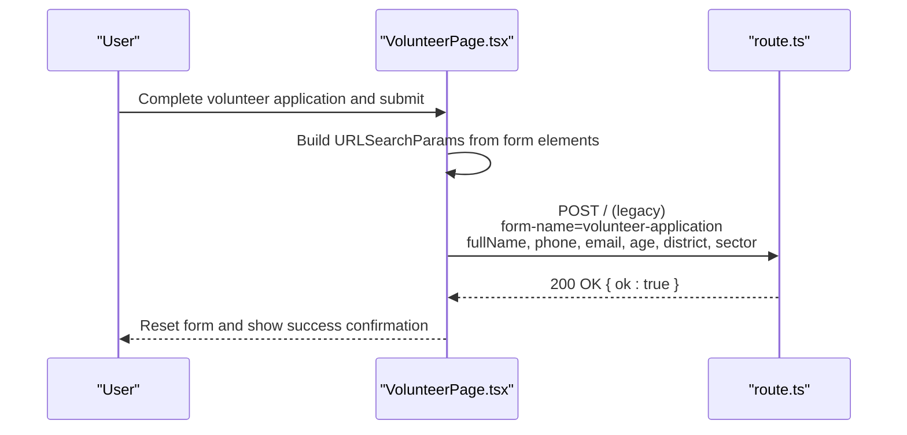
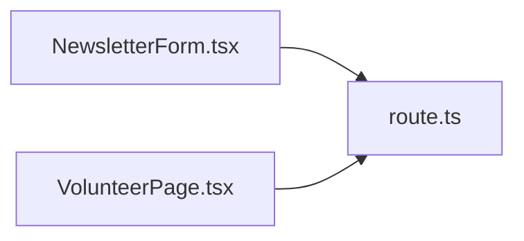

# API Documentation

<cite>
**Referenced Files in This Document**
- [route.ts](file://app/api/forms/route.ts)
- [NewsletterForm.tsx](file://components/layout/NewsletterForm.tsx)
- [VolunteerPage.tsx](file://components/pages/VolunteerPage.tsx)
- [README.md](file://README.md)
</cite>

## Table of Contents
1. [Introduction](#introduction)
2. [Project Structure](#project-structure)
3. [Core Components](#core-components)
4. [Architecture Overview](#architecture-overview)
5. [Detailed Component Analysis](#detailed-component-analysis)
6. [Dependency Analysis](#dependency-analysis)
7. [Performance Considerations](#performance-considerations)
8. [Troubleshooting Guide](#troubleshooting-guide)
9. [Conclusion](#conclusion)
10. [Appendices](#appendices)

## Introduction
This document describes the GMCF charity portal’s form handling endpoint used by the newsletter subscription and volunteer registration forms. The endpoint accepts form submissions, validates the presence of a required discriminator field, and returns a simple success response. It intentionally leaves persistence to external systems such as a CRM, email provider, or database, preserving the original fire-and-forget behavior of the legacy site.

The primary integration point is:
- HTTP method: POST
- URL pattern: /api/forms
- Content-Type: application/x-www-form-urlencoded
- Authentication: none (open endpoint; see Security Considerations)

**Section sources**
- [README.md:112-115](file://README.md#L112-L115)
- [route.ts:3-8](file://app/api/forms/route.ts#L3-L8)

## Project Structure
The form submission flow involves three main parts:
- Client-side newsletter form component that posts to /api/forms.
- Client-side volunteer page form that posts to the root path for legacy compatibility.
- Server-side route handler at app/api/forms/route.ts that validates and acknowledges submissions.

**Diagram sources**
- [NewsletterForm.tsx:11-31](file://components/layout/NewsletterForm.tsx#L11-L31)
- [VolunteerPage.tsx:40-58](file://components/pages/VolunteerPage.tsx#L40-L58)
- [route.ts:9-22](file://app/api/forms/route.ts#L9-L22)

**Section sources**
- [README.md:14-33](file://README.md#L14-L33)
- [route.ts:1-22](file://app/api/forms/route.ts#L1-L22)

## Core Components
- Form submission client components:
  - NewsletterForm.tsx constructs an x-www-form-urlencoded body from the HTML form and POSTs it to /api/forms.
  - VolunteerPage.tsx collects form data and posts to the root path for legacy Netlify compatibility.
- Server-side handler:
  - route.ts reads the request body as text, parses it into URLSearchParams, extracts the form-name field, validates its presence, and returns a JSON acknowledgment.

Key responsibilities:
- NewsletterForm.tsx: UI state, optimistic confirmation, and POST to /api/forms.
- VolunteerPage.tsx: Multi-step volunteer application UI and legacy POST to /.
- route.ts: Minimal validation and standardized JSON response.

**Section sources**
- [NewsletterForm.tsx:11-31](file://components/layout/NewsletterForm.tsx#L11-L31)
- [VolunteerPage.tsx:40-58](file://components/pages/VolunteerPage.tsx#L40-L58)
- [route.ts:9-22](file://app/api/forms/route.ts#L9-L22)

## Architecture Overview
The form submission architecture follows a simple client-server contract:

**Diagram sources**
- [NewsletterForm.tsx:11-31](file://components/layout/NewsletterForm.tsx#L11-L31)
- [VolunteerPage.tsx:40-58](file://components/pages/VolunteerPage.tsx#L40-L58)
- [route.ts:9-22](file://app/api/forms/route.ts#L9-L22)

## Detailed Component Analysis

### Endpoint Specification: POST /api/forms
- Method: POST
- Path: /api/forms
- Request format:
  - Content-Type: application/x-www-form-urlencoded
  - Required fields:
    - form-name: string. Identifies the form type (e.g., newsletter-subscription, volunteer-application).
- Response format:
  - Success:
    - Status: 200
    - Body: JSON object with ok set to true and form containing the submitted form-name value.
  - Error:
    - Missing form-name:
      - Status: 400
      - Body: JSON object with ok set to false and error describing the missing field.

Notes:
- The endpoint does not validate additional fields beyond form-name.
- No authentication or authorization is enforced by this endpoint.
- Persistence is intentionally delegated to external systems.

**Diagram sources**
- [route.ts:9-22](file://app/api/forms/route.ts#L9-L22)

**Section sources**
- [route.ts:9-22](file://app/api/forms/route.ts#L9-L22)

### Newsletter Subscription Form
- Purpose: Collect email addresses for newsletter subscriptions.
- Submission target: POST /api/forms
- Fields:
  - form-name: hidden field, value newsletter-subscription
  - email: required email input
- Validation rules:
  - Browser-level required attribute on email.
  - Server-level requires form-name to be present.
- Behavior:
  - On submit, the client sends an x-www-form-urlencoded payload to /api/forms.
  - On network failure, the client still sets an optimistic “subscribed” state and resets the form.

**Diagram sources**
- [NewsletterForm.tsx:11-31](file://components/layout/NewsletterForm.tsx#L11-L31)
- [route.ts:9-22](file://app/api/forms/route.ts#L9-L22)

**Section sources**
- [NewsletterForm.tsx:11-31](file://components/layout/NewsletterForm.tsx#L11-L31)
- [route.ts:9-22](file://app/api/forms/route.ts#L9-L22)

### Volunteer Registration Form
- Purpose: Collect volunteer candidate information for orientation scheduling.
- Submission target: POST / (legacy compatibility), which routes to the same server environment.
- Fields observed in the UI:
  - form-name: hidden field, value volunteer-application
  - fullName: required text
  - phone: required telephone number
  - email: required email address
  - age: required number with min/max constraints
  - district: required select dropdown
  - sector: radio selection among predefined humanitarian sectors
- Validation rules:
  - Browser-level required attributes and input types enforce basic validation.
  - Server-level requires form-name to be present.
- Behavior:
  - On submit, the client builds a URLSearchParams body and posts to /.
  - On completion, the form resets and increments a success counter to scroll to a success message.

**Diagram sources**
- [VolunteerPage.tsx:40-58](file://components/pages/VolunteerPage.tsx#L40-L58)
- [VolunteerPage.tsx:687-700](file://components/pages/VolunteerPage.tsx#L687-L700)
- [VolunteerPage.tsx:701-800](file://components/pages/VolunteerPage.tsx#L701-L800)
- [route.ts:9-22](file://app/api/forms/route.ts#L9-L22)

**Section sources**
- [VolunteerPage.tsx:40-58](file://components/pages/VolunteerPage.tsx#L40-L58)
- [VolunteerPage.tsx:687-800](file://components/pages/VolunteerPage.tsx#L687-L800)
- [route.ts:9-22](file://app/api/forms/route.ts#L9-L22)

## Dependency Analysis
- Client components depend on the server endpoint contract:
  - NewsletterForm.tsx expects POST /api/forms to accept x-www-form-urlencoded payloads and return a successful JSON response.
  - VolunteerPage.tsx posts to / for legacy compatibility but relies on the same server runtime.
- Server endpoint depends only on Next.js utilities to read the request body and return JSON responses.

**Diagram sources**
- [NewsletterForm.tsx:11-31](file://components/layout/NewsletterForm.tsx#L11-L31)
- [VolunteerPage.tsx:40-58](file://components/pages/VolunteerPage.tsx#L40-L58)
- [route.ts:9-22](file://app/api/forms/route.ts#L9-L22)

**Section sources**
- [NewsletterForm.tsx:11-31](file://components/layout/NewsletterForm.tsx#L11-L31)
- [VolunteerPage.tsx:40-58](file://components/pages/VolunteerPage.tsx#L40-L58)
- [route.ts:9-22](file://app/api/forms/route.ts#L9-L22)

## Performance Considerations
- The endpoint performs minimal processing: reading the raw body, parsing parameters, and returning JSON. This keeps latency low and avoids heavy computation.
- Since no persistence occurs in the handler, performance is primarily determined by the client’s network round-trip and browser rendering.
- For high-volume scenarios, consider adding rate limiting and caching strategies at the edge or reverse proxy layer before reaching the handler.

[No sources needed since this section provides general guidance]

## Troubleshooting Guide
Common issues and resolutions:
- Missing form-name:
  - Symptom: 400 response with error indicating missing form-name.
  - Resolution: Ensure the hidden form-name field is included in the form payload.
- Network errors:
  - NewsletterForm.tsx catches fetch failures and still shows optimistic success. If users do not receive confirmation emails or records, verify backend integration points outside this endpoint.
- Legacy volunteer form posting to /:
  - Confirm that the deployment environment routes the root POST to the same server runtime where the handler resides.

Operational checks:
- Inspect the request payload to confirm form-name is present.
- Validate that the client sets Content-Type to application/x-www-form-urlencoded.
- Monitor server logs for 400 responses indicating missing form-name.

**Section sources**
- [route.ts:14-19](file://app/api/forms/route.ts#L14-L19)
- [NewsletterForm.tsx:18-31](file://components/layout/NewsletterForm.tsx#L18-L31)
- [VolunteerPage.tsx:40-58](file://components/pages/VolunteerPage.tsx#L40-L58)

## Conclusion
The GMCF portal’s form handling endpoint provides a lightweight, stable contract for accepting newsletter and volunteer submissions. It validates the presence of the form-name field and returns a consistent JSON acknowledgment. Clients should ensure they include the required fields and handle both success and error states appropriately. External systems are responsible for persisting and processing the submitted data.

[No sources needed since this section summarizes without analyzing specific files]

## Appendices

### Request and Response Schemas

- Request schema (application/x-www-form-urlencoded):
  - form-name: string (required)
  - Additional fields vary by form type:
    - Newsletter subscription:
      - email: string (required by client)
    - Volunteer registration:
      - fullName: string (required by client)
      - phone: string (required by client)
      - email: string (required by client)
      - age: number (required by client, min/max enforced by client)
      - district: string (required by client, select options)
      - sector: string (required by client, radio options)

- Response schema:
  - Success (200):
    - ok: boolean (true)
    - form: string (the submitted form-name)
  - Error (400):
    - ok: boolean (false)
    - error: string (description of validation failure)

**Section sources**
- [route.ts:9-22](file://app/api/forms/route.ts#L9-L22)
- [NewsletterForm.tsx:33-69](file://components/layout/NewsletterForm.tsx#L33-L69)
- [VolunteerPage.tsx:687-800](file://components/pages/VolunteerPage.tsx#L687-L800)

### Security Considerations
- Authentication: None. The endpoint is open to the internet.
- Authorization: Not enforced.
- Input validation: Only form-name presence is validated server-side.
- Recommendations:
  - Add authentication or token-based access control if sensitive data is involved.
  - Implement server-side validation for all fields.
  - Apply rate limiting and bot protection at the edge or gateway.
  - Enforce HTTPS and secure headers in deployment configuration.

[No sources needed since this section provides general guidance]

### Rate Limiting Approaches
- Edge-level throttling using platform features (e.g., CDN or hosting provider limits).
- Middleware or gateway-level counters per IP or per form-name.
- Backoff and retry policies on the client side to avoid thundering herds.

[No sources needed since this section provides general guidance]

### Extending the API for Additional Form Types
- Add new form-name values in client components (e.g., donation-intent, event-registration).
- Extend server-side logic to branch on form-name and perform type-specific validation and routing to external systems.
- Maintain backward compatibility by keeping existing responses unchanged for current form types.

[No sources needed since this section provides general guidance]

### Integration with External Email Providers or CRM Systems
- Replace the current acknowledgment-only handler with calls to your email service or CRM after validating form-name and required fields.
- Use asynchronous job queues to avoid blocking the request.
- Log integration events and surface actionable errors to clients when necessary.

[No sources needed since this section provides general guidance]