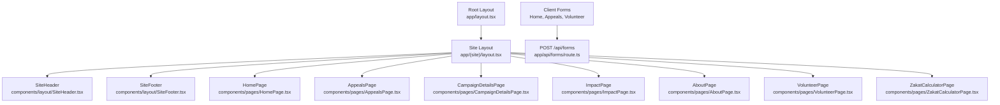
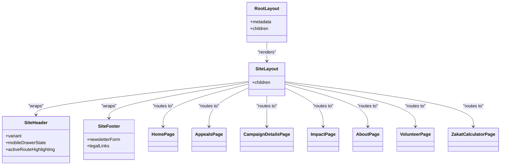
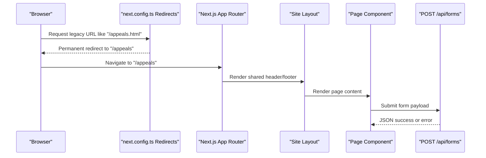
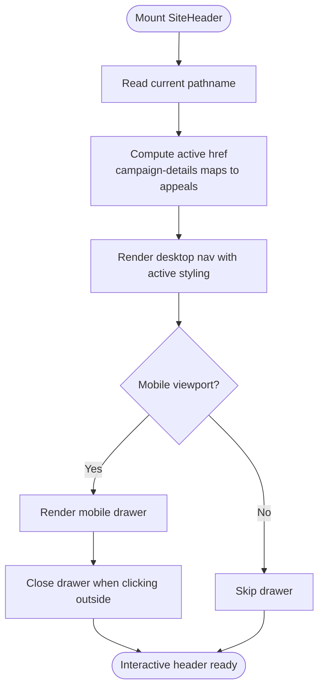
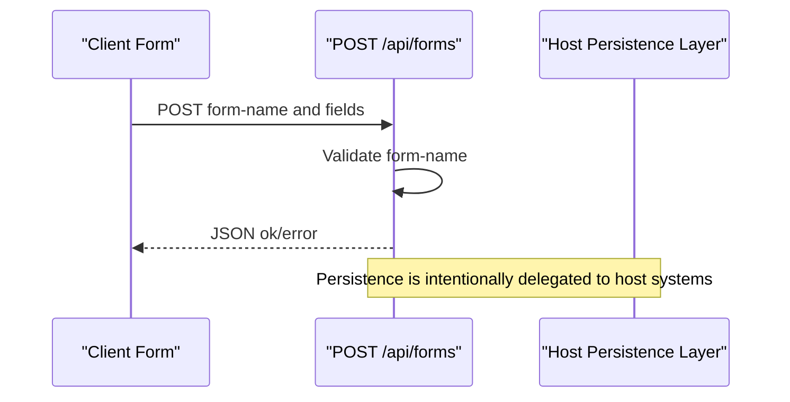
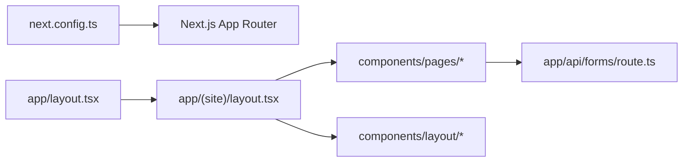

# Architecture Overview

<cite>
**Referenced Files in This Document**
- [README.md](file://README.md)
- [next.config.ts](file://next.config.ts)
- [app/layout.tsx](file://app/layout.tsx)
- [app/(site)/layout.tsx](file://app/(site)/layout.tsx)
- [app/(site)/page.tsx](file://app/(site)/page.tsx)
- [app/(site)/appeals/page.tsx](file://app/(site)/appeals/page.tsx)
- [app/api/forms/route.ts](file://app/api/forms/route.ts)
- [components/layout/SiteHeader.tsx](file://components/layout/SiteHeader.tsx)
- [components/layout/SiteFooter.tsx](file://components/layout/SiteFooter.tsx)
- [components/pages/HomePage.tsx](file://components/pages/HomePage.tsx)
- [components/pages/AppealsPage.tsx](file://components/pages/AppealsPage.tsx)
- [components/pages/CampaignDetailsPage.tsx](file://components/pages/CampaignDetailsPage.tsx)
- [components/pages/ImpactPage.tsx](file://components/pages/ImpactPage.tsx)
- [components/pages/AboutPage.tsx](file://components/pages/AboutPage.tsx)
- [components/pages/VolunteerPage.tsx](file://components/pages/VolunteerPage.tsx)
- [components/pages/ZakatCalculatorPage.tsx](file://components/pages/ZakatCalculatorPage.tsx)
</cite>

## Table of Contents
1. [Introduction](#introduction)
2. [Project Structure](#project-structure)
3. [Core Components](#core-components)
4. [Architecture Overview](#architecture-overview)
5. [Detailed Component Analysis](#detailed-component-analysis)
6. [Dependency Analysis](#dependency-analysis)
7. [Performance Considerations](#performance-considerations)
8. [Troubleshooting Guide](#troubleshooting-guide)
9. [Conclusion](#conclusion)

## Introduction
This document explains the architectural design of the GMCF charity portal built with Next.js App Router, TypeScript, and Tailwind CSS. The application migrated from static HTML to React components while preserving legacy URLs through permanent redirects. It uses route groups for shared site chrome, separates layout concerns from page content, and exposes a small API boundary for form submissions.

The system is organized around:
- A root layout that configures fonts, metadata, global styles, and Material Symbols.
- A site layout under the `(site)` route group that wraps every public page with `SiteHeader` and `SiteFooter`.
- Page-level client components under `components/pages/` that implement interactive features such as donation flows, Zakat calculation, appeal filtering, campaign storytelling, impact dossiers, about/governance content, volunteer onboarding, and the Zakat calculator.
- An API route at `app/api/forms/route.ts` that preserves the original fire-and-forget form contract.

## Project Structure
The repository follows Next.js App Router conventions:
- `app/` contains layouts, pages, and API routes.
- `app/(site)/` is a route group that shares one layout across all public pages.
- `components/layout/` holds reusable shell components (`SiteHeader`, `SiteFooter`, newsletter form).
- `components/pages/` holds full-page React components for each feature area.
- `legacy/` keeps the original static site for reference and migration validation.
- `next.config.ts` defines legacy `.html` URL redirects to clean App Router paths.

**Diagram sources**
- [app/layout.tsx:1-61](file://app/layout.tsx#L1-L61)
- [app/(site)/layout.tsx:1-15](file://app/(site)/layout.tsx#L1-L15)
- [components/layout/SiteHeader.tsx:1-234](file://components/layout/SiteHeader.tsx#L1-L234)
- [components/layout/SiteFooter.tsx:1-233](file://components/layout/SiteFooter.tsx#L1-L233)
- [components/pages/HomePage.tsx:1-800](file://components/pages/HomePage.tsx#L1-L800)
- [components/pages/AppealsPage.tsx:1-800](file://components/pages/AppealsPage.tsx#L1-L800)
- [components/pages/CampaignDetailsPage.tsx:1-800](file://components/pages/CampaignDetailsPage.tsx#L1-L800)
- [components/pages/ImpactPage.tsx:1-800](file://components/pages/ImpactPage.tsx#L1-L800)
- [components/pages/AboutPage.tsx:1-747](file://components/pages/AboutPage.tsx#L1-L747)
- [components/pages/VolunteerPage.tsx:1-800](file://components/pages/VolunteerPage.tsx#L1-L800)
- [components/pages/ZakatCalculatorPage.tsx:1-800](file://components/pages/ZakatCalculatorPage.tsx#L1-L800)
- [app/api/forms/route.ts:1-23](file://app/api/forms/route.ts#L1-L23)

**Section sources**
- [README.md:14-64](file://README.md#L14-L64)
- [next.config.ts:1-32](file://next.config.ts#L1-L32)

## Core Components
The portal’s core runtime structure consists of:

- **Root layout**: Sets language, global fonts, favicon, Material Symbols links, default metadata, and base body classes.
- **Site layout**: Wraps page content with header and footer.
- **SiteHeader**: Provides international meta strip, navigation, active-route highlighting, mobile drawer, currency selector, and donor/volunteer shortcuts.
- **SiteFooter**: Contains trust messaging, featured appeals, global office information, legal links, and newsletter subscription.
- **Page components**: Each major route renders a dedicated client component with rich interactivity.

**Diagram sources**
- [app/layout.tsx:1-61](file://app/layout.tsx#L1-L61)
- [app/(site)/layout.tsx:1-15](file://app/(site)/layout.tsx#L1-L15)
- [components/layout/SiteHeader.tsx:1-234](file://components/layout/SiteHeader.tsx#L1-L234)
- [components/layout/SiteFooter.tsx:1-233](file://components/layout/SiteFooter.tsx#L1-L233)
- [app/(site)/page.tsx:1-15](file://app/(site)/page.tsx#L1-L15)
- [app/(site)/appeals/page.tsx:1-14](file://app/(site)/appeals/page.tsx#L1-L14)

**Section sources**
- [app/layout.tsx:1-61](file://app/layout.tsx#L1-L61)
- [app/(site)/layout.tsx:1-15](file://app/(site)/layout.tsx#L1-L15)
- [components/layout/SiteHeader.tsx:1-234](file://components/layout/SiteHeader.tsx#L1-L234)
- [components/layout/SiteFooter.tsx:1-233](file://components/layout/SiteFooter.tsx#L1-L233)
- [app/(site)/page.tsx:1-15](file://app/(site)/page.tsx#L1-L15)
- [app/(site)/appeals/page.tsx:1-14](file://app/(site)/appeals/page.tsx#L1-L14)

## Architecture Overview
The high-level architecture emphasizes separation of concerns:

- **Routing and layout boundaries**:
  - `app/layout.tsx` owns global document configuration.
  - `app/(site)/layout.tsx` owns shared chrome for public pages.
  - Route files under `app/(site)/` are thin shells that import page components and set per-page metadata.

- **Component composition**:
  - `SiteHeader` and `SiteFooter` are reused by every page inside the site layout.
  - Page components encapsulate domain-specific UI and state.

- **Legacy compatibility**:
  - `next.config.ts` maps old `.html` URLs to clean App Router routes using permanent redirects.
  - Unknown paths render the branded 404 page.

- **API boundary**:
  - `app/api/forms/route.ts` accepts form submissions with a `form-name` field and returns a simple JSON response.
  - Client forms post data to this endpoint or to the legacy Netlify-compatible surface depending on integration needs.

**Diagram sources**
- [next.config.ts:1-32](file://next.config.ts#L1-L32)
- [app/(site)/layout.tsx:1-15](file://app/(site)/layout.tsx#L1-L15)
- [app/(site)/appeals/page.tsx:1-14](file://app/(site)/appeals/page.tsx#L1-L14)
- [app/api/forms/route.ts:1-23](file://app/api/forms/route.ts#L1-L23)

**Section sources**
- [README.md:137-152](file://README.md#L137-L152)
- [next.config.ts:1-32](file://next.config.ts#L1-L32)

## Detailed Component Analysis

### Root Layout and Global Configuration
The root layout:
- Imports Google fonts via `next/font/google` and exposes CSS variables for typography.
- Declares default metadata including title template, description, application name, and favicon.
- Adds Material Symbols stylesheet links.
- Applies base body classes for background, font family, text color, and antialiasing.

This layer ensures consistent typography, branding, and accessibility baseline across all routes.

**Section sources**
- [app/layout.tsx:1-61](file://app/layout.tsx#L1-L61)

### Site Layout and Shared Chrome
The site layout:
- Imports `SiteHeader` and `SiteFooter`.
- Renders them around `children`, ensuring every page under `(site)` has the same top and bottom chrome.
- Keeps page-specific logic isolated in page components.

This pattern enforces consistent navigation, branding, and footer content without duplicating markup in each page.

**Section sources**
- [app/(site)/layout.tsx:1-15](file://app/(site)/layout.tsx#L1-L15)

### SiteHeader Interaction Model
`SiteHeader` is a client component responsible for:
- Defining navigation items and mapping them to routes.
- Highlighting the active link based on current pathname.
- Managing mobile drawer state and closing behavior.
- Rendering an international meta strip, logo, desktop navigation, donate CTA, optional donor/volunteer shortcut, and responsive mobile menu.

It supports a `simple` variant used by the slim 404 header, removing currency selection and donor portal shortcut.

**Diagram sources**
- [components/layout/SiteHeader.tsx:1-234](file://components/layout/SiteHeader.tsx#L1-L234)

**Section sources**
- [components/layout/SiteHeader.tsx:1-234](file://components/layout/SiteHeader.tsx#L1-L234)

### SiteFooter Composition
`SiteFooter` composes:
- A trust banner emphasizing 100% Zakat guarantee and transparency.
- Featured appeals linking to `/appeals` and `/campaign-details`.
- Global headquarters details and contact information.
- Newsletter subscription via `NewsletterForm`.
- Bottom legal links and site navigation.

It acts as a stable cross-page anchor for compliance messaging and secondary navigation.

**Section sources**
- [components/layout/SiteFooter.tsx:1-233](file://components/layout/SiteFooter.tsx#L1-L233)

### Page Routing and Metadata Shells
Route files under `app/(site)/` are intentionally minimal:
- They import the corresponding page component from `components/pages/`.
- They export page-specific metadata such as title and description.
- They return the page component as the rendered output.

Examples include the homepage and appeals page.

**Section sources**
- [app/(site)/page.tsx:1-15](file://app/(site)/page.tsx#L1-L15)
- [app/(site)/appeals/page.tsx:1-14](file://app/(site)/appeals/page.tsx#L1-L14)

### Interactive Page Components

#### HomePage
`HomePage` implements:
- Donation frequency selection (one-time vs monthly).
- Fund selection among meal, pediatric care, Zakat, winter warmth, and water projects.
- Preset amount chips and custom amount input.
- Quick Zakat assessment fields and a flow that scrolls to the donation card when Zakat is due.
- Hero narrative, metrics ribbon, and active appeals preview cards.

It demonstrates how page-level state drives user journeys without requiring server calls for local interactions.

**Section sources**
- [components/pages/HomePage.tsx:1-800](file://components/pages/HomePage.tsx#L1-L800)

#### AppealsPage
`AppealsPage` provides:
- Category filter pills.
- Live search over campaign titles and descriptions.
- Sorting by urgency, funding level, target amount, and alphabetical order.
- A quick-donate modal with preset amounts and custom input.
- Campaign cards linking to `/campaign-details`.

It models complex client-side filtering and presentation logic typical of a charity appeals catalog.

**Section sources**
- [components/pages/AppealsPage.tsx:1-800](file://components/pages/AppealsPage.tsx#L1-L800)

#### CampaignDetailsPage
`CampaignDetailsPage` implements:
- Breadcrumb navigation and campaign status badges.
- Photo gallery with thumbnail switching.
- Tabbed content for story, cost breakdown, field dispatch log, and Zakat governance.
- Donation controls supporting one-time or monthly giving and Zakat designation.

It illustrates rich storytelling combined with transparent financial breakdowns and Shariah compliance messaging.

**Section sources**
- [components/pages/CampaignDetailsPage.tsx:1-800](file://components/pages/CampaignDetailsPage.tsx#L1-L800)

#### ImpactPage
`ImpactPage` presents:
- Verified outcome metrics.
- Case filters by child protection, healthcare, food relief, and WASH.
- Featured case dossier with timeline and sponsorship tiers.
- Shariah verification pipeline explanation and audit references.

It balances emotional storytelling with accountability and structured program reporting.

**Section sources**
- [components/pages/ImpactPage.tsx:1-800](file://components/pages/ImpactPage.tsx#L1-L800)

#### AboutPage
`AboutPage` communicates:
- Mission, pillars of stewardship, and zero-overhead policy.
- Shariah advisory council and independent audit panel.
- Public disclosures and downloadable governance documents.
- Institutional history and global offices.

It serves as the trust and governance anchor for donors and partners.

**Section sources**
- [components/pages/AboutPage.tsx:1-747](file://components/pages/AboutPage.tsx#L1-L747)

#### VolunteerPage
`VolunteerPage` offers:
- Sector pathway cards for emergency relief, medical camps, youth education, and media/logistics.
- Application form with sector preselection and success feedback.
- FAQ accordion and safety/trust messaging.

It connects prospective volunteers to operational pathways and onboarding.

**Section sources**
- [components/pages/VolunteerPage.tsx:1-800](file://components/pages/VolunteerPage.tsx#L1-L800)

#### ZakatCalculatorPage
`ZakatCalculatorPage` implements:
- Five-category asset and liability inputs.
- Real-time net wealth and Zakat obligation calculation.
- Nisab threshold indicator and status messaging.
- Cause allocation selector and fulfillment action.

It translates Shariah-compliant financial rules into an accessible interactive tool.

**Section sources**
- [components/pages/ZakatCalculatorPage.tsx:1-800](file://components/pages/ZakatCalculatorPage.tsx#L1-L800)

### API Form Integration
`app/api/forms/route.ts`:
- Accepts POST requests with `application/x-www-form-urlencoded` payloads.
- Parses `form-name` from the request body.
- Returns a simple JSON response indicating success or missing field.
- Leaves persistence to the host environment, preserving the original fire-and-forget contract.

**Diagram sources**
- [app/api/forms/route.ts:1-23](file://app/api/forms/route.ts#L1-L23)

**Section sources**
- [app/api/forms/route.ts:1-23](file://app/api/forms/route.ts#L1-L23)

## Dependency Analysis
The application exhibits clear layering:

- **Configuration layer**: `next.config.ts` handles legacy URL redirections and enables component caching and partial prefetching.
- **Layout layer**: `app/layout.tsx` and `app/(site)/layout.tsx` define document and site chrome.
- **Routing layer**: Thin route files map URLs to page components and metadata.
- **Presentation layer**: `components/pages/*` contain domain-specific UI and state.
- **Shared layout layer**: `components/layout/*` provide reusable header, footer, and newsletter form.
- **Integration layer**: `app/api/forms/route.ts` exposes a stable contract for form submissions.

**Diagram sources**
- [next.config.ts:1-32](file://next.config.ts#L1-L32)
- [app/layout.tsx:1-61](file://app/layout.tsx#L1-L61)
- [app/(site)/layout.tsx:1-15](file://app/(site)/layout.tsx#L1-L15)
- [app/api/forms/route.ts:1-23](file://app/api/forms/route.ts#L1-L23)

**Section sources**
- [README.md:14-64](file://README.md#L14-L64)
- [next.config.ts:1-32](file://next.config.ts#L1-L32)

## Performance Considerations
The project applies several performance-oriented strategies:

- **Font optimization**: Fonts are loaded via `next/font/google` with variable exposure and swap display, reducing layout shift and improving perceived load time.
- **Component caching**: `cacheComponents: true` reduces rebuild overhead for repeated component trees.
- **Partial prefetching**: `partialPrefetching: true` improves navigation responsiveness by prefetching parts of the app.
- **Static metadata**: Per-page metadata is declared directly in route files, enabling efficient SEO and browser rendering.
- **Tailwind-based styling**: Utility-first CSS minimizes custom stylesheet complexity and leverages build-time optimizations.
- **Client-only interactivity**: Heavy interactive logic lives in client components, keeping server-rendered pages lean where possible.

Recommendations:
- Keep page components focused on presentation and local state; move data fetching to server components or API handlers if backend integration grows.
- Prefer image optimization and lazy loading for large field photos.
- Monitor bundle size as more interactive tools are added.
- Use Next.js analytics and performance metrics to validate improvements.

[No sources needed since this section provides general guidance]

## Troubleshooting Guide
Common issues and their likely causes:

- **Legacy `.html` URLs returning 404**:
  - Ensure `next.config.ts` includes the expected redirect entries.
  - Verify deployment builds use the configured redirects.

- **Missing `form-name` in form submissions**:
  - Check that client forms include a hidden `form-name` field before posting.
  - Inspect the API response for the explicit missing-field error.

- **Mobile drawer not closing**:
  - Confirm click-outside handler is attached and header ref is present.
  - Ensure event propagation is handled correctly for nested elements.

- **Active navigation highlight incorrect**:
  - Review pathname comparison logic, especially for `/campaign-details` mapping to `/appeals`.

- **Fonts not applied**:
  - Verify `app/layout.tsx` imports and applies font variables to `html` className.
  - Confirm global CSS and Tailwind configuration are included.

**Section sources**
- [next.config.ts:1-32](file://next.config.ts#L1-L32)
- [app/api/forms/route.ts:1-23](file://app/api/forms/route.ts#L1-L23)
- [components/layout/SiteHeader.tsx:1-234](file://components/layout/SiteHeader.tsx#L1-L234)
- [app/layout.tsx:1-61](file://app/layout.tsx#L1-L61)

## Conclusion
The GMCF portal adopts a clean Next.js App Router architecture that separates global document configuration, shared site chrome, page routing, and interactive page components. Legacy compatibility is maintained through permanent redirects, while the API route preserves the original form contract. The design emphasizes trust, transparency, and Shariah-compliant stewardship through consistent messaging, accessible navigation, and interactive tools. Future growth should continue to respect these boundaries, adding server-side integrations where appropriate while keeping client components focused on user interaction and presentation.

[No sources needed since this section summarizes without analyzing specific files]