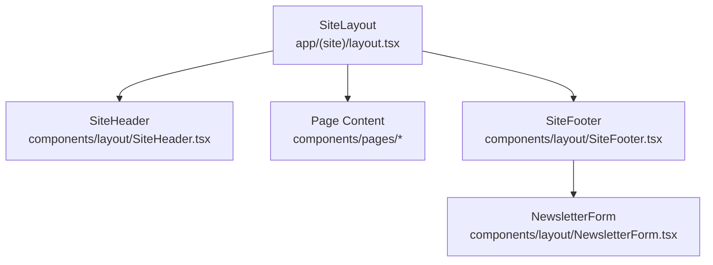
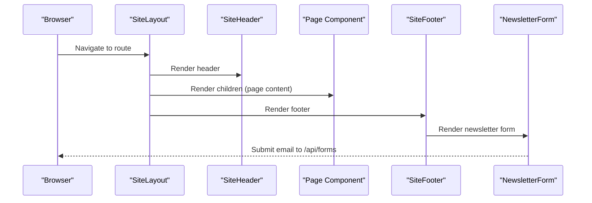
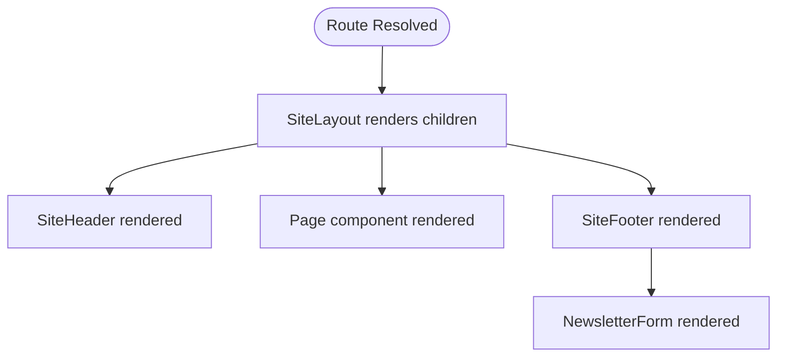
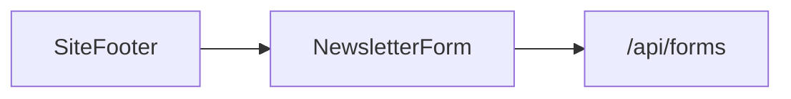
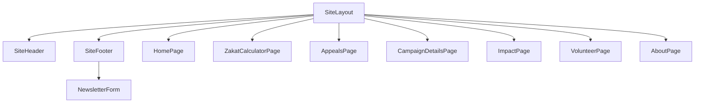

# Component Architecture

<cite>
**Referenced Files in This Document**
- [app/(site)/layout.tsx](file://app/(site)/layout.tsx)
- [components/layout/SiteHeader.tsx](file://components/layout/SiteHeader.tsx)
- [components/layout/SiteFooter.tsx](file://components/layout/SiteFooter.tsx)
- [components/layout/NewsletterForm.tsx](file://components/layout/NewsletterForm.tsx)
- [app/(site)/page.tsx](file://app/(site)/page.tsx)
- [components/pages/HomePage.tsx](file://components/pages/HomePage.tsx)
- [components/pages/ZakatCalculatorPage.tsx](file://components/pages/ZakatCalculatorPage.tsx)
- [components/pages/AppealsPage.tsx](file://components/pages/AppealsPage.tsx)
- [components/pages/CampaignDetailsPage.tsx](file://components/pages/CampaignDetailsPage.tsx)
- [components/pages/ImpactPage.tsx](file://components/pages/ImpactPage.tsx)
- [components/pages/VolunteerPage.tsx](file://components/pages/VolunteerPage.tsx)
- [components/pages/AboutPage.tsx](file://components/pages/AboutPage.tsx)
</cite>

## Table of Contents
1. [Introduction](#introduction)
2. [Project Structure](#project-structure)
3. [Core Components](#core-components)
4. [Architecture Overview](#architecture-overview)
5. [Detailed Component Analysis](#detailed-component-analysis)
6. [Dependency Analysis](#dependency-analysis)
7. [Performance Considerations](#performance-considerations)
8. [Troubleshooting Guide](#troubleshooting-guide)
9. [Conclusion](#conclusion)

## Introduction
This document explains the React component architecture for the site, focusing on how layout components and page components are separated, composed, and maintained consistently. The application uses Next.js App Router conventions where a site-level layout wraps every page with a consistent header and footer. Page components own their interactive state and business logic, while layout components provide shared chrome such as navigation, branding, trust messaging, and newsletter subscription.

The separation improves reusability, testability, and consistency:
- Layout components encapsulate global UI patterns and cross-cutting concerns.
- Page components encapsulate domain-specific content and user interactions.
- Data flows from parent to child via props, while local state is managed inside each component using React hooks.

## Project Structure
The project organizes components into two primary folders:
- `components/layout`: Shared layout components (`SiteHeader`, `SiteFooter`, `NewsletterForm`).
- `components/pages`: Feature-specific page components (`HomePage`, `ZakatCalculatorPage`, `AppealsPage`, `CampaignDetailsPage`, `ImpactPage`, `VolunteerPage`, `AboutPage`).

Routing and layout composition live under `app/(site)/layout.tsx`, which renders `SiteHeader` and `SiteFooter` around page content. Each route file (for example, `app/(site)/page.tsx`) imports and renders its corresponding page component.

**Diagram sources**
- [app/(site)/layout.tsx:1-15](file://app/(site)/layout.tsx#L1-L15)
- [components/layout/SiteHeader.tsx:1-234](file://components/layout/SiteHeader.tsx#L1-L234)
- [components/layout/SiteFooter.tsx:1-233](file://components/layout/SiteFooter.tsx#L1-L233)
- [components/layout/NewsletterForm.tsx:1-72](file://components/layout/NewsletterForm.tsx#L1-L72)

**Section sources**
- [app/(site)/layout.tsx:1-15](file://app/(site)/layout.tsx#L1-L15)
- [app/(site)/page.tsx:1-15](file://app/(site)/page.tsx#L1-L15)

## Core Components
This section documents the key layout and page components, their responsibilities, props interfaces, and state management patterns.

### Layout Components

#### SiteHeader
Responsibilities:
- Renders international meta strip, brand logo, navigation links, donation CTA, and mobile drawer.
- Highlights active navigation based on current pathname.
- Supports a simple variant that removes currency switcher and donor portal shortcut.

Props interface:
- `variant`: `'default' | 'simple'`. Controls whether additional header features are shown.

State and behavior:
- Uses `useState` for mobile drawer open/close.
- Uses `useRef` for click-outside detection.
- Uses `useEffect` to attach/detach document click listener.
- Uses Next.js `usePathname` to compute active link highlighting.

Reusability pattern:
- Single source of truth for top navigation and branding across all pages.
- Optional variant prop enables reuse in contexts requiring a slimmer header.

**Section sources**
- [components/layout/SiteHeader.tsx:16-23](file://components/layout/SiteHeader.tsx#L16-L23)
- [components/layout/SiteHeader.tsx:24-43](file://components/layout/SiteHeader.tsx#L24-L43)
- [components/layout/SiteHeader.tsx:45-231](file://components/layout/SiteHeader.tsx#L45-L231)

#### SiteFooter
Responsibilities:
- Displays trust banner, organization info, featured appeals, global office details, and newsletter subscription form.
- Provides consistent bottom-of-page navigation and legal information.

Composition:
- Composes `NewsletterForm` to handle email subscription UX.

Data flow:
- No direct props passed to `NewsletterForm`; it manages its own internal state and submission behavior.

**Section sources**
- [components/layout/SiteFooter.tsx:1-233](file://components/layout/SiteFooter.tsx#L1-L233)

#### NewsletterForm
Responsibilities:
- Renders an email input and subscribe button.
- Submits data to `/api/forms` using `fetch`.
- Shows optimistic success state after submission.

State and behavior:
- `status`: `'idle' | 'subscribed'` controls button text and styling.
- `formRef`: references the form element for reset and focus management.
- `handleSubmit`: serializes form data, posts to API, catches errors, sets status to subscribed, resets form, and blurs input.

Error handling:
- Errors during fetch are swallowed to preserve optimistic UX; the component still shows success.

**Section sources**
- [components/layout/NewsletterForm.tsx:5-31](file://components/layout/NewsletterForm.tsx#L5-L31)
- [components/layout/NewsletterForm.tsx:33-71](file://components/layout/NewsletterForm.tsx#L33-L71)

### Page Components

#### HomePage
Responsibilities:
- Hero narrative, impact metrics, quick donation engine, active appeals grid.
- Includes a mini Zakat calculator experience integrated into the donation card.

State and behavior:
- Donation frequency, selected fund, amount selection, custom amount input, and zakat fields.
- Computes net wealth and zakat due using `useMemo`.
- Handles amount selection, field updates, reset, and “Pay Zakat Now” workflow.

Integration with layout:
- Rendered by the site layout, receiving no props from layout; layout provides header/footer automatically.

**Section sources**
- [components/pages/HomePage.tsx:16-82](file://components/pages/HomePage.tsx#L16-L82)
- [components/pages/HomePage.tsx:84-800](file://components/pages/HomePage.tsx#L84-L800)

#### ZakatCalculatorPage
Responsibilities:
- Comprehensive Zakat calculator with five asset/liability categories.
- Live summary panel showing assets, debts, net wealth, Nisab status, and zakat due.
- Cause allocation selector and fulfillment action.

State and behavior:
- Field values stored in a single object state.
- Derived values computed inline: assets, debts, net wealth, zakat due, Nisab threshold check.
- FAQ toggles and recomputation tracking for UI transitions.

Integration with layout:
- Standalone page wrapped by site layout; no props required from layout.

**Section sources**
- [components/pages/ZakatCalculatorPage.tsx:21-60](file://components/pages/ZakatCalculatorPage.tsx#L21-L60)
- [components/pages/ZakatCalculatorPage.tsx:61-105](file://components/pages/ZakatCalculatorPage.tsx#L61-L105)
- [components/pages/ZakatCalculatorPage.tsx:107-800](file://components/pages/ZakatCalculatorPage.tsx#L107-L800)

#### AppealsPage
Responsibilities:
- Lists active appeals with search, category filters, sorting, and quick donation modal.
- Maintains visibility and order of campaign cards based on user interactions.

State and behavior:
- Query string, active category, sort value, card order, visibility flags, modal state.
- `useEffect` recalculates visible cards when query or category changes.
- Sorting algorithm updates card order based on urgency, funding progress, alphabetical order, or target amount.

Integration with layout:
- Wrapped by site layout; no props needed from layout.

**Section sources**
- [components/pages/AppealsPage.tsx:63-93](file://components/pages/AppealsPage.tsx#L63-L93)
- [components/pages/AppealsPage.tsx:95-152](file://components/pages/AppealsPage.tsx#L95-L152)
- [components/pages/AppealsPage.tsx:154-800](file://components/pages/AppealsPage.tsx#L154-L800)

#### CampaignDetailsPage
Responsibilities:
- Detailed appeal story, media gallery with thumbnails, tabbed content (about, budget breakdown, field updates, Shariah governance).
- Donation widget supporting one-time or monthly amounts and Zakat designation.

State and behavior:
- Active tab, active thumbnail index, donation amount, frequency toggle, Zakat flag.
- Gallery switching updates main image and alt attributes.
- Submission triggers confirmation alert simulating checkout redirection.

Integration with layout:
- Wrapped by site layout; no props needed from layout.

**Section sources**
- [components/pages/CampaignDetailsPage.tsx:6-28](file://components/pages/CampaignDetailsPage.tsx#L6-L28)
- [components/pages/CampaignDetailsPage.tsx:29-52](file://components/pages/CampaignDetailsPage.tsx#L29-L52)
- [components/pages/CampaignDetailsPage.tsx:54-800](file://components/pages/CampaignDetailsPage.tsx#L54-L800)

#### ImpactPage
Responsibilities:
- Story-driven impact showcase with case filters, sponsor tiers, and transparency pipeline explanation.
- Modal-based case dossiers and sponsorship actions.

State and behavior:
- Open modals map keyed by modal ID.
- Active filter and filter touched state for visual feedback.
- Sponsorship tier selection and submission handler.

Integration with layout:
- Wrapped by site layout; no props needed from layout.

**Section sources**
- [components/pages/ImpactPage.tsx:20-34](file://components/pages/ImpactPage.tsx#L20-L34)
- [components/pages/ImpactPage.tsx:36-800](file://components/pages/ImpactPage.tsx#L36-L800)

#### VolunteerPage
Responsibilities:
- Volunteer pathway cards, sector selection, application form, and FAQ accordion.
- Scrolls to success message after submission.

State and behavior:
- Selected sector, submit count, open FAQ index.
- Preselects sector and scrolls to application form.
- Form submission serializes data and posts to root endpoint; then increments submit count and resets form.

Integration with layout:
- Wrapped by site layout; no props needed from layout.

**Section sources**
- [components/pages/VolunteerPage.tsx:16-58](file://components/pages/VolunteerPage.tsx#L16-L58)
- [components/pages/VolunteerPage.tsx:60-800](file://components/pages/VolunteerPage.tsx#L60-L800)

#### AboutPage
Responsibilities:
- Institutional mission, pillars, governance council, public disclosures, story, and global offices.
- Static informational page with strong trust signals and links to audits and appeals.

State and behavior:
- Mostly presentational; minimal interactivity.

Integration with layout:
- Wrapped by site layout; no props needed from layout.

**Section sources**
- [components/pages/AboutPage.tsx:5-747](file://components/pages/AboutPage.tsx#L5-L747)

## Architecture Overview
The site follows a clear parent-child composition model:
- `SiteLayout` renders `SiteHeader`, page content (`children`), and `SiteFooter`.
- Page components render rich content and manage their own state.
- Layout components do not depend on page state; they remain reusable and consistent.

**Diagram sources**
- [app/(site)/layout.tsx:1-15](file://app/(site)/layout.tsx#L1-L15)
- [components/layout/SiteHeader.tsx:1-234](file://components/layout/SiteHeader.tsx#L1-L234)
- [components/layout/SiteFooter.tsx:1-233](file://components/layout/SiteFooter.tsx#L1-L233)
- [components/layout/NewsletterForm.tsx:1-72](file://components/layout/NewsletterForm.tsx#L1-L72)

## Detailed Component Analysis

### Layout Wrapping Strategy
`SiteLayout` composes the header and footer around page content. This ensures every page receives consistent branding, navigation, and footer messaging without duplicating code.

**Diagram sources**
- [app/(site)/layout.tsx:1-15](file://app/(site)/layout.tsx#L1-L15)

**Section sources**
- [app/(site)/layout.tsx:1-15](file://app/(site)/layout.tsx#L1-L15)

### Props Interfaces and Composition Patterns
- `SiteHeader` accepts `variant` to toggle between default and simple modes.
- `SiteFooter` composes `NewsletterForm` without passing props; `NewsletterForm` owns its state and submission logic.
- Page components do not receive props from layout; they are self-contained and rely on internal state and Next.js routing/navigation.

Best practices demonstrated:
- Keep layout components free of page-specific state.
- Use optional props to enable variants (e.g., header variant).
- Encapsulate form logic within small components like `NewsletterForm`.

**Section sources**
- [components/layout/SiteHeader.tsx:16-23](file://components/layout/SiteHeader.tsx#L16-L23)
- [components/layout/SiteFooter.tsx:1-233](file://components/layout/SiteFooter.tsx#L1-L233)
- [components/layout/NewsletterForm.tsx:1-72](file://components/layout/NewsletterForm.tsx#L1-L72)

### State Management Patterns Using React Hooks
Common patterns across page components:
- Local state via `useState` for UI interactions (modals, tabs, filters, forms).
- Derived computations via `useMemo` or inline calculations to avoid unnecessary re-renders.
- Side effects via `useEffect` for event listeners and scroll behaviors.
- DOM access via `useRef` for focus management and element queries.

Examples:
- `HomePage` uses `useState` for donation frequency, fund selection, amount selection, and zakat fields; `useMemo` computes zakat due.
- `ZakatCalculatorPage` maintains a flat fields object and derives assets, debts, net wealth, and zakat due.
- `AppealsPage` uses `useEffect` to recalculate visible cards based on query and category.
- `VolunteerPage` uses `useEffect` to scroll to success message after submission.

**Section sources**
- [components/pages/HomePage.tsx:16-82](file://components/pages/HomePage.tsx#L16-L82)
- [components/pages/ZakatCalculatorPage.tsx:21-60](file://components/pages/ZakatCalculatorPage.tsx#L21-L60)
- [components/pages/AppealsPage.tsx:63-93](file://components/pages/AppealsPage.tsx#L63-L93)
- [components/pages/VolunteerPage.tsx:16-58](file://components/pages/VolunteerPage.tsx#L16-L58)

### Data Flow Between Parent and Child Components
- Layout-to-page: No props are passed; layout provides structural context (header/footer).
- Footer-to-newsletter: `SiteFooter` renders `NewsletterForm` without props; newsletter handles its own state and API call.
- Page-to-widget: Some pages embed mini widgets (e.g., donation card in `HomePage`) that manage internal state and trigger navigation or alerts.

**Diagram sources**
- [components/layout/SiteFooter.tsx:1-233](file://components/layout/SiteFooter.tsx#L1-L233)
- [components/layout/NewsletterForm.tsx:1-72](file://components/layout/NewsletterForm.tsx#L1-L72)

**Section sources**
- [components/layout/SiteFooter.tsx:1-233](file://components/layout/SiteFooter.tsx#L1-L233)
- [components/layout/NewsletterForm.tsx:1-72](file://components/layout/NewsletterForm.tsx#L1-L72)

### Reusability and Consistency Best Practices
- Centralize global navigation and branding in `SiteHeader`.
- Provide variant props to adapt layout components to different contexts.
- Keep page components focused on content and interaction; avoid leaking layout concerns into pages.
- Use small, self-contained components for recurring UI patterns (e.g., `NewsletterForm`).
- Maintain consistent typography, spacing, and color tokens through Tailwind classes across components.

[No sources needed since this section provides general guidance]

## Dependency Analysis
The dependency graph highlights how layout components compose smaller utilities and how page components integrate with the layout.

**Diagram sources**
- [app/(site)/layout.tsx:1-15](file://app/(site)/layout.tsx#L1-L15)
- [components/layout/SiteHeader.tsx:1-234](file://components/layout/SiteHeader.tsx#L1-L234)
- [components/layout/SiteFooter.tsx:1-233](file://components/layout/SiteFooter.tsx#L1-L233)
- [components/layout/NewsletterForm.tsx:1-72](file://components/layout/NewsletterForm.tsx#L1-L72)
- [components/pages/HomePage.tsx:1-800](file://components/pages/HomePage.tsx#L1-L800)
- [components/pages/ZakatCalculatorPage.tsx:1-800](file://components/pages/ZakatCalculatorPage.tsx#L1-L800)
- [components/pages/AppealsPage.tsx:1-800](file://components/pages/AppealsPage.tsx#L1-L800)
- [components/pages/CampaignDetailsPage.tsx:1-800](file://components/pages/CampaignDetailsPage.tsx#L1-L800)
- [components/pages/ImpactPage.tsx:1-800](file://components/pages/ImpactPage.tsx#L1-L800)
- [components/pages/VolunteerPage.tsx:1-800](file://components/pages/VolunteerPage.tsx#L1-L800)
- [components/pages/AboutPage.tsx:1-747](file://components/pages/AboutPage.tsx#L1-L747)

**Section sources**
- [app/(site)/layout.tsx:1-15](file://app/(site)/layout.tsx#L1-L15)

## Performance Considerations
- Prefer memoization for expensive derived data (e.g., zakat calculations) using `useMemo`.
- Avoid unnecessary re-renders by keeping state localized and minimizing prop drilling.
- Use client-side event listeners judiciously; clean up subscriptions in `useEffect` return functions.
- Defer heavy operations until user interactions occur (e.g., filtering and sorting only when inputs change).
- Keep layout components lightweight; avoid embedding heavy logic that could affect every page render.

[No sources needed since this section provides general guidance]

## Troubleshooting Guide
Common issues and resolutions:
- Mobile drawer does not close: Ensure document click listener is attached and ref is correctly bound; verify `setIsDrawerOpen(false)` is called outside header clicks.
- Newsletter form appears to succeed even on network failure: The component intentionally swallows fetch errors to show optimistic success; add explicit error states if backend failures must be surfaced.
- Zakat calculation not updating: Verify field update handlers set state correctly and derived values are recomputed; ensure inputs are controlled and values are parsed safely.
- Appeal cards not filtering: Confirm `useEffect` dependencies include query and active category; validate card attribute reading and text matching logic.

**Section sources**
- [components/layout/SiteHeader.tsx:34-43](file://components/layout/SiteHeader.tsx#L34-L43)
- [components/layout/NewsletterForm.tsx:18-31](file://components/layout/NewsletterForm.tsx#L18-L31)
- [components/pages/HomePage.tsx:32-66](file://components/pages/HomePage.tsx#L32-L66)
- [components/pages/AppealsPage.tsx:79-93](file://components/pages/AppealsPage.tsx#L79-L93)

## Conclusion
The architecture cleanly separates layout concerns from page concerns, enabling consistent headers and footers across all routes while allowing page components to own their interactive state and business logic. Layout components are reusable and configurable, and page components follow predictable state management patterns using React hooks. This structure supports maintainability, scalability, and a cohesive user experience across the site.

[No sources needed since this section summarizes without analyzing specific files]