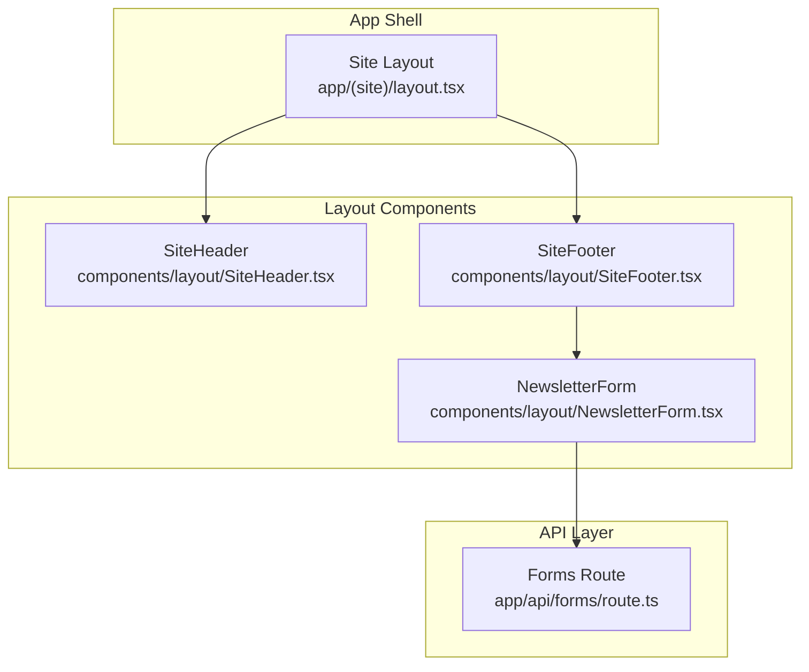
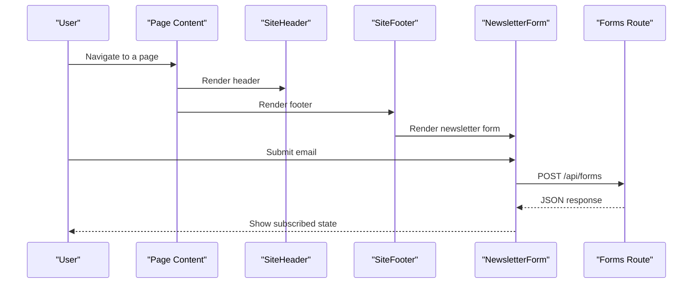
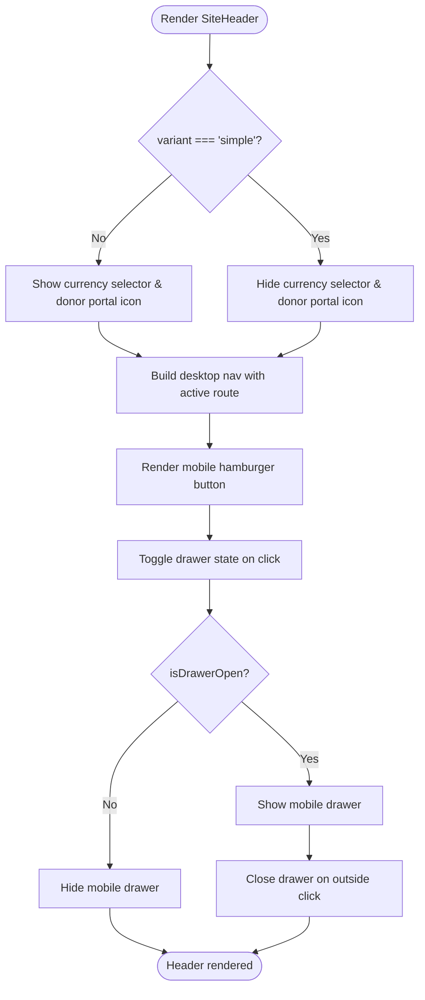
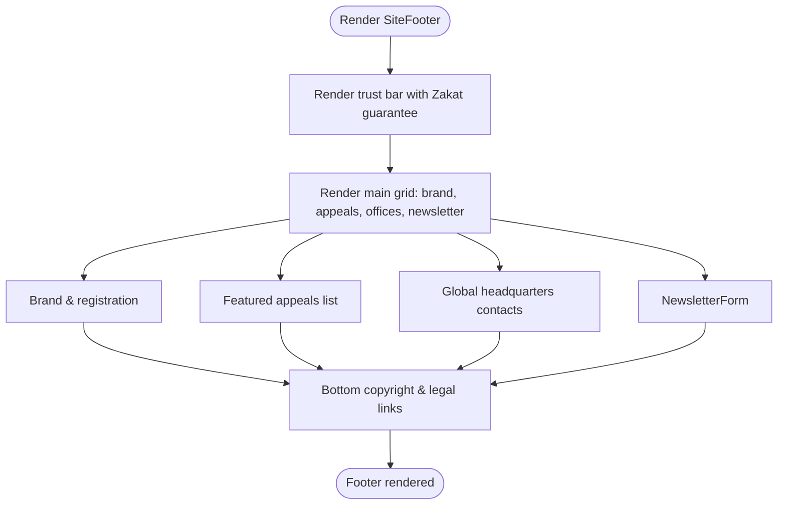
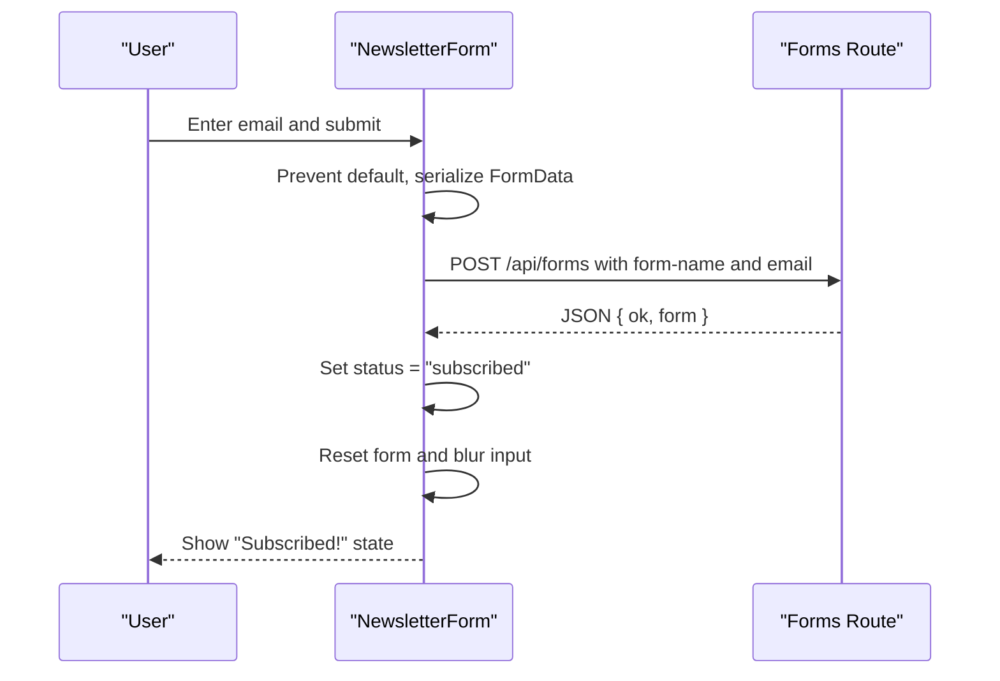
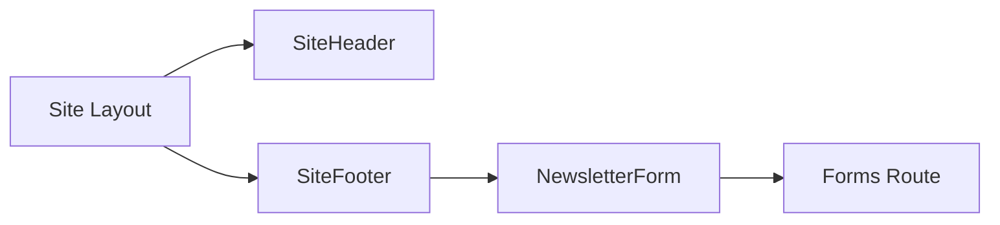

# Layout Components

<cite>
**Referenced Files in This Document**
- [SiteHeader.tsx](file://components/layout/SiteHeader.tsx)
- [SiteFooter.tsx](file://components/layout/SiteFooter.tsx)
- [NewsletterForm.tsx](file://components/layout/NewsletterForm.tsx)
- [site layout.tsx](file://app/(site)/layout.tsx)
- [forms route.ts](file://app/api/forms/route.ts)
- [README.md](file://README.md)
</cite>

## Table of Contents
1. [Introduction](#introduction)
2. [Project Structure](#project-structure)
3. [Core Components](#core-components)
4. [Architecture Overview](#architecture-overview)
5. [Detailed Component Analysis](#detailed-component-analysis)
6. [Dependency Analysis](#dependency-analysis)
7. [Performance Considerations](#performance-considerations)
8. [Troubleshooting Guide](#troubleshooting-guide)
9. [Conclusion](#conclusion)

## Introduction
This document explains the site-wide layout components that provide consistent navigation, branding, and footer functionality across the application:

- SiteHeader: global header with responsive navigation, mobile drawer menu, and currency switching UI.
- SiteFooter: global footer with trust messaging, global links, and newsletter subscription integration.
- NewsletterForm: client-side form handling for email subscriptions with optimistic success state and API integration.

These components are composed by the site layout to ensure a uniform user experience on every page.

## Project Structure
The layout components live under `components/layout` and are wrapped around page content by the site layout under `app/(site)/layout.tsx`. The newsletter form posts to the Next.js API route at `app/api/forms/route.ts`.

**Diagram sources**
- [site layout.tsx:1-15](file://app/(site)/layout.tsx#L1-L15)
- [SiteHeader.tsx:1-234](file://components/layout/SiteHeader.tsx#L1-L234)
- [SiteFooter.tsx:1-233](file://components/layout/SiteFooter.tsx#L1-L233)
- [NewsletterForm.tsx:1-72](file://components/layout/NewsletterForm.tsx#L1-L72)
- [forms route.ts:1-23](file://app/api/forms/route.ts#L1-L23)

**Section sources**
- [site layout.tsx:1-15](file://app/(site)/layout.tsx#L1-L15)
- [README.md:14-65](file://README.md#L14-L65)

## Core Components
- SiteHeader provides:
  - International meta strip with helpline and Zakat calculator link.
  - Desktop navigation with active-route highlighting.
  - Mobile drawer menu toggled via a hamburger button.
  - Optional currency selector (hidden in the “simple” variant).
  - Two variants: default and simple (for slim layouts such as 404).

- SiteFooter provides:
  - Trust bar with Zakat guarantee messaging and quick actions.
  - Branding, registration information, and appeal links.
  - Global office contact details.
  - Newsletter subscription area using NewsletterForm.
  - Bottom legal and global links.

- NewsletterForm provides:
  - Client-side form submission to `/api/forms`.
  - Optimistic success state after submission.
  - Native HTML validation for required email input.
  - Netlify-compatible hidden field for legacy compatibility.

**Section sources**
- [SiteHeader.tsx:16-22](file://components/layout/SiteHeader.tsx#L16-L22)
- [SiteHeader.tsx:24-43](file://components/layout/SiteHeader.tsx#L24-L43)
- [SiteHeader.tsx:45-108](file://components/layout/SiteHeader.tsx#L45-L108)
- [SiteHeader.tsx:110-191](file://components/layout/SiteHeader.tsx#L110-L191)
- [SiteHeader.tsx:193-231](file://components/layout/SiteHeader.tsx#L193-L231)
- [SiteFooter.tsx:5-42](file://components/layout/SiteFooter.tsx#L5-L42)
- [SiteFooter.tsx:44-185](file://components/layout/SiteFooter.tsx#L44-L185)
- [SiteFooter.tsx:187-229](file://components/layout/SiteFooter.tsx#L187-L229)
- [NewsletterForm.tsx:5-31](file://components/layout/NewsletterForm.tsx#L5-L31)
- [NewsletterForm.tsx:33-71](file://components/layout/NewsletterForm.tsx#L33-L71)

## Architecture Overview
The site layout composes SiteHeader and SiteFooter around page content. NewsletterForm is embedded inside SiteFooter and posts to the forms API route.

**Diagram sources**
- [site layout.tsx:4-13](file://app/(site)/layout.tsx#L4-L13)
- [SiteFooter.tsx:174-184](file://components/layout/SiteFooter.tsx#L174-L184)
- [NewsletterForm.tsx:11-31](file://components/layout/NewsletterForm.tsx#L11-L31)
- [forms route.ts:9-22](file://app/api/forms/route.ts#L9-L22)

## Detailed Component Analysis

### SiteHeader
Responsibilities:
- Display international meta strip with helpline, Zakat calculator link, and optional currency selector.
- Provide desktop navigation with active-route detection.
- Implement mobile drawer menu with toggle and click-outside-to-close behavior.
- Support two visual variants: default and simple.

Props interface:
- variant: `'default' | 'simple'` — controls whether the currency selector and donor portal shortcut are shown.

State management:
- isDrawerOpen: boolean controlled by useState to open/close the mobile drawer.
- activeHref: derived from usePathname to highlight the current section; campaign-details routes map to appeals.

Event handling:
- Hamburger button toggles drawer state and stops event propagation.
- Click-outside handler closes the drawer when clicking outside the header.
- Drawer links close the drawer on navigation.

Responsive design:
- Desktop nav visible at xl breakpoint; drawer appears below xl.
- Meta strip adapts spacing and visibility across breakpoints.
- Currency selector is hidden in simple variant.

Accessibility:
- Toggle button includes aria-label and aria-expanded.
- Currency select has an accessible label.

**Diagram sources**
- [SiteHeader.tsx:16-22](file://components/layout/SiteHeader.tsx#L16-L22)
- [SiteHeader.tsx:24-43](file://components/layout/SiteHeader.tsx#L24-L43)
- [SiteHeader.tsx:45-108](file://components/layout/SiteHeader.tsx#L45-L108)
- [SiteHeader.tsx:110-191](file://components/layout/SiteHeader.tsx#L110-L191)
- [SiteHeader.tsx:193-231](file://components/layout/SiteHeader.tsx#L193-L231)

**Section sources**
- [SiteHeader.tsx:16-22](file://components/layout/SiteHeader.tsx#L16-L22)
- [SiteHeader.tsx:24-43](file://components/layout/SiteHeader.tsx#L24-L43)
- [SiteHeader.tsx:45-108](file://components/layout/SiteHeader.tsx#L45-L108)
- [SiteHeader.tsx:110-191](file://components/layout/SiteHeader.tsx#L110-L191)
- [SiteHeader.tsx:193-231](file://components/layout/SiteHeader.tsx#L193-L231)

### SiteFooter
Responsibilities:
- Communicate trust signals and Zakat guarantee.
- Provide quick actions to calculate Zakat and view audit reports.
- Present brand info, registration numbers, and appeal links.
- List global office addresses and contact details.
- Embed NewsletterForm for field bulletins.
- Offer bottom legal links and site navigation.

Integration points:
- Renders NewsletterForm component for subscription.
- Links to key pages including appeals, zakat-calculator, impact, about, and volunteer.

Accessibility considerations:
- Uses semantic footer element.
- Provides clear headings and descriptive links.
- Includes meaningful text for icons through adjacent labels or link text.

**Diagram sources**
- [SiteFooter.tsx:5-42](file://components/layout/SiteFooter.tsx#L5-L42)
- [SiteFooter.tsx:44-185](file://components/layout/SiteFooter.tsx#L44-L185)
- [SiteFooter.tsx:187-229](file://components/layout/SiteFooter.tsx#L187-L229)

**Section sources**
- [SiteFooter.tsx:5-42](file://components/layout/SiteFooter.tsx#L5-L42)
- [SiteFooter.tsx:44-185](file://components/layout/SiteFooter.tsx#L44-L185)
- [SiteFooter.tsx:187-229](file://components/layout/SiteFooter.tsx#L187-L229)

### NewsletterForm
Responsibilities:
- Collect email address via native HTML input.
- Validate using built-in browser validation (required, type="email").
- Serialize form data and POST to `/api/forms`.
- Update local state to show “Subscribed!” after submission.
- Reset form and blur input after successful submission.

State management:
- status: 'idle' | 'subscribed' — reflects optimistic success state.

API integration:
- Submits to app/api/forms/route.ts with URL-encoded payload.
- The API expects a form-name field and returns a JSON response.

Error handling:
- Catches fetch errors silently and still shows optimistic success, matching legacy behavior.

**Diagram sources**
- [NewsletterForm.tsx:5-31](file://components/layout/NewsletterForm.tsx#L5-L31)
- [NewsletterForm.tsx:33-71](file://components/layout/NewsletterForm.tsx#L33-L71)
- [forms route.ts:9-22](file://app/api/forms/route.ts#L9-L22)

**Section sources**
- [NewsletterForm.tsx:5-31](file://components/layout/NewsletterForm.tsx#L5-L31)
- [NewsletterForm.tsx:33-71](file://components/layout/NewsletterForm.tsx#L33-L71)
- [forms route.ts:1-23](file://app/api/forms/route.ts#L1-L23)

## Dependency Analysis
- SiteHeader depends on Next.js Link and usePathname for routing and active-state logic.
- SiteFooter imports NewsletterForm and uses Next.js Link for navigation.
- NewsletterForm posts to the forms API route.
- The site layout composes SiteHeader and SiteFooter around children.

**Diagram sources**
- [site layout.tsx:1-15](file://app/(site)/layout.tsx#L1-L15)
- [SiteFooter.tsx:1-4](file://components/layout/SiteFooter.tsx#L1-L4)
- [NewsletterForm.tsx:11-23](file://components/layout/NewsletterForm.tsx#L11-L23)
- [forms route.ts:1-23](file://app/api/forms/route.ts#L1-L23)

**Section sources**
- [site layout.tsx:1-15](file://app/(site)/layout.tsx#L1-L15)
- [SiteFooter.tsx:1-4](file://components/layout/SiteFooter.tsx#L1-L4)
- [NewsletterForm.tsx:11-23](file://components/layout/NewsletterForm.tsx#L11-L23)
- [forms route.ts:1-23](file://app/api/forms/route.ts#L1-L23)

## Performance Considerations
- SiteHeader uses a fixed header with backdrop blur; consider limiting heavy effects if performance becomes an issue on low-end devices.
- Drawer visibility is controlled via CSS classes and React state; avoid unnecessary re-renders by keeping state minimal.
- NewsletterForm performs a single fetch per submission and updates local state only; this keeps interactions fast and predictable.
- Active route calculation in SiteHeader is lightweight and based on pathname comparison.

[No sources needed since this section provides general guidance]

## Troubleshooting Guide
Common issues and resolutions:

- Mobile drawer does not close on outside click:
  - Ensure the document click listener is attached and the header ref is present.
  - Verify that the drawer’s click handler stops propagation so it does not immediately close itself.

- Currency selector not visible:
  - Confirm the header variant is set to default; the simple variant hides the selector.

- Newsletter form submits but no feedback:
  - Check network tab for POST to /api/forms.
  - Verify the API route exists and returns a valid JSON response.
  - Remember the form shows optimistic success even on network errors to match legacy behavior.

- Active route not highlighted:
  - Ensure usePathname is available and the route path matches NAV_ITEMS href values.
  - Campaign-details routes should map to appeals for active highlighting.

**Section sources**
- [SiteHeader.tsx:24-43](file://components/layout/SiteHeader.tsx#L24-L43)
- [SiteHeader.tsx:81-105](file://components/layout/SiteHeader.tsx#L81-L105)
- [SiteHeader.tsx:129-147](file://components/layout/SiteHeader.tsx#L129-L147)
- [NewsletterForm.tsx:11-31](file://components/layout/NewsletterForm.tsx#L11-L31)
- [forms route.ts:9-22](file://app/api/forms/route.ts#L9-L22)

## Conclusion
SiteHeader, SiteFooter, and NewsletterForm together deliver a consistent, accessible, and responsive site-wide experience. They encapsulate navigation, branding, trust signals, and subscription flows while integrating cleanly with Next.js routing and API routes. Composing them through the site layout ensures all pages share the same structure and interaction patterns.

[No sources needed since this section summarizes without analyzing specific files]