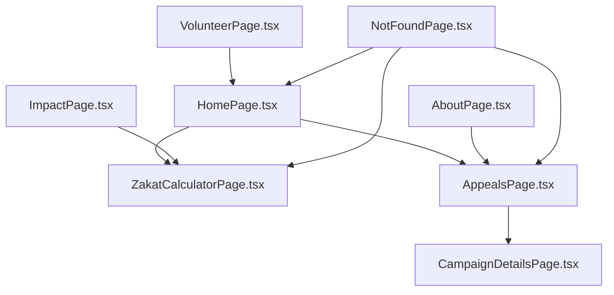
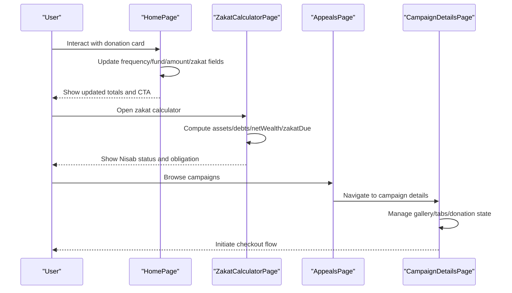
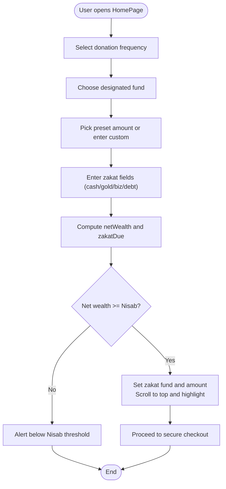
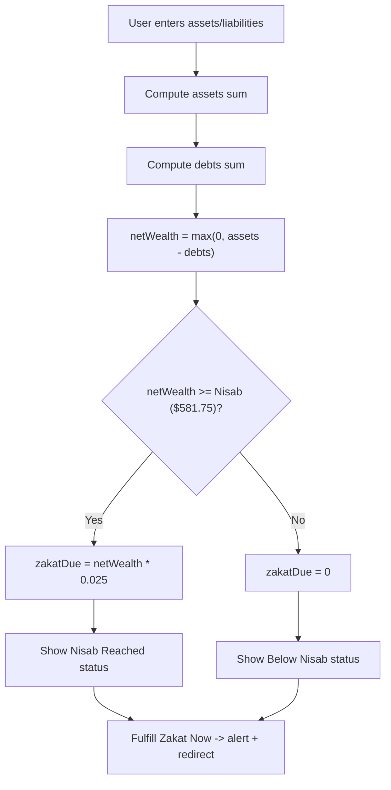
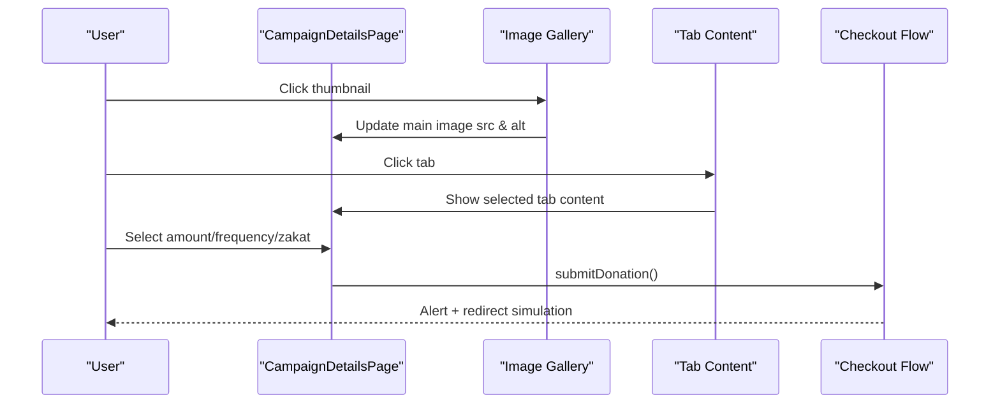
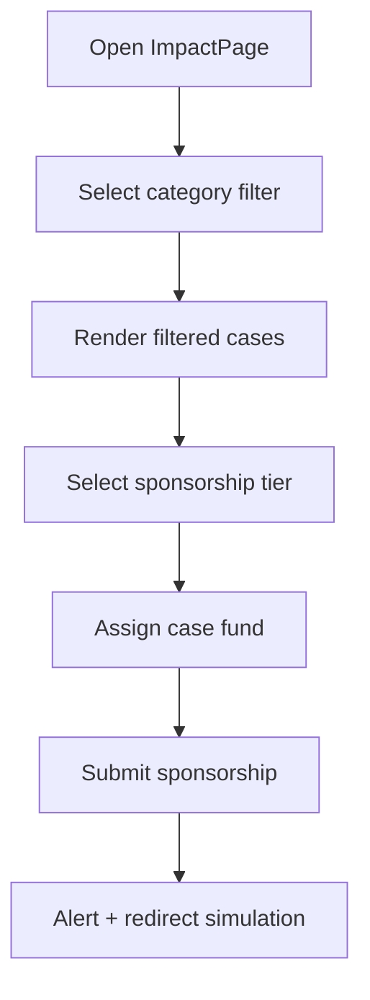
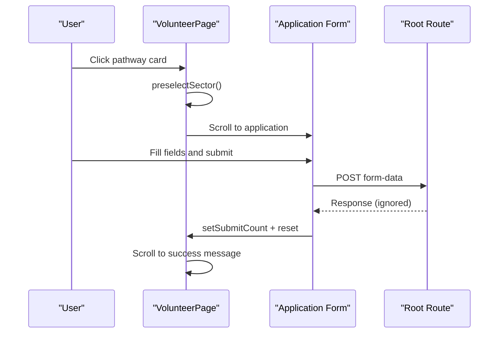
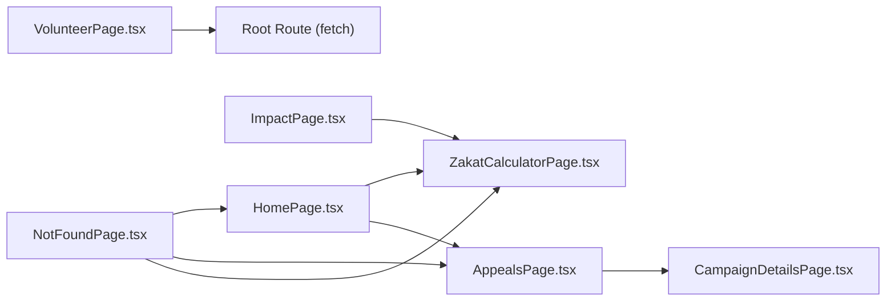

# Page Components

<cite>
**Referenced Files in This Document**
- [HomePage.tsx](file://components/pages/HomePage.tsx)
- [ZakatCalculatorPage.tsx](file://components/pages/ZakatCalculatorPage.tsx)
- [AppealsPage.tsx](file://components/pages/AppealsPage.tsx)
- [CampaignDetailsPage.tsx](file://components/pages/CampaignDetailsPage.tsx)
- [AboutPage.tsx](file://components/pages/AboutPage.tsx)
- [ImpactPage.tsx](file://components/pages/ImpactPage.tsx)
- [VolunteerPage.tsx](file://components/pages/VolunteerPage.tsx)
- [NotFoundPage.tsx](file://components/pages/NotFoundPage.tsx)
</cite>

## Table of Contents
1. [Introduction](#introduction)
2. [Project Structure](#project-structure)
3. [Core Components](#core-components)
4. [Architecture Overview](#architecture-overview)
5. [Detailed Component Analysis](#detailed-component-analysis)
6. [Dependency Analysis](#dependency-analysis)
7. [Performance Considerations](#performance-considerations)
8. [Troubleshooting Guide](#troubleshooting-guide)
9. [Conclusion](#conclusion)

## Introduction
This document explains the page components that implement the main application features: a donation-focused landing experience, zakat calculation with Shariah compliance signals, campaign browsing and details, impact storytelling, volunteer onboarding, and error handling. Each component is analyzed for business logic, user interactions, state management, data flow, and integration points such as payment gateways and external services.

## Project Structure
The pages are implemented as client-side React components under `components/pages`. They compose layout elements, present interactive forms, and navigate to other routes using Next.js links. The site’s routing maps these pages to URL paths like `/`, `/zakat-calculator`, `/appeals`, `/campaign-details`, `/about`, `/impact`, `/volunteer`, and a 404 fallback.

**Diagram sources**
- [HomePage.tsx:100-218](file://components/pages/HomePage.tsx#L100-L218)
- [ZakatCalculatorPage.tsx:785-794](file://components/pages/ZakatCalculatorPage.tsx#L785-L794)
- [AppealsPage.tsx:1-120](file://components/pages/AppealsPage.tsx#L1-L120)
- [CampaignDetailsPage.tsx:60-100](file://components/pages/CampaignDetailsPage.tsx#L60-L100)
- [ImpactPage.tsx:656-663](file://components/pages/ImpactPage.tsx#L656-L663)
- [AboutPage.tsx:727-738](file://components/pages/AboutPage.tsx#L727-L738)
- [VolunteerPage.tsx:194-199](file://components/pages/VolunteerPage.tsx#L194-L199)
- [NotFoundPage.tsx:27-53](file://components/pages/NotFoundPage.tsx#L27-L53)

**Section sources**
- [HomePage.tsx:1-218](file://components/pages/HomePage.tsx#L1-L218)
- [ZakatCalculatorPage.tsx:1-107](file://components/pages/ZakatCalculatorPage.tsx#L1-L107)
- [AppealsPage.tsx:1-120](file://components/pages/AppealsPage.tsx#L1-L120)
- [CampaignDetailsPage.tsx:1-54](file://components/pages/CampaignDetailsPage.tsx#L1-L54)
- [AboutPage.tsx:1-81](file://components/pages/AboutPage.tsx#L1-L81)
- [ImpactPage.tsx:1-36](file://components/pages/ImpactPage.tsx#L1-L36)
- [VolunteerPage.tsx:1-64](file://components/pages/VolunteerPage.tsx#L1-L64)
- [NotFoundPage.tsx:1-59](file://components/pages/NotFoundPage.tsx#L1-L59)

## Core Components
- HomePage: Primary landing page with an interactive donation engine and embedded zakat calculator logic. It manages donation frequency, fund selection, amount presets, custom amounts, and zakat fields. It also highlights active appeals and provides navigation to dedicated pages.
- ZakatCalculatorPage: Comprehensive zakat assessment with asset categories, liabilities, Nisab threshold validation, real-time summary, and fulfillment actions.
- AppealsPage: Campaign listing with filtering, sorting, and donation modal functionality (implementation referenced).
- CampaignDetailsPage: Detailed appeal view with gallery, tabs, cost breakdown, field updates, zakat governance, and donation submission.
- AboutPage: Institutional trust, pillars, governance council, disclosures, and CTAs.
- ImpactPage: Case stories, filters, sponsorship tiers, and transparency pipeline visuals.
- VolunteerPage: Sector pathways, application form, and onboarding steps.
- NotFoundPage: Error page with navigation options.

**Section sources**
- [HomePage.tsx:16-83](file://components/pages/HomePage.tsx#L16-L83)
- [ZakatCalculatorPage.tsx:36-97](file://components/pages/ZakatCalculatorPage.tsx#L36-L97)
- [AppealsPage.tsx:1-120](file://components/pages/AppealsPage.tsx#L1-L120)
- [CampaignDetailsPage.tsx:17-53](file://components/pages/CampaignDetailsPage.tsx#L17-L53)
- [AboutPage.tsx:5-81](file://components/pages/AboutPage.tsx#L5-L81)
- [ImpactPage.tsx:20-36](file://components/pages/ImpactPage.tsx#L20-L36)
- [VolunteerPage.tsx:16-64](file://components/pages/VolunteerPage.tsx#L16-L64)
- [NotFoundPage.tsx:5-59](file://components/pages/NotFoundPage.tsx#L5-L59)

## Architecture Overview
The pages follow a consistent pattern:
- Client-side state via React hooks (`useState`, `useMemo`, `useRef`, `useEffect`).
- Localized business logic within each page component.
- Navigation through Next.js `<Link>` to related pages.
- External integrations represented by UI flows (payment gateway prompts, fetch calls, alerts).

**Diagram sources**
- [HomePage.tsx:16-83](file://components/pages/HomePage.tsx#L16-L83)
- [ZakatCalculatorPage.tsx:47-61](file://components/pages/ZakatCalculatorPage.tsx#L47-L61)
- [CampaignDetailsPage.tsx:42-52](file://components/pages/CampaignDetailsPage.tsx#L42-L52)

## Detailed Component Analysis

### HomePage
Business Logic
- Donation engine state: frequency, selected fund, preset amount, custom amount, highlight effect.
- Embedded zakat fields: cash, gold, biz, debt; computes net wealth and zakat due using a local Nisab threshold.
- Amount selection: preset chips and custom input with focus management.
- Zakat quick-pay: scrolls to top, sets zakat fund, highlights amount, and shows alert if below threshold.

User Interaction Patterns
- Frequency toggle between one-time and monthly.
- Cause selector dropdown for designated funds.
- Amount chip grid and custom input.
- Quick action buttons linking to zakat calculator and appeals.

State Management
- Local state variables for all inputs and computed values.
- `useMemo` for zakat computation based on fields.
- Refs for focusing custom amount input.

Data Flow
- Inputs update state synchronously.
- Computed values drive UI feedback (highlighting, alerts).
- Links navigate to `/zakat-calculator` and `/appeals`.

External Integrations
- Payment gateway mentioned in UI (Card, PayPal, bKash), but no direct API call in this file.

Complex Interactions
- Zakat calculation algorithm integrated into the homepage for quick estimation and redirection to full calculator or donation flow.

**Diagram sources**
- [HomePage.tsx:16-83](file://components/pages/HomePage.tsx#L16-L83)

**Section sources**
- [HomePage.tsx:16-83](file://components/pages/HomePage.tsx#L16-L83)
- [HomePage.tsx:100-218](file://components/pages/HomePage.tsx#L100-L218)

### ZakatCalculatorPage
Business Logic
- Asset categories: cash home/bank, gold/silver value, inventory/stocks, property resale, rental income.
- Liabilities: debts due and bills due.
- Net wealth = max(0, total assets - total liabilities).
- Zakat due = 2.5% of net wealth if above Nisab threshold ($581.75 USD); otherwise zero.
- Nisab status text and icon change based on thresholds.

Shariah Compliance Features
- Emphasizes ring-fenced accounts, Tamleek direct transfer, and zero overhead.
- Live Nisab benchmark ticker referencing LBMA standards.
- Fulfillment action triggers checkout flow confirmation.

User Interaction Patterns
- Real-time field updates trigger recomputation.
- Reset button clears all fields.
- Fulfill Zakat Now button shows alert with calculated amount or guidance when below Nisab.

State Management
- Single fields object for all inputs.
- Boolean flags for FAQ toggles and transition behavior.
- Derived values computed inline during render.

Data Flow
- Input changes update fields and mark recomputation.
- Summary panel displays assets, liabilities, net wealth, Nisab status, and zakat due.
- Allocation selector allows choosing target cause.

External Integrations
- UI indicates redirect to bank gateway upon fulfillment.

Complex Interactions
- Five-category matrix with live summary and Shariah messaging.

**Diagram sources**
- [ZakatCalculatorPage.tsx:21-34](file://components/pages/ZakatCalculatorPage.tsx#L21-L34)
- [ZakatCalculatorPage.tsx:47-61](file://components/pages/ZakatCalculatorPage.tsx#L47-L61)
- [ZakatCalculatorPage.tsx:84-97](file://components/pages/ZakatCalculatorPage.tsx#L84-L97)

**Section sources**
- [ZakatCalculatorPage.tsx:1-107](file://components/pages/ZakatCalculatorPage.tsx#L1-L107)
- [ZakatCalculatorPage.tsx:340-794](file://components/pages/ZakatCalculatorPage.tsx#L340-L794)

### AppealsPage
Business Logic
- Campaign filtering and sorting (implementation referenced).
- Donation modal functionality triggered from campaign cards (implementation referenced).

User Interaction Patterns
- Filter chips or controls to narrow campaigns.
- Sort controls to reorder results.
- Modal opens to collect donation details and submit.

State Management
- Likely uses local state for filter criteria, sort order, and modal visibility.

Data Flow
- Filters and sort affect displayed campaign list.
- Modal collects donor inputs and initiates checkout flow.

External Integrations
- Modal likely integrates with payment gateway or redirects to checkout.

Complex Interactions
- Filtering and sorting combined with modal-driven donations.

**Section sources**
- [AppealsPage.tsx:1-120](file://components/pages/AppealsPage.tsx#L1-L120)

### CampaignDetailsPage
Business Logic
- Gallery management: main image and thumbnails with alt attributes.
- Tabbed content: About Appeal, Cost Breakdown, Field Dispatch Log, Zakat Governance.
- Donation submission: amount, frequency, zakat designation, and checkout initiation.

User Interaction Patterns
- Click thumbnails to switch main image.
- Switch tabs to reveal different content sections.
- Toggle monthly vs one-time and zakat designation.
- Submit donation triggers alert and simulated redirect.

State Management
- Active tab and active thumbnail indices.
- Donation amount, frequency, and zakat flag.

Data Flow
- Thumbnail click updates main image source and alt attribute.
- Tab clicks show/hide content panels.
- Donation submission composes message and simulates gateway redirect.

External Integrations
- UI indicates redirect to bank gateway after submission.

Complex Interactions
- Rich media gallery with metadata propagation.
- Tabbed governance and budget transparency.

**Diagram sources**
- [CampaignDetailsPage.tsx:17-53](file://components/pages/CampaignDetailsPage.tsx#L17-L53)
- [CampaignDetailsPage.tsx:29-40](file://components/pages/CampaignDetailsPage.tsx#L29-L40)
- [CampaignDetailsPage.tsx:259-278](file://components/pages/CampaignDetailsPage.tsx#L259-L278)

**Section sources**
- [CampaignDetailsPage.tsx:1-54](file://components/pages/CampaignDetailsPage.tsx#L1-L54)
- [CampaignDetailsPage.tsx:143-255](file://components/pages/CampaignDetailsPage.tsx#L143-L255)
- [CampaignDetailsPage.tsx:259-278](file://components/pages/CampaignDetailsPage.tsx#L259-L278)

### AboutPage
Business Logic
- Presents institutional trust metrics, foundational pillars, governance council, and public disclosures.
- Provides CTAs to audits and donation pages.

User Interaction Patterns
- Static informational layout with download links and email contact.
- Button triggers alert for audit report access.

State Management
- Minimal state; primarily presentational.

Data Flow
- Links navigate to `/appeals`.
- Audit button shows alert with instructions.

External Integrations
- Email link to governance contact.

Complex Interactions
- Structured presentation of governance documents and organizational structure.

**Section sources**
- [AboutPage.tsx:5-81](file://components/pages/AboutPage.tsx#L5-L81)
- [AboutPage.tsx:727-738](file://components/pages/AboutPage.tsx#L727-L738)

### ImpactPage
Business Logic
- Case story filtering by category.
- Sponsorship tier selection and case fund assignment.
- Transparency pipeline visualization emphasizing Tamleek protocol.

User Interaction Patterns
- Filter chips toggle active category.
- Tier buttons select sponsorship amount.
- Modal toggles open detailed dossiers.
- Sponsorship submit triggers alert.

State Management
- Modal visibility map keyed by modal ID.
- Active filter and touched flag.
- Active sponsorship tier.

Data Flow
- Filter changes update active category.
- Tier selection updates sponsorship amount.
- Modals display case-specific information.

External Integrations
- Link to zakat calculator.
- Sponsorship submit shows alert indicating redirect to secure checkout.

Complex Interactions
- Category filtering combined with sponsorship widget and modals.

**Diagram sources**
- [ImpactPage.tsx:20-36](file://components/pages/ImpactPage.tsx#L20-L36)
- [ImpactPage.tsx:149-198](file://components/pages/ImpactPage.tsx#L149-L198)
- [ImpactPage.tsx:711-767](file://components/pages/ImpactPage.tsx#L711-L767)

**Section sources**
- [ImpactPage.tsx:1-36](file://components/pages/ImpactPage.tsx#L1-L36)
- [ImpactPage.tsx:149-198](file://components/pages/ImpactPage.tsx#L149-L198)
- [ImpactPage.tsx:711-767](file://components/pages/ImpactPage.tsx#L711-L767)

### VolunteerPage
Business Logic
- Sector pathway selection preselects sector and scrolls to application form.
- Form submission serializes FormData to URLSearchParams and posts to root route.
- Success message auto-scrolls after submission.

User Interaction Patterns
- Pathway cards allow selecting sectors.
- Application form collects personal details and preferred sector.
- FAQ accordion toggles.

State Management
- Selected sector, submission count, FAQ index.
- Ref for success message scrolling.

Data Flow
- Sector selection updates state and scrolls to form.
- Form submission sends POST request and resets form.
- Success message appears and scrolls into view.

External Integrations
- Fetch call to root route for form submission.

Complex Interactions
- Preselection and smooth scroll to application section.
- Conditional FAQ expansion.

**Diagram sources**
- [VolunteerPage.tsx:22-29](file://components/pages/VolunteerPage.tsx#L22-L29)
- [VolunteerPage.tsx:31-38](file://components/pages/VolunteerPage.tsx#L31-L38)
- [VolunteerPage.tsx:40-58](file://components/pages/VolunteerPage.tsx#L40-L58)

**Section sources**
- [VolunteerPage.tsx:16-64](file://components/pages/VolunteerPage.tsx#L16-L64)
- [VolunteerPage.tsx:194-199](file://components/pages/VolunteerPage.tsx#L194-L199)
- [VolunteerPage.tsx:566-700](file://components/pages/VolunteerPage.tsx#L566-L700)

### NotFoundPage
Business Logic
- Displays error message and provides navigation to homepage, appeals, and zakat calculator.

User Interaction Patterns
- Clickable links to explore causes or calculate zakat.

State Management
- No state; purely presentational.

Data Flow
- Links navigate to `/`, `/appeals`, `/zakat-calculator`.

External Integrations
- None.

Complex Interactions
- Simple navigation recovery UX.

**Section sources**
- [NotFoundPage.tsx:5-59](file://components/pages/NotFoundPage.tsx#L5-L59)

## Dependency Analysis
- Internal Dependencies
  - Pages use Next.js `<Link>` for navigation.
  - HomePage references ZakatCalculatorPage logic locally and navigates to its route.
  - CampaignDetailsPage includes rich media and tabbed content without external libraries beyond React.
  - ImpactPage and VolunteerPage manage local state for filters, modals, and forms.
- External Dependencies
  - Payment gateway UI mentions (Card, PayPal, bKash) indicate intended integration points.
  - ZakatCalculatorPage references LBMA standards for Nisab benchmarks.
  - VolunteerPage performs a fetch to root route for form submission.

**Diagram sources**
- [HomePage.tsx:100-218](file://components/pages/HomePage.tsx#L100-L218)
- [ZakatCalculatorPage.tsx:785-794](file://components/pages/ZakatCalculatorPage.tsx#L785-L794)
- [AppealsPage.tsx:1-120](file://components/pages/AppealsPage.tsx#L1-L120)
- [CampaignDetailsPage.tsx:60-100](file://components/pages/CampaignDetailsPage.tsx#L60-L100)
- [ImpactPage.tsx:656-663](file://components/pages/ImpactPage.tsx#L656-L663)
- [VolunteerPage.tsx:40-58](file://components/pages/VolunteerPage.tsx#L40-L58)
- [NotFoundPage.tsx:27-53](file://components/pages/NotFoundPage.tsx#L27-L53)

**Section sources**
- [HomePage.tsx:100-218](file://components/pages/HomePage.tsx#L100-L218)
- [ZakatCalculatorPage.tsx:785-794](file://components/pages/ZakatCalculatorPage.tsx#L785-L794)
- [AppealsPage.tsx:1-120](file://components/pages/AppealsPage.tsx#L1-L120)
- [CampaignDetailsPage.tsx:60-100](file://components/pages/CampaignDetailsPage.tsx#L60-L100)
- [ImpactPage.tsx:656-663](file://components/pages/ImpactPage.tsx#L656-L663)
- [VolunteerPage.tsx:40-58](file://components/pages/VolunteerPage.tsx#L40-L58)
- [NotFoundPage.tsx:27-53](file://components/pages/NotFoundPage.tsx#L27-L53)

## Performance Considerations
- Avoid heavy computations inside render loops; prefer memoization for derived values (as seen in HomePage’s zakat computation).
- Minimize re-renders by keeping state localized and using refs for DOM focus operations.
- Use lazy loading for images and defer non-critical scripts where possible.
- Keep modal states minimal and close them promptly to free resources.
- Debounce frequent input updates if integrating with external APIs.

[No sources needed since this section provides general guidance]

## Troubleshooting Guide
Common Issues
- Zakat threshold alerts: Ensure inputs are valid numbers; negative values are normalized to zero.
- Modal not closing: Verify modal toggle functions and state keys.
- Form submission failures: Check network requests and server endpoints; handle errors gracefully.
- Image gallery mismatch: Confirm thumbnail refs and main image src/alt synchronization.

Mitigations
- Validate numeric inputs and provide clear feedback.
- Centralize modal state management to avoid inconsistent visibility.
- Add error boundaries and user-friendly messages for failed submissions.
- Test gallery interactions across devices and screen sizes.

**Section sources**
- [ZakatCalculatorPage.tsx:84-97](file://components/pages/ZakatCalculatorPage.tsx#L84-L97)
- [ImpactPage.tsx:26-34](file://components/pages/ImpactPage.tsx#L26-L34)
- [VolunteerPage.tsx:40-58](file://components/pages/VolunteerPage.tsx#L40-L58)
- [CampaignDetailsPage.tsx:29-40](file://components/pages/CampaignDetailsPage.tsx#L29-L40)

## Conclusion
The page components collectively deliver a cohesive donation and zakat experience with strong emphasis on Shariah compliance, transparency, and user engagement. HomePage integrates zakat estimation directly into the donation flow, ZakatCalculatorPage provides comprehensive assessment and fulfillment, AppealsPage and CampaignDetailsPage support campaign discovery and detailed storytelling, ImpactPage showcases verified outcomes, VolunteerPage streamlines onboarding, and NotFoundPage ensures graceful navigation recovery. Future enhancements should include robust error handling, analytics tracking, and seamless payment gateway integration.