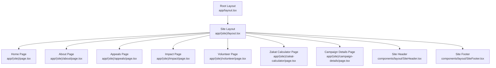
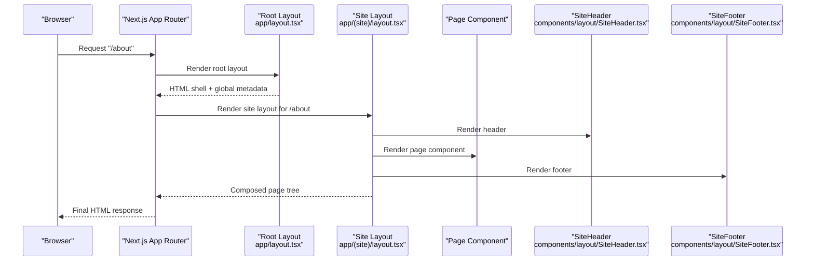
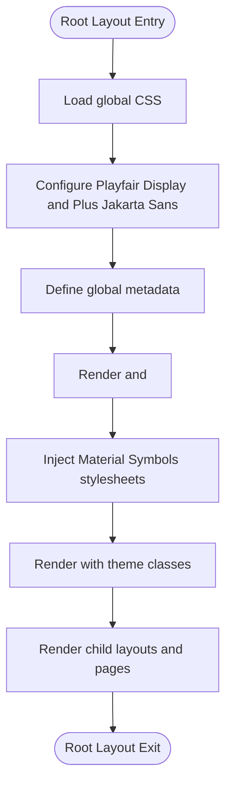
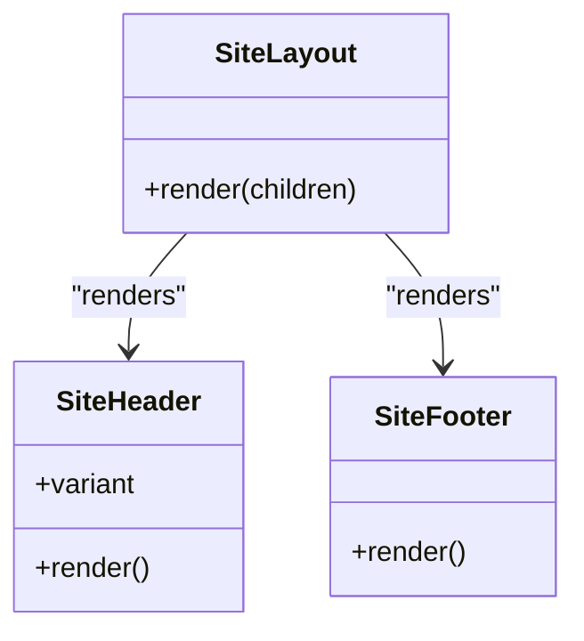
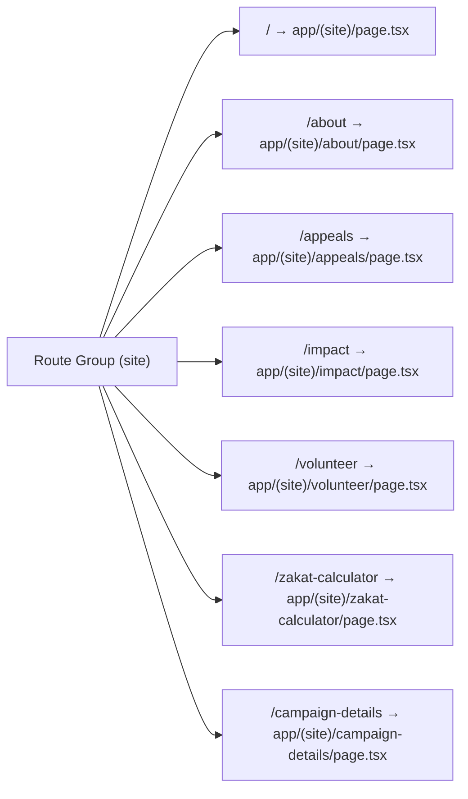
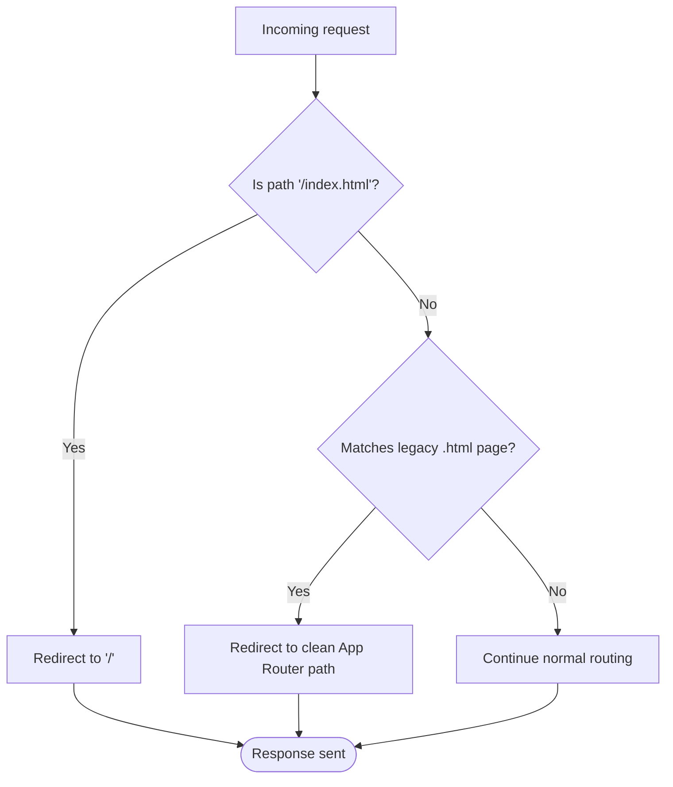
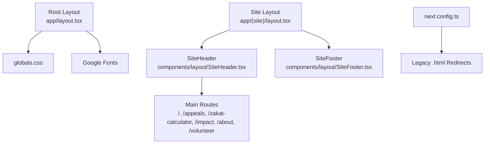

# Routing Structure

<cite>
**Referenced Files in This Document**
- [app/layout.tsx](file://app/layout.tsx)
- [app/(site)/layout.tsx](file://app/(site)/layout.tsx)
- [app/(site)/page.tsx](file://app/(site)/page.tsx)
- [next.config.ts](file://next.config.ts)
- [components/layout/SiteHeader.tsx](file://components/layout/SiteHeader.tsx)
- [components/layout/SiteFooter.tsx](file://components/layout/SiteFooter.tsx)
</cite>

## Table of Contents
1. [Introduction](#introduction)
2. [Project Structure](#project-structure)
3. [Core Components](#core-components)
4. [Architecture Overview](#architecture-overview)
5. [Detailed Component Analysis](#detailed-component-analysis)
6. [Dependency Analysis](#dependency-analysis)
7. [Performance Considerations](#performance-considerations)
8. [Troubleshooting Guide](#troubleshooting-guide)
9. [Conclusion](#conclusion)

## Introduction
This document explains the Next.js App Router routing structure for the project. It covers:
- The root layout that configures global fonts, metadata, and HTML boilerplate.
- The site layout group that wraps every main application page with a shared header and footer.
- Route groups and how they organize the main application routes under `(site)`.
- Legacy URL redirects that keep old `.html` URLs working by redirecting to clean App Router paths.
- How to add new routes following the established patterns.
- The relationship between route groups and component composition.

## Project Structure
The routing is organized using the Next.js App Router conventions:
- `app/layout.tsx` defines the root layout applied to the entire application.
- `app/(site)/layout.tsx` defines a layout for the main site section.
- `app/(site)/page.tsx` is the home page inside the site route group.
- Other pages such as `/about`, `/appeals`, `/impact`, `/volunteer`, `/zakat-calculator`, and `/campaign-details` live under `app/(site)`.
- Shared UI components for the header and footer live under `components/layout`.
- Legacy static HTML files remain under `legacy/` and are kept for reference; runtime behavior is handled by `next.config.ts`.

**Diagram sources**
- [app/layout.tsx:37-60](file://app/layout.tsx#L37-L60)
- [app/(site)/layout.tsx:4-14](file://app/(site)/layout.tsx#L4-L14)
- [app/(site)/page.tsx:12-14](file://app/(site)/page.tsx#L12-L14)
- [components/layout/SiteHeader.tsx:1-234](file://components/layout/SiteHeader.tsx#L1-L234)
- [components/layout/SiteFooter.tsx:1-233](file://components/layout/SiteFooter.tsx#L1-L233)

**Section sources**
- [app/layout.tsx:1-61](file://app/layout.tsx#L1-L61)
- [app/(site)/layout.tsx:1-15](file://app/(site)/layout.tsx#L1-L15)
- [app/(site)/page.tsx:1-15](file://app/(site)/page.tsx#L1-L15)
- [components/layout/SiteHeader.tsx:1-234](file://components/layout/SiteHeader.tsx#L1-L234)
- [components/layout/SiteFooter.tsx:1-233](file://components/layout/SiteFooter.tsx#L1-L233)

## Core Components
This section summarizes the key routing-related files and their responsibilities.

- Root layout (`app/layout.tsx`)
  - Loads global CSS.
  - Configures Google Fonts Playfair Display and Plus Jakarta Sans as CSS variables.
  - Declares global metadata including title template, description, application name, favicon, and legacy head fields.
  - Renders the `<html>` and `<body>` shell and injects icon font links.

- Site layout (`app/(site)/layout.tsx`)
  - Wraps all pages under the `(site)` route group with `SiteHeader` and `SiteFooter`.
  - Provides consistent chrome around page content.

- Home page (`app/(site)/page.tsx`)
  - Defines page-level metadata for the root route.
  - Renders the reusable `HomePage` component from `components/pages`.

- Legacy redirects (`next.config.ts`)
  - Redirects `/index.html` to `/`.
  - Redirects legacy `.html` URLs to clean App Router paths for known pages.

**Section sources**
- [app/layout.tsx:1-61](file://app/layout.tsx#L1-L61)
- [app/(site)/layout.tsx:1-15](file://app/(site)/layout.tsx#L1-L15)
- [app/(site)/page.tsx:1-15](file://app/(site)/page.tsx#L1-L15)
- [next.config.ts:1-32](file://next.config.ts#L1-L32)

## Architecture Overview
The application uses layered layouts:
- The root layout provides global concerns: fonts, metadata, and HTML shell.
- The site layout adds application-wide chrome: header and footer.
- Individual pages compose domain-specific components.

**Diagram sources**
- [app/layout.tsx:37-60](file://app/layout.tsx#L37-L60)
- [app/(site)/layout.tsx:4-14](file://app/(site)/layout.tsx#L4-L14)
- [components/layout/SiteHeader.tsx:1-234](file://components/layout/SiteHeader.tsx#L1-L234)
- [components/layout/SiteFooter.tsx:1-233](file://components/layout/SiteFooter.tsx#L1-L233)

## Detailed Component Analysis

### Root Layout: Global Fonts, Metadata, and HTML Shell
The root layout is responsible for:
- Font configuration:
  - Plus Jakarta Sans with multiple weights and a CSS variable.
  - Playfair Display with italic support and a CSS variable.
- Global metadata:
  - Default title and template.
  - Description, application name, favicon, and legacy head fields.
- HTML boilerplate:
  - Language attribute on `<html>`.
  - Icon font stylesheet links in `<head>`.
  - Body classes for theme tokens and typography defaults.

**Diagram sources**
- [app/layout.tsx:1-61](file://app/layout.tsx#L1-L61)

**Section sources**
- [app/layout.tsx:1-61](file://app/layout.tsx#L1-L61)

### Site Layout: Shared Header and Footer Wrapper
The site layout composes the header and footer around page content:
- Imports `SiteHeader` and `SiteFooter`.
- Renders them above and below `children`.
- Ensures all pages under `(site)` share the same navigation and footer structure.

**Diagram sources**
- [app/(site)/layout.tsx:1-15](file://app/(site)/layout.tsx#L1-L15)
- [components/layout/SiteHeader.tsx:1-234](file://components/layout/SiteHeader.tsx#L1-L234)
- [components/layout/SiteFooter.tsx:1-233](file://components/layout/SiteFooter.tsx#L1-L233)

**Section sources**
- [app/(site)/layout.tsx:1-15](file://app/(site)/layout.tsx#L1-L15)
- [components/layout/SiteHeader.tsx:1-234](file://components/layout/SiteHeader.tsx#L1-L234)
- [components/layout/SiteFooter.tsx:1-233](file://components/layout/SiteFooter.tsx#L1-L233)

### Route Groups: Organizing Main Application Routes Under (site)
Route groups allow organizing related routes without affecting the URL path:
- `(site)` groups the main application pages.
- Pages inside this group map directly to clean URLs like `/about`, `/appeals`, etc.
- The group’s layout applies shared chrome while keeping the URL unchanged.

[No sources needed since this diagram shows conceptual mapping of route groups to URLs]

**Section sources**
- [app/(site)/page.tsx:1-15](file://app/(site)/page.tsx#L1-L15)

### Legacy URL Redirect Configuration
Legacy static HTML URLs are redirected to clean App Router paths:
- `/index.html` redirects permanently to `/`.
- Known legacy pages such as `/about.html`, `/appeals.html`, etc., redirect to their corresponding clean routes.
- This preserves bookmarks, search results, and external links after migration.

**Diagram sources**
- [next.config.ts:3-28](file://next.config.ts#L3-L28)

**Section sources**
- [next.config.ts:1-32](file://next.config.ts#L1-L32)

### Adding New Routes Following Established Patterns
To add a new page under the main site:
1. Create a folder under `app/(site)/` named after the desired route segment.
2. Add a `page.tsx` file inside that folder.
3. If the page needs its own metadata, export it from `page.tsx`.
4. Compose the page using reusable components from `components/pages`.
5. Update navigation if the route should be discoverable from the header or footer.

Example pattern:
- Folder: `app/(site)/new-feature/`
- File: `app/(site)/new-feature/page.tsx`
- Export page-level metadata if needed.
- Render a feature-specific component.

Relationship between route groups and component composition:
- Route groups define where pages live and what layout applies.
- The site layout composes header/footer around each page.
- Pages themselves compose domain-specific components, keeping UI modular and reusable.

**Section sources**
- [app/(site)/page.tsx:1-15](file://app/(site)/page.tsx#L1-L15)
- [app/(site)/layout.tsx:1-15](file://app/(site)/layout.tsx#L1-L15)

## Dependency Analysis
The routing layer depends on shared layout components and configuration:
- Root layout depends on global CSS and Google Fonts.
- Site layout depends on header and footer components.
- Navigation in the header references main routes, reinforcing the route map.
- Legacy redirects depend on a list of known legacy pages.

**Diagram sources**
- [app/layout.tsx:1-61](file://app/layout.tsx#L1-L61)
- [app/(site)/layout.tsx:1-15](file://app/(site)/layout.tsx#L1-L15)
- [components/layout/SiteHeader.tsx:1-234](file://components/layout/SiteHeader.tsx#L1-L234)
- [next.config.ts:1-32](file://next.config.ts#L1-L32)

**Section sources**
- [app/layout.tsx:1-61](file://app/layout.tsx#L1-L61)
- [app/(site)/layout.tsx:1-15](file://app/(site)/layout.tsx#L1-L15)
- [components/layout/SiteHeader.tsx:1-234](file://components/layout/SiteHeader.tsx#L1-L234)
- [next.config.ts:1-32](file://next.config.ts#L1-L32)

## Performance Considerations
- Font loading:
  - Using Next.js font optimization reduces layout shift and improves perceived performance.
  - CSS variables enable efficient theme switching and consistent typography across the app.
- Caching and prefetching:
  - The configuration enables component caching and partial prefetching to improve navigation speed.
- Redirects:
  - Permanent redirects for legacy URLs reduce server-side processing over time and preserve SEO value.

[No sources needed since this section provides general guidance]

## Troubleshooting Guide
Common issues and resolutions:
- Legacy URLs returning 404:
  - Ensure the legacy page slug exists in the redirect list in `next.config.ts`.
  - Verify the source pattern matches the incoming URL exactly.
- Missing header or footer on a page:
  - Confirm the page is under `app/(site)/` so the site layout applies.
  - Check that the site layout imports and renders both header and footer.
- Fonts not applying:
  - Verify the root layout includes the font configurations and applies CSS variables to `<html>`.
  - Ensure global CSS is imported at the top of the root layout.

**Section sources**
- [next.config.ts:3-28](file://next.config.ts#L3-L28)
- [app/(site)/layout.tsx:1-15](file://app/(site)/layout.tsx#L1-L15)
- [app/layout.tsx:1-61](file://app/layout.tsx#L1-L61)

## Conclusion
The routing structure cleanly separates global concerns, shared site chrome, and page-specific content:
- The root layout centralizes fonts, metadata, and HTML shell.
- The site layout ensures consistent header and footer across main pages.
- Route groups organize the application without changing URLs.
- Legacy redirects maintain backward compatibility.
Following the documented patterns makes adding new routes predictable and maintains a consistent user experience.

[No sources needed since this section summarizes without analyzing specific files]