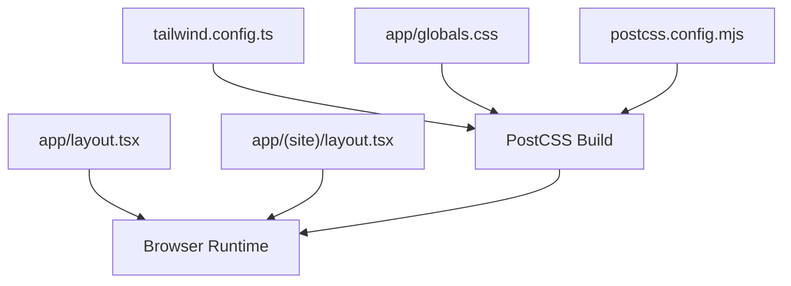
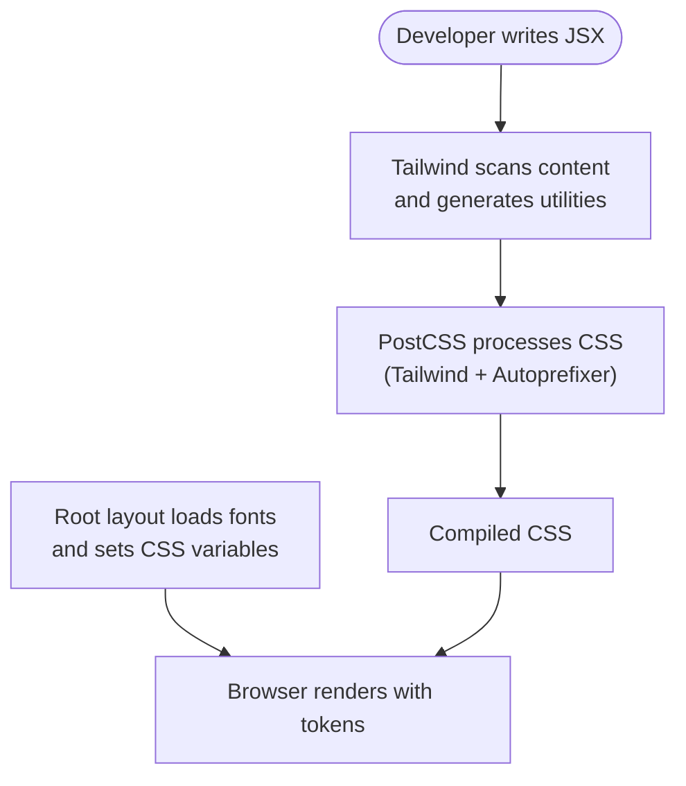
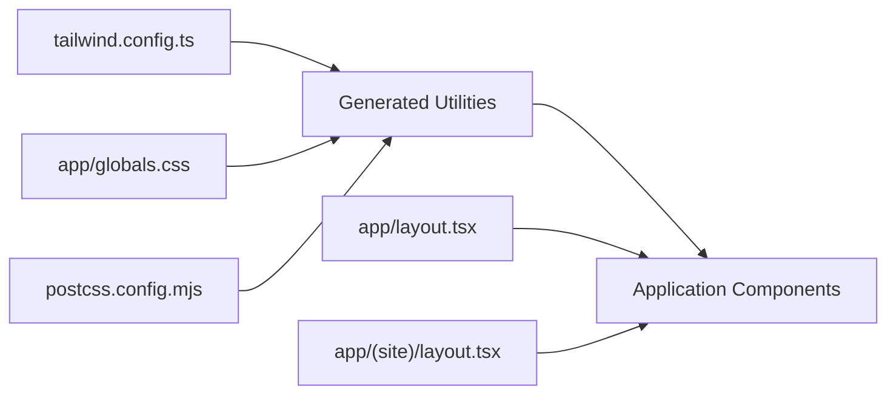

# Styling System

<cite>
**Referenced Files in This Document**
- [tailwind.config.ts](file://tailwind.config.ts)
- [app/globals.css](file://app/globals.css)
- [postcss.config.mjs](file://postcss.config.mjs)
- [app/layout.tsx](file://app/layout.tsx)
- [app/(site)/layout.tsx](file://app/(site)/layout.tsx)
- [docs/DESIGN.md](file://docs/DESIGN.md)
</cite>

## Table of Contents
1. [Introduction](#introduction)
2. [Project Structure](#project-structure)
3. [Core Components](#core-components)
4. [Architecture Overview](#architecture-overview)
5. [Detailed Component Analysis](#detailed-component-analysis)
6. [Dependency Analysis](#dependency-analysis)
7. [Performance Considerations](#performance-considerations)
8. [Troubleshooting Guide](#troubleshooting-guide)
9. [Conclusion](#conclusion)
10. [Appendices](#appendices)

## Introduction
This document explains the Tailwind CSS styling system and design tokens used by the application. It covers the custom theme configuration, color palette, typography system with Playfair Display and Plus Jakarta Sans, responsive breakpoints, global styles, component-specific patterns, accessibility considerations, and performance optimizations. It also provides guidance on extending the design system with new colors or components.

## Project Structure
The styling system is centered around a small set of files:
- Tailwind configuration defines the design tokens (colors, typography scale, font families).
- Global CSS applies base resets, typography overrides, and utility classes.
- PostCSS configures Tailwind and Autoprefixer.
- Root layout injects Google Fonts and exposes CSS custom properties for fonts.
- Site layout composes header and footer around page content.

**Diagram sources**
- [tailwind.config.ts:1-129](file://tailwind.config.ts#L1-L129)
- [app/globals.css:1-189](file://app/globals.css#L1-L189)
- [postcss.config.mjs:1-9](file://postcss.config.mjs#L1-L9)
- [app/layout.tsx:1-61](file://app/layout.tsx#L1-L61)
- [app/(site)/layout.tsx:1-15](file://app/(site)/layout.tsx#L1-L15)

**Section sources**
- [tailwind.config.ts:1-129](file://tailwind.config.ts#L1-L129)
- [app/globals.css:1-189](file://app/globals.css#L1-L189)
- [postcss.config.mjs:1-9](file://postcss.config.mjs#L1-L9)
- [app/layout.tsx:1-61](file://app/layout.tsx#L1-L61)
- [app/(site)/layout.tsx:1-15](file://app/(site)/layout.tsx#L1-L15)

## Core Components
- Custom Tailwind theme:
  - Colors: Material 3–inspired surface, primary, secondary, tertiary, error, and semantic tokens; brand accents such as zakat gold and muted text.
  - Typography: Headline, title, body, and label scales with explicit sizes, line heights, weights, and letter spacing.
  - Font families: Sans mapped to Plus Jakarta Sans via CSS variable; serif mapped to Playfair Display via CSS variable.
- Global CSS:
  - Base reset and scroll behavior.
  - Explicit typography overrides for h1–h3 and utility classes.
  - Responsive media queries for headline scaling.
  - Legacy compatibility rules for the not-found page.
- PostCSS pipeline:
  - Tailwind and Autoprefixer plugins.
- Root layout:
  - Loads Playfair Display and Plus Jakarta Sans from Google Fonts.
  - Exposes CSS variables `--font-playfair` and `--font-plus-jakarta`.
  - Applies default background, text color, and sans-serif font family.

**Section sources**
- [tailwind.config.ts:6-123](file://tailwind.config.ts#L6-L123)
- [app/globals.css:5-189](file://app/globals.css#L5-L189)
- [postcss.config.mjs:1-9](file://postcss.config.mjs#L1-L9)
- [app/layout.tsx:6-19](file://app/layout.tsx#L6-L19)
- [app/layout.tsx:55-57](file://app/layout.tsx#L55-L57)

## Architecture Overview
The styling architecture follows a layered approach:
- Design tokens are defined in Tailwind’s theme extension.
- Global CSS layers provide base resets and enforce consistent typography across elements and utility classes.
- The build pipeline compiles Tailwind utilities and adds vendor prefixes via Autoprefixer.
- The root layout registers fonts and sets CSS custom properties consumed by Tailwind’s font-family mappings.

**Diagram sources**
- [tailwind.config.ts:1-129](file://tailwind.config.ts#L1-L129)
- [postcss.config.mjs:1-9](file://postcss.config.mjs#L1-L9)
- [app/layout.tsx:1-61](file://app/layout.tsx#L1-L61)

## Detailed Component Analysis

### Color Palette and Tokens
The theme extends Tailwind’s color space with semantic tokens aligned to a Material 3-inspired system:
- Surface tokens: base surface, dim/bright variants, container levels, tint, and clean white.
- Primary/Secondary/Tertiary tokens: base colors, containers, fixed variants, and on-colors for contrast.
- Error tokens: error, container, and on-error.
- Neutral tokens: outline, outline-variant, inverse-surface, on-background, and muted text.
- Brand accents: zakat-gold-light, amber-vibrant, oceanic-teal-deep, emerald-dark, border-subtle.

Usage guidance:
- Use primary for institutional identity and key interactive states.
- Use secondary for high-priority conversion actions.
- Use tertiary for deep anchor sections and authoritative summaries.
- Use surface tokens for backgrounds and cards; use on-* tokens for text and icons.

Extending colors:
- Add new tokens under `theme.extend.colors` in the Tailwind configuration.
- Reference them in components using the generated class names (for example, `bg-primary`, `text-secondary-container`).

**Section sources**
- [tailwind.config.ts:8-66](file://tailwind.config.ts#L8-L66)
- [docs/DESIGN.md:3-58](file://docs/DESIGN.md#L3-L58)

### Typography System
Typography is defined in two places:
- Tailwind theme: a comprehensive scale of headline, title, body, and label tokens with size, line height, weight, and letter spacing.
- Global CSS: explicit overrides for native headings and utility classes, including responsive breakpoints for headlines.

Key characteristics:
- Serif headings and titles use Playfair Display via CSS variables.
- Body and UI text use Plus Jakarta Sans via CSS variables.
- Headlines scale responsively: mobile-first sizes increase at tablet and desktop breakpoints.
- Labels apply subtle tracking for improved scan speed.

Responsive breakpoints:
- Mobile base sizes apply by default.
- Tablet breakpoint increases headline sizes.
- Desktop breakpoint further increases headline sizes and tightens line-height where appropriate.

Extending typography:
- Add new tokens under `theme.extend.fontSize` in the Tailwind configuration.
- For element-level overrides, add corresponding classes in global CSS if needed.

**Section sources**
- [tailwind.config.ts:67-122](file://tailwind.config.ts#L67-L122)
- [app/globals.css:26-173](file://app/globals.css#L26-L173)
- [docs/DESIGN.md:59-137](file://docs/DESIGN.md#L59-L137)

### Font Loading and CSS Custom Properties
Fonts are loaded through Next.js font loaders:
- Plus Jakarta Sans is configured with multiple weights and exposed as `--font-plus-jakarta`.
- Playfair Display is configured with selected weights and style variants and exposed as `--font-playfair`.
- Tailwind maps `sans` to `var(--font-plus-jakarta)` and `serif` to `var(--font-playfair)`.
- Global CSS uses these variables to ensure consistent font application across utility classes and native elements.

Best practices:
- Keep font subsets minimal to reduce payload.
- Use `display: 'swap'` to avoid invisible text during loading.
- Apply font variables at the HTML level so all descendants inherit them.

**Section sources**
- [app/layout.tsx:6-19](file://app/layout.tsx#L6-L19)
- [app/layout.tsx:41-44](file://app/layout.tsx#L41-L44)
- [tailwind.config.ts:119-122](file://tailwind.config.ts#L119-L122)
- [app/globals.css:26-35](file://app/globals.css#L26-L35)

### Global Styles and Base Layer
Global CSS establishes:
- Base reset for margins and padding.
- Scroll behavior and first/last child margin normalization inside main.
- Hidden webkit scrollbar.
- Consistent serif font application for headings and utility classes.
- Explicit typography overrides for h1–h3 and utility classes.
- Responsive media queries for headline scaling.
- Compatibility overrides for the legacy not-found page.

Recommendations:
- Prefer Tailwind utilities for most styling needs.
- Reserve global CSS for cross-cutting concerns like base resets and token-driven typography.

**Section sources**
- [app/globals.css:1-24](file://app/globals.css#L1-L24)
- [app/globals.css:26-173](file://app/globals.css#L26-L173)
- [app/globals.css:175-189](file://app/globals.css#L175-L189)

### Build Pipeline and PostCSS
PostCSS is configured to run:
- Tailwind CSS plugin to generate utilities based on the theme and content paths.
- Autoprefixer to add vendor prefixes for broad browser support.

Content scanning:
- Tailwind scans TypeScript and TSX files under `app` and `components` directories.

**Section sources**
- [postcss.config.mjs:1-9](file://postcss.config.mjs#L1-L9)
- [tailwind.config.ts:3-5](file://tailwind.config.ts#L3-L5)

### Component-Specific Styling Patterns
While component-specific styles live within React components, the design system encourages:
- Using semantic color tokens for backgrounds, borders, and text.
- Applying typography tokens for consistent hierarchy.
- Leveraging responsive utilities to adapt layouts per viewport.
- Maintaining accessible contrast ratios between foreground and background tokens.

Example patterns:
- Buttons: use primary or secondary tokens for fill and text, with hover states derived from the same palette.
- Cards: use surface-clean or surface-container-low for backgrounds, outline or border-subtle for borders.
- Forms: use on-surface for labels and inputs, focus rings using primary tokens.

Note: These patterns are conceptual and should be implemented using the provided tokens and utilities.

[No sources needed since this section provides general guidance]

## Dependency Analysis
The styling dependencies flow from configuration to runtime:

**Diagram sources**
- [tailwind.config.ts:1-129](file://tailwind.config.ts#L1-L129)
- [app/globals.css:1-189](file://app/globals.css#L1-L189)
- [postcss.config.mjs:1-9](file://postcss.config.mjs#L1-L9)
- [app/layout.tsx:1-61](file://app/layout.tsx#L1-L61)
- [app/(site)/layout.tsx:1-15](file://app/(site)/layout.tsx#L1-L15)

**Section sources**
- [tailwind.config.ts:1-129](file://tailwind.config.ts#L1-L129)
- [app/globals.css:1-189](file://app/globals.css#L1-L189)
- [postcss.config.mjs:1-9](file://postcss.config.mjs#L1-L9)
- [app/layout.tsx:1-61](file://app/layout.tsx#L1-L61)
- [app/(site)/layout.tsx:1-15](file://app/(site)/layout.tsx#L1-L15)

## Performance Considerations
- Content-based generation: Tailwind scans only the specified content paths, minimizing unused CSS.
- Autoprefixer ensures broad compatibility without manual vendor prefixes.
- Font loading uses `display: 'swap'` to prevent invisible text and improve perceived performance.
- Minimal font subsets are requested to reduce payload.
- Global CSS avoids heavy shadows and prefers tonal surfaces for depth, reducing visual noise and repaint costs.

[No sources needed since this section provides general guidance]

## Troubleshooting Guide
Common issues and resolutions:
- Fonts not applying:
  - Ensure the root HTML element includes both CSS variables for fonts.
  - Verify that Tailwind’s font-family mappings reference the correct CSS variables.
- Typography inconsistencies:
  - Check for conflicting overrides in global CSS; prefer Tailwind utilities when possible.
  - Confirm that responsive media queries are applied to the intended selectors.
- Colors not appearing:
  - Confirm that the token exists in the Tailwind theme extension.
  - Ensure the component uses the generated class name for the token.
- Build errors related to CSS:
  - Validate PostCSS configuration includes Tailwind and Autoprefixer.
  - Confirm content paths include all directories containing JSX/TSX files.

**Section sources**
- [app/layout.tsx:41-44](file://app/layout.tsx#L41-L44)
- [tailwind.config.ts:119-122](file://tailwind.config.ts#L119-L122)
- [app/globals.css:26-173](file://app/globals.css#L26-L173)
- [postcss.config.mjs:1-9](file://postcss.config.mjs#L1-L9)

## Conclusion
The styling system combines a robust Tailwind theme with carefully curated global CSS to deliver a consistent, accessible, and performant design language. Semantic color tokens, a clear typography scale, and responsive breakpoints enable scalable component development. Extending the system involves adding tokens to the Tailwind configuration and leveraging CSS variables for fonts. Following the outlined best practices will maintain consistency, accessibility, and performance across the application.

[No sources needed since this section summarizes without analyzing specific files]

## Appendices

### How to Extend the Design System

#### Adding New Colors
- Open the Tailwind configuration file.
- Add new entries under `theme.extend.colors`.
- Use the generated class names in components (for example, `bg-new-token`, `text-on-new-token`).

**Section sources**
- [tailwind.config.ts:8-66](file://tailwind.config.ts#L8-L66)

#### Adding New Typography Tokens
- Open the Tailwind configuration file.
- Add new entries under `theme.extend.fontSize` with size, line height, weight, and optional letter spacing.
- If you need element-level overrides, add corresponding classes in global CSS.

**Section sources**
- [tailwind.config.ts:67-118](file://tailwind.config.ts#L67-L118)
- [app/globals.css:37-173](file://app/globals.css#L37-L173)

#### Defining Responsive Breakpoints
- The system uses mobile-first defaults with media queries for tablet and desktop.
- To adjust breakpoints, update the relevant media queries in global CSS or leverage Tailwind’s built-in responsive prefixes.

**Section sources**
- [app/globals.css:45-59](file://app/globals.css#L45-L59)
- [app/globals.css:69-83](file://app/globals.css#L69-L83)
- [app/globals.css:93-100](file://app/globals.css#L93-L100)

#### Accessibility Checklist
- Ensure sufficient contrast between text and background tokens.
- Provide visible focus indicators using primary or secondary tokens.
- Use semantic headings and maintain a logical heading hierarchy.
- Test with screen readers and keyboard navigation.

[No sources needed since this section provides general guidance]