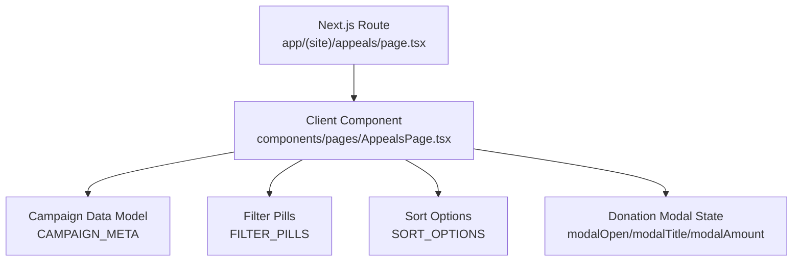
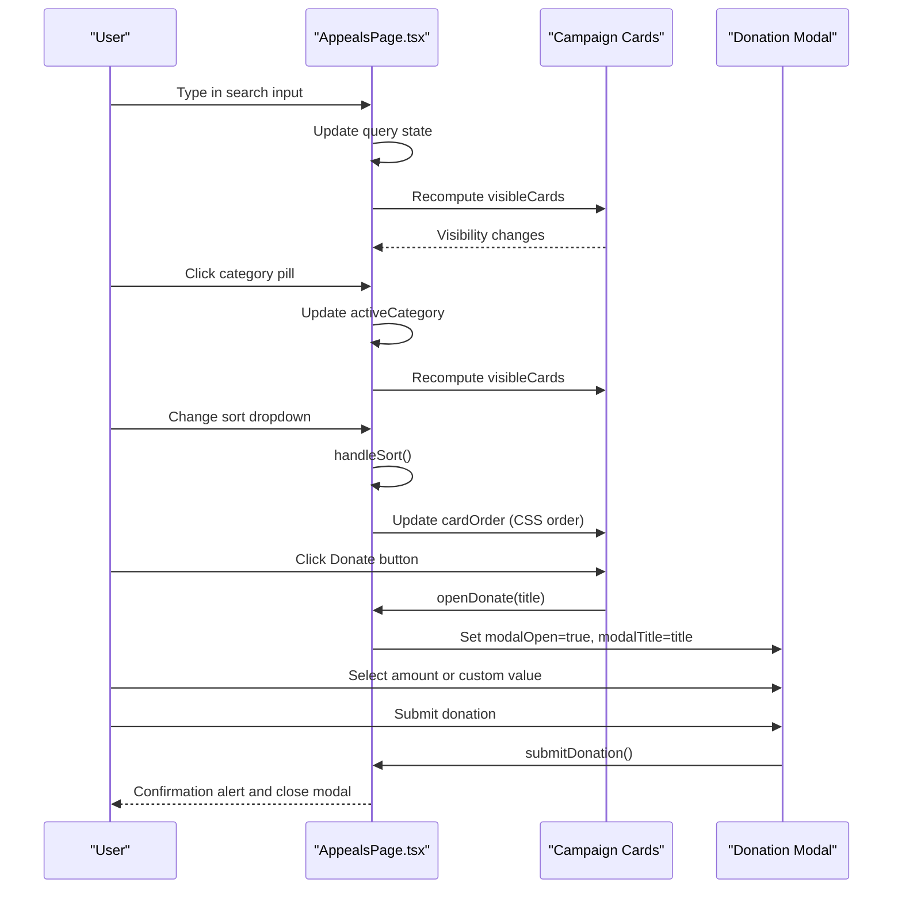
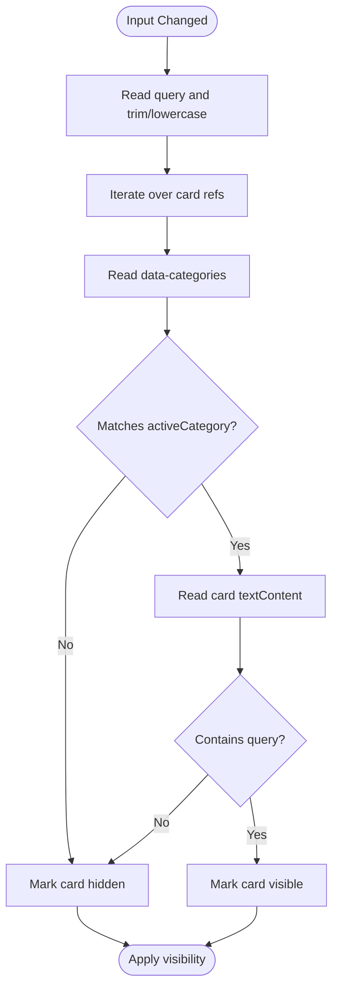
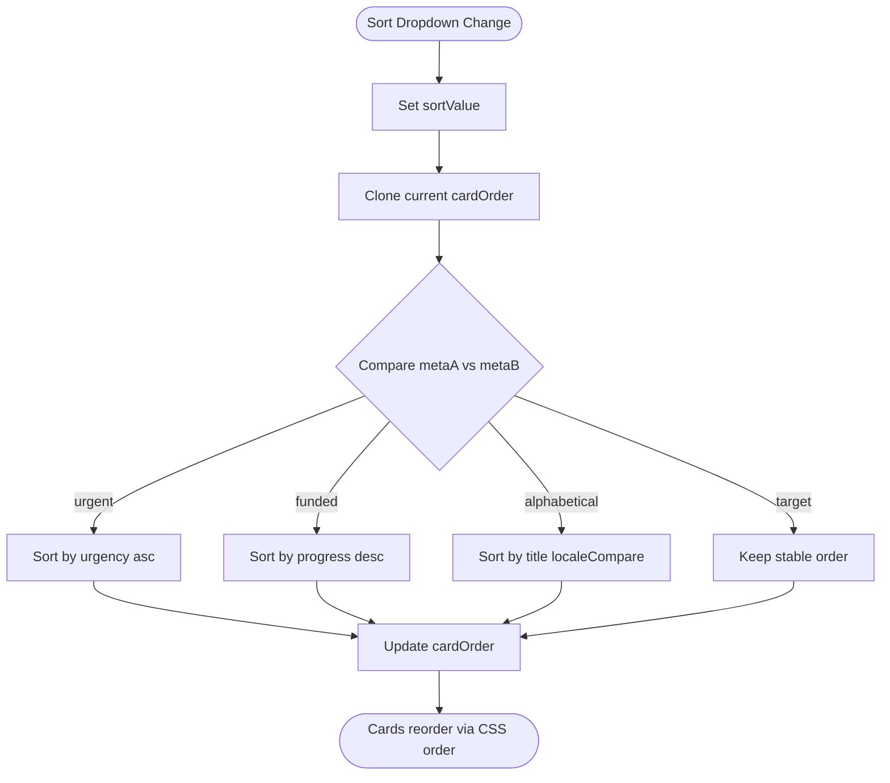
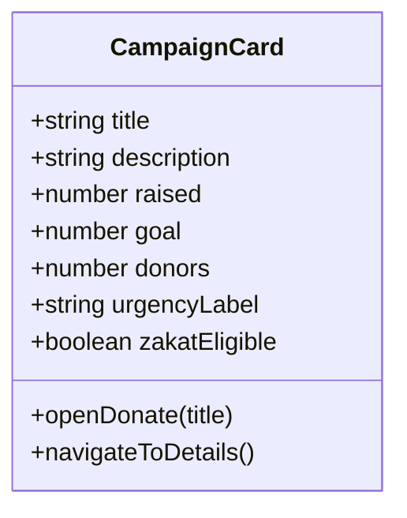
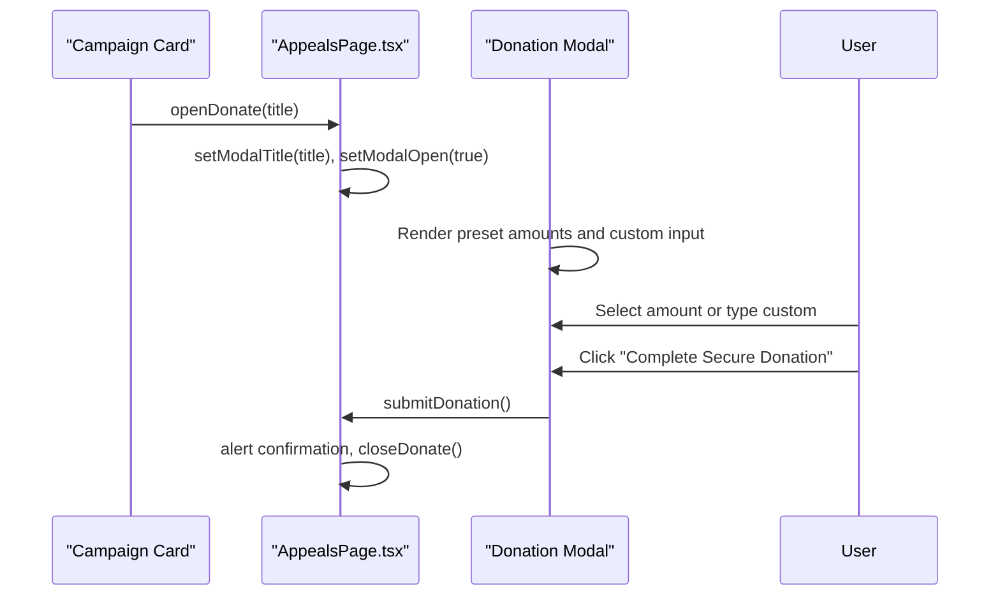
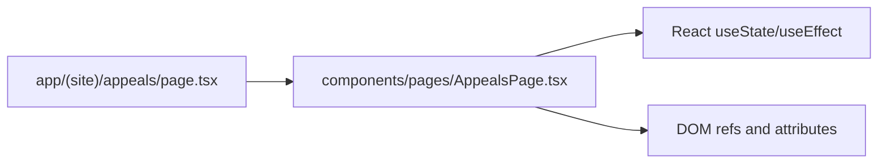

# Appeals & Emergency Causes Management

<cite>
**Referenced Files in This Document**
- [page.tsx](file://app/(site)/appeals/page.tsx)
- [AppealsPage.tsx](file://components/pages/AppealsPage.tsx)
- [README.md](file://README.md)
</cite>

## Table of Contents
1. [Introduction](#introduction)
2. [Project Structure](#project-structure)
3. [Core Components](#core-components)
4. [Architecture Overview](#architecture-overview)
5. [Detailed Component Analysis](#detailed-component-analysis)
6. [Dependency Analysis](#dependency-analysis)
7. [Performance Considerations](#performance-considerations)
8. [Troubleshooting Guide](#troubleshooting-guide)
9. [Conclusion](#conclusion)

## Introduction
This document explains the appeals and emergency causes management system built for the Global Muslim Charitable Foundation website. It focuses on:
- Campaign filtering by category (food relief, healthcare, winter warmth, clean water, zakat eligibility)
- Live search across campaign content
- Sorting mechanisms (urgency, funding progress, target amount, alphabetical)
- Campaign card components with progress tracking, funding goals, donor counts, and urgency indicators
- Integrated donation modal allowing direct donations from campaign listings
- Responsive grid layout, image handling, and accessibility considerations

The implementation is a Next.js App Router page that renders a client-side React component responsible for all interactive behavior.

## Project Structure
The appeals feature is exposed through a Next.js route and implemented as a client component:
- Route entry point: `app/(site)/appeals/page.tsx`
- Interactive UI logic: `components/pages/AppealsPage.tsx`

**Diagram sources**
- [page.tsx:1-14](file://app/(site)/appeals/page.tsx#L1-L14)
- [AppealsPage.tsx:6-22](file://components/pages/AppealsPage.tsx#L6-L22)
- [AppealsPage.tsx:24-61](file://components/pages/AppealsPage.tsx#L24-L61)
- [AppealsPage.tsx:63-77](file://components/pages/AppealsPage.tsx#L63-L77)

**Section sources**
- [page.tsx:1-14](file://app/(site)/appeals/page.tsx#L1-L14)
- [README.md:14-32](file://README.md#L14-L32)

## Core Components
- **Route wrapper**: Renders the client component and sets SEO metadata for the appeals page.
- **Client component**: Manages state for search, category filter, sort order, visibility, and donation modal. It also renders:
  - Hero header with impact metrics
  - Search input and sort dropdown
  - Category filter pills
  - Responsive campaign grid
  - Integrated quick-donation modal

Key data structures:
- `FILTER_PILLS`: Defines available categories including food, medical, water, winter, zakat, and an “all” option.
- `SORT_OPTIONS`: Defines sorting strategies such as most urgent, most funded, target amount, and alphabetical.
- `CAMPAIGN_META`: Metadata used to compute sort order and initial visibility.
- `MODAL_AMOUNTS`: Preset donation amounts shown in the modal.

State variables:
- `query`: Live search text
- `activeCategory`: Selected category pill
- `sortValue`: Selected sort strategy
- `cardOrder`: Array of indices controlling visual order
- `visibleCards`: Boolean array controlling card visibility
- `modalOpen`, `modalTitle`, `modalAmount`: Donation modal controls

**Section sources**
- [page.tsx:1-14](file://app/(site)/appeals/page.tsx#L1-L14)
- [AppealsPage.tsx:6-22](file://components/pages/AppealsPage.tsx#L6-L22)
- [AppealsPage.tsx:24-61](file://components/pages/AppealsPage.tsx#L24-L61)
- [AppealsPage.tsx:63-77](file://components/pages/AppealsPage.tsx#L63-L77)

## Architecture Overview
The appeals page follows a simple client-side architecture:
- The route file imports and renders the client component.
- The client component owns all interactive state and DOM references.
- Filtering and search are computed via a `useEffect` hook that reads DOM attributes and text content.
- Sorting updates the visual order using CSS `order` style applied to each card.
- The donation modal is rendered inline and toggled via state.

**Diagram sources**
- [AppealsPage.tsx:79-113](file://components/pages/AppealsPage.tsx#L79-L113)
- [AppealsPage.tsx:136-152](file://components/pages/AppealsPage.tsx#L136-L152)
- [AppealsPage.tsx:160-251](file://components/pages/AppealsPage.tsx#L160-L251)

## Detailed Component Analysis

### Campaign Data Model
The campaign metadata model provides fields used for sorting and initial visibility:
- `categories`: Space-separated category tokens (e.g., “food zakat”, “medical zakat”, “water”, “winter”)
- `progress`: Funding progress percentage
- `urgency`: Numeric urgency level (lower means more urgent)
- `title`: Human-readable campaign title

Example entries include food relief, pediatric eye surgery, clean water wells, winter blankets, emergency hospital care, and inclusive special children therapy.

Complexity:
- Reading and comparing metadata during sort is O(n log n) due to array sorting.
- Filtering uses DOM attribute checks and substring matching; performance depends on number of cards and text length.

**Section sources**
- [AppealsPage.tsx:24-61](file://components/pages/AppealsPage.tsx#L24-L61)

### Filtering Logic
The live filter combines two conditions:
- Category match: If the selected pill is not “all”, the card’s `data-categories` must include the selected category token.
- Query match: If the search string is non-empty, the card’s text content must contain the query substring (case-insensitive).

Implementation highlights:
- A `useEffect` recomputes `visibleCards` whenever `query` or `activeCategory` changes.
- Each card has a `ref` so the effect can read its attributes and text content.
- Cards are conditionally hidden via Tailwind’s `hidden` class based on `visibleCards`.

**Diagram sources**
- [AppealsPage.tsx:79-93](file://components/pages/AppealsPage.tsx#L79-L93)

**Section sources**
- [AppealsPage.tsx:79-93](file://components/pages/AppealsPage.tsx#L79-L93)

### Sorting Mechanisms
Sorting options:
- Most Urgent Need: Sorts by ascending `urgency` (lower numbers first).
- Most Funded: Sorts by descending `progress`.
- Target Amount: No explicit comparator implemented; returns stable order.
- Alphabetical: Sorts by `title` using locale-aware comparison.

Implementation details:
- `handleSort` updates `sortValue` and recalculates `cardOrder`.
- Each card applies `style={{ order: cardOrder.indexOf(index) }}` to visually reorder without re-rendering the DOM tree.

**Diagram sources**
- [AppealsPage.tsx:95-113](file://components/pages/AppealsPage.tsx#L95-L113)

**Section sources**
- [AppealsPage.tsx:95-113](file://components/pages/AppealsPage.tsx#L95-L113)

### Campaign Card Components
Each campaign card includes:
- Image area with overlay badges (category tags, Zakat/Sadaqah labels, location)
- Title, short description, and partnership/program label
- Progress bar showing raised amount versus goal
- Donor count and additional metrics (operations funded, items distributed, children supported)
- Urgency indicator text (e.g., “Urgent Daily Need”, “High Medical Urgency”, “Seasonal Appeal”)
- Action buttons:
  - Primary donate button opens the integrated donation modal with the campaign title
  - Secondary link navigates to the campaign details page

Accessibility and UX notes:
- Images use descriptive `alt` attributes.
- Buttons have clear labels and icons.
- Cards use semantic `<article>` elements.

Responsive grid layout:
- Uses Tailwind responsive classes: single column on small screens, two columns on medium, three columns on large.

Image handling:
- Images are displayed directly with standard `src` attributes.
- There is no lazy loading implementation in this component; images load eagerly.

**Diagram sources**
- [AppealsPage.tsx:390-507](file://components/pages/AppealsPage.tsx#L390-L507)
- [AppealsPage.tsx:511-629](file://components/pages/AppealsPage.tsx#L511-L629)
- [AppealsPage.tsx:633-751](file://components/pages/AppealsPage.tsx#L633-L751)
- [AppealsPage.tsx:755-875](file://components/pages/AppealsPage.tsx#L755-L875)
- [AppealsPage.tsx:879-997](file://components/pages/AppealsPage.tsx#L879-L997)
- [AppealsPage.tsx:1001-1119](file://components/pages/AppealsPage.tsx#L1001-L1119)

**Section sources**
- [AppealsPage.tsx:390-507](file://components/pages/AppealsPage.tsx#L390-L507)
- [AppealsPage.tsx:511-629](file://components/pages/AppealsPage.tsx#L511-L629)
- [AppealsPage.tsx:633-751](file://components/pages/AppealsPage.tsx#L633-L751)
- [AppealsPage.tsx:755-875](file://components/pages/AppealsPage.tsx#L755-L875)
- [AppealsPage.tsx:879-997](file://components/pages/AppealsPage.tsx#L879-L997)
- [AppealsPage.tsx:1001-1119](file://components/pages/AppealsPage.tsx#L1001-L1119)

### Integrated Donation Modal
The modal allows users to donate directly from campaign listings:
- Triggered by clicking any card’s donate button, which calls `openDonate(title)`
- Displays preset amount chips ($25, $50, $100, $250) and a custom amount input
- Shows a Zakat certification notice
- Submits via `submitDonation`, currently showing an alert and closing the modal

Modal state:
- `modalOpen`: Controls visibility
- `modalTitle`: Campaign title passed from the card
- `modalAmount`: Selected or custom amount

Keyboard and screen reader considerations:
- The modal is a fixed overlay with a close button.
- Inputs have labels and IDs for assistive technology.
- Focus management and trap are not explicitly implemented in this component.

**Diagram sources**
- [AppealsPage.tsx:136-152](file://components/pages/AppealsPage.tsx#L136-L152)
- [AppealsPage.tsx:160-251](file://components/pages/AppealsPage.tsx#L160-L251)

**Section sources**
- [AppealsPage.tsx:136-152](file://components/pages/AppealsPage.tsx#L136-L152)
- [AppealsPage.tsx:160-251](file://components/pages/AppealsPage.tsx#L160-L251)

### Search Implementation
The search input binds to `query` state and triggers a `useEffect` that:
- Normalizes the query (trim and lowercase)
- Iterates over DOM nodes referenced by `cardRefs`
- Reads each card’s `data-categories` and `textContent`
- Computes visibility based on category and query matches

Practical example:
- Typing “street food” will match cards whose text contains that substring.
- Selecting “Food Security & Street Meals” filters to cards with the “food” category token.

**Section sources**
- [AppealsPage.tsx:79-93](file://components/pages/AppealsPage.tsx#L79-L93)
- [AppealsPage.tsx:320-332](file://components/pages/AppealsPage.tsx#L320-L332)

### Responsive Grid Layout
The campaigns grid adapts to screen sizes:
- Single column on mobile
- Two columns on medium screens
- Three columns on large screens

This is achieved with Tailwind’s responsive grid utilities.

**Section sources**
- [AppealsPage.tsx:380-387](file://components/pages/AppealsPage.tsx#L380-L387)

### Image Handling
Images in campaign cards:
- Use standard `src` attributes
- Include descriptive `alt` text
- Do not implement lazy loading in this component

Recommendation:
- Consider adding lazy loading (e.g., native `loading="lazy"` or IntersectionObserver-based approach) to improve performance on pages with many images.

**Section sources**
- [AppealsPage.tsx:400-405](file://components/pages/AppealsPage.tsx#L400-L405)
- [AppealsPage.tsx:521-526](file://components/pages/AppealsPage.tsx#L521-L526)
- [AppealsPage.tsx:643-648](file://components/pages/AppealsPage.tsx#L643-L648)
- [AppealsPage.tsx:765-770](file://components/pages/AppealsPage.tsx#L765-L770)
- [AppealsPage.tsx:889-894](file://components/pages/AppealsPage.tsx#L889-L894)
- [AppealsPage.tsx:1011-1016](file://components/pages/AppealsPage.tsx#L1011-L1016)

### Accessibility Considerations
Current accessibility features:
- Semantic HTML structure (`<main>`, `<section>`, `<article>`)
- Descriptive `alt` attributes on images
- Labels and IDs for inputs in the modal
- Clear button labels and iconography

Areas for improvement:
- Add focus trapping within the modal when open
- Manage focus return to the trigger element after closing
- Provide keyboard shortcuts (e.g., Escape to close modal)
- Ensure sufficient color contrast for all text and badges
- Add ARIA roles and states for dynamic content (e.g., `aria-live` for filtered results count)

**Section sources**
- [AppealsPage.tsx:160-251](file://components/pages/AppealsPage.tsx#L160-L251)
- [AppealsPage.tsx:390-507](file://components/pages/AppealsPage.tsx#L390-L507)

## Dependency Analysis
The appeals feature has minimal external dependencies beyond React and Next.js:
- Route file imports the client component
- Client component manages internal state and DOM references
- No third-party libraries are imported for filtering or modal behavior

**Diagram sources**
- [page.tsx:1-14](file://app/(site)/appeals/page.tsx#L1-L14)
- [AppealsPage.tsx:4-5](file://components/pages/AppealsPage.tsx#L4-L5)

**Section sources**
- [page.tsx:1-14](file://app/(site)/appeals/page.tsx#L1-L14)
- [AppealsPage.tsx:4-5](file://components/pages/AppealsPage.tsx#L4-L5)

## Performance Considerations
- Filtering runs on every change to `query` or `activeCategory`, iterating over all card refs. For larger datasets, consider virtualization or precomputed filters.
- Sorting uses array sort with comparisons against `CAMPAIGN_META`; ensure metadata remains synchronized with rendered cards.
- Images load eagerly; consider lazy loading to reduce initial payload.
- Modal submission currently uses an alert; integrate a proper payment flow asynchronously to avoid blocking the UI.

[No sources needed since this section provides general guidance]

## Troubleshooting Guide
Common issues and resolutions:
- Filters not applying:
  - Verify each card has correct `data-categories` values matching `FILTER_PILLS`.
  - Ensure `cardRefs` are populated and not null before reading attributes.
- Search returning no results:
  - Confirm the query normalization (trim/lowercase) matches expected input.
  - Check that card text content includes searchable terms.
- Sort not updating order:
  - Validate `cardOrder` computation and that each card applies `style={{ order: ... }}`.
- Modal not closing:
  - Ensure `closeDonate` is called on backdrop click and submit.
  - Check event delegation if integrating with other overlays.

**Section sources**
- [AppealsPage.tsx:79-93](file://components/pages/AppealsPage.tsx#L79-L93)
- [AppealsPage.tsx:95-113](file://components/pages/AppealsPage.tsx#L95-L113)
- [AppealsPage.tsx:136-152](file://components/pages/AppealsPage.tsx#L136-L152)

## Conclusion
The appeals and emergency causes management system provides a robust, client-side interface for browsing, filtering, searching, and donating to humanitarian campaigns. Its design emphasizes clarity, urgency, and transparency, with accessible markup and responsive layouts. Future enhancements should prioritize performance optimizations (lazy loading, virtualized lists), improved accessibility (focus management, ARIA states), and integration with a secure payment backend for the donation modal.

[No sources needed since this section summarizes without analyzing specific files]