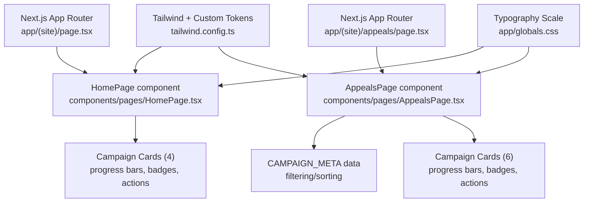
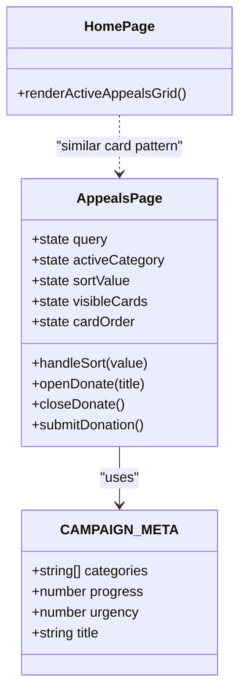
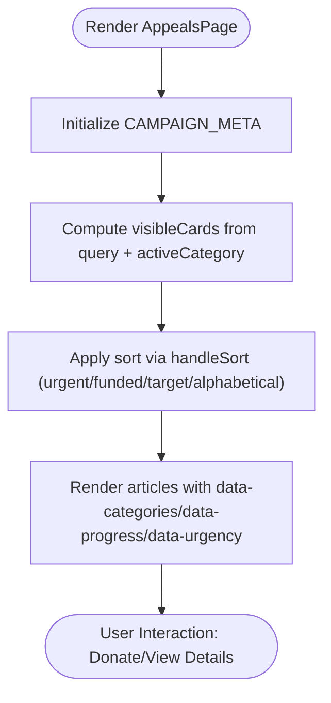
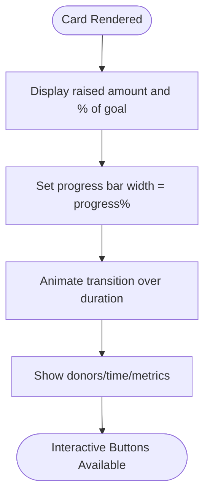
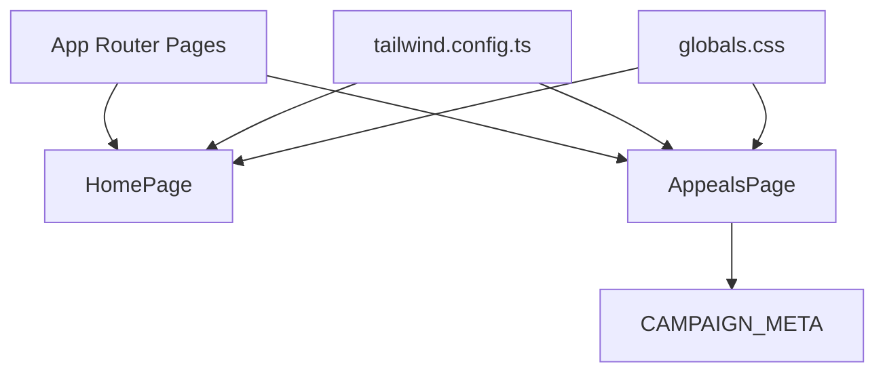

# Campaign Cards & Progress Display

<cite>
**Referenced Files in This Document**
- [HomePage.tsx](file://components/pages/HomePage.tsx)
- [AppealsPage.tsx](file://components/pages/AppealsPage.tsx)
- [page.tsx (site root)](file://app/(site)/page.tsx)
- [appeals/page.tsx](file://app/(site)/appeals/page.tsx)
- [globals.css](file://app/globals.css)
- [tailwind.config.ts](file://tailwind.config.ts)
</cite>

## Table of Contents
1. [Introduction](#introduction)
2. [Project Structure](#project-structure)
3. [Core Components](#core-components)
4. [Architecture Overview](#architecture-overview)
5. [Detailed Component Analysis](#detailed-component-analysis)
6. [Dependency Analysis](#dependency-analysis)
7. [Performance Considerations](#performance-considerations)
8. [Troubleshooting Guide](#troubleshooting-guide)
9. [Conclusion](#conclusion)

## Introduction
This document explains the campaign card components and progress display system used across the site’s landing and appeals pages. It covers:
- The CAMPAIGN_META data structure that drives filtering, sorting, and metadata for campaigns
- Responsive grid layout using CSS Grid with breakpoints for mobile, tablet, and desktop
- Progress bar implementation showing funding status, donor counts, and remaining time indicators
- Card structure examples including image handling, category badges, location tags, and action buttons
- Hover effects, transitions, and visual feedback systems
- Accessibility features such as semantic HTML structure and screen reader compatibility

## Project Structure
The campaign cards are rendered by two main React components:
- HomePage renders a compact four-card “Active Appeals” grid on the landing page
- AppealsPage renders a richer six-card grid with search, filters, sort controls, and a donation modal

**Diagram sources**
- [page.tsx (site root):1-15](file://app/(site)/page.tsx#L1-L15)
- [appeals/page.tsx:1-14](file://app/(site)/appeals/page.tsx#L1-L14)
- [HomePage.tsx:506-798](file://components/pages/HomePage.tsx#L506-L798)
- [AppealsPage.tsx:24-61](file://components/pages/AppealsPage.tsx#L24-L61)
- [AppealsPage.tsx:378-1120](file://components/pages/AppealsPage.tsx#L378-L1120)
- [tailwind.config.ts:1-129](file://tailwind.config.ts#L1-L129)
- [globals.css:26-173](file://app/globals.css#L26-L173)

**Section sources**
- [page.tsx (site root):1-15](file://app/(site)/page.tsx#L1-L15)
- [appeals/page.tsx:1-14](file://app/(site)/appeals/page.tsx#L1-L14)
- [HomePage.tsx:506-798](file://components/pages/HomePage.tsx#L506-L798)
- [AppealsPage.tsx:24-61](file://components/pages/AppealsPage.tsx#L24-L61)
- [AppealsPage.tsx:378-1120](file://components/pages/AppealsPage.tsx#L378-L1120)
- [tailwind.config.ts:1-129](file://tailwind.config.ts#L1-L129)
- [globals.css:26-173](file://app/globals.css#L26-L173)

## Core Components
- Campaign cards are implemented inline within both HomePage and AppealsPage. Each card includes:
  - Image container with hover zoom
  - Category badges (e.g., Food Relief, Pediatric Care, Water & WASH, Winter Relief)
  - Zakat/Sadaqah eligibility badges
  - Location tag overlay
  - Title, short description
  - Progress section with raised amount, goal percentage, animated progress bar
  - Donor count and optional remaining time or impact metrics
  - Action buttons to donate or view details

Key responsibilities:
- HomePage: presents a concise set of active appeals with simple progress bars and call-to-action links
- AppealsPage: provides advanced filtering, search, sorting, and a quick-donation modal; also exposes CAMPAIGN_META for programmatic control

**Section sources**
- [HomePage.tsx:540-798](file://components/pages/HomePage.tsx#L540-L798)
- [AppealsPage.tsx:378-1120](file://components/pages/AppealsPage.tsx#L378-L1120)

## Architecture Overview
The campaign UI is driven by static JSX with embedded state logic in AppealsPage for filtering and sorting. The data model CAMPAIGN_META centralizes categories, progress percentages, urgency levels, and titles.

**Diagram sources**
- [AppealsPage.tsx:24-61](file://components/pages/AppealsPage.tsx#L24-L61)
- [AppealsPage.tsx:95-113](file://components/pages/AppealsPage.tsx#L95-L113)
- [HomePage.tsx:540-798](file://components/pages/HomePage.tsx#L540-L798)

## Detailed Component Analysis

### CAMPAIGN_META Data Structure
CAMPAIGN_META defines the canonical dataset for campaigns. Each entry contains:
- categories: space-separated string tokens used for filtering (e.g., "food zakat", "medical zakat", "water", "winter")
- progress: numeric percentage indicating funding completion
- urgency: numeric priority level where lower values indicate higher urgency
- title: human-readable campaign title

Usage:
- Filtering: visibleCards array is computed based on activeCategory and query
- Sorting: handleSort reorders cardOrder using urgency, progress, alphabetical order, or target amount
- Rendering: each article element carries data attributes mirroring meta fields for runtime access

**Diagram sources**
- [AppealsPage.tsx:24-61](file://components/pages/AppealsPage.tsx#L24-L61)
- [AppealsPage.tsx:79-113](file://components/pages/AppealsPage.tsx#L79-L113)
- [AppealsPage.tsx:390-1120](file://components/pages/AppealsPage.tsx#L390-L1120)

**Section sources**
- [AppealsPage.tsx:24-61](file://components/pages/AppealsPage.tsx#L24-L61)
- [AppealsPage.tsx:79-113](file://components/pages/AppealsPage.tsx#L79-L113)

### Responsive Grid Layout
Both pages use CSS Grid with responsive breakpoints:
- Mobile: single column
- Tablet: two columns
- Desktop: three or four columns depending on the section

Examples:
- HomePage Active Appeals grid: grid-cols-1 md:grid-cols-2 lg:grid-cols-4
- AppealsPage campaigns grid: grid-cols-1 md:grid-cols-2 lg:grid-cols-3

These grids ensure consistent alignment and spacing across devices while maximizing content density on larger screens.

**Section sources**
- [HomePage.tsx:542](file://components/pages/HomePage.tsx#L542)
- [AppealsPage.tsx:384-387](file://components/pages/AppealsPage.tsx#L384-L387)

### Progress Bar Implementation
Each card displays:
- Raised amount and goal percentage
- Animated progress bar whose width corresponds to progress percentage
- Donor count and additional metrics (remaining time, operations funded, wells built, blankets distributed)

Implementation patterns:
- Progress width is set via inline style width percentage
- Transition duration applied to the inner bar for smooth animation
- Metrics are presented alongside icons for clarity

**Diagram sources**
- [HomePage.tsx:576-600](file://components/pages/HomePage.tsx#L576-L600)
- [AppealsPage.tsx:445-480](file://components/pages/AppealsPage.tsx#L445-L480)
- [AppealsPage.tsx:566-601](file://components/pages/AppealsPage.tsx#L566-L601)
- [AppealsPage.tsx:688-723](file://components/pages/AppealsPage.tsx#L688-L723)
- [AppealsPage.tsx:810-845](file://components/pages/AppealsPage.tsx#L810-L845)
- [AppealsPage.tsx:934-969](file://components/pages/AppealsPage.tsx#L934-L969)
- [AppealsPage.tsx:1056-1091](file://components/pages/AppealsPage.tsx#L1056-L1091)

**Section sources**
- [HomePage.tsx:576-600](file://components/pages/HomePage.tsx#L576-L600)
- [AppealsPage.tsx:445-480](file://components/pages/AppealsPage.tsx#L445-L480)
- [AppealsPage.tsx:566-601](file://components/pages/AppealsPage.tsx#L566-L601)
- [AppealsPage.tsx:688-723](file://components/pages/AppealsPage.tsx#L688-L723)
- [AppealsPage.tsx:810-845](file://components/pages/AppealsPage.tsx#L810-L845)
- [AppealsPage.tsx:934-969](file://components/pages/AppealsPage.tsx#L934-L969)
- [AppealsPage.tsx:1056-1091](file://components/pages/AppealsPage.tsx#L1056-L1091)

### Card Structure Examples
Common elements per card:
- Image container with object-cover and hover scale effect
- Category badge(s) positioned at top-left
- Eligibility badge (Zakat Eligible / Sadaqah Jariyah) at top-right
- Location tag overlay at bottom-right
- Title and short description
- Progress section with raised/goal, animated bar, donor/time metrics
- Action buttons: primary donate button and secondary link to details

Example references:
- One Meal One Hope card: image, Food Relief badge, Zakat Eligible badge, location tag, progress, donors, donate button
- Project Alo card: Pediatric Surgery badge, Zakat Eligible badge, location tag, progress, donors, sponsor surgery button
- Clean Water card: Water & WASH badge, Sadaqah Jariyah badge, location tag, progress, wells/donors, fund well button
- Project Sheetolota card: Winter Relief badge, Zakat Eligible badge, location tag, progress, blankets/donors, send warmth button

**Section sources**
- [HomePage.tsx:545-611](file://components/pages/HomePage.tsx#L545-L611)
- [HomePage.tsx:615-673](file://components/pages/HomePage.tsx#L615-L673)
- [HomePage.tsx:677-735](file://components/pages/HomePage.tsx#L677-L735)
- [HomePage.tsx:739-797](file://components/pages/HomePage.tsx#L739-L797)
- [AppealsPage.tsx:390-507](file://components/pages/AppealsPage.tsx#L390-L507)
- [AppealsPage.tsx:511-629](file://components/pages/AppealsPage.tsx#L511-L629)
- [AppealsPage.tsx:633-751](file://components/pages/AppealsPage.tsx#L633-L751)
- [AppealsPage.tsx:755-875](file://components/pages/AppealsPage.tsx#L755-L875)

### Hover Effects, Transitions, and Visual Feedback
- Image hover: group-hover:scale-105 with transition-transform duration-500
- Card hover: shadow elevation and color transitions on title/link
- Button hover: background color changes and subtle shadows
- Progress bar: transition-all duration-1000 for smooth fill animation
- Focus states: inputs and selects have focus rings and border highlights

These effects improve perceived responsiveness and guide user attention without overwhelming the interface.

**Section sources**
- [HomePage.tsx:545-611](file://components/pages/HomePage.tsx#L545-L611)
- [AppealsPage.tsx:390-507](file://components/pages/AppealsPage.tsx#L390-L507)
- [AppealsPage.tsx:511-629](file://components/pages/AppealsPage.tsx#L511-L629)
- [AppealsPage.tsx:633-751](file://components/pages/AppealsPage.tsx#L633-L751)
- [AppealsPage.tsx:755-875](file://components/pages/AppealsPage.tsx#L755-L875)

### Accessibility Features
Semantic HTML structure:
- Articles for campaign cards
- Headings hierarchy for titles and sections
- Descriptive alt text on images
- Labels and ids for form inputs (search, sort, custom amounts)

Screen reader considerations:
- aria-labels can be added to interactive elements if needed
- Ensure sufficient color contrast between text and backgrounds
- Use descriptive button labels and link titles

Current implementation strengths:
- Semantic tags (article, h1-h3)
- Alt attributes on images
- Accessible input labels and ids
- Clear visual hierarchy and readable typography

Potential improvements:
- Add aria-live regions for dynamic filter results
- Provide aria-describedby for progress bars to announce current percentage
- Include skip links and focus management for modal interactions

**Section sources**
- [AppealsPage.tsx:316-374](file://components/pages/AppealsPage.tsx#L316-L374)
- [AppealsPage.tsx:390-507](file://components/pages/AppealsPage.tsx#L390-L507)
- [AppealsPage.tsx:511-629](file://components/pages/AppealsPage.tsx#L511-L629)
- [AppealsPage.tsx:633-751](file://components/pages/AppealsPage.tsx#L633-L751)
- [AppealsPage.tsx:755-875](file://components/pages/AppealsPage.tsx#L755-L875)

## Dependency Analysis
- Next.js App Router pages mount the React components
- Tailwind configuration defines design tokens (colors, font sizes)
- Global CSS establishes typography scale and base styles
- AppealsPage depends on CAMPAIGN_META for filtering/sorting logic
- Both pages share similar card structures but differ in complexity and interactivity

**Diagram sources**
- [page.tsx (site root):1-15](file://app/(site)/page.tsx#L1-L15)
- [appeals/page.tsx:1-14](file://app/(site)/appeals/page.tsx#L1-L14)
- [AppealsPage.tsx:24-61](file://components/pages/AppealsPage.tsx#L24-L61)
- [tailwind.config.ts:1-129](file://tailwind.config.ts#L1-L129)
- [globals.css:26-173](file://app/globals.css#L26-L173)

**Section sources**
- [page.tsx (site root):1-15](file://app/(site)/page.tsx#L1-L15)
- [appeals/page.tsx:1-14](file://app/(site)/appeals/page.tsx#L1-L14)
- [AppealsPage.tsx:24-61](file://components/pages/AppealsPage.tsx#L24-L61)
- [tailwind.config.ts:1-129](file://tailwind.config.ts#L1-L129)
- [globals.css:26-173](file://app/globals.css#L26-L173)

## Performance Considerations
- Images use object-cover and lazy loading is not explicitly enabled; consider adding loading="lazy" for offscreen images
- Inline styles for progress widths are efficient; avoid excessive re-renders by memoizing derived values if datasets grow
- Animations use CSS transitions; keep durations reasonable to maintain responsiveness
- Filtering and sorting operate on small arrays; performance is negligible but should be monitored if scaling up

[No sources needed since this section provides general guidance]

## Troubleshooting Guide
Common issues and resolutions:
- Filters not applying: verify data-categories attribute matches activeCategory tokens
- Sort order incorrect: confirm CAMPAIGN_META entries have valid urgency and progress values
- Modal not closing: ensure close event handlers are bound and backdrop click targets the modal container
- Progress bar not animating: check that the inner div has transition classes and width is set correctly

**Section sources**
- [AppealsPage.tsx:79-113](file://components/pages/AppealsPage.tsx#L79-L113)
- [AppealsPage.tsx:160-251](file://components/pages/AppealsPage.tsx#L160-L251)
- [AppealsPage.tsx:390-1120](file://components/pages/AppealsPage.tsx#L390-L1120)

## Conclusion
The campaign card system combines a clear data model (CAMPAIGN_META), responsive CSS Grid layouts, and accessible, interactive components. Progress bars provide immediate feedback on funding status, while category badges, location tags, and action buttons create intuitive navigation. AppealsPage extends functionality with filtering, sorting, and a donation modal, making it suitable for complex campaign browsing. The design leverages Tailwind tokens and global typography for consistency and readability across devices.

[No sources needed since this section summarizes without analyzing specific files]