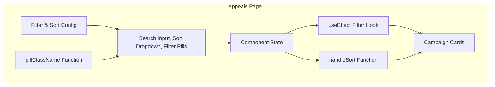
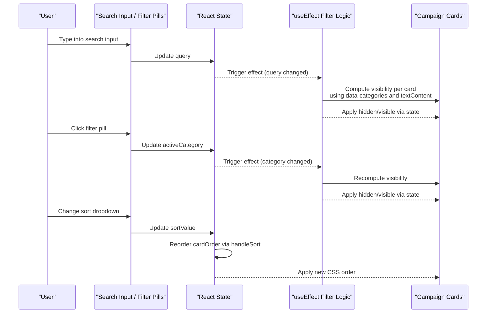
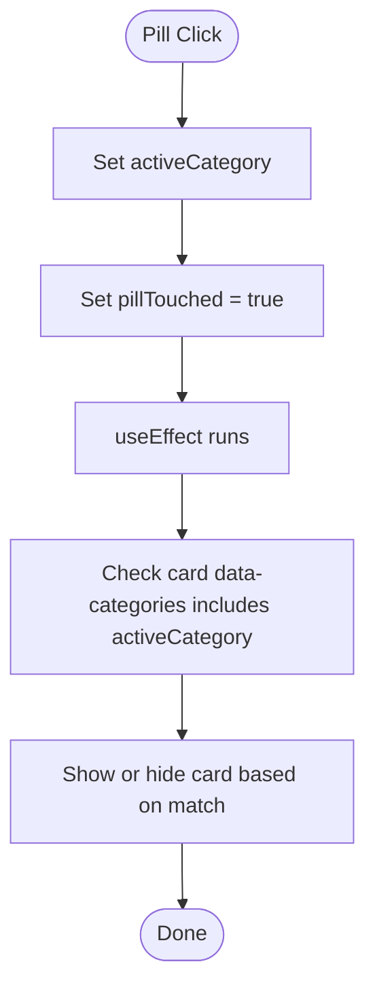
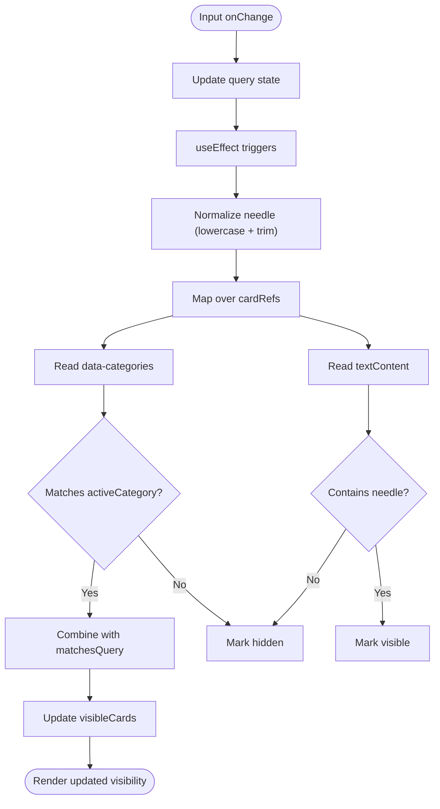
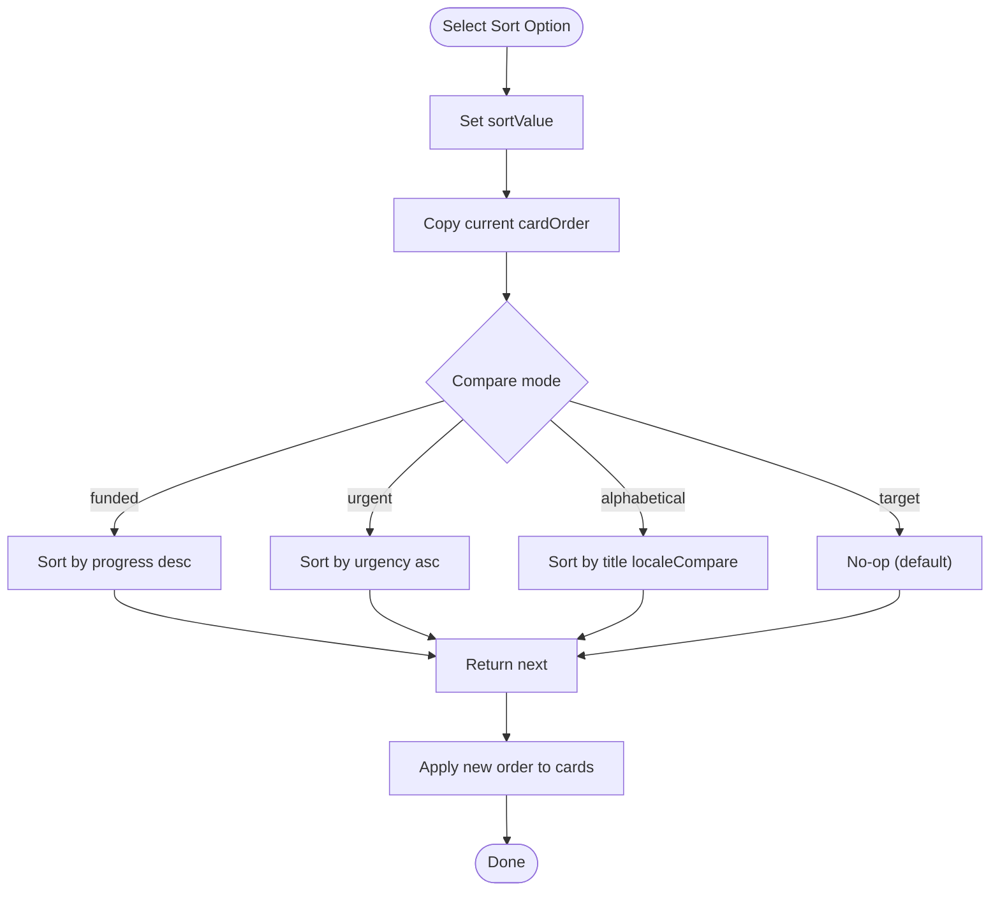
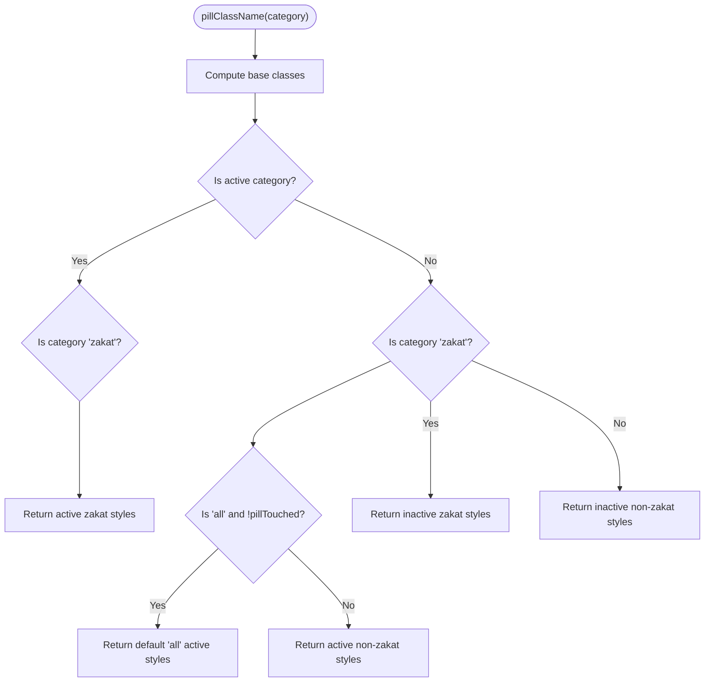
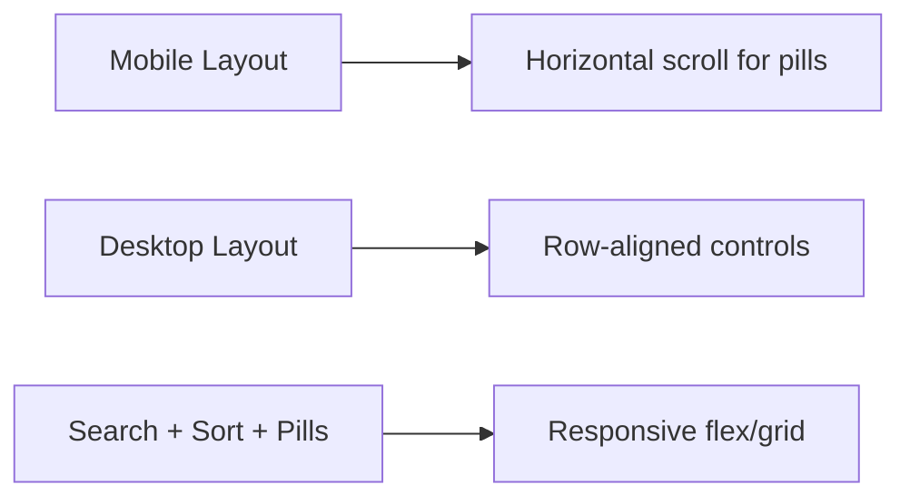
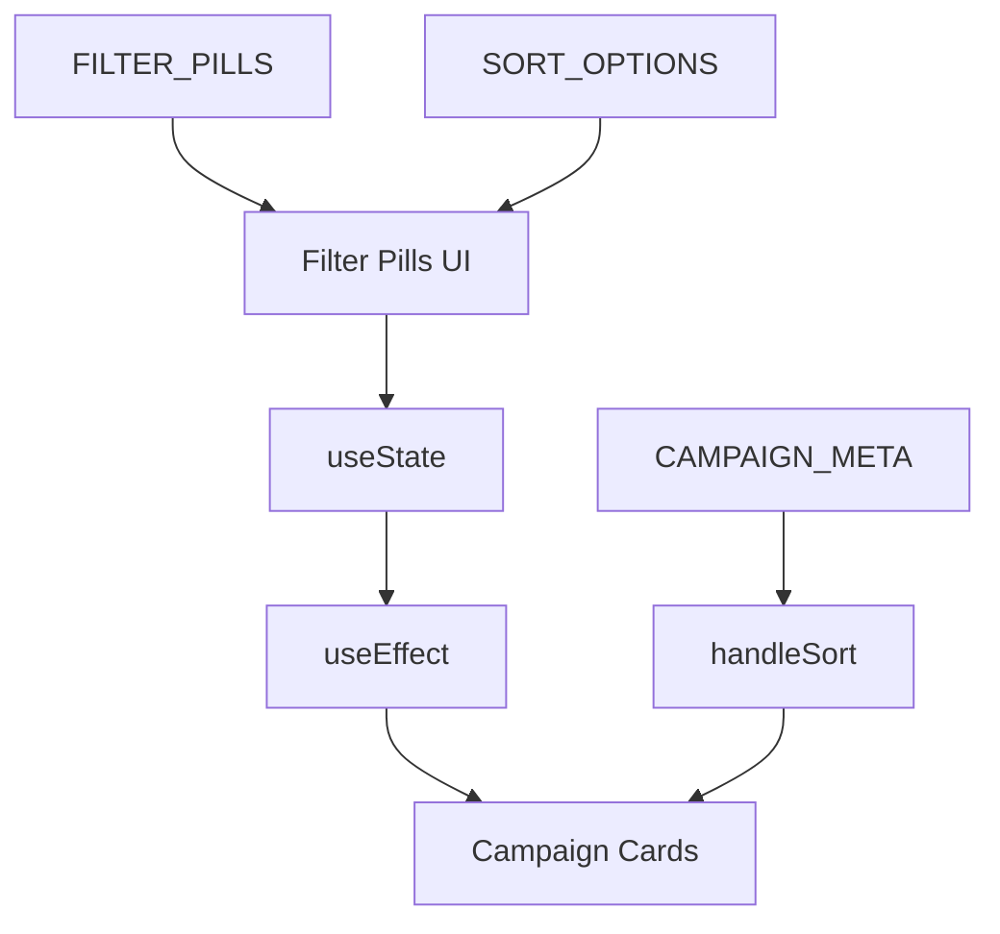

# Campaign Filtering & Search System

<cite>
**Referenced Files in This Document**
- [AppealsPage.tsx](file://components/pages/AppealsPage.tsx)
</cite>

## Table of Contents
1. [Introduction](#introduction)
2. [Project Structure](#project-structure)
3. [Core Components](#core-components)
4. [Architecture Overview](#architecture-overview)
5. [Detailed Component Analysis](#detailed-component-analysis)
6. [Dependency Analysis](#dependency-analysis)
7. [Performance Considerations](#performance-considerations)
8. [Troubleshooting Guide](#troubleshooting-guide)
9. [Conclusion](#conclusion)

## Introduction
This document explains the campaign filtering and search system implemented on the Appeals page. It covers:
- Category-based filtering using a configuration array of filter pills
- Live text search that filters campaigns by content and data attributes
- Sorting mechanisms for urgency, funding progress, target amount, and alphabetical order
- Dynamic pill styling logic
- Responsive interface behavior
- Accessibility considerations for screen readers and keyboard navigation

The implementation is contained within a single React component file.

## Project Structure
The filtering and search functionality lives in the Appeals page component. The relevant parts include:
- A configuration array defining filter categories and labels
- A configuration array defining sort options
- State variables for query, active category, sort value, card ordering, and visibility
- A useEffect hook that computes visibility based on search query and selected category
- A sorting function that reorders campaign cards
- A dynamic class name generator for filter pills
- UI elements for search input, sort dropdown, and filter pills
- Campaign cards with data attributes used for filtering and sorting

**Diagram sources**
- [AppealsPage.tsx:6-20](file://components/pages/AppealsPage.tsx#L6-L20)
- [AppealsPage.tsx:63-78](file://components/pages/AppealsPage.tsx#L63-L78)
- [AppealsPage.tsx:79-93](file://components/pages/AppealsPage.tsx#L79-L93)
- [AppealsPage.tsx:95-113](file://components/pages/AppealsPage.tsx#L95-L113)
- [AppealsPage.tsx:115-134](file://components/pages/AppealsPage.tsx#L115-L134)
- [AppealsPage.tsx:314-374](file://components/pages/AppealsPage.tsx#L314-L374)
- [AppealsPage.tsx:380-1121](file://components/pages/AppealsPage.tsx#L380-L1121)

**Section sources**
- [AppealsPage.tsx:6-20](file://components/pages/AppealsPage.tsx#L6-L20)
- [AppealsPage.tsx:63-78](file://components/pages/AppealsPage.tsx#L63-L78)
- [AppealsPage.tsx:314-374](file://components/pages/AppealsPage.tsx#L314-L374)
- [AppealsPage.tsx:380-1121](file://components/pages/AppealsPage.tsx#L380-L1121)

## Core Components
- FILTER_PILLS: Defines available category filters including “all”, “food”, “medical”, “water”, “winter”, and “zakat”. Each entry has a category key and a user-facing label.
- SORT_OPTIONS: Defines sorting choices: “urgent”, “funded”, “target”, and “alphabetical”.
- CAMPAIGN_META: Metadata used by sorting logic (categories, progress percentage, urgency level, title).
- State variables:
  - query: live search text
  - activeCategory: currently selected filter category
  - pillTouched: tracks whether a pill has been interacted with to adjust default styling
  - sortValue: current sort option
  - cardOrder: index permutation controlling visual order
  - visibleCards: boolean array indicating which cards are visible after filtering
- Functions:
  - useEffect: recomputes visibility when query or activeCategory changes
  - handleSort: updates sort state and reorders cards
  - pillClassName: returns Tailwind classes for each filter pill based on selection and category

**Section sources**
- [AppealsPage.tsx:6-20](file://components/pages/AppealsPage.tsx#L6-L20)
- [AppealsPage.tsx:24-61](file://components/pages/AppealsPage.tsx#L24-L61)
- [AppealsPage.tsx:63-78](file://components/pages/AppealsPage.tsx#L63-L78)
- [AppealsPage.tsx:79-134](file://components/pages/AppealsPage.tsx#L79-L134)

## Architecture Overview
The filtering and search flow combines client-side state and DOM data attributes:

**Diagram sources**
- [AppealsPage.tsx:79-93](file://components/pages/AppealsPage.tsx#L79-L93)
- [AppealsPage.tsx:95-113](file://components/pages/AppealsPage.tsx#L95-L113)
- [AppealsPage.tsx:314-374](file://components/pages/AppealsPage.tsx#L314-L374)
- [AppealsPage.tsx:380-1121](file://components/pages/AppealsPage.tsx#L380-L1121)

## Detailed Component Analysis

### Category-Based Filtering with FILTER_PILLS
- FILTER_PILLS defines six categories:
  - all: shows all campaigns
  - food: filters campaigns tagged with “food”
  - medical: filters campaigns tagged with “medical”
  - water: filters campaigns tagged with “water”
  - winter: filters campaigns tagged with “winter”
  - zakat: filters campaigns tagged with “zakat”
- Each pill renders a button with a data-category attribute matching its category key.
- When a pill is clicked, the component sets activeCategory and marks pillTouched true to influence default styling.

**Diagram sources**
- [AppealsPage.tsx:6-13](file://components/pages/AppealsPage.tsx#L6-L13)
- [AppealsPage.tsx:359-373](file://components/pages/AppealsPage.tsx#L359-L373)
- [AppealsPage.tsx:79-93](file://components/pages/AppealsPage.tsx#L79-L93)

**Section sources**
- [AppealsPage.tsx:6-13](file://components/pages/AppealsPage.tsx#L6-L13)
- [AppealsPage.tsx:359-373](file://components/pages/AppealsPage.tsx#L359-L373)
- [AppealsPage.tsx:79-93](file://components/pages/AppealsPage.tsx#L79-L93)

### Live Search Implementation
- The search input binds to the query state variable.
- On every change, useEffect recalculates visibility:
  - Normalizes the query to lowercase and trims whitespace
  - For each card:
    - Reads data-categories from the card element
    - Reads textContent from the card element and lowercases it
    - Checks if the card’s categories include the activeCategory (or if activeCategory is “all”)
    - Checks if the card’s text contains the normalized query (or if query is empty)
  - Updates visibleCards accordingly

**Diagram sources**
- [AppealsPage.tsx:320-332](file://components/pages/AppealsPage.tsx#L320-L332)
- [AppealsPage.tsx:79-93](file://components/pages/AppealsPage.tsx#L79-L93)

**Section sources**
- [AppealsPage.tsx:320-332](file://components/pages/AppealsPage.tsx#L320-L332)
- [AppealsPage.tsx:79-93](file://components/pages/AppealsPage.tsx#L79-L93)

### Sorting Mechanisms
- SORT_OPTIONS provides four sort modes:
  - urgent: sorts by ascending urgency number (lower numbers first)
  - funded: sorts by descending funding progress
  - target: included as an option; current comparator does not implement a distinct rule beyond returning no-op
  - alphabetical: sorts by title using locale comparison
- handleSort updates sortValue and reorders cardOrder:
  - Creates a copy of the current index array
  - Sorts indices based on CAMPAIGN_META values
  - Applies new order via inline style on each card

**Diagram sources**
- [AppealsPage.tsx:15-20](file://components/pages/AppealsPage.tsx#L15-L20)
- [AppealsPage.tsx:95-113](file://components/pages/AppealsPage.tsx#L95-L113)
- [AppealsPage.tsx:341-352](file://components/pages/AppealsPage.tsx#L341-L352)
- [AppealsPage.tsx:380-1121](file://components/pages/AppealsPage.tsx#L380-L1121)

**Section sources**
- [AppealsPage.tsx:15-20](file://components/pages/AppealsPage.tsx#L15-L20)
- [AppealsPage.tsx:95-113](file://components/pages/AppealsPage.tsx#L95-L113)
- [AppealsPage.tsx:341-352](file://components/pages/AppealsPage.tsx#L341-L352)
- [AppealsPage.tsx:380-1121](file://components/pages/AppealsPage.tsx#L380-L1121)

### Dynamic Pill Styling with pillClassName
- pillClassName returns Tailwind class strings based on:
  - Whether the pill is the active category
  - Whether the category is “zakat”
  - Whether the active category is “all” and the user has not yet touched any pill
- Active states use high-contrast colors; inactive states use subtle backgrounds with hover effects.

**Diagram sources**
- [AppealsPage.tsx:115-134](file://components/pages/AppealsPage.tsx#L115-L134)
- [AppealsPage.tsx:359-373](file://components/pages/AppealsPage.tsx#L359-L373)

**Section sources**
- [AppealsPage.tsx:115-134](file://components/pages/AppealsPage.tsx#L115-L134)
- [AppealsPage.tsx:359-373](file://components/pages/AppealsPage.tsx#L359-L373)

### Responsive Filter Pills Interface
- The filter pills container uses horizontal scrolling with overflow-x-auto and hides scrollbars via a utility class.
- On small screens, pills wrap or scroll horizontally; on larger screens, they align in a row.
- The entire control bar stacks vertically on narrow viewports and switches to a row layout on medium and larger screens.

**Diagram sources**
- [AppealsPage.tsx:314-374](file://components/pages/AppealsPage.tsx#L314-L374)

**Section sources**
- [AppealsPage.tsx:314-374](file://components/pages/AppealsPage.tsx#L314-L374)

### Accessibility Considerations
- Screen reader support:
  - Buttons for filter pills provide accessible names via their text content.
  - The search input has a descriptive placeholder and an icon indicating purpose.
  - The sort dropdown exposes labeled options.
- Keyboard navigation:
  - Standard focus order follows DOM order; users can tab through inputs, buttons, and select elements.
  - No custom key handlers are present; native browser behavior applies.
- Recommendations:
  - Add aria-label or aria-describedby where helpful (e.g., “Filter campaigns by category”).
  - Announce results count changes to assistive technologies when filtering changes.
  - Ensure color contrast meets WCAG guidelines for active/inactive pill states.

[No sources needed since this section provides general guidance]

## Dependency Analysis
The filtering and search system depends on:
- Configuration arrays for categories and sort options
- React hooks for state and side effects
- DOM data attributes on campaign cards for filtering
- Inline styles for card ordering

**Diagram sources**
- [AppealsPage.tsx:6-20](file://components/pages/AppealsPage.tsx#L6-L20)
- [AppealsPage.tsx:24-61](file://components/pages/AppealsPage.tsx#L24-L61)
- [AppealsPage.tsx:63-78](file://components/pages/AppealsPage.tsx#L63-L78)
- [AppealsPage.tsx:79-113](file://components/pages/AppealsPage.tsx#L79-L113)
- [AppealsPage.tsx:380-1121](file://components/pages/AppealsPage.tsx#L380-L1121)

**Section sources**
- [AppealsPage.tsx:6-20](file://components/pages/AppealsPage.tsx#L6-L20)
- [AppealsPage.tsx:24-61](file://components/pages/AppealsPage.tsx#L24-L61)
- [AppealsPage.tsx:63-78](file://components/pages/AppealsPage.tsx#L63-L78)
- [AppealsPage.tsx:79-113](file://components/pages/AppealsPage.tsx#L79-L113)
- [AppealsPage.tsx:380-1121](file://components/pages/AppealsPage.tsx#L380-L1121)

## Performance Considerations
- Filtering runs on every change to query or activeCategory. With a small fixed set of cards, this is efficient.
- Text matching uses simple substring checks; consider debouncing the search input if the dataset grows.
- Sorting creates a new array and sorts indices; ensure stable comparisons for large datasets.
- Avoid unnecessary re-renders by keeping state minimal and memoizing derived values if needed.

[No sources needed since this section provides general guidance]

## Troubleshooting Guide
- If filtering does not update:
  - Verify that each campaign card has a correct data-categories attribute.
  - Confirm that activeCategory matches one of the expected values.
  - Check that useEffect dependencies include both query and activeCategory.
- If search does not match content:
  - Ensure textContent is being read from the card element.
  - Confirm normalization steps (lowercase and trim) are applied consistently.
- If sorting appears incorrect:
  - Validate CAMPAIGN_META values for progress and urgency.
  - Confirm handleSort comparator logic for the chosen sort mode.
- If pill styles look wrong:
  - Check pillClassName conditions for activeCategory, zakat, and pillTouched.
  - Ensure Tailwind classes referenced exist in the project’s theme.

**Section sources**
- [AppealsPage.tsx:79-93](file://components/pages/AppealsPage.tsx#L79-L93)
- [AppealsPage.tsx:95-113](file://components/pages/AppealsPage.tsx#L95-L113)
- [AppealsPage.tsx:115-134](file://components/pages/AppealsPage.tsx#L115-L134)
- [AppealsPage.tsx:380-1121](file://components/pages/AppealsPage.tsx#L380-L1121)

## Conclusion
The Appeals page implements a robust, client-side campaign filtering and search system. It combines:
- A clear category-based filter model defined by FILTER_PILLS
- Live search against campaign text and data attributes
- Multiple sorting strategies for urgency, funding, and alphabetical order
- Dynamic pill styling for intuitive feedback
- A responsive layout suitable for mobile and desktop

This design keeps the codebase simple while providing powerful filtering and discovery features for donors navigating humanitarian campaigns.