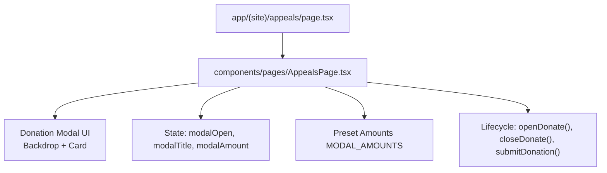
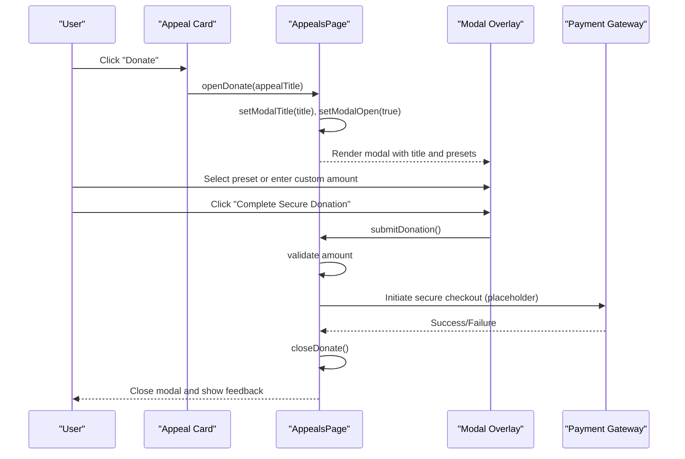
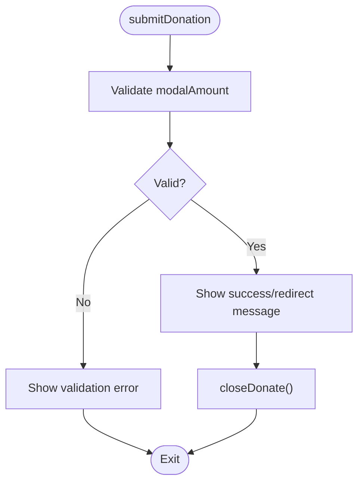
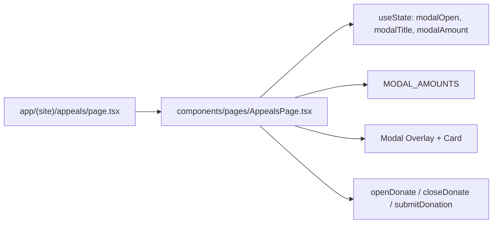

# Integrated Donation Modal System

<cite>
**Referenced Files in This Document**
- [page.tsx](file://app/(site)/appeals/page.tsx)
- [AppealsPage.tsx](file://components/pages/AppealsPage.tsx)
- [CampaignDetailsPage.tsx](file://components/pages/CampaignDetailsPage.tsx)
</cite>

## Table of Contents
1. [Introduction](#introduction)
2. [Project Structure](#project-structure)
3. [Core Components](#core-components)
4. [Architecture Overview](#architecture-overview)
5. [Detailed Component Analysis](#detailed-component-analysis)
6. [Dependency Analysis](#dependency-analysis)
7. [Performance Considerations](#performance-considerations)
8. [Troubleshooting Guide](#troubleshooting-guide)
9. [Conclusion](#conclusion)

## Introduction
This document explains the integrated donation modal embedded within the appeals page. It covers state management using React useState hooks, preset amount selection, custom input validation, modal lifecycle functions (openDonate, closeDonate, submitDonation), UI structure with backdrop blur and focus management, keyboard navigation considerations, Zakat certification messaging, payment processing integration points, error handling strategies, responsive design, and mobile touch interactions.

## Project Structure
The donations flow is implemented as a Next.js app shell that renders a reusable page component:
- The route file for the appeals page renders the main component.
- The main component implements the donation modal logic and UI.

**Diagram sources**
- [page.tsx:1-14](file://app/(site)/appeals/page.tsx#L1-L14)
- [AppealsPage.tsx:70-152](file://components/pages/AppealsPage.tsx#L70-L152)
- [AppealsPage.tsx:160-251](file://components/pages/AppealsPage.tsx#L160-L251)

**Section sources**
- [page.tsx:1-14](file://app/(site)/appeals/page.tsx#L1-L14)

## Core Components
- Modal state variables:
  - modalOpen: controls visibility of the modal overlay.
  - modalTitle: dynamic title reflecting the selected appeal.
  - modalAmount: current donation amount (preset or custom).
- Preset amounts:
  - MODAL_AMOUNTS array provides quick-select chips ($25, $50, $100, $250).
- Lifecycle functions:
  - openDonate(title): sets modalTitle and opens the modal.
  - closeDonate(): closes the modal.
  - submitDonation(): validates and submits the donation, then closes the modal.

Key implementation references:
- State declarations and constants: [AppealsPage.tsx:22-22](file://components/pages/AppealsPage.tsx#L22-L22), [AppealsPage.tsx:75-77](file://components/pages/AppealsPage.tsx#L75-L77)
- Lifecycle functions: [AppealsPage.tsx:136-152](file://components/pages/AppealsPage.tsx#L136-L152)
- Modal UI rendering: [AppealsPage.tsx:160-251](file://components/pages/AppealsPage.tsx#L160-L251)

**Section sources**
- [AppealsPage.tsx:22-22](file://components/pages/AppealsPage.tsx#L22-L22)
- [AppealsPage.tsx:75-77](file://components/pages/AppealsPage.tsx#L75-L77)
- [AppealsPage.tsx:136-152](file://components/pages/AppealsPage.tsx#L136-L152)
- [AppealsPage.tsx:160-251](file://components/pages/AppealsPage.tsx#L160-L251)

## Architecture Overview
The modal integrates into the appeals page as an overlay triggered by appeal cards. It uses controlled inputs for amount selection and a submit action that currently shows a confirmation alert and closes the modal.

**Diagram sources**
- [AppealsPage.tsx:136-152](file://components/pages/AppealsPage.tsx#L136-L152)
- [AppealsPage.tsx:160-251](file://components/pages/AppealsPage.tsx#L160-L251)

## Detailed Component Analysis

### Modal State Management
- Uses React useState for:
  - modalOpen: boolean to toggle overlay visibility.
  - modalTitle: string to reflect the active appeal.
  - modalAmount: string representing the selected or typed amount.
- Preset amounts are defined in a constant array and rendered as selectable chips.

References:
- State hooks: [AppealsPage.tsx:75-77](file://components/pages/AppealsPage.tsx#L75-L77)
- Presets array: [AppealsPage.tsx:22-22](file://components/pages/AppealsPage.tsx#L22-L22)

**Section sources**
- [AppealsPage.tsx:22-22](file://components/pages/AppealsPage.tsx#L22-L22)
- [AppealsPage.tsx:75-77](file://components/pages/AppealsPage.tsx#L75-L77)

### Preset Amount Selection and Custom Input Validation
- Preset chips iterate over MODAL_AMOUNTS and update modalAmount on click.
- Custom input is a number field bound to modalAmount; it should enforce positive values and reasonable limits.
- Current implementation binds the input value to modalAmount and updates via onChange.

References:
- Preset chip rendering and selection: [AppealsPage.tsx:196-210](file://components/pages/AppealsPage.tsx#L196-L210)
- Custom input binding: [AppealsPage.tsx:225-225](file://components/pages/AppealsPage.tsx#L225-L225)

Validation recommendations:
- Enforce minimum and maximum bounds.
- Strip non-numeric characters.
- Prevent negative or zero values.
- Provide inline error messages when invalid.

**Section sources**
- [AppealsPage.tsx:196-210](file://components/pages/AppealsPage.tsx#L196-L210)
- [AppealsPage.tsx:225-225](file://components/pages/AppealsPage.tsx#L225-L225)

### Modal Lifecycle Functions
- openDonate(title):
  - Sets modalTitle to the provided appeal name.
  - Opens the modal by setting modalOpen to true.
- closeDonate():
  - Closes the modal by setting modalOpen to false.
- submitDonation():
  - Validates modalAmount.
  - Shows a confirmation message indicating redirect to a secure checkout.
  - Closes the modal.

References:
- openDonate: [AppealsPage.tsx:136-139](file://components/pages/AppealsPage.tsx#L136-L139)
- closeDonate: [AppealsPage.tsx:141-143](file://components/pages/AppealsPage.tsx#L141-L143)
- submitDonation: [AppealsPage.tsx:145-152](file://components/pages/AppealsPage.tsx#L145-L152)

**Diagram sources**
- [AppealsPage.tsx:145-152](file://components/pages/AppealsPage.tsx#L145-L152)

**Section sources**
- [AppealsPage.tsx:136-152](file://components/pages/AppealsPage.tsx#L136-L152)

### Modal UI Structure, Backdrop Blur, Focus Management, and Keyboard Navigation
- Overlay:
  - Fixed full-screen container with conditional flex/hidden based on modalOpen.
  - Uses backdrop-blur and semi-transparent background to dim content behind.
  - Clicking outside the modal card closes it.
- Modal Card:
  - Header includes appeal icon, title, and close button.
  - Body contains preset amount grid and custom input.
  - Footer has a primary submit button.
- Accessibility:
  - Ensure focus moves into the modal when opened and returns to trigger element on close.
  - Trap focus inside the modal while open.
  - Support Escape key to close.
  - Use aria attributes (aria-modal, role="dialog", aria-labelledby) for screen readers.

References:
- Overlay and backdrop: [AppealsPage.tsx:160-168](file://components/pages/AppealsPage.tsx#L160-L168)
- Header and close button: [AppealsPage.tsx:170-189](file://components/pages/AppealsPage.tsx#L170-L189)
- Submit button: [AppealsPage.tsx:240-249](file://components/pages/AppealsPage.tsx#L240-L249)

**Section sources**
- [AppealsPage.tsx:160-189](file://components/pages/AppealsPage.tsx#L160-L189)
- [AppealsPage.tsx:240-249](file://components/pages/AppealsPage.tsx#L240-L249)

### Zakat Certification Messaging
- The appeals page metadata references Zakat-eligible funds.
- For explicit Zakat designation during donation, follow the pattern used in the campaign details page where a Zakat flag toggles a Shariah-compliant note.

References:
- Appeals metadata mentioning Zakat eligibility: [page.tsx:5-9](file://app/(site)/appeals/page.tsx#L5-L9)
- Zakat messaging pattern in campaign details: [CampaignDetailsPage.tsx:42-52](file://components/pages/CampaignDetailsPage.tsx#L42-L52)

Recommendation:
- Add a Zakat toggle in the modal to label donations as 100% Shariah Zakat when applicable, mirroring the campaign details approach.

**Section sources**
- [page.tsx:5-9](file://app/(site)/appeals/page.tsx#L5-L9)
- [CampaignDetailsPage.tsx:42-52](file://components/pages/CampaignDetailsPage.tsx#L42-L52)

### Payment Processing Integration Points
- Current behavior:
  - submitDonation shows an alert confirming redirect to a secure checkout.
- Integration plan:
  - Replace alert with a call to a payment service (e.g., Stripe Checkout, Razorpay, bank gateway).
  - Handle success and failure states, updating UI accordingly.
  - Persist donation intent and transaction IDs for auditability.

References:
- Placeholder submission: [AppealsPage.tsx:145-152](file://components/pages/AppealsPage.tsx#L145-L152)
- Campaign details example of payment initiation messaging: [CampaignDetailsPage.tsx:42-52](file://components/pages/CampaignDetailsPage.tsx#L42-L52)

**Section sources**
- [AppealsPage.tsx:145-152](file://components/pages/AppealsPage.tsx#L145-L152)
- [CampaignDetailsPage.tsx:42-52](file://components/pages/CampaignDetailsPage.tsx#L42-L52)

### Error Handling Strategies
- Client-side validation:
  - Reject empty, non-numeric, zero, or negative amounts.
  - Enforce min/max thresholds.
- Server-side validation:
  - Validate amount and currency before creating a payment intent.
- User feedback:
  - Inline errors near the input.
  - Toast or banner for network/payment failures.
- Recovery:
  - Allow retry without losing user selections.
  - Preserve modal state across retries.

[No sources needed since this section provides general guidance]

### Responsive Design and Mobile Touch Interactions
- Grid layout for preset amounts adapts to small screens.
- Modal card scales down with max-width and padding adjustments.
- Touch-friendly targets:
  - Ensure buttons and inputs have adequate tap sizes.
  - Avoid hover-only interactions; provide active/focus states.
- Gestures:
  - Swipe-down to dismiss is optional; ensure Escape and outside-click remain supported.

References:
- Preset grid: [AppealsPage.tsx:195-211](file://components/pages/AppealsPage.tsx#L195-L211)
- Modal container styling: [AppealsPage.tsx:160-169](file://components/pages/AppealsPage.tsx#L160-L169)

**Section sources**
- [AppealsPage.tsx:195-211](file://components/pages/AppealsPage.tsx#L195-L211)
- [AppealsPage.tsx:160-169](file://components/pages/AppealsPage.tsx#L160-L169)

## Dependency Analysis
The appeals route depends on the page component, which encapsulates all modal logic and UI.

**Diagram sources**
- [page.tsx:1-14](file://app/(site)/appeals/page.tsx#L1-L14)
- [AppealsPage.tsx:22-22](file://components/pages/AppealsPage.tsx#L22-L22)
- [AppealsPage.tsx:75-77](file://components/pages/AppealsPage.tsx#L75-L77)
- [AppealsPage.tsx:136-152](file://components/pages/AppealsPage.tsx#L136-L152)
- [AppealsPage.tsx:160-251](file://components/pages/AppealsPage.tsx#L160-L251)

**Section sources**
- [page.tsx:1-14](file://app/(site)/appeals/page.tsx#L1-L14)
- [AppealsPage.tsx:22-22](file://components/pages/AppealsPage.tsx#L22-L22)
- [AppealsPage.tsx:75-77](file://components/pages/AppealsPage.tsx#L75-L77)
- [AppealsPage.tsx:136-152](file://components/pages/AppealsPage.tsx#L136-L152)
- [AppealsPage.tsx:160-251](file://components/pages/AppealsPage.tsx#L160-L251)

## Performance Considerations
- Keep modal state minimal and co-locate related logic to reduce re-renders.
- Memoize static arrays like MODAL_AMOUNTS at module scope (already done).
- Debounce custom input changes if performing real-time validation or API calls.
- Avoid heavy computations inside render; precompute derived values.

[No sources needed since this section provides general guidance]

## Troubleshooting Guide
Common issues and resolutions:
- Modal does not close on outside click:
  - Verify onClick handler checks event.target vs event.currentTarget.
  - Reference: [AppealsPage.tsx:165-167](file://components/pages/AppealsPage.tsx#L165-L167)
- Preset selection not updating input:
  - Ensure setModalAmount is called and input value is bound to modalAmount.
  - References: [AppealsPage.tsx:206-206](file://components/pages/AppealsPage.tsx#L206-L206), [AppealsPage.tsx:225-225](file://components/pages/AppealsPage.tsx#L225-L225)
- Submit triggers but no feedback:
  - Check submitDonation implementation and replace placeholder alert with proper UX.
  - Reference: [AppealsPage.tsx:145-152](file://components/pages/AppealsPage.tsx#L145-L152)
- Zakat labeling missing:
  - Add a Zakat toggle and display Shariah-compliant messaging similar to campaign details.
  - Reference: [CampaignDetailsPage.tsx:42-52](file://components/pages/CampaignDetailsPage.tsx#L42-L52)

**Section sources**
- [AppealsPage.tsx:165-167](file://components/pages/AppealsPage.tsx#L165-L167)
- [AppealsPage.tsx:206-206](file://components/pages/AppealsPage.tsx#L206-L206)
- [AppealsPage.tsx:225-225](file://components/pages/AppealsPage.tsx#L225-L225)
- [AppealsPage.tsx:145-152](file://components/pages/AppealsPage.tsx#L145-L152)
- [CampaignDetailsPage.tsx:42-52](file://components/pages/CampaignDetailsPage.tsx#L42-L52)

## Conclusion
The integrated donation modal on the appeals page provides a clear, accessible interface for selecting preset or custom donation amounts, with a straightforward lifecycle for opening, closing, and submitting donations. To productionize, implement robust client and server validation, integrate a secure payment provider, add Zakat designation support, and enhance accessibility with focus trapping and keyboard navigation. These improvements will deliver a reliable, inclusive, and compliant donation experience.