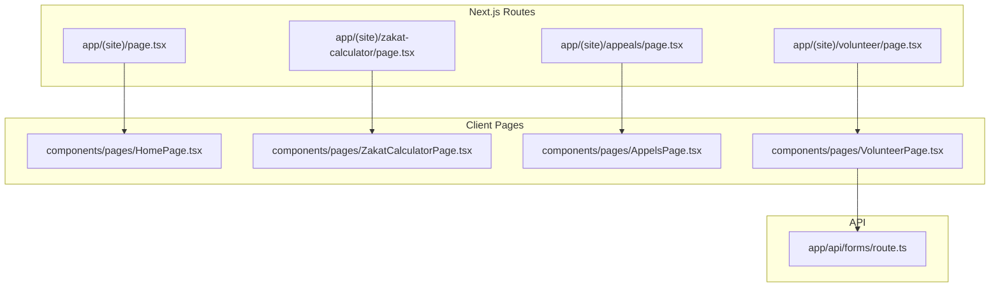
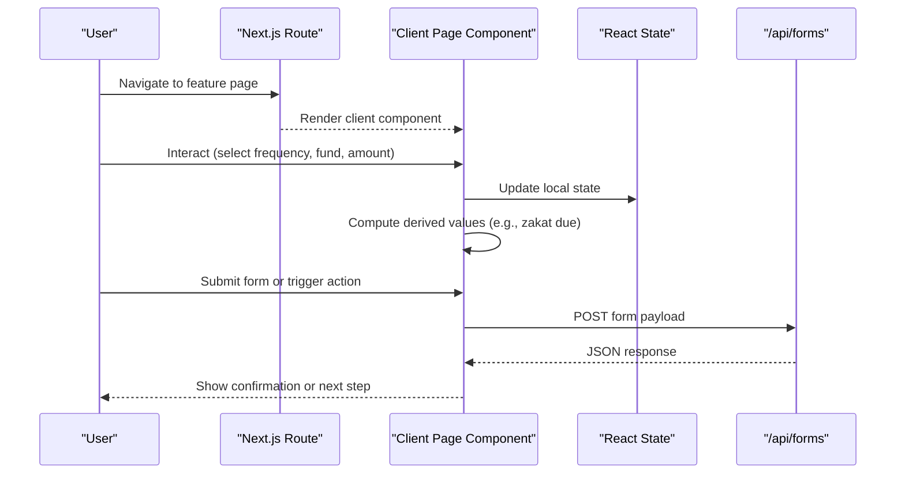
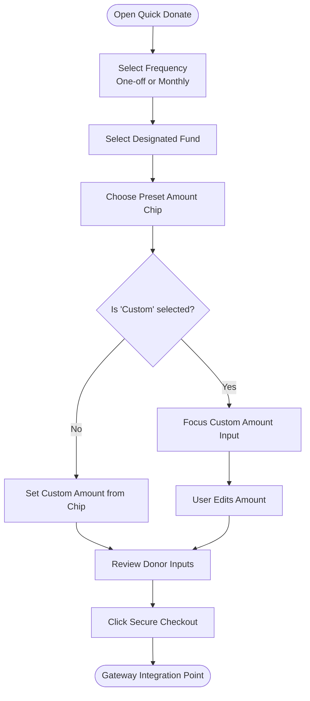
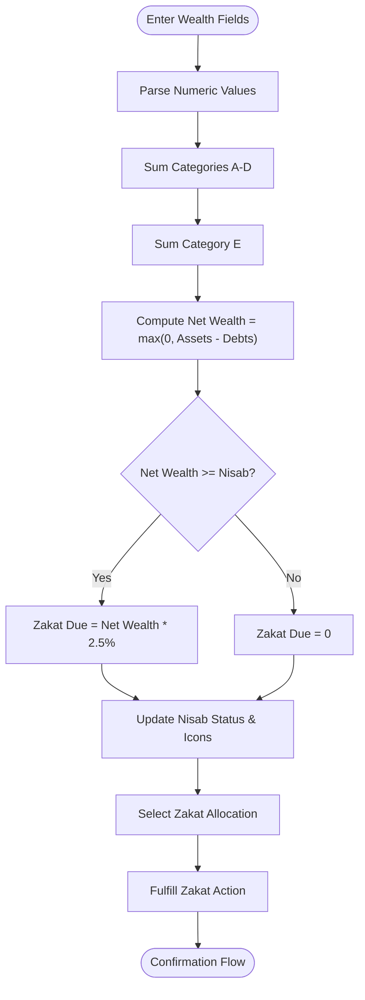
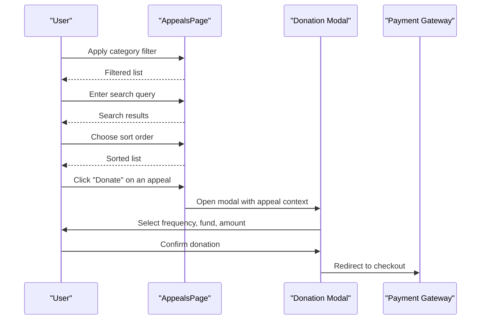
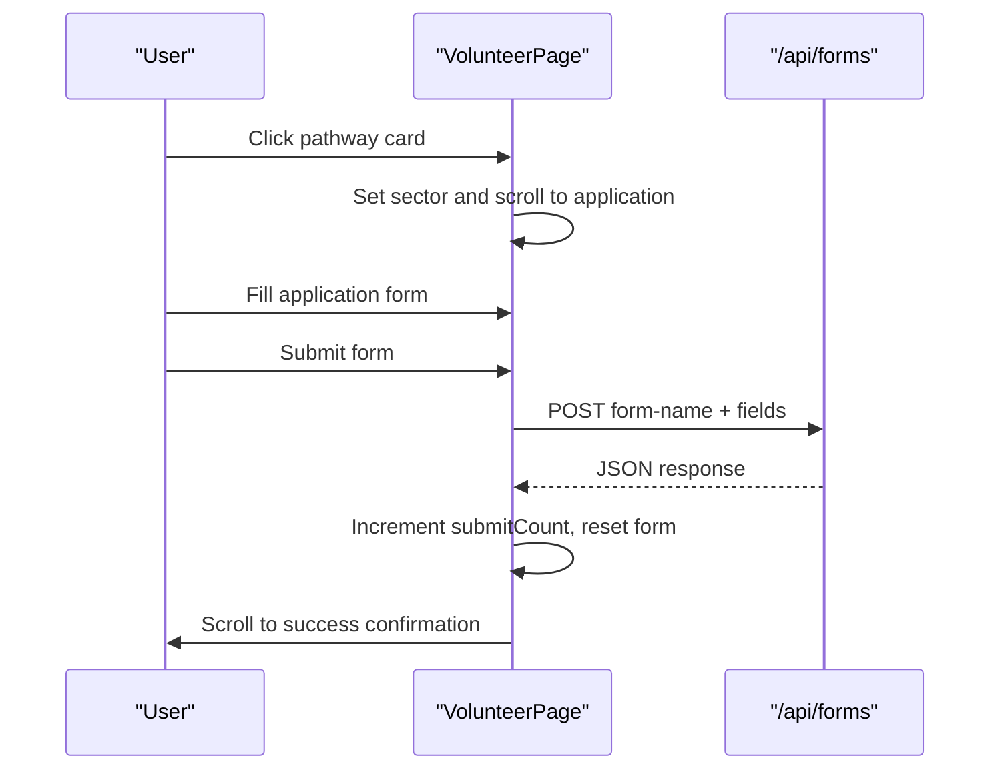
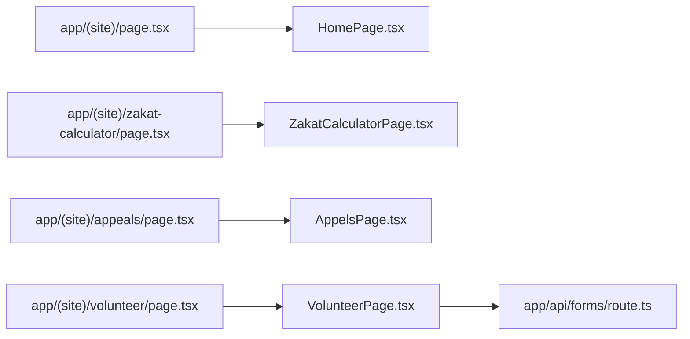

# Core Features

<cite>
**Referenced Files in This Document**
- [README.md](file://README.md)
- [app/(site)/page.tsx](file://app/(site)/page.tsx)
- [components/pages/HomePage.tsx](file://components/pages/HomePage.tsx)
- [app/(site)/zakat-calculator/page.tsx](file://app/(site)/zakat-calculator/page.tsx)
- [components/pages/ZakatCalculatorPage.tsx](file://components/pages/ZakatCalculatorPage.tsx)
- [app/(site)/appeals/page.tsx](file://app/(site)/appeals/page.tsx)
- [components/pages/AppelsPage.tsx](file://components/pages/AppelsPage.tsx)
- [app/(site)/volunteer/page.tsx](file://app/(site)/volunteer/page.tsx)
- [components/pages/VolunteerPage.tsx](file://components/pages/VolunteerPage.tsx)
- [app/api/forms/route.ts](file://app/api/forms/route.ts)
</cite>

## Table of Contents
1. [Introduction](#introduction)
2. [Project Structure](#project-structure)
3. [Core Components](#core-components)
4. [Architecture Overview](#architecture-overview)
5. [Detailed Component Analysis](#detailed-component-analysis)
6. [Dependency Analysis](#dependency-analysis)
7. [Performance Considerations](#performance-considerations)
8. [Troubleshooting Guide](#troubleshooting-guide)
9. [Conclusion](#conclusion)

## Introduction
This document explains the core interactive features of the GMCF charity portal: a unified donation system, a Shariah-compliant Zakat calculator, an appeals and emergency causes interface, and a volunteer application portal. It focuses on state management, user interaction patterns, data flow, and integration points with external services. The documentation is written for both technical and non-technical readers and includes concrete references to the actual codebase.

## Project Structure
The portal is built with Next.js App Router and TypeScript. Interactive pages are client components under `components/pages`, while route wrappers live under `app/(site)`. A shared API endpoint handles form submissions.

**Diagram sources**
- [app/(site)/page.tsx:1-15](file://app/(site)/page.tsx#L1-L15)
- [app/(site)/zakat-calculator/page.tsx:1-15](file://app/(site)/zakat-calculator/page.tsx#L1-L15)
- [app/(site)/appeals/page.tsx:1-14](file://app/(site)/appeals/page.tsx#L1-L14)
- [app/(site)/volunteer/page.tsx:1-14](file://app/(site)/volunteer/page.tsx#L1-L14)
- [components/pages/HomePage.tsx:1-800](file://components/pages/HomePage.tsx#L1-L800)
- [components/pages/ZakatCalculatorPage.tsx:1-800](file://components/pages/ZakatCalculatorPage.tsx#L1-L800)
- [components/pages/AppelsPage.tsx:1-1166](file://components/pages/AppelsPage.tsx#L1-L1166)
- [components/pages/VolunteerPage.tsx:1-800](file://components/pages/VolunteerPage.tsx#L1-L800)
- [app/api/forms/route.ts:1-23](file://app/api/forms/route.ts#L1-L23)

**Section sources**
- [README.md:14-65](file://README.md#L14-L65)

## Core Components
- Unified Donation System (Home Page Quick Donate): Frequency toggle, fund selection, preset amount chips, custom amount input, donor quick inputs, and secure checkout CTA.
- Zakat Calculator: Ten-field wealth assessment matrix, Nisab threshold validation, real-time totals, allocation selector, and fulfillment action.
- Appeals & Emergency Causes: Category filtering, search, sorting, and integrated donation modal.
- Volunteer Portal: Pathway preselection, application form, success confirmation, and FAQ accordion.

**Section sources**
- [README.md:85-101](file://README.md#L85-L101)

## Architecture Overview
The interactive features follow a consistent pattern:
- Route wrapper files render page-level client components.
- Client components manage local React state for user interactions.
- Calculations run locally using `useState` and derived values.
- Form submissions use fire-and-forget POST requests to `/api/forms`.

**Diagram sources**
- [app/(site)/page.tsx:1-15](file://app/(site)/page.tsx#L1-L15)
- [app/(site)/zakat-calculator/page.tsx:1-15](file://app/(site)/zakat-calculator/page.tsx#L1-L15)
- [app/(site)/appeals/page.tsx:1-14](file://app/(site)/appeals/page.tsx#L1-L14)
- [app/(site)/volunteer/page.tsx:1-14](file://app/(site)/volunteer/page.tsx#L1-L14)
- [app/api/forms/route.ts:1-23](file://app/api/forms/route.ts#L1-L23)

## Detailed Component Analysis

### Unified Donation System (Home Page Quick Donate)
The home page implements a compact donation engine that supports:
- Gift frequency selection between one-time and monthly giving.
- Fund categorization via a dropdown with multiple designated funds.
- Preset amount chips including a custom amount option.
- Custom amount input with optional highlighting feedback.
- Optional donor quick inputs (name, email/phone).
- Secure checkout CTA referencing card, PayPal, and bKash.

State management highlights:
- Frequency state toggles UI and behavior.
- Fund state selects the designated cause.
- Amount choice state controls selected chip and syncs with custom input.
- Custom amount state holds the typed value and can be programmatically set by Zakat flow.
- Highlight flag provides brief visual feedback when Zakat auto-fills the amount.

Data flow and integration:
- Preset amounts are defined as a constant array with labels and layout hints.
- Nisab threshold and quick Zakat calculation are also present on the home page; if zakatable wealth exceeds the threshold, the flow sets the fund to Zakat, populates the custom amount, scrolls to the top, and highlights the amount field.
- The checkout button is a placeholder for payment gateway integration.

**Diagram sources**
- [components/pages/HomePage.tsx:6-12](file://components/pages/HomePage.tsx#L6-L12)
- [components/pages/HomePage.tsx:16-24](file://components/pages/HomePage.tsx#L16-L24)
- [components/pages/HomePage.tsx:49-58](file://components/pages/HomePage.tsx#L49-L58)
- [components/pages/HomePage.tsx:68-82](file://components/pages/HomePage.tsx#L68-L82)
- [components/pages/HomePage.tsx:264-390](file://components/pages/HomePage.tsx#L264-L390)

Implementation details and examples:
- Preset amounts and custom option are defined in a constant array used to render buttons.
- Frequency toggle updates state and changes active styling.
- Fund selection uses a controlled select element bound to state.
- Amount chips call a handler that either focuses the custom input or synchronizes the custom amount.
- Zakat “apply to donation” logic sets the fund to Zakat, rounds the calculated amount into the custom field, scrolls to the top, and briefly highlights the input.

**Section sources**
- [components/pages/HomePage.tsx:6-12](file://components/pages/HomePage.tsx#L6-L12)
- [components/pages/HomePage.tsx:16-24](file://components/pages/HomePage.tsx#L16-L24)
- [components/pages/HomePage.tsx:49-58](file://components/pages/HomePage.tsx#L49-L58)
- [components/pages/HomePage.tsx:68-82](file://components/pages/HomePage.tsx#L68-L82)
- [components/pages/HomePage.tsx:264-390](file://components/pages/HomePage.tsx#L264-L390)

### Shariah-Compliant Zakat Calculator
The Zakat calculator provides a comprehensive 10-field assessment matrix grouped into five categories:
- Liquid cash and bank balances.
- Gold, silver, and precious metals.
- Business inventory and stocks.
- Real estate for resale and rental income.
- Short-term liabilities and immediate debts.

Key behaviors:
- Each field update triggers recomputation of assets, debts, net wealth, and zakat due.
- Nisab threshold validation determines whether zakat is obligatory or optional.
- Status text and icon change based on whether the threshold is reached.
- Users can reset all fields and fulfill zakat through a dedicated action.
- An allocation selector allows directing zakat to specific causes.

Real-time calculation logic:
- Assets sum across categories A–D.
- Debts sum across category E.
- Net wealth is max(0, assets - debts).
- Zakat due is 2.5% of net wealth only if net wealth meets or exceeds the silver Nisab benchmark.

**Diagram sources**
- [components/pages/ZakatCalculatorPage.tsx:6-19](file://components/pages/ZakatCalculatorPage.tsx#L6-L19)
- [components/pages/ZakatCalculatorPage.tsx:21-34](file://components/pages/ZakatCalculatorPage.tsx#L21-L34)
- [components/pages/ZakatCalculatorPage.tsx:36-45](file://components/pages/ZakatCalculatorPage.tsx#L36-L45)
- [components/pages/ZakatCalculatorPage.tsx:47-67](file://components/pages/ZakatCalculatorPage.tsx#L47-L67)
- [components/pages/ZakatCalculatorPage.tsx:79-97](file://components/pages/ZakatCalculatorPage.tsx#L79-L97)
- [components/pages/ZakatCalculatorPage.tsx:659-794](file://components/pages/ZakatCalculatorPage.tsx#L659-L794)

Integration points:
- The “Fulfill Zakat Now” button currently shows a browser alert confirming transfer to the donation tray.
- The allocation selector offers predefined destinations such as crisis priority, pediatric surgery, urgent nourishment, widows’ support, and clean water.

**Section sources**
- [components/pages/ZakatCalculatorPage.tsx:6-19](file://components/pages/ZakatCalculatorPage.tsx#L6-L19)
- [components/pages/ZakatCalculatorPage.tsx:21-34](file://components/pages/ZakatCalculatorPage.tsx#L21-L34)
- [components/pages/ZakatCalculatorPage.tsx:36-45](file://components/pages/ZakatCalculatorPage.tsx#L36-L45)
- [components/pages/ZakatCalculatorPage.tsx:47-67](file://components/pages/ZakatCalculatorPage.tsx#L47-L67)
- [components/pages/ZakatCalculatorPage.tsx:79-97](file://components/pages/ZakatCalculatorPage.tsx#L79-L97)
- [components/pages/ZakatCalculatorPage.tsx:659-794](file://components/pages/ZakatCalculatorPage.tsx#L659-L794)

### Appeals and Emergency Causes
The appeals page provides:
- Category filtering via pills.
- Live search functionality.
- Sorting capabilities.
- Integrated donation modal with preset amount chips.

Interaction model:
- Filtering narrows the displayed appeals by category.
- Search filters by keyword against appeal titles and descriptions.
- Sorting reorders results by criteria such as urgency or funding progress.
- Selecting an appeal opens a donation modal where users choose frequency, fund, and amount before proceeding to checkout.

**Diagram sources**
- [app/(site)/appeals/page.tsx:1-14](file://app/(site)/appeals/page.tsx#L1-L14)
- [components/pages/AppelsPage.tsx:1-1166](file://components/pages/AppelsPage.tsx#L1-L1166)

Note: The route wrapper imports `AppealsPage`, while the file name in this repository is `AppelsPage.tsx`. The implementation contains the filtering, search, sorting, and modal logic referenced above.

**Section sources**
- [app/(site)/appeals/page.tsx:1-14](file://app/(site)/appeals/page.tsx#L1-L14)
- [components/pages/AppelsPage.tsx:1-1166](file://components/pages/AppelsPage.tsx#L1-L1166)

### Volunteer Portal
The volunteer portal supports:
- Pathway preselection among humanitarian sectors.
- Application form with personal details, contact information, age, district, and preferred sector.
- Success confirmation flow with smooth scroll to a confirmation area.
- FAQ accordion for common questions.

State management and interactions:
- Sector state tracks the selected pathway and is preselected by clicking pathway cards.
- On submit, the form serializes FormData into URLSearchParams and posts to the root path using a fire-and-forget request.
- After submission, the component increments a counter, resets the form, and scrolls to the success message.
- FAQ toggling manages open/closed states per item.

**Diagram sources**
- [components/pages/VolunteerPage.tsx:5-14](file://components/pages/VolunteerPage.tsx#L5-L14)
- [components/pages/VolunteerPage.tsx:16-38](file://components/pages/VolunteerPage.tsx#L16-L38)
- [components/pages/VolunteerPage.tsx:40-58](file://components/pages/VolunteerPage.tsx#L40-L58)
- [components/pages/VolunteerPage.tsx:60-62](file://components/pages/VolunteerPage.tsx#L60-L62)
- [components/pages/VolunteerPage.tsx:687-694](file://components/pages/VolunteerPage.tsx#L687-L694)
- [app/api/forms/route.ts:1-23](file://app/api/forms/route.ts#L1-L23)

Form contract:
- The API expects a `form-name` field and returns a simple JSON envelope indicating success or error.
- The volunteer form includes a hidden `form-name` field and submits via `fetch` to the root path.

**Section sources**
- [components/pages/VolunteerPage.tsx:5-14](file://components/pages/VolunteerPage.tsx#L5-L14)
- [components/pages/VolunteerPage.tsx:16-38](file://components/pages/VolunteerPage.tsx#L16-L38)
- [components/pages/VolunteerPage.tsx:40-58](file://components/pages/VolunteerPage.tsx#L40-L58)
- [components/pages/VolunteerPage.tsx:60-62](file://components/pages/VolunteerPage.tsx#L60-L62)
- [components/pages/VolunteerPage.tsx:687-694](file://components/pages/VolunteerPage.tsx#L687-L694)
- [app/api/forms/route.ts:1-23](file://app/api/forms/route.ts#L1-L23)

## Dependency Analysis
- Route wrappers depend on page-level client components.
- Client components manage their own state and perform local calculations.
- VolunteerPage depends on the forms API for submission handling.
- The README documents cross-page interlinking and interactive tools, aligning with the implemented features.

**Diagram sources**
- [app/(site)/page.tsx:1-15](file://app/(site)/page.tsx#L1-L15)
- [app/(site)/zakat-calculator/page.tsx:1-15](file://app/(site)/zakat-calculator/page.tsx#L1-L15)
- [app/(site)/appeals/page.tsx:1-14](file://app/(site)/appeals/page.tsx#L1-L14)
- [app/(site)/volunteer/page.tsx:1-14](file://app/(site)/volunteer/page.tsx#L1-L14)
- [components/pages/HomePage.tsx:1-800](file://components/pages/HomePage.tsx#L1-L800)
- [components/pages/ZakatCalculatorPage.tsx:1-800](file://components/pages/ZakatCalculatorPage.tsx#L1-L800)
- [components/pages/AppelsPage.tsx:1-1166](file://components/pages/AppelsPage.tsx#L1-L1166)
- [components/pages/VolunteerPage.tsx:1-800](file://components/pages/VolunteerPage.tsx#L1-L800)
- [app/api/forms/route.ts:1-23](file://app/api/forms/route.ts#L1-L23)

**Section sources**
- [README.md:78-101](file://README.md#L78-L101)

## Performance Considerations
- Local state updates keep calculations fast and avoid unnecessary server calls.
- Zakat computation runs on every field change; consider debouncing heavy computations if additional fields are added.
- The volunteer form uses fire-and-forget submission to avoid blocking the UI; ensure backend reliability and idempotency.
- Avoid excessive re-renders by memoizing derived values where appropriate.

[No sources needed since this section provides general guidance]

## Troubleshooting Guide
- Zakat below Nisab: When net wealth is below the threshold, the calculator indicates optional Sadaqah and disables obligatory zakat. Ensure asset entries are accurate and debts are correctly deducted.
- Zakat not applying to donation: Verify that the “Apply to donation” flow sets the fund to Zakat and populates the custom amount. Confirm the highlight feedback appears briefly.
- Volunteer form submission: If no confirmation appears, check that the form includes the hidden `form-name` field and that the API returns a successful JSON response. Inspect network logs for fetch errors.
- Appeals modal not opening: Confirm that the selected appeal triggers the modal and that preset amount chips are available inside the modal.

**Section sources**
- [components/pages/ZakatCalculatorPage.tsx:79-97](file://components/pages/ZakatCalculatorPage.tsx#L79-L97)
- [components/pages/VolunteerPage.tsx:40-58](file://components/pages/VolunteerPage.tsx#L40-L58)
- [app/api/forms/route.ts:1-23](file://app/api/forms/route.ts#L1-L23)

## Conclusion
The GMCF portal’s core features provide intuitive, state-driven experiences for donations, Zakat calculation, appeals discovery, and volunteer applications. The architecture emphasizes local state management, clear data flows, and minimal server dependencies, enabling responsive interactions and straightforward integrations with payment gateways and external systems.

[No sources needed since this section summarizes without analyzing specific files]