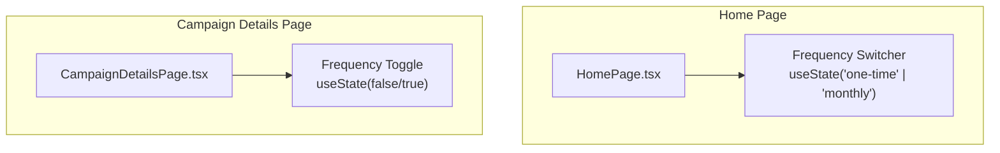
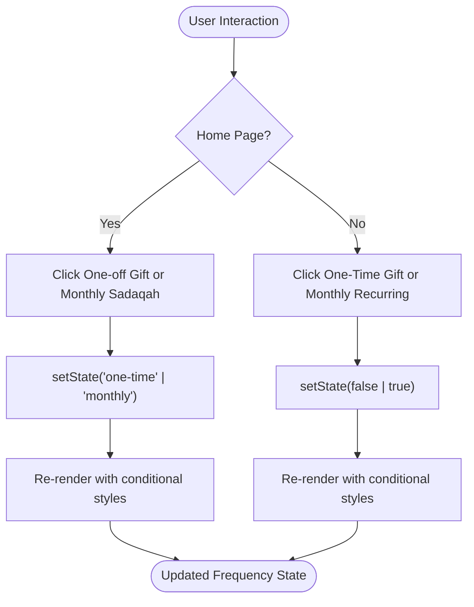
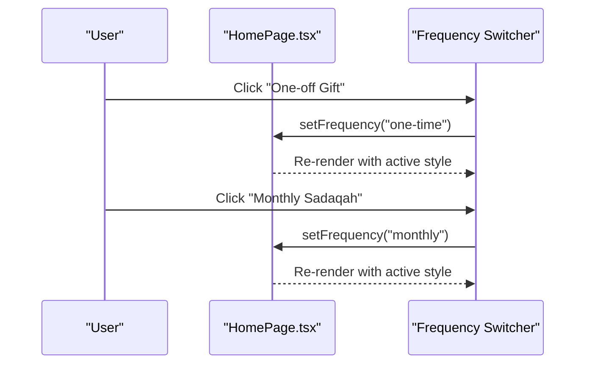
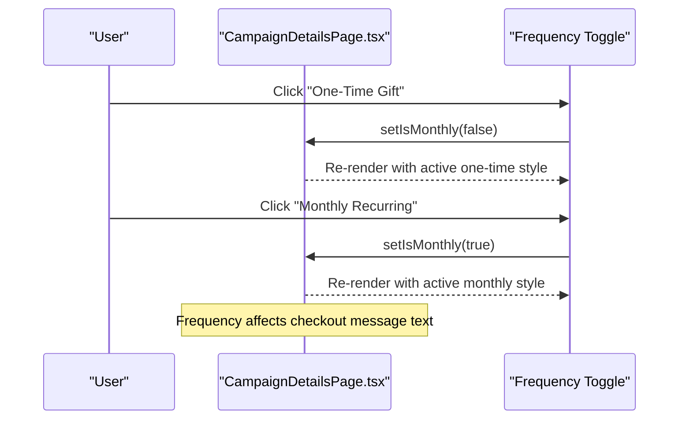
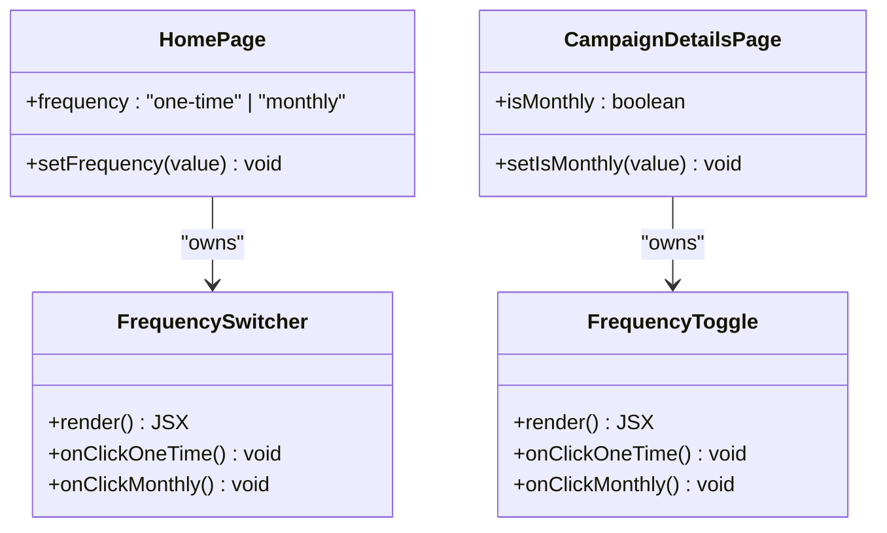
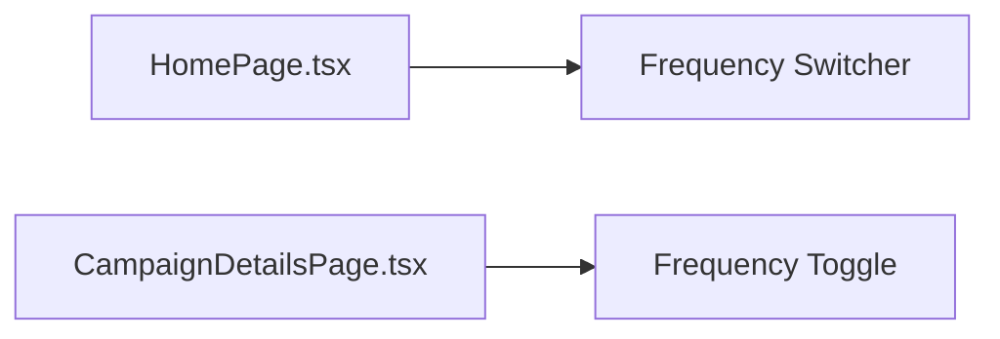

# Donation Frequency Selection

<cite>
**Referenced Files in This Document**
- [HomePage.tsx](file://components/pages/HomePage.tsx)
- [CampaignDetailsPage.tsx](file://components/pages/CampaignDetailsPage.tsx)
</cite>

## Table of Contents
1. [Introduction](#introduction)
2. [Project Structure](#project-structure)
3. [Core Components](#core-components)
4. [Architecture Overview](#architecture-overview)
5. [Detailed Component Analysis](#detailed-component-analysis)
6. [Dependency Analysis](#dependency-analysis)
7. [Performance Considerations](#performance-considerations)
8. [Troubleshooting Guide](#troubleshooting-guide)
9. [Conclusion](#conclusion)

## Introduction
This document explains the donation frequency selection component that lets users choose between one-time and monthly donations. It covers how React state with the useState hook manages the toggle, the visual design patterns such as grid layout and active/inactive button states, accessibility considerations including keyboard navigation and screen reader support, mobile responsiveness, and user interaction patterns. Two implementations are documented:
- A compact frequency switcher inside a floating donation card on the home page.
- A full-width frequency toggle within the campaign details donation form.

## Project Structure
The donation frequency selection is implemented in two page components:
- Home page quick donation card
- Campaign details donation form

**Diagram sources**
- [HomePage.tsx:17-19](file://components/pages/HomePage.tsx#L17-L19)
- [CampaignDetailsPage.tsx:22-23](file://components/pages/CampaignDetailsPage.tsx#L22-L23)

**Section sources**
- [HomePage.tsx:17-19](file://components/pages/HomePage.tsx#L17-L19)
- [CampaignDetailsPage.tsx:22-23](file://components/pages/CampaignDetailsPage.tsx#L22-L23)

## Core Components
There are two related UI elements for selecting donation frequency:

- Home page frequency switcher
  - State: `frequency` with values `"one-time"` or `"monthly"`, initialized to `"one-time"`.
  - Behavior: Clicking either button updates the state via `setFrequency(...)`.
  - Visuals: A two-column grid container with rounded background; active button uses primary background and white text; inactive buttons use surface text color with hover to primary.

- Campaign details frequency toggle
  - State: `isMonthly` boolean, initialized to `false` (one-time).
  - Behavior: Clicking “One-Time Gift” sets `isMonthly = false`; clicking “Monthly Recurring” sets `isMonthly = true`.
  - Visuals: A pill-shaped container with two equal-width buttons; active button gets primary background and shadow; inactive button shows surface text with hover to primary. The monthly button includes an icon indicating recurring action.

These two implementations share the same conceptual pattern: a pair of mutually exclusive options rendered as buttons, styled conditionally based on state.

**Section sources**
- [HomePage.tsx:17-19](file://components/pages/HomePage.tsx#L17-L19)
- [HomePage.tsx:270-298](file://components/pages/HomePage.tsx#L270-L298)
- [CampaignDetailsPage.tsx:22-23](file://components/pages/CampaignDetailsPage.tsx#L22-L23)
- [CampaignDetailsPage.tsx:1049-1079](file://components/pages/CampaignDetailsPage.tsx#L1049-L1079)

## Architecture Overview
The frequency selection logic is local to each page component. There is no shared component file; instead, each page owns its own state and renders its own frequency control.

[No sources needed since this diagram shows conceptual workflow, not actual code structure]

## Detailed Component Analysis

### Home Page Frequency Switcher
- State management
  - Uses `useState<"one-time" | "monthly">("one-time")`.
  - Each button calls `setFrequency("one-time")` or `setFrequency("monthly")`.
- Visual design
  - Container: two-column grid with subtle mint background, padding, rounded corners, and a light border.
  - Active state: primary background, white text, small shadow.
  - Inactive state: surface text color with hover to primary.
  - Typography: bold for active, semibold for inactive.
  - Data attributes: `data-freq="one-time"` and `data-freq="monthly"` for testing or analytics hooks.
- Accessibility
  - Buttons are native interactive elements, focusable by default.
  - No custom role or aria-* attributes are present in the snippet; assistive technology will announce them as buttons.
  - Labeling: a visible label “Donation Frequency” precedes the group.
- Mobile responsiveness
  - Grid columns collapse naturally; buttons remain touch-friendly due to adequate height and spacing.
- User interaction patterns
  - Single-click selection; immediate re-render reflects the chosen option.

**Diagram sources**
- [HomePage.tsx:17-19](file://components/pages/HomePage.tsx#L17-L19)
- [HomePage.tsx:270-298](file://components/pages/HomePage.tsx#L270-L298)

**Section sources**
- [HomePage.tsx:17-19](file://components/pages/HomePage.tsx#L17-L19)
- [HomePage.tsx:266-298](file://components/pages/HomePage.tsx#L266-L298)

### Campaign Details Frequency Toggle
- State management
  - Uses `useState(false)` for `isMonthly`.
  - “One-Time Gift” sets `isMonthly = false`.
  - “Monthly Recurring” sets `isMonthly = true`.
- Visual design
  - Container: pill-shaped background with flex alignment.
  - Active state: primary background, white text, shadow.
  - Inactive state: surface text color with hover to primary.
  - Monthly button includes a recurring icon to reinforce meaning.
- Accessibility
  - Buttons are native and keyboard-focusable.
  - IDs `freq-one` and `freq-month` can be used for automated tests or programmatic access.
  - No explicit aria-* attributes are present; consider adding `aria-pressed` for better semantics if needed.
- Mobile responsiveness
  - Flex layout distributes space evenly; buttons remain large enough for touch targets.
- Integration with donation flow
  - The frequency state influences checkout messaging, where the selected frequency is included in the confirmation message.

**Diagram sources**
- [CampaignDetailsPage.tsx:22-23](file://components/pages/CampaignDetailsPage.tsx#L22-L23)
- [CampaignDetailsPage.tsx:42-52](file://components/pages/CampaignDetailsPage.tsx#L42-L52)
- [CampaignDetailsPage.tsx:1049-1079](file://components/pages/CampaignDetailsPage.tsx#L1049-L1079)

**Section sources**
- [CampaignDetailsPage.tsx:22-23](file://components/pages/CampaignDetailsPage.tsx#L22-L23)
- [CampaignDetailsPage.tsx:42-52](file://components/pages/CampaignDetailsPage.tsx#L42-L52)
- [CampaignDetailsPage.tsx:1049-1079](file://components/pages/CampaignDetailsPage.tsx#L1049-L1079)

### Visual Design Patterns
- Grid layout
  - Home page uses a two-column grid container to align the two frequency options side-by-side.
  - Campaign details uses a flex container with equal-width buttons.
- Active/inactive states
  - Active: primary background, white text, shadow elevation.
  - Inactive: surface text color with hover to primary.
- Color transitions
  - Both implementations apply smooth transitions for color changes on hover and state updates.
- Iconography
  - Campaign details adds a recurring icon next to the monthly option to improve clarity.

**Diagram sources**
- [HomePage.tsx:17-19](file://components/pages/HomePage.tsx#L17-L19)
- [CampaignDetailsPage.tsx:22-23](file://components/pages/CampaignDetailsPage.tsx#L22-L23)

### Accessibility Features
- Keyboard navigation
  - Native `<button>` elements receive focus and activation via Enter/Space automatically.
- Screen reader support
  - Visible labels (“Donation Frequency”) provide context.
  - Button text clearly indicates the selected frequency.
  - Optional enhancement: add `aria-pressed` to indicate active state for toggles.
- Focus management
  - No custom focus traps; standard tab order applies.
- Recommendations
  - Add `aria-pressed={frequency === "one-time"}` and similar for the campaign details toggle to explicitly communicate toggle state.
  - Ensure sufficient contrast between active and inactive text colors across themes.

**Section sources**
- [HomePage.tsx:266-298](file://components/pages/HomePage.tsx#L266-L298)
- [CampaignDetailsPage.tsx:1049-1079](file://components/pages/CampaignDetailsPage.tsx#L1049-L1079)

### Code Examples and Implementation Notes
- Frequency state handling
  - Home page: `useState<"one-time" | "monthly">("one-time")` and `setFrequency(...)`.
  - Campaign details: `useState(false)` for `isMonthly` and `setIsMonthly(...)`.
- Button styling logic
  - Conditional classes render active vs inactive styles based on current state.
  - Transitions applied for smooth color changes.
- User interaction patterns
  - Click handlers update state directly.
  - Frequency choice influences downstream behavior (e.g., checkout messages).

**Section sources**
- [HomePage.tsx:17-19](file://components/pages/HomePage.tsx#L17-L19)
- [HomePage.tsx:270-298](file://components/pages/HomePage.tsx#L270-L298)
- [CampaignDetailsPage.tsx:22-23](file://components/pages/CampaignDetailsPage.tsx#L22-L23)
- [CampaignDetailsPage.tsx:1049-1079](file://components/pages/CampaignDetailsPage.tsx#L1049-L1079)

### Mobile Responsiveness and Touch-Friendly Design
- Touch targets
  - Buttons have sufficient vertical padding and width to accommodate taps.
- Layout adaptation
  - Grid and flex layouts ensure buttons stack or distribute evenly on smaller screens.
- Spacing and readability
  - Adequate gaps and font sizes maintain legibility and usability on mobile devices.

**Section sources**
- [HomePage.tsx:270-298](file://components/pages/HomePage.tsx#L270-L298)
- [CampaignDetailsPage.tsx:1049-1079](file://components/pages/CampaignDetailsPage.tsx#L1049-L1079)

## Dependency Analysis
Both frequency controls are self-contained within their respective page components. They do not import shared frequency logic from other modules.

**Diagram sources**
- [HomePage.tsx:17-19](file://components/pages/HomePage.tsx#L17-L19)
- [CampaignDetailsPage.tsx:22-23](file://components/pages/CampaignDetailsPage.tsx#L22-L23)

**Section sources**
- [HomePage.tsx:17-19](file://components/pages/HomePage.tsx#L17-L19)
- [CampaignDetailsPage.tsx:22-23](file://components/pages/CampaignDetailsPage.tsx#L22-L23)

## Performance Considerations
- Local state updates are lightweight and confined to single components.
- Conditional rendering relies on simple boolean/string checks, minimizing re-renders.
- No external libraries or heavy computations are involved in the frequency selection logic.

[No sources needed since this section provides general guidance]

## Troubleshooting Guide
- Buttons not visually updating
  - Verify that the state variable matches the expected type (`"one-time" | "monthly"` on home page; boolean on campaign details).
  - Confirm that click handlers call the correct setter function.
- Accessibility concerns
  - If screen readers do not convey toggle state, add `aria-pressed` to reflect active state.
- Styling inconsistencies
  - Check conditional class names for active vs inactive states.
  - Ensure transition utilities are available in the project’s CSS configuration.

**Section sources**
- [HomePage.tsx:17-19](file://components/pages/HomePage.tsx#L17-L19)
- [HomePage.tsx:270-298](file://components/pages/HomePage.tsx#L270-L298)
- [CampaignDetailsPage.tsx:22-23](file://components/pages/CampaignDetailsPage.tsx#L22-L23)
- [CampaignDetailsPage.tsx:1049-1079](file://components/pages/CampaignDetailsPage.tsx#L1049-L1079)

## Conclusion
The donation frequency selection feature is implemented consistently across two pages using React’s useState hook. The home page uses a string-based frequency state, while the campaign details page uses a boolean flag. Both provide clear visual feedback through conditional styling, smooth transitions, and accessible button interactions. For improved accessibility, consider adding `aria-pressed` to explicitly communicate toggle state. The designs are responsive and touch-friendly, ensuring a good experience across devices.