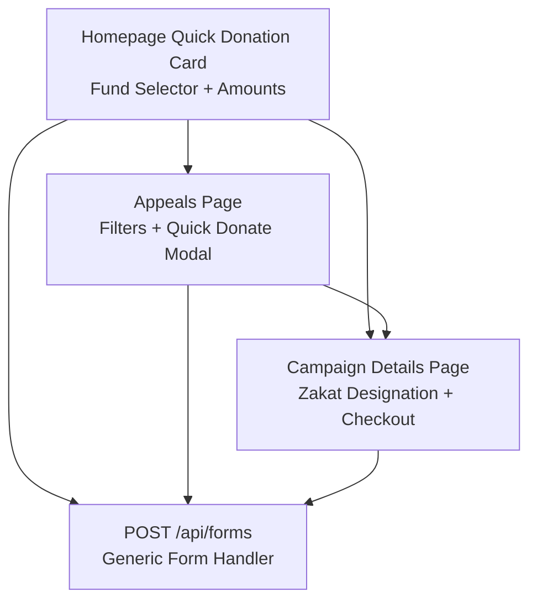
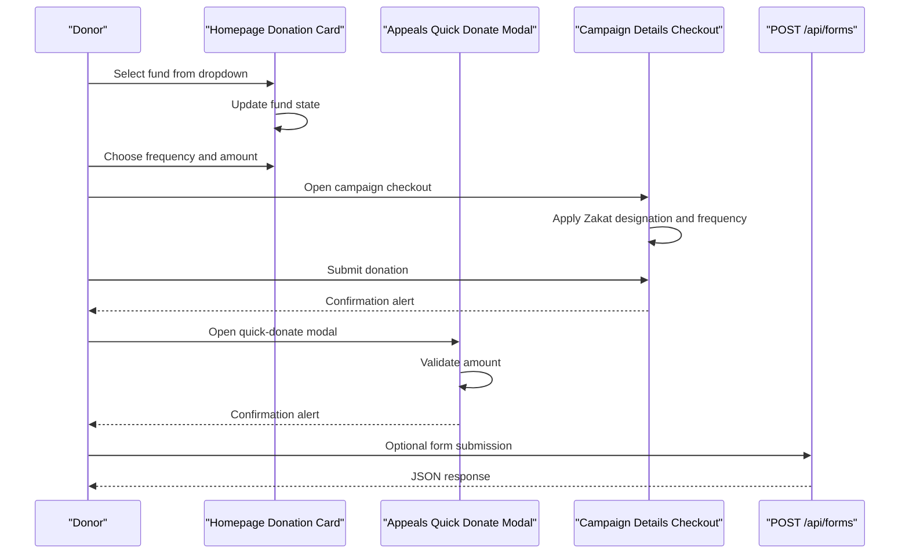
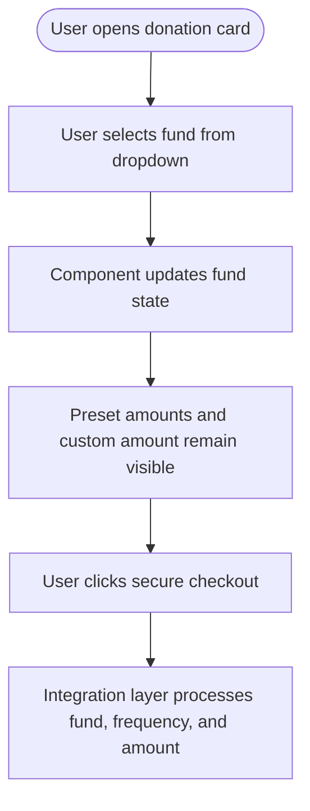
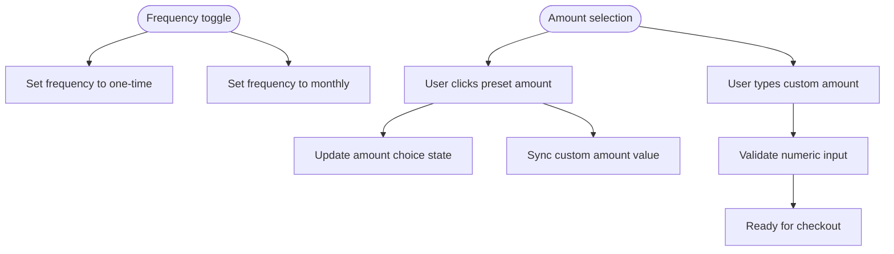
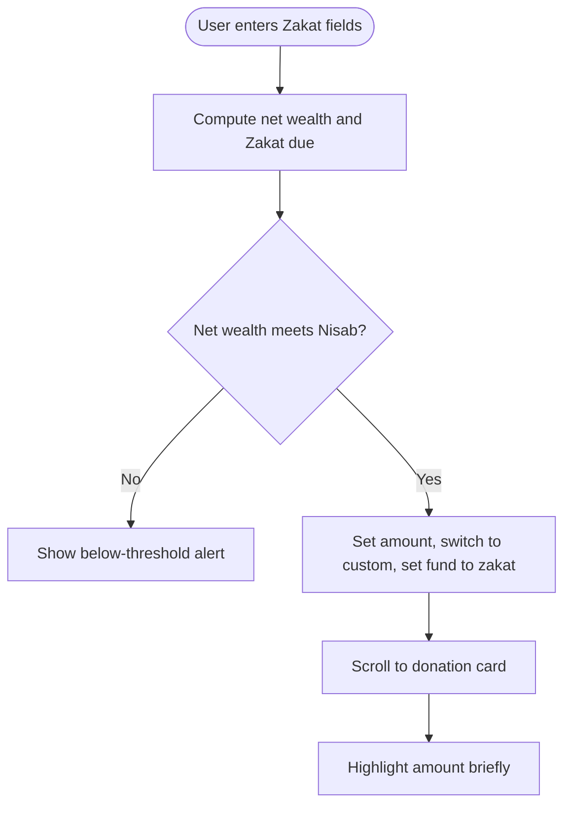
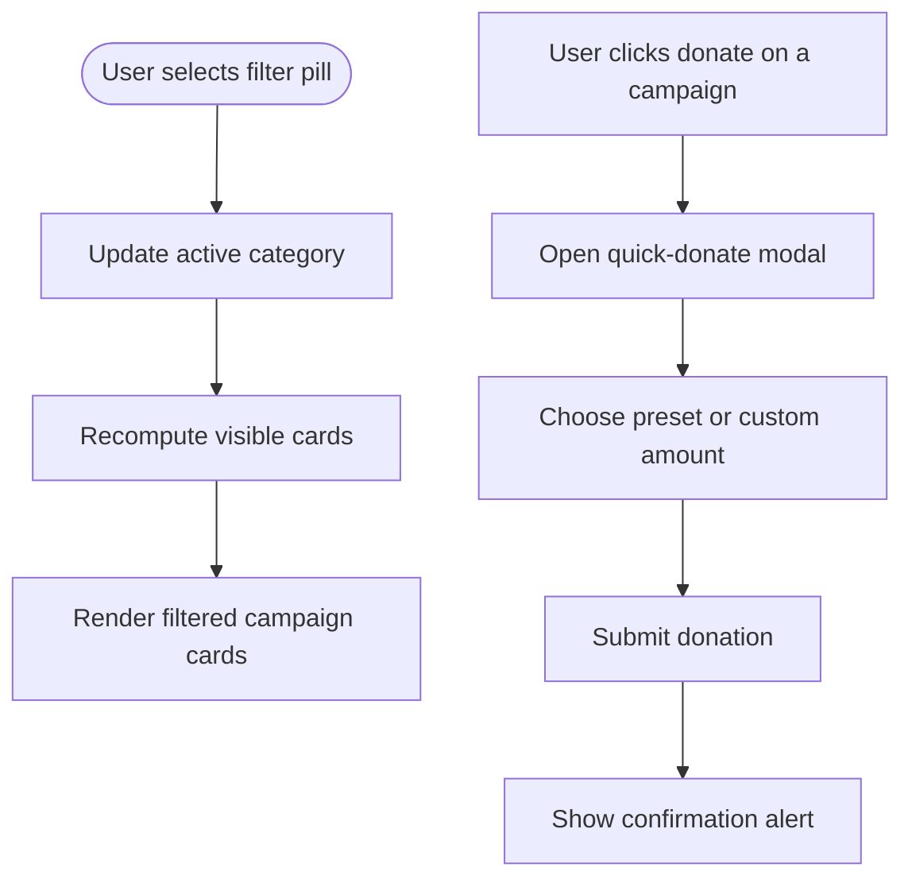
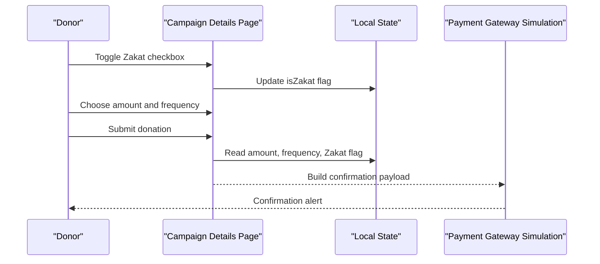
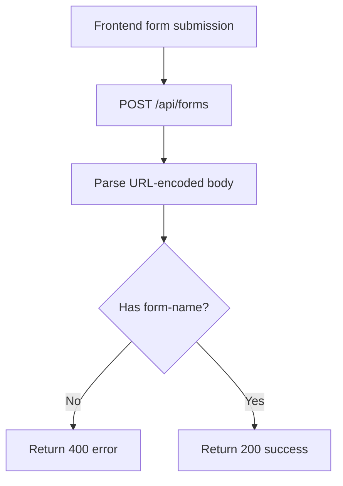
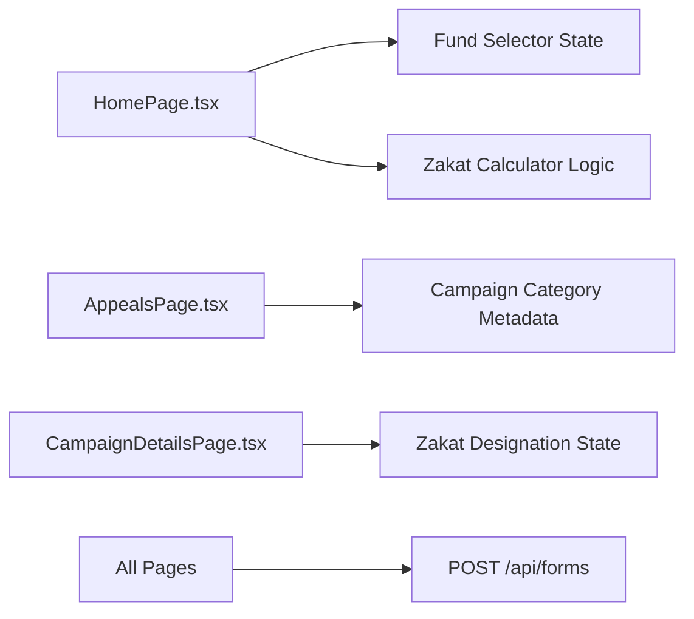

# Fund Categorization System

<cite>
**Referenced Files in This Document**
- [HomePage.tsx](file://components/pages/HomePage.tsx)
- [AppealsPage.tsx](file://components/pages/AppealsPage.tsx)
- [CampaignDetailsPage.tsx](file://components/pages/CampaignDetailsPage.tsx)
- [route.ts](file://app/api/forms/route.ts)
- [README.md](file://README.md)
</cite>

## Table of Contents
1. [Introduction](#introduction)
2. [Project Structure](#project-structure)
3. [Core Components](#core-components)
4. [Architecture Overview](#architecture-overview)
5. [Detailed Component Analysis](#detailed-component-analysis)
6. [Dependency Analysis](#dependency-analysis)
7. [Performance Considerations](#performance-considerations)
8. [Troubleshooting Guide](#troubleshooting-guide)
9. [Conclusion](#conclusion)

## Introduction
This document explains the fund categorization system used by the charity portal to support five distinct charitable causes:
- One Meal One Hope (emergency food)
- Project Alo (pediatric medical and eye surgery)
- General Zakat Fund (Shariah-compliant, 100% direct)
- Project Sheetolota (winter warmth and blankets)
- Clean Water Wells (clean water and sanitation)

The system centers on a dropdown selector that lets donors designate where their donation should go. It also integrates with frequency selection, preset amount chips, custom amount input, Zakat calculation, appeal filtering, campaign detail checkout, and a generic form submission endpoint.

The goal is to help developers and product owners understand how fund selection affects the donation flow, reporting, accessibility, and internationalization strategy.

## Project Structure
The fund categorization logic lives primarily in page-level React components under `components/pages`. The homepage contains the main quick-donation card with the fund selector. The appeals page provides category-based filtering and a quick-donate modal. The campaign details page adds Zakat designation and recurring-giving options for a specific cause. A minimal API route handles generic form submissions.

**Diagram sources**
- [HomePage.tsx:244-447](file://components/pages/HomePage.tsx#L244-L447)
- [AppealsPage.tsx:154-251](file://components/pages/AppealsPage.tsx#L154-L251)
- [CampaignDetailsPage.tsx:42-52](file://components/pages/CampaignDetailsPage.tsx#L42-L52)
- [route.ts:9-21](file://app/api/forms/route.ts#L9-L21)

**Section sources**
- [README.md:14-64](file://README.md#L14-L64)

## Core Components
The fund categorization system has three primary integration points:

| Component | Responsibility | Key Fund Integration |
|---|---|---|
| Homepage quick-donation card | Presents frequency, fund selector, preset amounts, custom amount, donor fields, and secure checkout button | Holds the selected fund state and exposes it to downstream processing |
| Appeals page | Filters campaigns by category and opens a quick-donate modal | Uses category metadata such as `food`, `medical`, `water`, `winter`, and `zakat` |
| Campaign details page | Shows campaign story, cost breakdown, dispatch log, Zakat governance, and checkout controls | Adds Zakat designation and monthly vs one-time giving |
| Generic form API | Accepts form submissions with a required `form-name` field | Can be extended to accept fund identifiers when integrating with CRM or payment providers |

**Section sources**
- [HomePage.tsx:16-24](file://components/pages/HomePage.tsx#L16-L24)
- [HomePage.tsx:303-337](file://components/pages/HomePage.tsx#L303-L337)
- [AppealsPage.tsx:6-20](file://components/pages/AppealsPage.tsx#L6-L20)
- [CampaignDetailsPage.tsx:17-28](file://components/pages/CampaignDetailsPage.tsx#L17-L28)
- [route.ts:3-21](file://app/api/forms/route.ts#L3-L21)

## Architecture Overview
At runtime, the fund categorization system follows this flow:

1. The user selects a designated fund from the dropdown.
2. The component updates local state with the chosen fund identifier.
3. The user chooses a frequency and amount.
4. On checkout, the application can:
   - Show a confirmation message simulating gateway redirection.
   - Optionally post data to `/api/forms`.
   - Route to an external payment provider or internal donation ledger.

**Diagram sources**
- [HomePage.tsx:311-316](file://components/pages/HomePage.tsx#L311-L316)
- [CampaignDetailsPage.tsx:42-52](file://components/pages/CampaignDetailsPage.tsx#L42-L52)
- [AppealsPage.tsx:145-152](file://components/pages/AppealsPage.tsx#L145-L152)
- [route.ts:9-21](file://app/api/forms/route.ts#L9-L21)

## Detailed Component Analysis

### Fund Selector Dropdown
The fund selector is implemented as a controlled `<select>` element inside the homepage quick-donation card.

Key implementation characteristics:
- Controlled by React state named `fund`.
- `onChange` handler calls `setFund(event.target.value)`.
- Five option values map to the five charitable causes.
- The label above the selector reads “Select Designated Fund”.
- The selector uses accessible markup with an associated label and stable `id`.

Fund mapping:
- `meal`: One Meal One Hope (Emergency Food Support)
- `alo`: Project Alo (Pediatric Medical & Eye Surgery)
- `zakat`: 100% General Zakat Fund (Shariah-Compliant)
- `winter`: Project Sheetolota (Winter Warmth & Blankets)
- `water`: Clean Water Wells & Dignified Sanitation

**Diagram sources**
- [HomePage.tsx:303-337](file://components/pages/HomePage.tsx#L303-L337)

**Section sources**
- [HomePage.tsx:16-24](file://components/pages/HomePage.tsx#L16-L24)
- [HomePage.tsx:303-337](file://components/pages/HomePage.tsx#L303-L337)

### Frequency and Amount Selection
Frequency is not a native HTML select; it is a two-button toggle for one-time versus monthly giving. Amount selection combines preset chips and a custom numeric input.

Important behaviors:
- Frequency toggles update local state.
- Preset amount buttons update both the selected chip and the custom amount field.
- Choosing “Custom Amount” focuses the custom input.
- The custom amount can be highlighted temporarily after Zakat calculation applies a computed value.

**Diagram sources**
- [HomePage.tsx:266-299](file://components/pages/HomePage.tsx#L266-L299)
- [HomePage.tsx:339-390](file://components/pages/HomePage.tsx#L339-L390)

**Section sources**
- [HomePage.tsx:266-299](file://components/pages/HomePage.tsx#L266-L299)
- [HomePage.tsx:339-390](file://components/pages/HomePage.tsx#L339-L390)

### Zakat Calculation and Automatic Fund Assignment
The homepage includes a simple Zakat calculator that computes net zakatable wealth against a USD Nisab threshold. When Zakat is due, the “Pay Zakat Now” action:
- Sets the custom amount to the calculated Zakat value.
- Switches the amount mode to custom.
- Assigns the fund to `zakat`.
- Scrolls to the top and briefly highlights the amount area.

**Diagram sources**
- [HomePage.tsx:32-43](file://components/pages/HomePage.tsx#L32-L43)
- [HomePage.tsx:68-82](file://components/pages/HomePage.tsx#L68-L82)

**Section sources**
- [HomePage.tsx:32-43](file://components/pages/HomePage.tsx#L32-L43)
- [HomePage.tsx:68-82](file://components/pages/HomePage.tsx#L68-L82)

### Appeals Page Filtering and Quick Donate Modal
The appeals page organizes campaigns using category metadata. Categories include:
- `food`
- `medical`
- `water`
- `winter`
- `zakat`

Filter pills and sorting control which campaigns are visible. The quick-donate modal collects a donation amount and submits through a simulated checkout flow.

**Diagram sources**
- [AppealsPage.tsx:6-20](file://components/pages/AppealsPage.tsx#L6-L20)
- [AppealsPage.tsx:79-93](file://components/pages/AppealsPage.tsx#L79-L93)
- [AppealsPage.tsx:145-152](file://components/pages/AppealsPage.tsx#L145-L152)

**Section sources**
- [AppealsPage.tsx:6-20](file://components/pages/AppealsPage.tsx#L6-L20)
- [AppealsPage.tsx:79-93](file://components/pages/AppealsPage.tsx#L79-L93)
- [AppealsPage.tsx:145-152](file://components/pages/AppealsPage.tsx#L145-L152)

### Campaign Details Page Zakat Designation and Checkout
The campaign details page adds deeper context around a specific appeal and supports:
- Tabbed content including Zakat governance.
- Monthly versus one-time giving.
- A Zakat checkbox that changes the donation description.
- A submit handler that constructs a confirmation message including amount, frequency, and Zakat designation.

**Diagram sources**
- [CampaignDetailsPage.tsx:17-28](file://components/pages/CampaignDetailsPage.tsx#L17-L28)
- [CampaignDetailsPage.tsx:42-52](file://components/pages/CampaignDetailsPage.tsx#L42-L52)

**Section sources**
- [CampaignDetailsPage.tsx:17-28](file://components/pages/CampaignDetailsPage.tsx#L17-L28)
- [CampaignDetailsPage.tsx:42-52](file://components/pages/CampaignDetailsPage.tsx#L42-L52)

### Form Submission Endpoint
The repository includes a generic form submission endpoint at `/api/forms`. It expects a `form-name` field and returns a JSON response. This contract is intentionally fire-and-forget so the UI behaves like the legacy site while allowing backend integration later.

**Diagram sources**
- [route.ts:9-21](file://app/api/forms/route.ts#L9-L21)

**Section sources**
- [route.ts:3-21](file://app/api/forms/route.ts#L3-L21)

## Dependency Analysis
The fund categorization system is intentionally lightweight and localized within page components. There is no shared fund configuration module yet, so fund identifiers and labels are embedded directly in the UI code.

**Diagram sources**
- [HomePage.tsx:16-24](file://components/pages/HomePage.tsx#L16-L24)
- [AppealsPage.tsx:24-61](file://components/pages/AppealsPage.tsx#L24-L61)
- [CampaignDetailsPage.tsx:17-28](file://components/pages/CampaignDetailsPage.tsx#L17-L28)
- [route.ts:9-21](file://app/api/forms/route.ts#L9-L21)

**Section sources**
- [HomePage.tsx:16-24](file://components/pages/HomePage.tsx#L16-L24)
- [AppealsPage.tsx:24-61](file://components/pages/AppealsPage.tsx#L24-L61)
- [CampaignDetailsPage.tsx:17-28](file://components/pages/CampaignDetailsPage.tsx#L17-L28)
- [route.ts:9-21](file://app/api/forms/route.ts#L9-L21)

## Performance Considerations
- The fund selector is a small controlled component with minimal re-renders.
- Zakat computation uses `useMemo` to avoid recalculating unless inputs change.
- Appeal filtering recomputes visibility based on query and category, which is acceptable for the current number of campaigns.
- No heavy network calls occur during fund selection; all interactions are client-side until checkout.

[No sources needed since this section provides general guidance]

## Troubleshooting Guide

### Fund Not Applied to Checkout
If selecting a fund does not appear in the final donation payload:
- Verify that the fund state is updated by the dropdown’s `onChange` handler.
- Ensure the checkout handler reads the current fund state rather than a stale closure.
- If extending the generic form endpoint, add a `fund` field to the submitted payload and validate it against allowed values.

**Section sources**
- [HomePage.tsx:311-316](file://components/pages/HomePage.tsx#L311-L316)
- [route.ts:9-21](file://app/api/forms/route.ts#L9-L21)

### Zakat Amount Not Auto-Filled
If clicking “Pay Zakat Now” does not set the amount or fund:
- Confirm that net wealth meets the Nisab threshold.
- Check that the Zakat calculation function returns a positive value.
- Verify that the handler sets `amount`, switches to custom mode, and assigns `zakat` to the fund.

**Section sources**
- [HomePage.tsx:32-43](file://components/pages/HomePage.tsx#L32-L43)
- [HomePage.tsx:68-82](file://components/pages/HomePage.tsx#L68-L82)

### Appeal Filters Not Working
If campaign cards do not filter correctly:
- Confirm the active category matches the `data-categories` attribute on each card.
- Ensure the search query is trimmed and lowercased before comparison.
- Verify that the visibility array is rebuilt whenever query or category changes.

**Section sources**
- [AppealsPage.tsx:79-93](file://components/pages/AppealsPage.tsx#L79-L93)

### Form Submission Returns Missing Field Error
If the form endpoint returns a missing-field error:
- Ensure the frontend posts a `form-name` field.
- For fund-related submissions, extend the payload to include fund, frequency, amount, and donor information.
- Add server-side validation for fund identifiers before persisting.

**Section sources**
- [route.ts:9-21](file://app/api/forms/route.ts#L9-L21)

## Conclusion
The fund categorization system currently provides a clear, accessible dropdown for designating donations across five charitable causes. It integrates with frequency selection, amount selection, Zakat calculation, appeal filtering, and campaign-specific checkout flows. To strengthen production readiness, consider:
- Centralizing fund definitions into a typed configuration object.
- Adding explicit validation for fund identifiers on both frontend and backend.
- Extending the form endpoint to accept structured donation payloads.
- Implementing analytics events for fund selection, Zakat designation, and checkout completion.
- Preparing internationalized strings for fund descriptions and Zakat terminology.

[No sources needed since this section summarizes without analyzing specific files]

## Appendices

### Accessibility Compliance Notes
- The fund selector uses a labeled `<select>` with a descriptive label and stable `id`.
- Focus states use visible ring styles.
- Icons are decorative and paired with meaningful text labels.
- Color contrast follows the project’s design tokens.

**Section sources**
- [HomePage.tsx:303-337](file://components/pages/HomePage.tsx#L303-L337)

### Internationalization Considerations
- Fund labels are currently hardcoded in JSX.
- Recommended approach:
  - Extract fund titles and descriptions into translation keys.
  - Separate short display names from longer explanatory descriptions.
  - Localize Zakat-related terms such as “Zakat,” “Sadaqah,” and Shariah compliance statements.
  - Provide locale-aware currency formatting for amounts.

**Section sources**
- [HomePage.tsx:317-331](file://components/pages/HomePage.tsx#L317-L331)
- [CampaignDetailsPage.tsx:42-52](file://components/pages/CampaignDetailsPage.tsx#L42-L52)