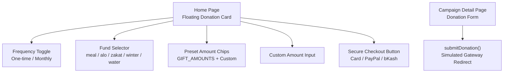
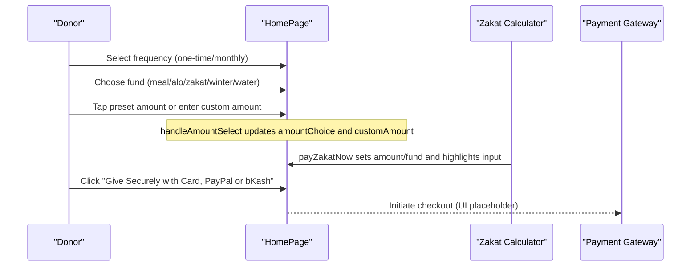
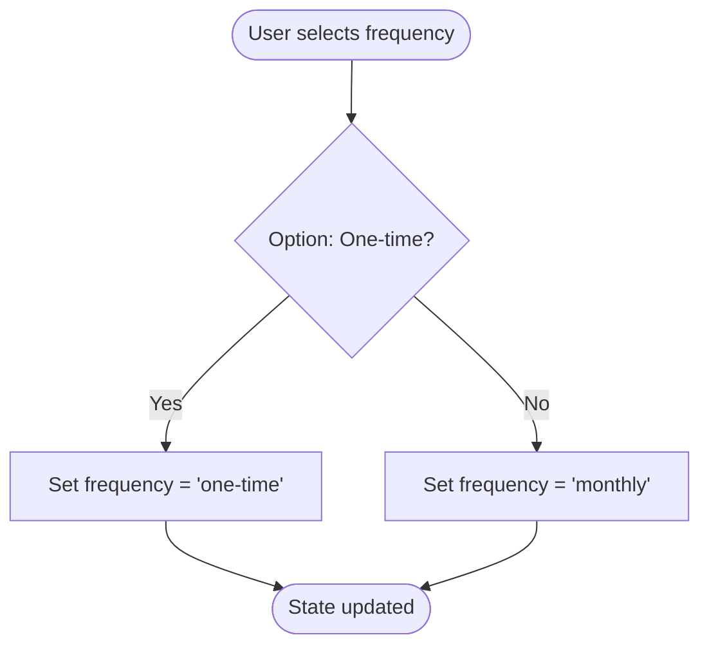
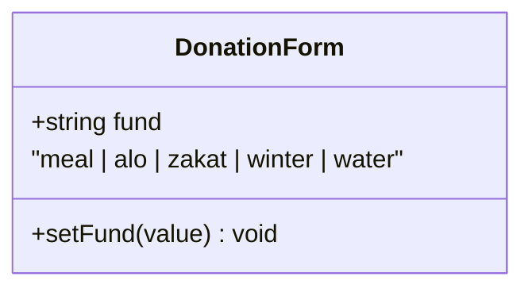
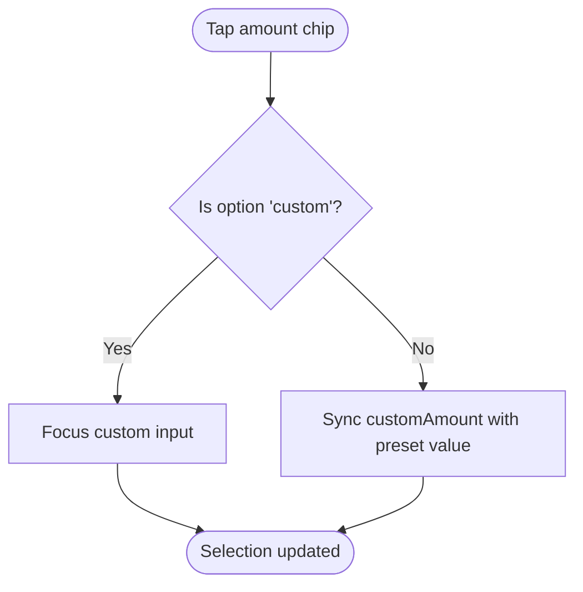
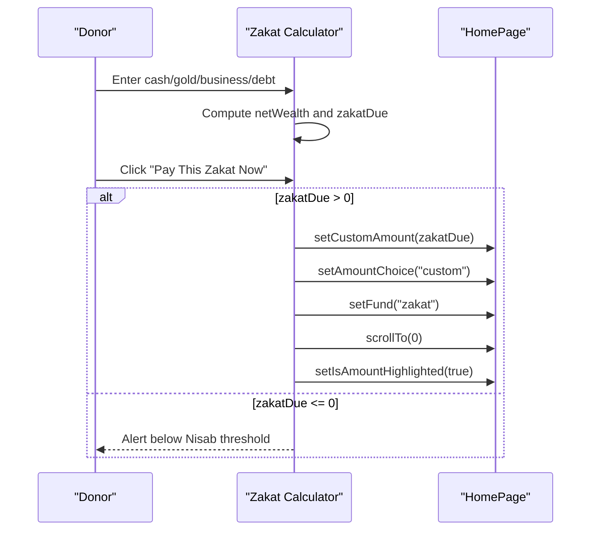
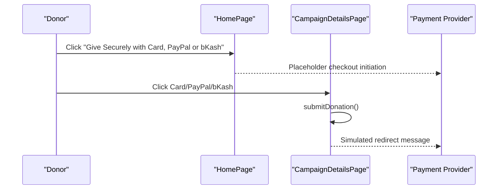
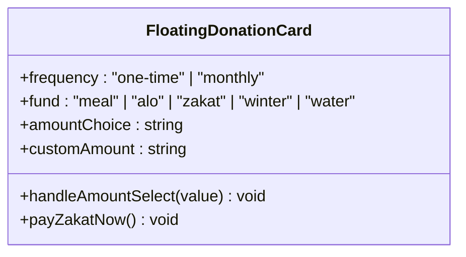
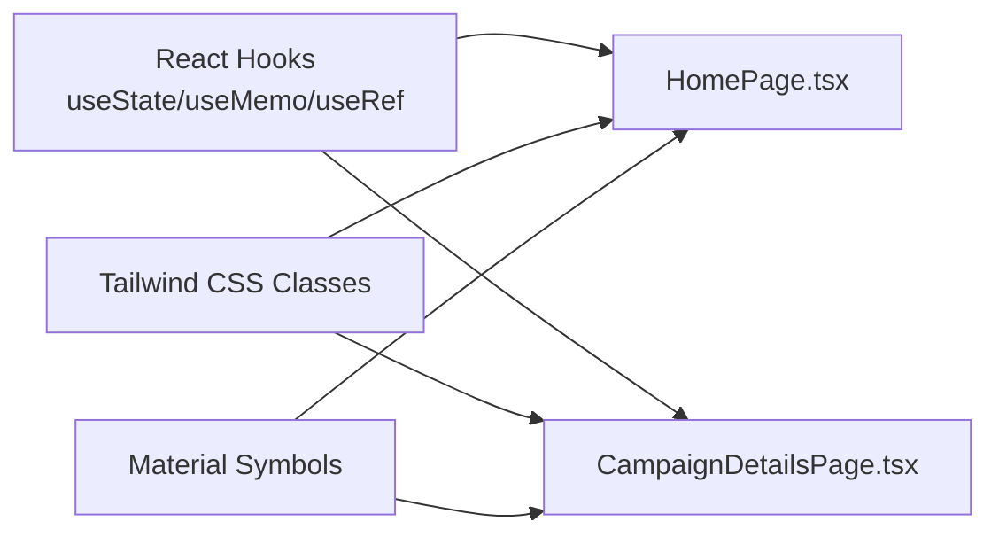

# Interactive Donation System

<cite>
**Referenced Files in This Document**
- [HomePage.tsx](file://components/pages/HomePage.tsx)
- [CampaignDetailsPage.tsx](file://components/pages/CampaignDetailsPage.tsx)
- [DESIGN.md](file://docs/DESIGN.md)
</cite>

## Table of Contents
1. [Introduction](#introduction)
2. [Project Structure](#project-structure)
3. [Core Components](#core-components)
4. [Architecture Overview](#architecture-overview)
5. [Detailed Component Analysis](#detailed-component-analysis)
6. [Dependency Analysis](#dependency-analysis)
7. [Performance Considerations](#performance-considerations)
8. [Troubleshooting Guide](#troubleshooting-guide)
9. [Conclusion](#conclusion)

## Introduction
This document explains the unified donation system implemented across the site’s main pages. It covers:
- Frequency selection between one-time and monthly donations
- Fund categorization with five distinct categories: meal, alo, zakat, winter, water
- Preset amount selection with six predefined amounts plus custom input
- Complete user interaction flow from frequency selection to checkout initiation
- State management patterns using React hooks for frequency, fund, amount choice, and custom amount handling
- Integration points with payment processing systems including card, PayPal, and bKash
- Accessibility features, responsive design patterns, and the floating donation card UI component

The implementation is primarily contained in the home page and campaign detail page components, with design guidance documented separately.

## Project Structure
The donation system lives inside Next.js client components:
- The home page contains a floating donation engine card with frequency toggles, fund selection, preset amount chips, custom amount input, donor quick inputs, and a secure checkout button.
- The campaign detail page includes its own donation state and a submit action that simulates redirecting to a bank gateway.
- Design tokens and component behavior are described in the design documentation.

**Diagram sources**
- [HomePage.tsx:16-58](file://components/pages/HomePage.tsx#L16-L58)
- [HomePage.tsx:264-446](file://components/pages/HomePage.tsx#L264-L446)
- [CampaignDetailsPage.tsx:17-52](file://components/pages/CampaignDetailsPage.tsx#L17-L52)

**Section sources**
- [HomePage.tsx:16-58](file://components/pages/HomePage.tsx#L16-L58)
- [CampaignDetailsPage.tsx:17-52](file://components/pages/CampaignDetailsPage.tsx#L17-L52)
- [DESIGN.md:215-235](file://docs/DESIGN.md#L215-L235)

## Core Components
- Floating Donation Engine Card on the home page provides the primary donation experience.
- Campaign Detail Page offers a focused donation form for a specific appeal.
- Zakat Calculator section integrates with the donation flow by pre-filling amount and fund when applicable.

Key behaviors:
- Frequency toggle switches between one-time and monthly giving.
- Fund selector routes donations into designated programs.
- Preset amount chips include five numeric values and a custom option.
- Custom amount input allows free-form entry and optional focus management.
- Secure checkout button indicates support for card, PayPal, and bKash.

**Section sources**
- [HomePage.tsx:242-446](file://components/pages/HomePage.tsx#L242-L446)
- [CampaignDetailsPage.tsx:17-52](file://components/pages/CampaignDetailsPage.tsx#L17-L52)

## Architecture Overview
The donation system follows a simple client-side state model:
- Local React state holds frequency, selected fund, chosen preset amount, and custom amount.
- A handler function manages preset amount selection and custom input focus.
- The Zakat calculator can update donation state (amount, fund, scroll, highlight).
- Payment integration is represented by UI buttons; actual payment logic is not implemented in these files.

**Diagram sources**
- [HomePage.tsx:16-58](file://components/pages/HomePage.tsx#L16-L58)
- [HomePage.tsx:68-82](file://components/pages/HomePage.tsx#L68-L82)
- [HomePage.tsx:409-420](file://components/pages/HomePage.tsx#L409-L420)

## Detailed Component Analysis

### Frequency Selection
- The frequency state is a typed string union supporting "one-time" and "monthly".
- Two toggle buttons visually reflect the active frequency and update state on click.
- This pattern ensures clear affordance and keyboard-friendly switching.

**Diagram sources**
- [HomePage.tsx:17-19](file://components/pages/HomePage.tsx#L17-L19)
- [HomePage.tsx:274-298](file://components/pages/HomePage.tsx#L274-L298)

**Section sources**
- [HomePage.tsx:17-19](file://components/pages/HomePage.tsx#L17-L19)
- [HomePage.tsx:264-298](file://components/pages/HomePage.tsx#L264-L298)

### Fund Categorization
- The fund state is a string representing one of five categories: meal, alo, zakat, winter, water.
- A select dropdown lists each category with descriptive labels.
- Changing the dropdown updates the fund state used later during checkout.

**Diagram sources**
- [HomePage.tsx:20-20](file://components/pages/HomePage.tsx#L20-L20)
- [HomePage.tsx:303-337](file://components/pages/HomePage.tsx#L303-L337)

**Section sources**
- [HomePage.tsx:20-20](file://components/pages/HomePage.tsx#L20-L20)
- [HomePage.tsx:303-337](file://components/pages/HomePage.tsx#L303-L337)

### Preset Amount Selection and Custom Input
- GIFT_AMOUNTS defines six options: $25, $50, $100, $250, and a custom amount option.
- The handleAmountSelect function updates the selected preset and focuses the custom input when needed.
- When a preset is selected, the custom amount field is synchronized with the chosen value.

**Diagram sources**
- [HomePage.tsx:6-12](file://components/pages/HomePage.tsx#L6-L12)
- [HomePage.tsx:49-58](file://components/pages/HomePage.tsx#L49-L58)
- [HomePage.tsx:345-363](file://components/pages/HomePage.tsx#L345-L363)
- [HomePage.tsx:368-390](file://components/pages/HomePage.tsx#L368-L390)

**Section sources**
- [HomePage.tsx:6-12](file://components/pages/HomePage.tsx#L6-L12)
- [HomePage.tsx:49-58](file://components/pages/HomePage.tsx#L49-L58)
- [HomePage.tsx:345-390](file://components/pages/HomePage.tsx#L345-L390)

### Zakat Calculator Integration
- The Zakat calculator computes net wealth and zakat due based on user inputs.
- When zakat is payable, payZakatNow sets the custom amount to the calculated zakat due, switches the fund to zakat, scrolls to the top, and briefly highlights the amount input.
- If below the Nisab threshold, it alerts the user accordingly.

**Diagram sources**
- [HomePage.tsx:32-43](file://components/pages/HomePage.tsx#L32-L43)
- [HomePage.tsx:68-82](file://components/pages/HomePage.tsx#L68-L82)
- [HomePage.tsx:1150-1167](file://components/pages/HomePage.tsx#L1150-L1167)

**Section sources**
- [HomePage.tsx:32-43](file://components/pages/HomePage.tsx#L32-L43)
- [HomePage.tsx:68-82](file://components/pages/HomePage.tsx#L68-L82)
- [HomePage.tsx:1150-1167](file://components/pages/HomePage.tsx#L1150-L1167)

### Payment Processing Integration Points
- The home page presents a secure checkout button indicating support for card, PayPal, and bKash.
- The campaign detail page shows fast checkout buttons for card, PayPal, and bKash/Mobile Financial Services.
- Both components simulate checkout initiation rather than implementing backend payment logic.

**Diagram sources**
- [HomePage.tsx:409-420](file://components/pages/HomePage.tsx#L409-L420)
- [CampaignDetailsPage.tsx:42-52](file://components/pages/CampaignDetailsPage.tsx#L42-L52)
- [CampaignDetailsPage.tsx:1364-1384](file://components/pages/CampaignDetailsPage.tsx#L1364-L1384)

**Section sources**
- [HomePage.tsx:409-420](file://components/pages/HomePage.tsx#L409-L420)
- [CampaignDetailsPage.tsx:42-52](file://components/pages/CampaignDetailsPage.tsx#L42-L52)
- [CampaignDetailsPage.tsx:1364-1384](file://components/pages/CampaignDetailsPage.tsx#L1364-L1384)

### Accessibility Features
- Inputs use semantic types such as number and text, improving mobile keyboard behavior.
- Labels and placeholders provide context for donors.
- Focus management is applied to the custom amount input when selecting the custom option.
- Visual feedback uses color changes and borders to indicate active states.

Best practices observed:
- Clear label hierarchy for frequency, fund, and amount sections.
- Focus ring styles for interactive elements.
- Descriptive button text indicating supported payment methods.

**Section sources**
- [HomePage.tsx:264-298](file://components/pages/HomePage.tsx#L264-L298)
- [HomePage.tsx:303-337](file://components/pages/HomePage.tsx#L303-L337)
- [HomePage.tsx:345-390](file://components/pages/HomePage.tsx#L345-L390)
- [HomePage.tsx:392-405](file://components/pages/HomePage.tsx#L392-L405)

### Responsive Design Patterns
- Grid layouts adapt from single-column on small screens to multi-column on larger screens.
- Typography scales using Tailwind utilities for readability across devices.
- Touch targets are sized appropriately for mobile interactions.
- The floating donation card remains usable on all screen sizes.

Design guidelines referenced:
- Donation amount selector chips follow defined active and inactive styles.
- Input fields have consistent height and focus states.

**Section sources**
- [HomePage.tsx:122-124](file://components/pages/HomePage.tsx#L122-L124)
- [HomePage.tsx:242-446](file://components/pages/HomePage.tsx#L242-L446)
- [DESIGN.md:222-235](file://docs/DESIGN.md#L222-L235)

### Floating Donation Card UI Component
- The card groups frequency, fund, amount, donor info, and checkout into a cohesive unit.
- It uses rounded corners, subtle shadows, and clear visual hierarchy.
- Trust indicators include SSL encryption messaging and payment method logos.

**Diagram sources**
- [HomePage.tsx:16-58](file://components/pages/HomePage.tsx#L16-L58)
- [HomePage.tsx:242-446](file://components/pages/HomePage.tsx#L242-L446)

**Section sources**
- [HomePage.tsx:242-446](file://components/pages/HomePage.tsx#L242-L446)

## Dependency Analysis
- HomePage depends on React hooks: useState, useMemo, useRef.
- CampaignDetailsPage depends on useState and useRef for gallery and donation state.
- Both components render UI using Tailwind CSS classes and Material Symbols icons.
- No direct imports of payment SDKs are present; integration points are UI-level placeholders.

**Diagram sources**
- [HomePage.tsx:1-4](file://components/pages/HomePage.tsx#L1-L4)
- [CampaignDetailsPage.tsx:1-4](file://components/pages/CampaignDetailsPage.tsx#L1-L4)

**Section sources**
- [HomePage.tsx:1-4](file://components/pages/HomePage.tsx#L1-L4)
- [CampaignDetailsPage.tsx:1-4](file://components/pages/CampaignDetailsPage.tsx#L1-L4)

## Performance Considerations
- State updates are localized within components, minimizing re-renders outside the donation forms.
- useMemo is used to compute zakat-related values efficiently based on input fields.
- Avoid unnecessary re-renders by keeping state minimal and scoped to relevant components.
- Image assets are external; consider lazy loading if adding more media to donation flows.

[No sources needed since this section provides general guidance]

## Troubleshooting Guide
Common issues and resolutions:
- Custom amount not focusing after selecting "Custom Amount": Ensure handleAmountSelect runs and the ref is attached to the input element.
- Zakat calculation not updating: Verify zakatFields inputs are bound correctly and useMemo dependencies include all fields.
- Checkout button does nothing: Confirm the intended integration point is wired to your payment provider; currently, it is a UI placeholder.

**Section sources**
- [HomePage.tsx:49-58](file://components/pages/HomePage.tsx#L49-L58)
- [HomePage.tsx:32-43](file://components/pages/HomePage.tsx#L32-L43)
- [HomePage.tsx:409-420](file://components/pages/HomePage.tsx#L409-L420)

## Conclusion
The unified donation system provides an accessible, responsive, and intuitive interface for selecting donation frequency, fund, and amount, with clear integration points for card, PayPal, and bKash payments. State management is straightforward using React hooks, and the floating donation card centralizes the donor experience. Future enhancements should implement actual payment processing, expand validation, and add analytics tracking while preserving accessibility and responsiveness.

[No sources needed since this section summarizes without analyzing specific files]