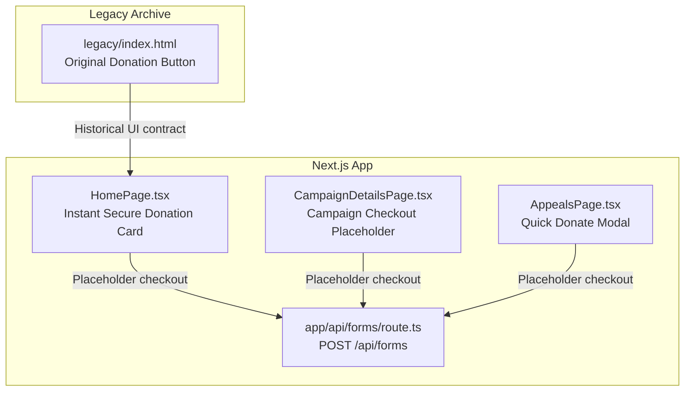
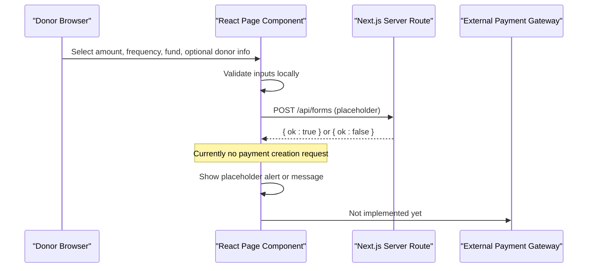
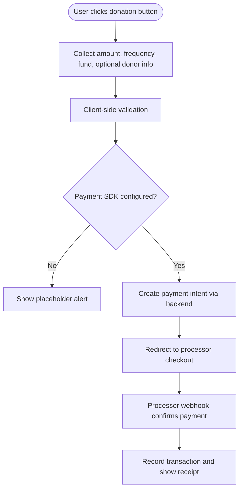
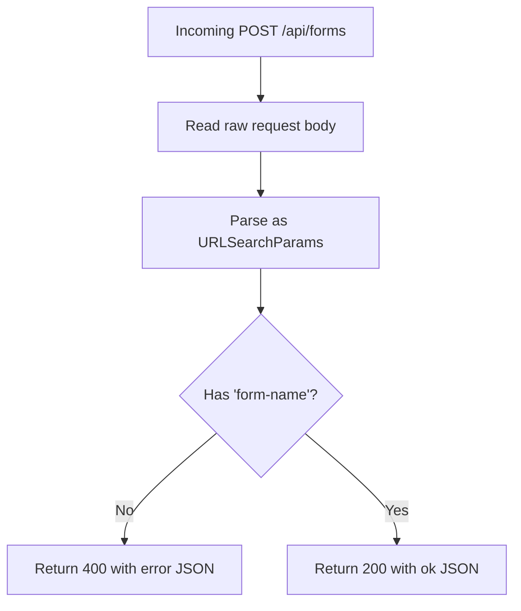
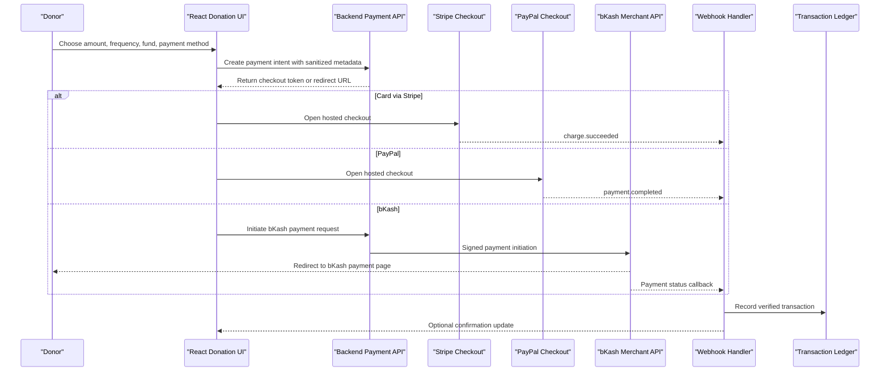
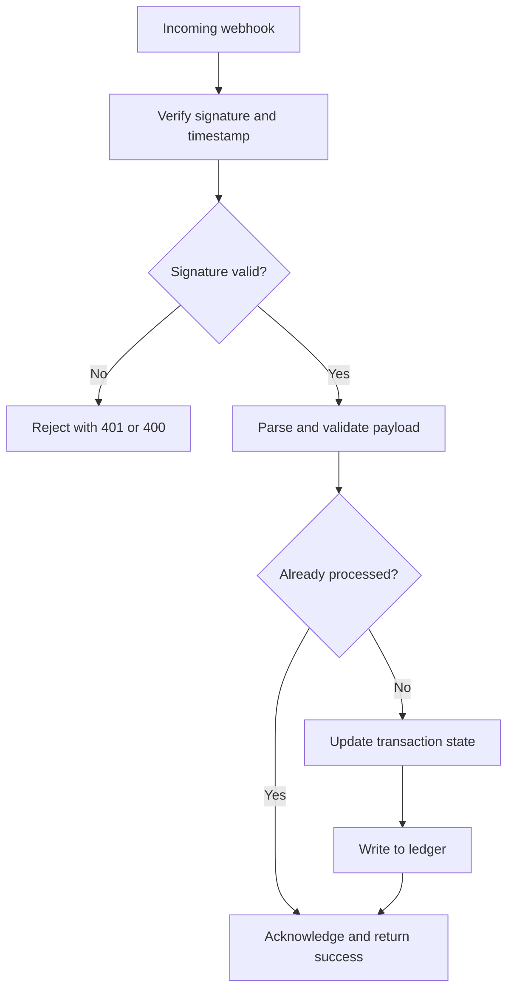
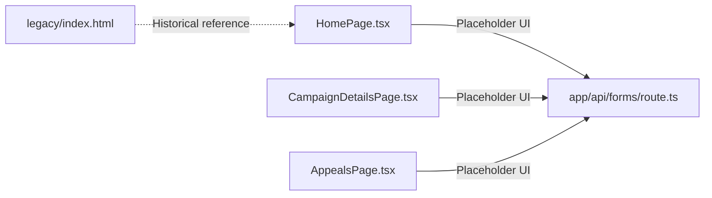

# Payment Processing Integration Points

<cite>
**Referenced Files in This Document**
- [README.md](file://README.md)
- [route.ts](file://app/api/forms/route.ts)
- [HomePage.tsx](file://components/pages/HomePage.tsx)
- [CampaignDetailsPage.tsx](file://components/pages/CampaignDetailsPage.tsx)
- [AppealsPage.tsx](file://components/pages/AppealsPage.tsx)
- [index.html](file://legacy/index.html)
</cite>

## Table of Contents
1. [Introduction](#introduction)
2. [Project Structure](#project-structure)
3. [Core Components](#core-components)
4. [Architecture Overview](#architecture-overview)
5. [Detailed Component Analysis](#detailed-component-analysis)
6. [Dependency Analysis](#dependency-analysis)
7. [Performance Considerations](#performance-considerations)
8. [Security and Compliance Considerations](#security-and-compliance-considerations)
9. [Troubleshooting Guide](#troubleshooting-guide)
10. [Conclusion](#conclusion)

## Introduction
This document explains the current payment processing integration points for a Next.js charity portal that advertises card, PayPal, and bKash donations. The repository currently implements:

- A user-facing donation UI with placeholder checkout flows.
- A server-side form endpoint used by legacy-style forms.
- No active payment gateway SDKs or webhook handlers yet.

The goal is to map where payment logic should live, how to extend the existing API route structure, and what security and compliance considerations apply when integrating real processors such as Stripe (cards), PayPal, and bKash in Bangladesh.

## Project Structure
The project is a Next.js App Router application with:

- Client pages under `components/pages/` containing interactive donation UIs.
- A server route under `app/api/forms/route.ts` for generic form submissions.
- Legacy static HTML archived under `legacy/`, including an earlier version of the donation button.

**Diagram sources**
- [HomePage.tsx:244-447](file://components/pages/HomePage.tsx#L244-L447)
- [CampaignDetailsPage.tsx:42-52](file://components/pages/CampaignDetailsPage.tsx#L42-L52)
- [AppealsPage.tsx:154-251](file://components/pages/AppealsPage.tsx#L154-L251)
- [route.ts:1-23](file://app/api/forms/route.ts#L1-L23)
- [index.html:457-471](file://legacy/index.html#L457-L471)

**Section sources**
- [README.md:14-65](file://README.md#L14-L65)
- [README.md:112-116](file://README.md#L112-L116)

## Core Components
The payment-related surface area currently consists of three client components and one server route:

| Component | Responsibility | Current Behavior |
|---|---|---|
| `HomePage.tsx` | Instant secure donation card with frequency, fund, amount, donor name/email fields, and a “Give Securely with Card, PayPal or bKash” button. | Placeholder checkout; no network call to a payment provider. |
| `CampaignDetailsPage.tsx` | Campaign-specific donation flow with Zakat toggle, frequency, and amount. | Placeholder alert simulating redirect to a bank gateway. |
| `AppealsPage.tsx` | Quick donate modal with preset amounts and submit action. | Placeholder alert simulating encrypted checkout redirection. |
| `app/api/forms/route.ts` | Accepts legacy-style form submissions with a `form-name` field. | Returns success or validation error JSON; does not process payments. |

**Section sources**
- [HomePage.tsx:244-447](file://components/pages/HomePage.tsx#L244-L447)
- [CampaignDetailsPage.tsx:42-52](file://components/pages/CampaignDetailsPage.tsx#L42-L52)
- [AppealsPage.tsx:154-251](file://components/pages/AppealsPage.tsx#L154-L251)
- [route.ts:1-23](file://app/api/forms/route.ts#L1-L23)

## Architecture Overview
At present, the architecture is a frontend-only donation experience backed by a generic form handler. There are no active integrations with card processors, PayPal, or bKash.

**Diagram sources**
- [HomePage.tsx:409-421](file://components/pages/HomePage.tsx#L409-L421)
- [CampaignDetailsPage.tsx:42-52](file://components/pages/CampaignDetailsPage.tsx#L42-L52)
- [AppealsPage.tsx:145-152](file://components/pages/AppealsPage.tsx#L145-L152)
- [route.ts:9-22](file://app/api/forms/route.ts#L9-L22)

## Detailed Component Analysis

### Donation Button Placeholders
The donation buttons across the site advertise multiple payment methods but do not implement them:

- **Homepage instant donation card**: Shows trust badges for SSL encryption, Visa, MasterCard, PayPal, and bKash, but the button has no click handler wired to a payment SDK.
- **Campaign details page**: The `submitDonation` function builds a confirmation message and shows an alert instead of creating a payment intent.
- **Appeals quick-donate modal**: The submit button triggers an alert describing redirection to an encrypted checkout.

**Diagram sources**
- [HomePage.tsx:409-421](file://components/pages/HomePage.tsx#L409-L421)
- [CampaignDetailsPage.tsx:42-52](file://components/pages/CampaignDetailsPage.tsx#L42-L52)
- [AppealsPage.tsx:145-152](file://components/pages/AppealsPage.tsx#L145-L152)

**Section sources**
- [HomePage.tsx:392-447](file://components/pages/HomePage.tsx#L392-L447)
- [CampaignDetailsPage.tsx:42-52](file://components/pages/CampaignDetailsPage.tsx#L42-L52)
- [AppealsPage.tsx:145-152](file://components/pages/AppealsPage.tsx#L145-L152)
- [index.html:457-471](file://legacy/index.html#L457-L471)

### API Route Structure for Form Submissions
The existing `POST /api/forms` route:

- Reads the raw request body as text.
- Parses it as URL-encoded form data.
- Extracts `form-name`.
- Returns a JSON response indicating success or missing field.

This route is intentionally lightweight and designed to preserve the original fire-and-forget contract while allowing future wiring to a CRM, email provider, or database. It is not a payment processing endpoint.

**Diagram sources**
- [route.ts:9-22](file://app/api/forms/route.ts#L9-L22)

**Section sources**
- [route.ts:1-23](file://app/api/forms/route.ts#L1-L23)
- [README.md:112-116](file://README.md#L112-L116)

### Integration Points for External Payment Gateways
To support card payments, PayPal, and bKash, the integration should be split into clear layers:

| Layer | Responsibility | Recommended Implementation Notes |
|---|---|---|
| Frontend UI | Collect donation amount, frequency, fund, donor contact, and selected payment method. | Keep sensitive payment data out of your app; use official SDKs or hosted checkout. |
| Backend API | Create payment intents, validate amounts, enforce business rules, and return safe checkout tokens. | Use environment variables for secrets; never log full PAN or CVV. |
| Payment Processor | Hosted checkout, tokenization, and authorization. | Stripe for cards, PayPal for PayPal, bKash for Bangladesh mobile wallet. |
| Webhook Service | Receive asynchronous payment events and reconcile transactions. | Verify signatures, idempotency keys, and timestamps. |
| Ledger and Receipts | Record successful payments, refunds, and allocations to funds. | Store minimal PII; keep audit trails for Zakat compliance. |

For cards, prefer Stripe Elements or Stripe Checkout so card data never touches your server. For PayPal, use PayPal Smart Buttons or Checkout SDK. For bKash, integrate the merchant API according to their documentation, typically requiring a server-to-server flow with signed requests and webhooks.

**Section sources**
- [HomePage.tsx:409-447](file://components/pages/HomePage.tsx#L409-L447)
- [CampaignDetailsPage.tsx:42-52](file://components/pages/CampaignDetailsPage.tsx#L42-L52)
- [AppealsPage.tsx:145-152](file://components/pages/AppealsPage.tsx#L145-L152)

### Transaction Processing Workflow Example
A production-ready workflow would look like this:

[No diagram sources needed since this diagram shows conceptual workflow, not actual code structure]

### Payment Method Configuration Examples
Configuration should be centralized and environment-driven. Below are example configuration shapes rather than implementation code:

| Field | Purpose | Example Value |
|---|---|---|
| `STRIPE_PUBLIC_KEY` | Frontend key for Stripe SDKs | `pk_live_...` |
| `STRIPE_SECRET_KEY` | Backend key for Stripe API | `sk_live_...` |
| `PAYPAL_CLIENT_ID` | PayPal SDK identifier | `AaBbCcDdEeFfGgHhIiJjKkLlMmNnOoPpQqRrSsTtUuVvWwXxYyZz` |
| `PAYPAL_SECRET` | PayPal API secret | `EbCdFeAgHiJkLmNoPqRsTuVwXyZaBcDeFgHiJkLmNoPqRsTuVwXyZ` |
| `BKASH_APP_KEY` | bKash merchant application key | `AppKey123456789` |
| `BKASH_APP_SECRET` | bKash merchant application secret | `AppSecret123456789` |
| `BKASH_BASE_URL` | bKash sandbox or production base URL | `https://sandbox.bkkash.com` |
| `WEBHOOK_SECRET` | Signature verification secret | `whsec_...` |
| `ALLOWED_CURRENCIES` | Supported currencies | `["USD", "BDT"]` |
| `MIN_DONATION_USD` | Minimum donation guardrail | `1` |
| `MAX_DONATION_USD` | Maximum donation guardrail | `100000` |

These values must be injected at runtime through environment variables and must never be committed to source control.

**Section sources**
- [HomePage.tsx:409-447](file://components/pages/HomePage.tsx#L409-L447)
- [CampaignDetailsPage.tsx:42-52](file://components/pages/CampaignDetailsPage.tsx#L42-L52)
- [AppealsPage.tsx:145-152](file://components/pages/AppealsPage.tsx#L145-L152)

### Webhook Handling Pattern
A robust webhook handler should:

1. Reject non-webhook requests.
2. Verify the signature using the processor-provided secret.
3. Parse and validate the event payload.
4. Deduplicate events using event IDs or idempotency keys.
5. Map processor events to internal transaction states.
6. Update the ledger only after successful verification.
7. Return appropriate HTTP status codes.
8. Log structured events without sensitive data.

[No diagram sources needed since this diagram shows conceptual workflow, not actual code structure]

### Regional Considerations for bKash in Bangladesh
bKash is a mobile financial service widely used in Bangladesh. When integrating bKash:

- Use the correct sandbox or production environment based on deployment stage.
- Support BDT for local donors and USD for international donors if required by business rules.
- Follow bKash’s merchant API documentation for payment initiation, confirmation, refund, and reconciliation endpoints.
- Handle redirects carefully because users may leave your site during bKash authentication.
- Ensure your backend validates all callbacks and does not trust client-supplied payment state.
- Comply with Bangladesh Bank guidelines and any applicable anti-money laundering requirements for charitable collections.
- Clearly disclose fees, currency conversion, and refund policies to donors.

**Section sources**
- [HomePage.tsx:409-447](file://components/pages/HomePage.tsx#L409-L447)
- [CampaignDetailsPage.tsx:42-52](file://components/pages/CampaignDetailsPage.tsx#L42-L52)
- [AppealsPage.tsx:145-152](file://components/pages/AppealsPage.tsx#L145-L152)

## Dependency Analysis
The current codebase has low coupling between payment UI and backend logic because no payment SDKs are imported. The main dependencies are:

- React components manage local state for donation selection.
- The server route depends only on Next.js built-in response utilities.
- Legacy HTML provides historical UI context but is not executed by the current app.

**Diagram sources**
- [HomePage.tsx:409-447](file://components/pages/HomePage.tsx#L409-L447)
- [CampaignDetailsPage.tsx:42-52](file://components/pages/CampaignDetailsPage.tsx#L42-L52)
- [AppealsPage.tsx:145-152](file://components/pages/AppealsPage.tsx#L145-L152)
- [route.ts:1-23](file://app/api/forms/route.ts#L1-L23)
- [index.html:457-471](file://legacy/index.html#L457-L471)

**Section sources**
- [HomePage.tsx:409-447](file://components/pages/HomePage.tsx#L409-L447)
- [CampaignDetailsPage.tsx:42-52](file://components/pages/CampaignDetailsPage.tsx#L42-L52)
- [AppealsPage.tsx:145-152](file://components/pages/AppealsPage.tsx#L145-L152)
- [route.ts:1-23](file://app/api/forms/route.ts#L1-L23)

## Performance Considerations
- Keep donation UI responsive by deferring heavy payment SDK initialization until the user selects a payment method.
- Use hosted checkout flows where possible to reduce client-side complexity and improve security.
- Avoid sending large payloads to the backend; send only necessary metadata such as amount, currency, fund, and donor contact.
- Cache static configuration such as available funds and preset amounts on the client when appropriate.
- Monitor webhook processing latency and queue long-running reconciliation tasks asynchronously.

[No sources needed since this section provides general guidance]

## Security and Compliance Considerations

### SSL Encryption
The UI displays trust messaging about SSL encryption and supported payment logos. In production:

- Serve the entire site over HTTPS.
- Enforce TLS 1.2 or higher.
- Configure strong cipher suites.
- Use HSTS headers where supported by the hosting platform.
- Do not rely on UI badges as proof of security; verify certificate validity and domain ownership.

**Section sources**
- [HomePage.tsx:425-447](file://components/pages/HomePage.tsx#L425-L447)
- [index.html:464-471](file://legacy/index.html#L464-L471)

### Data Validation
Current validation is minimal:

- The homepage collects optional name and email/phone fields but does not validate them before submission.
- The campaign page uses local numeric parsing for amounts.
- The appeals modal uses preset chips and a custom number input.
- The server route validates only the presence of `form-name`.

Recommended improvements:

- Validate amount ranges on both client and server.
- Normalize currency and convert amounts to smallest units where required by processors.
- Sanitize donor contact fields.
- Reject malformed or suspicious payloads early.
- Add rate limiting to donation endpoints.

**Section sources**
- [HomePage.tsx:392-421](file://components/pages/HomePage.tsx#L392-L421)
- [CampaignDetailsPage.tsx:42-52](file://components/pages/CampaignDetailsPage.tsx#L42-L52)
- [AppealsPage.tsx:190-249](file://components/pages/AppealsPage.tsx#L190-L249)
- [route.ts:9-22](file://app/api/forms/route.ts#L9-L22)

### Error Handling Patterns
Current error handling is placeholder-oriented:

- The server returns a 400 JSON response when `form-name` is missing.
- Client components show alerts instead of routing to error states.
- There is no retry logic, timeout handling, or processor error mapping.

Recommended patterns:

- Distinguish between client validation errors, network errors, and processor declines.
- Surface actionable messages to donors without exposing internal details.
- Implement idempotent retries for transient failures.
- Track errors with structured logging and monitoring.
- Provide fallback UX when a payment method is unavailable.

**Section sources**
- [route.ts:14-21](file://app/api/forms/route.ts#L14-L21)
- [CampaignDetailsPage.tsx:49-51](file://components/pages/CampaignDetailsPage.tsx#L49-L51)
- [AppealsPage.tsx:145-152](file://components/pages/AppealsPage.tsx#L145-L152)

### Compliance Requirements
- **PCI DSS**: Prefer hosted checkout or tokenization so card data does not touch your servers.
- **GDPR and privacy laws**: Minimize collected personal data, provide privacy notices, and honor deletion requests.
- **Anti-money laundering**: Apply donor risk checks for large recurring donations and high-risk regions.
- **Charity regulations**: Maintain transparent records of fund allocation, especially for Zakat-designated donations.
- **Shariah compliance**: The UI emphasizes Zakat governance; ensure backend allocation logic matches declared policy and auditability requirements.

[No sources needed since this section provides general guidance]

## Troubleshooting Guide

| Symptom | Likely Cause | Resolution |
|---|---|---|
| Donation button shows an alert but no redirect occurs | Placeholder implementation without payment SDK | Replace alert with backend payment intent creation and processor redirect. |
| `/api/forms` returns missing `form-name` error | Legacy form contract requires `form-name` | Include `form-name` in form submissions or create a dedicated payment endpoint. |
| Payment succeeds but ledger is not updated | Missing or failed webhook processing | Inspect webhook logs, verify signature, and ensure idempotent recording. |
| bKash payment fails in production | Wrong environment or invalid credentials | Switch from sandbox to production keys and validate merchant configuration. |
| Donors see mixed content warnings | Site served over HTTP or insecure assets | Enforce HTTPS and load all assets over secure URLs. |

**Section sources**
- [route.ts:14-21](file://app/api/forms/route.ts#L14-L21)
- [HomePage.tsx:409-421](file://components/pages/HomePage.tsx#L409-L421)
- [CampaignDetailsPage.tsx:49-51](file://components/pages/CampaignDetailsPage.tsx#L49-L51)
- [AppealsPage.tsx:145-152](file://components/pages/AppealsPage.tsx#L145-L152)

## Conclusion
The repository currently presents a polished donation interface that advertises card, PayPal, and bKash payments, but the actual payment processing is not implemented. The existing `POST /api/forms` route preserves a legacy form contract and can serve as a starting point for building a dedicated payment API. Production integration should separate concerns between frontend checkout UI, backend intent creation, external payment gateways, webhook reconciliation, and compliant transaction ledgers. Security, validation, error handling, and regional compliance—especially for bKash in Bangladesh—are essential prerequisites before enabling real donations.

[No sources needed since this section summarizes without analyzing specific files]