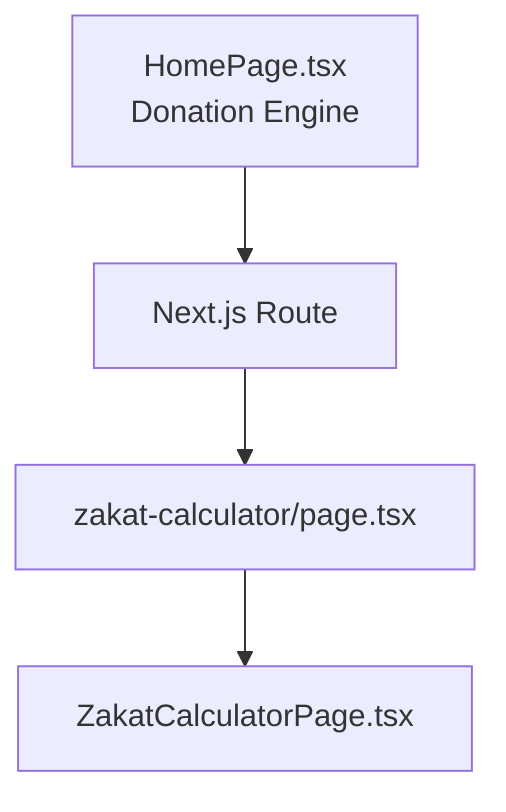
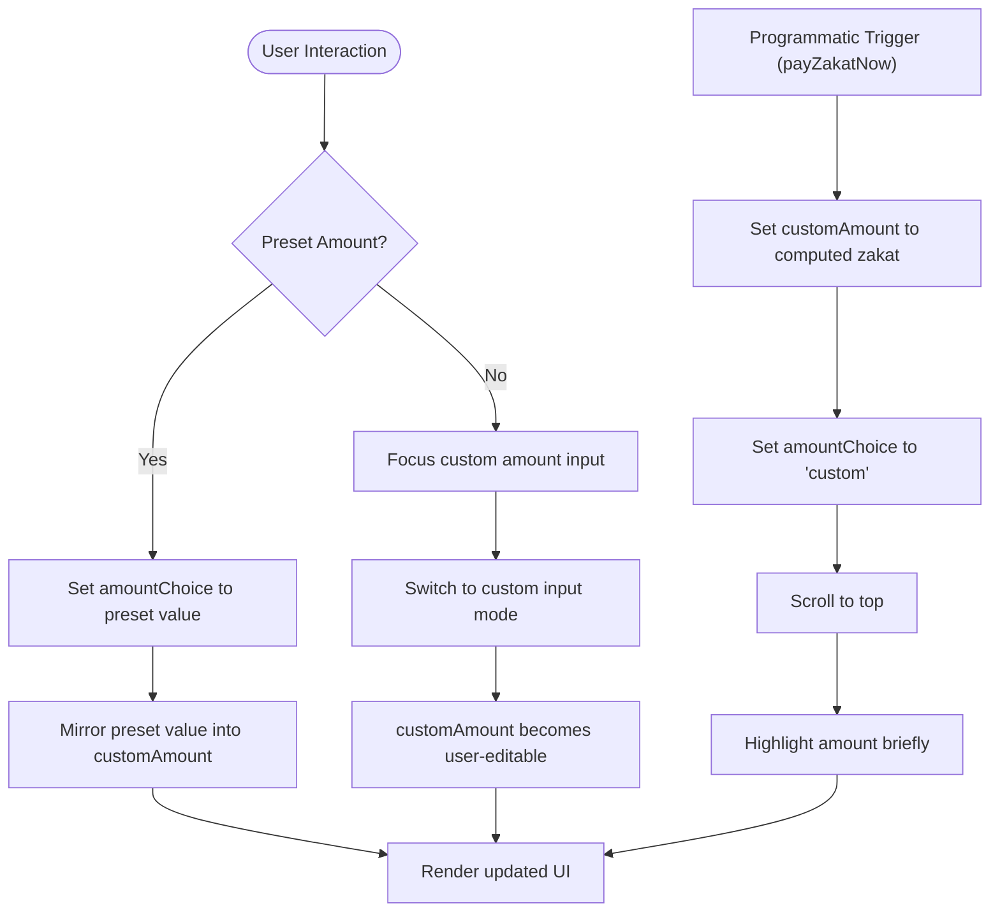
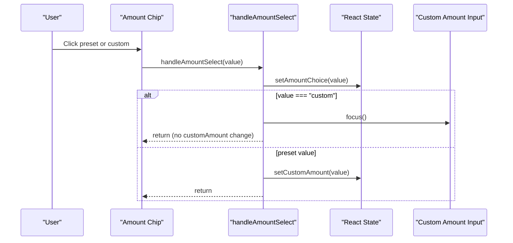
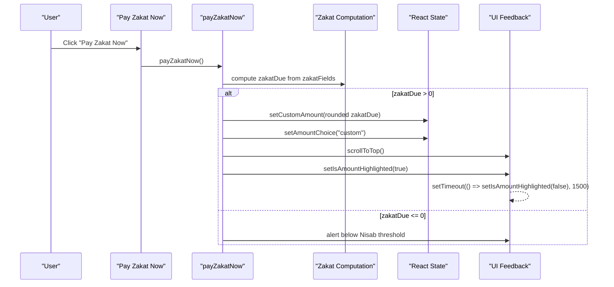
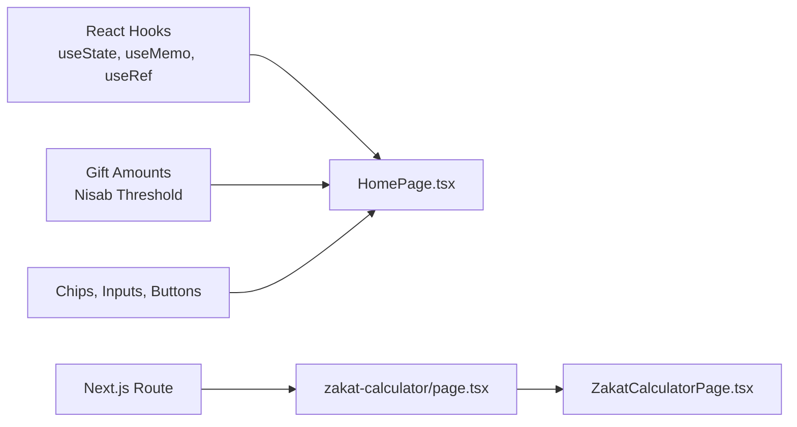

# Amount State Management & Synchronization

<cite>
**Referenced Files in This Document**
- [HomePage.tsx](file://components/pages/HomePage.tsx)
- [zakat-calculator page.tsx](file://app/(site)/zakat-calculator/page.tsx)
- [ZakatCalculatorPage.tsx](file://components/pages/ZakatCalculatorPage.tsx)
</cite>

## Table of Contents
1. [Introduction](#introduction)
2. [Project Structure](#project-structure)
3. [Core Components](#core-components)
4. [Architecture Overview](#architecture-overview)
5. [Detailed Component Analysis](#detailed-component-analysis)
6. [Dependency Analysis](#dependency-analysis)
7. [Performance Considerations](#performance-considerations)
8. [Troubleshooting Guide](#troubleshooting-guide)
9. [Conclusion](#conclusion)

## Introduction
This document explains the dual state management system coordinating between `amountChoice` and `customAmount` in the donation interface, focusing on:
- How preset amount selection updates both states consistently.
- How selecting “Custom Amount” switches to custom input mode and manages focus.
- How the zakat calculation flow programmatically synchronizes these states through `payZakatNow`.
- The relationship between the homepage donation engine and the dedicated zakat calculator page.

The goal is to make the coordination between preset amounts and custom input clear for developers integrating or extending this behavior.

## Project Structure
The relevant implementation lives in two main areas:
- Homepage donation engine with dual state synchronization.
- Dedicated zakat calculator page that computes zakat obligation and provides fulfillment actions.

**Diagram sources**
- [HomePage.tsx:16-82](file://components/pages/HomePage.tsx#L16-L82)
- [zakat-calculator page.tsx:1-14](file://app/(site)/zakat-calculator/page.tsx#L1-L14)
- [ZakatCalculatorPage.tsx:36-97](file://components/pages/ZakatCalculatorPage.tsx#L36-L97)

**Section sources**
- [HomePage.tsx:16-82](file://components/pages/HomePage.tsx#L16-L82)
- [zakat-calculator page.tsx:1-14](file://app/(site)/zakat-calculator/page.tsx#L1-L14)
- [ZakatCalculatorPage.tsx:36-97](file://components/pages/ZakatCalculatorPage.tsx#L36-L97)

## Core Components
- `HomePage.tsx`: Implements the dual state model (`amountChoice`, `customAmount`) and the `handleAmountSelect` function that coordinates preset vs custom workflows. It also contains `payZakatNow`, which sets both states programmatically when zakat is due.
- `zakat-calculator/page.tsx`: Next.js route component that renders the zakat calculator UI.
- `ZakatCalculatorPage.tsx`: Client-side zakat calculator logic, including asset/debt computation, Nisab threshold checks, and fulfillment UX.

Key responsibilities:
- Preset amount selection updates `amountChoice` and mirrors the value into `customAmount`.
- Custom amount selection focuses the input and keeps `customAmount` editable.
- Zakat calculation triggers programmatic state updates to align the UI with computed zakat due.

**Section sources**
- [HomePage.tsx:6-12](file://components/pages/HomePage.tsx#L6-L12)
- [HomePage.tsx:16-24](file://components/pages/HomePage.tsx#L16-L24)
- [HomePage.tsx:49-58](file://components/pages/HomePage.tsx#L49-L58)
- [HomePage.tsx:68-82](file://components/pages/HomePage.tsx#L68-L82)
- [zakat-calculator page.tsx:1-14](file://app/(site)/zakat-calculator/page.tsx#L1-L14)
- [ZakatCalculatorPage.tsx:36-97](file://components/pages/ZakatCalculatorPage.tsx#L36-L97)

## Architecture Overview
The donation engine uses a dual-state pattern:
- `amountChoice`: Represents the selected chip (preset value or “custom”).
- `customAmount`: Holds the actual numeric string used by the input field.

**Diagram sources**
- [HomePage.tsx:49-58](file://components/pages/HomePage.tsx#L49-L58)
- [HomePage.tsx:68-82](file://components/pages/HomePage.tsx#L68-L82)

## Detailed Component Analysis

### Dual State Model: `amountChoice` and `customAmount`
- Initialization:
  - `amountChoice` starts as a preset value (e.g., “50”).
  - `customAmount` starts as a numeric string (e.g., “50”).
- Purpose:
  - `amountChoice` drives chip selection visuals and indicates whether the user is in preset or custom mode.
  - `customAmount` is the source of truth for the input field’s value.

State initialization example paths:
- [Initialization of frequency, fund, amountChoice, customAmount:16-24](file://components/pages/HomePage.tsx#L16-L24)

**Section sources**
- [HomePage.tsx:16-24](file://components/pages/HomePage.tsx#L16-L24)

### Preset Amount Selection Logic: `handleAmountSelect`
Behavior:
- Always update `amountChoice` to reflect the selected option.
- If the selected option is not “custom”, mirror the preset value into `customAmount`.
- If the selected option is “custom”, focus the custom input and do not overwrite `customAmount`.

**Diagram sources**
- [HomePage.tsx:49-58](file://components/pages/HomePage.tsx#L49-L58)

**Section sources**
- [HomePage.tsx:49-58](file://components/pages/HomePage.tsx#L49-L58)

### Custom Amount Mode Switching and Focus Management
When “Custom Amount” is selected:
- The handler focuses the custom input element via a ref.
- The UI remains in custom mode, allowing the user to type freely.
- `amountChoice` stays “custom” while `customAmount` reflects the current input value.

Focus management path:
- [Ref declaration and usage](file://components/pages/HomePage.tsx#L24)
- [Focus call inside handleAmountSelect:52-54](file://components/pages/HomePage.tsx#L52-L54)

**Section sources**
- [HomePage.tsx:24](file://components/pages/HomePage.tsx#L24)
- [HomePage.tsx:52-54](file://components/pages/HomePage.tsx#L52-L54)

### Zakat Calculation Flow Integration: `payZakatNow`
When zakat is due:
- Compute zakat based on net wealth and Nisab threshold.
- Programmatically set `customAmount` to the rounded zakat due.
- Set `amountChoice` to “custom” to switch to custom input mode.
- Optionally scroll to the top and highlight the amount briefly.

**Diagram sources**
- [HomePage.tsx:32-43](file://components/pages/HomePage.tsx#L32-L43)
- [HomePage.tsx:68-82](file://components/pages/HomePage.tsx#L68-L82)

**Section sources**
- [HomePage.tsx:32-43](file://components/pages/HomePage.tsx#L32-L43)
- [HomePage.tsx:68-82](file://components/pages/HomePage.tsx#L68-L82)

### State Synchronization Patterns
- Preset selection:
  - Updates `amountChoice` to the chosen preset.
  - Mirrors the same value into `customAmount` so the input reflects the preset.
- Custom selection:
  - Sets `amountChoice` to “custom”.
  - Focuses the input; does not overwrite `customAmount`.
- Programmatic trigger:
  - `payZakatNow` sets both `customAmount` and `amountChoice` together to ensure consistent UI state after zakat computation.

Synchronization examples:
- [Preset mirroring](file://components/pages/HomePage.tsx#L57)
- [Custom mode focus:52-54](file://components/pages/HomePage.tsx#L52-L54)
- [Programmatic state sync:70-72](file://components/pages/HomePage.tsx#L70-L72)

**Section sources**
- [HomePage.tsx:52-58](file://components/pages/HomePage.tsx#L52-L58)
- [HomePage.tsx:70-72](file://components/pages/HomePage.tsx#L70-L72)

### Zakat Calculator Page Integration
The dedicated zakat calculator page renders a comprehensive form and summary card:
- Computes total assets, liabilities, net wealth, and zakat due.
- Displays Nisab status and obligation.
- Provides a fulfillment action that alerts users about their calculated zakat.

Relevant behaviors:
- Asset and debt parsing and summation.
- Net wealth and zakat due calculation using a fixed Nisab threshold.
- Fulfillment UX that informs users of the calculated amount.

Implementation paths:
- [Field structure and initial state:8-19](file://components/pages/ZakatCalculatorPage.tsx#L8-L19)
- [Asset/debt/net/zakat calculations:47-59](file://components/pages/ZakatCalculatorPage.tsx#L47-L59)
- [Fulfillment action:84-97](file://components/pages/ZakatCalculatorPage.tsx#L84-L97)

**Section sources**
- [ZakatCalculatorPage.tsx:8-19](file://components/pages/ZakatCalculatorPage.tsx#L8-L19)
- [ZakatCalculatorPage.tsx:47-59](file://components/pages/ZakatCalculatorPage.tsx#L47-L59)
- [ZakatCalculatorPage.tsx:84-97](file://components/pages/ZakatCalculatorPage.tsx#L84-L97)

## Dependency Analysis
The homepage donation engine depends on:
- React hooks (`useState`, `useMemo`, `useRef`) for state and refs.
- Local constants for gift presets and Nisab threshold.
- UI components for chips, inputs, and buttons.

The zakat calculator page depends on:
- Next.js metadata and routing.
- Client-side state for form fields and computed values.

**Diagram sources**
- [HomePage.tsx:1-4](file://components/pages/HomePage.tsx#L1-L4)
- [HomePage.tsx:6-14](file://components/pages/HomePage.tsx#L6-L14)
- [zakat-calculator page.tsx:1-4](file://app/(site)/zakat-calculator/page.tsx#L1-L4)
- [ZakatCalculatorPage.tsx:1-4](file://components/pages/ZakatCalculatorPage.tsx#L1-L4)

**Section sources**
- [HomePage.tsx:1-4](file://components/pages/HomePage.tsx#L1-L4)
- [HomePage.tsx:6-14](file://components/pages/HomePage.tsx#L6-L14)
- [zakat-calculator page.tsx:1-4](file://app/(site)/zakat-calculator/page.tsx#L1-L4)
- [ZakatCalculatorPage.tsx:1-4](file://components/pages/ZakatCalculatorPage.tsx#L1-L4)

## Performance Considerations
- Memoization:
  - Zakat computation uses `useMemo` to avoid recalculating on unrelated re-renders.
- Minimal state updates:
  - `handleAmountSelect` avoids unnecessary updates by only setting `customAmount` for preset selections.
- UI feedback:
  - Temporary highlight state is cleared via timeout to prevent long-lived effects.

Recommendations:
- Keep zakat computation memoized and dependent only on zakat fields.
- Avoid redundant state writes; prefer functional updates where possible.
- Debounce heavy operations if additional computations are added.

[No sources needed since this section provides general guidance]

## Troubleshooting Guide
Common issues and resolutions:
- Custom input not focused when selecting “Custom Amount”:
  - Ensure the ref is attached to the input and `handleAmountSelect` calls focus on “custom”.
  - Verify no other handlers override focus behavior.
- Preset amount not reflected in input:
  - Confirm `handleAmountSelect` mirrors the preset value into `customAmount`.
- Zakat amount not applied programmatically:
  - Check that `payZakatNow` sets both `customAmount` and `amountChoice` when zakat is due.
  - Validate zakat computation returns a positive value above the Nisab threshold.

Verification paths:
- [Focus handling in handleAmountSelect:52-54](file://components/pages/HomePage.tsx#L52-L54)
- [Preset mirroring in handleAmountSelect](file://components/pages/HomePage.tsx#L57)
- [Programmatic state sync in payZakatNow:70-72](file://components/pages/HomePage.tsx#L70-L72)

**Section sources**
- [HomePage.tsx:52-58](file://components/pages/HomePage.tsx#L52-L58)
- [HomePage.tsx:70-72](file://components/pages/HomePage.tsx#L70-L72)

## Conclusion
The dual state management system in the homepage donation engine ensures consistent behavior between preset amounts and custom input:
- `handleAmountSelect` coordinates preset selection and custom mode switching.
- `payZakatNow` synchronizes both states programmatically during zakat fulfillment.
- The zakat calculator page complements this flow by computing obligations and providing fulfillment UX.

This design maintains clarity, predictability, and a smooth user experience across preset and custom workflows.

[No sources needed since this section summarizes without analyzing specific files]