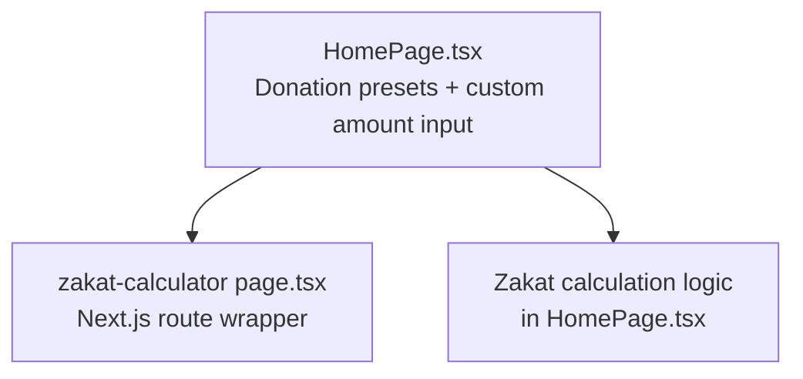
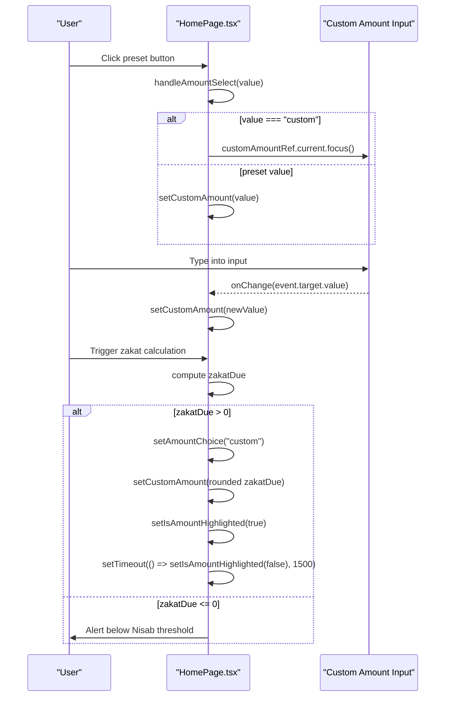
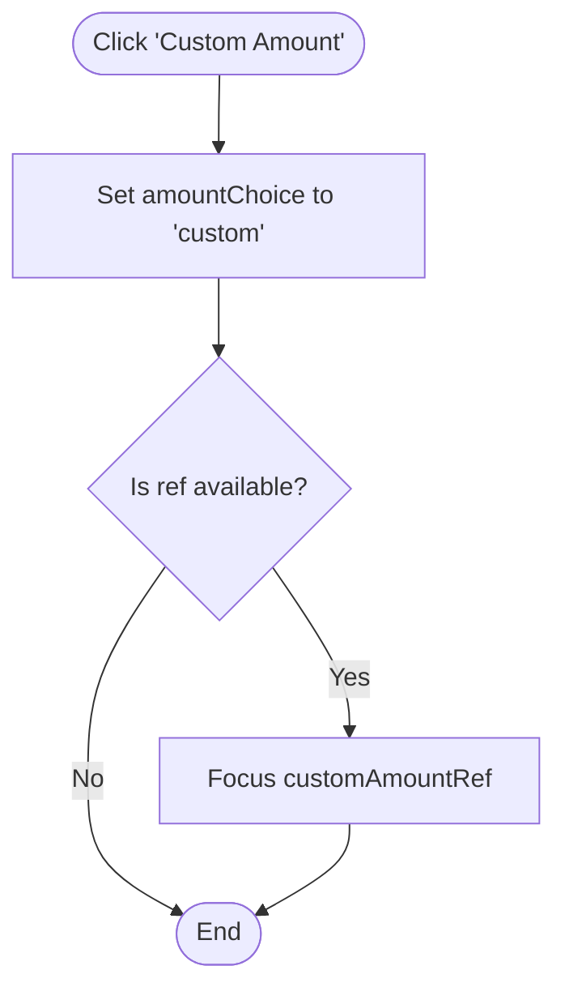
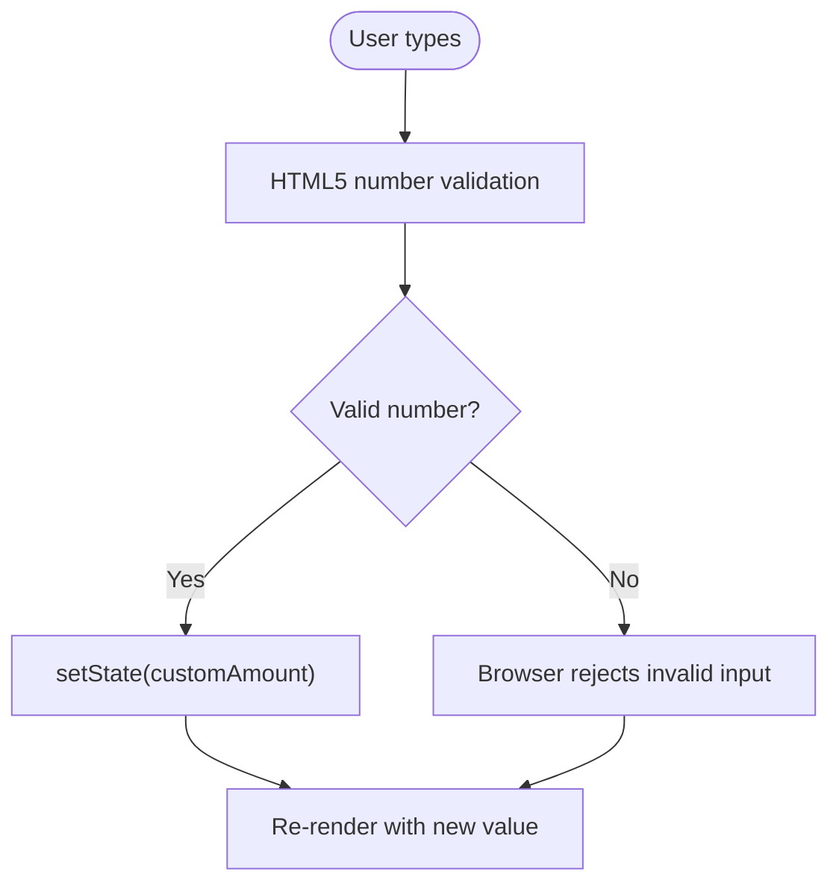
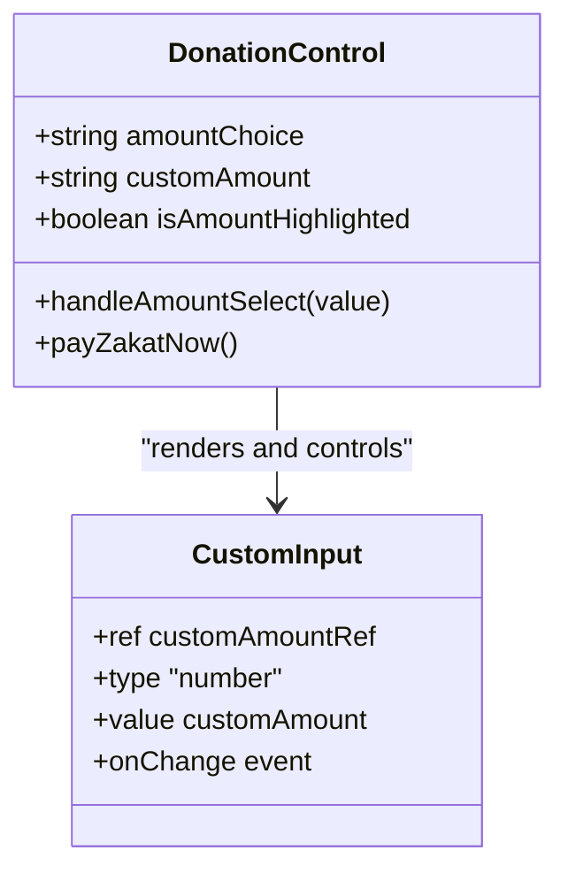
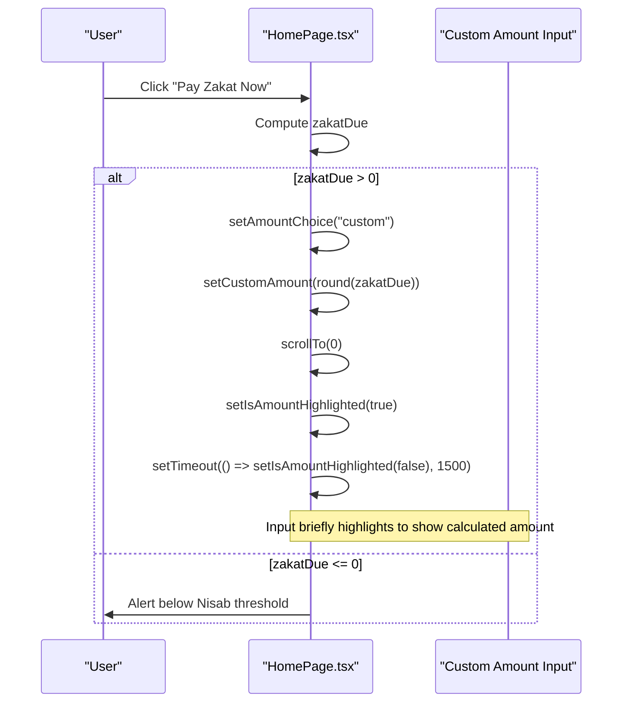
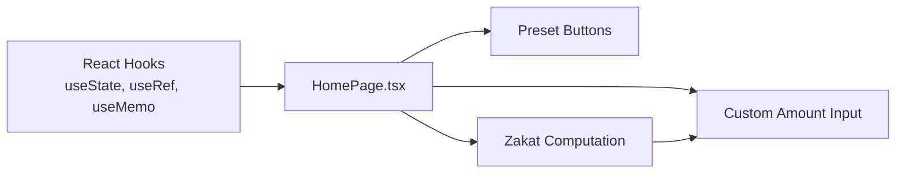

# Custom Amount Input Field

<cite>
**Referenced Files in This Document**
- [HomePage.tsx](file://components/pages/HomePage.tsx)
- [zakat-calculator page.tsx](file://app/(site)/zakat-calculator/page.tsx)
</cite>

## Table of Contents
1. [Introduction](#introduction)
2. [Project Structure](#project-structure)
3. [Core Components](#core-components)
4. [Architecture Overview](#architecture-overview)
5. [Detailed Component Analysis](#detailed-component-analysis)
6. [Dependency Analysis](#dependency-analysis)
7. [Performance Considerations](#performance-considerations)
8. [Troubleshooting Guide](#troubleshooting-guide)
9. [Conclusion](#conclusion)

## Introduction
This document explains the custom amount input field used for donation amounts on the homepage. It focuses on:
- Ref-based focus management when switching from preset amounts to the custom input
- HTML5 number type constraints and real-time state synchronization with `customAmount`
- Visual design patterns including the dollar sign prefix, USD suffix, and highlight effect driven by `isAmountHighlighted`
- Integration with zakat calculation flows that automatically select and highlight the custom amount

The implementation is contained within the homepage component and is surfaced through a Next.js route that renders the same component.

## Project Structure
The custom amount input lives inside the homepage component, which manages both donation presets and a dedicated custom input. The zakat calculator page is a separate route that renders its own calculator UI; the homepage also includes a lightweight zakat calculation section that interacts with the custom amount input.

**Diagram sources**
- [HomePage.tsx:16-82](file://components/pages/HomePage.tsx#L16-L82)
- [zakat-calculator page.tsx:1-15](file://app/(site)/zakat-calculator/page.tsx#L1-L15)

**Section sources**
- [HomePage.tsx:16-82](file://components/pages/HomePage.tsx#L16-L82)
- [zakat-calculator page.tsx:1-15](file://app/(site)/zakat-calculator/page.tsx#L1-L15)

## Core Components
- Preset amount buttons: A small set of predefined donation values plus a “Custom Amount” option.
- Custom amount input: An HTML5 number input with a dollar sign prefix and USD suffix.
- State variables:
  - `amountChoice`: Tracks the selected preset or “custom”.
  - `customAmount`: Holds the typed value in the custom input.
  - `isAmountHighlighted`: Controls a temporary background highlight for zakat integration feedback.
- Focus reference: `customAmountRef` points to the custom input element to programmatically focus it.

Key responsibilities:
- Selecting a preset updates `amountChoice` and sets `customAmount`.
- Selecting “Custom Amount” focuses the input without changing `customAmount`.
- Typing into the input updates `customAmount` in real time.
- Zakat flow can auto-select “custom”, populate the amount, scroll to the top, and briefly highlight the input.

**Section sources**
- [HomePage.tsx:6-12](file://components/pages/HomePage.tsx#L6-L12)
- [HomePage.tsx:16-30](file://components/pages/HomePage.tsx#L16-L30)
- [HomePage.tsx:49-58](file://components/pages/HomePage.tsx#L49-L58)
- [HomePage.tsx:68-82](file://components/pages/HomePage.tsx#L68-L82)
- [HomePage.tsx:368-390](file://components/pages/HomePage.tsx#L368-L390)

## Architecture Overview
The custom amount input is part of a compact donation control surface. User interactions follow these paths:
- Preset selection: Updates state and optionally fills the custom input value.
- Custom selection: Focuses the input so users can immediately type.
- Input typing: Synchronizes the controlled `value` prop with React state.
- Zakat integration: Computes zakat due, then selects “custom”, scrolls to the top, highlights the input, and resets the highlight after a short delay.

**Diagram sources**
- [HomePage.tsx:49-58](file://components/pages/HomePage.tsx#L49-L58)
- [HomePage.tsx:68-82](file://components/pages/HomePage.tsx#L68-L82)
- [HomePage.tsx:368-390](file://components/pages/HomePage.tsx#L368-L390)

## Detailed Component Analysis

### Ref-Based Focus Management
When the user clicks “Custom Amount,” the handler switches the active choice to “custom” and focuses the input via `customAmountRef`. This avoids setting a preset value and ensures immediate keyboard entry.

- Reference creation: `customAmountRef = useRef<HTMLInputElement>(null)`
- Focus trigger: `customAmountRef.current?.focus()`
- Element binding: `ref={customAmountRef}` attached to the input

**Diagram sources**
- [HomePage.tsx:24](file://components/pages/HomePage.tsx#L24)
- [HomePage.tsx:49-58](file://components/pages/HomePage.tsx#L49-L58)
- [HomePage.tsx:374](file://components/pages/HomePage.tsx#L374)

**Section sources**
- [HomePage.tsx:24](file://components/pages/HomePage.tsx#L24)
- [HomePage.tsx:49-58](file://components/pages/HomePage.tsx#L49-L58)
- [HomePage.tsx:374](file://components/pages/HomePage.tsx#L374)

### Input Validation and Real-Time State Synchronization
The input uses `type="number"` to leverage browser-level numeric validation. Its `value` is bound to `customAmount`, making it a controlled component. Every keystroke triggers `onChange`, which calls `setCustomAmount` to keep React state synchronized with the DOM.

- Number constraint: `type="number"`
- Controlled value: `value={customAmount}`
- Real-time update: `onChange={(event) => setCustomAmount(event.target.value)}`

**Diagram sources**
- [HomePage.tsx:373-385](file://components/pages/HomePage.tsx#L373-L385)

**Section sources**
- [HomePage.tsx:373-385](file://components/pages/HomePage.tsx#L373-L385)

### Visual Design Patterns
The input container provides clear currency context and optional visual feedback:
- Dollar sign prefix: A prominent `$` before the input.
- USD suffix: A muted “USD” label after the input.
- Highlight effect: When `isAmountHighlighted` is true, the input background changes to a subtle mint color to draw attention during zakat integration.

**Diagram sources**
- [HomePage.tsx:16-30](file://components/pages/HomePage.tsx#L16-L30)
- [HomePage.tsx:368-390](file://components/pages/HomePage.tsx#L368-L390)

**Section sources**
- [HomePage.tsx:368-390](file://components/pages/HomePage.tsx#L368-L390)

### Zakat Calculation Integration
The homepage computes zakat based on provided fields and integrates with the custom amount input:
- If zakat due is greater than zero:
  - Set `amountChoice` to “custom”
  - Populate `customAmount` with the rounded zakat due
  - Scroll to the top
  - Temporarily highlight the input using `isAmountHighlighted`
- If zakat due is zero or below the threshold:
  - Show an alert explaining the situation

**Diagram sources**
- [HomePage.tsx:32-43](file://components/pages/HomePage.tsx#L32-L43)
- [HomePage.tsx:68-82](file://components/pages/HomePage.tsx#L68-L82)

**Section sources**
- [HomePage.tsx:32-43](file://components/pages/HomePage.tsx#L32-L43)
- [HomePage.tsx:68-82](file://components/pages/HomePage.tsx#L68-L82)

### Code Examples (by location)
- Input element configuration:
  - See [input element definition:373-385](file://components/pages/HomePage.tsx#L373-L385)
- onChange handler implementation:
  - See [onChange handler:382-384](file://components/pages/HomePage.tsx#L382-L384)
- Focus management pattern for “Custom Amount”:
  - See [handler and focus call:49-58](file://components/pages/HomePage.tsx#L49-L58)
  - See [ref attachment](file://components/pages/HomePage.tsx#L374)

**Section sources**
- [HomePage.tsx:49-58](file://components/pages/HomePage.tsx#L49-L58)
- [HomePage.tsx:373-385](file://components/pages/HomePage.tsx#L373-L385)

## Dependency Analysis
- Internal dependencies:
  - React hooks: `useState`, `useRef`, `useMemo`
  - Next.js Link component (used elsewhere in the page)
- Data flow:
  - Preset buttons drive `amountChoice` and conditionally update `customAmount`
  - Custom input drives `customAmount` via controlled `value` and `onChange`
  - Zakat computation depends on zakat fields and influences `amountChoice`, `customAmount`, and `isAmountHighlighted`

**Diagram sources**
- [HomePage.tsx:4](file://components/pages/HomePage.tsx#L4)
- [HomePage.tsx:16-30](file://components/pages/HomePage.tsx#L16-L30)
- [HomePage.tsx:32-43](file://components/pages/HomePage.tsx#L32-L43)

**Section sources**
- [HomePage.tsx:4](file://components/pages/HomePage.tsx#L4)
- [HomePage.tsx:16-30](file://components/pages/HomePage.tsx#L16-L30)
- [HomePage.tsx:32-43](file://components/pages/HomePage.tsx#L32-L43)

## Performance Considerations
- Controlled input: Using `value={customAmount}` ensures predictable state but re-renders on every keystroke. For very large forms, consider debounced updates or uncontrolled inputs with refs if performance becomes critical.
- Highlight timeout: The 1500ms highlight uses `setTimeout`; ensure cleanup is not required here since it does not create long-lived timers beyond the brief flash.
- Memoization: Zakat computation uses `useMemo` to avoid unnecessary recalculations when zakat fields do not change.

[No sources needed since this section provides general guidance]

## Troubleshooting Guide
- Custom input not focusing:
  - Verify `customAmountRef` is attached to the input element.
  - Ensure `handleAmountSelect` runs when “Custom Amount” is clicked.
  - Check for early returns preventing focus execution.
- Value not updating while typing:
  - Confirm `onChange` calls `setCustomAmount` with `event.target.value`.
  - Ensure no other component overrides the input’s value.
- Highlight not appearing:
  - Verify `isAmountHighlighted` toggles to true during zakat flow.
  - Confirm the conditional class applying the highlight is present on the input.

**Section sources**
- [HomePage.tsx:49-58](file://components/pages/HomePage.tsx#L49-L58)
- [HomePage.tsx:373-385](file://components/pages/HomePage.tsx#L373-L385)
- [HomePage.tsx:68-82](file://components/pages/HomePage.tsx#L68-L82)

## Conclusion
The custom amount input field provides a focused, accessible, and visually consistent way for users to specify donation amounts. It leverages ref-based focus management for smooth transitions from presets to manual entry, HTML5 number constraints for basic validation, and real-time state synchronization for responsive behavior. The zakat integration enhances usability by automatically selecting and highlighting the custom input when a calculated zakat amount is ready to be donated.

[No sources needed since this section summarizes without analyzing specific files]