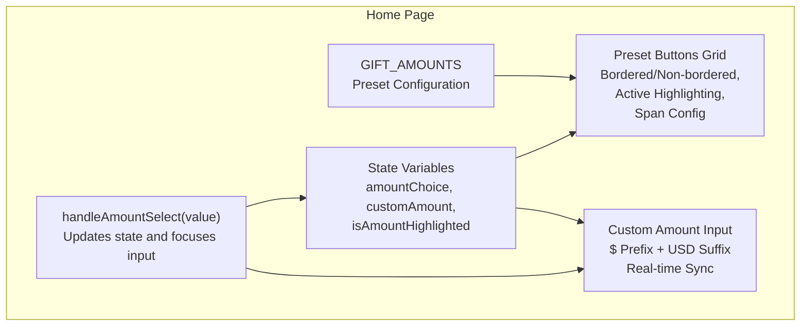
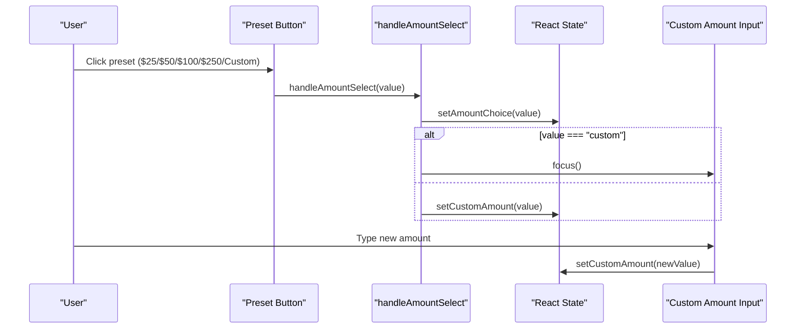
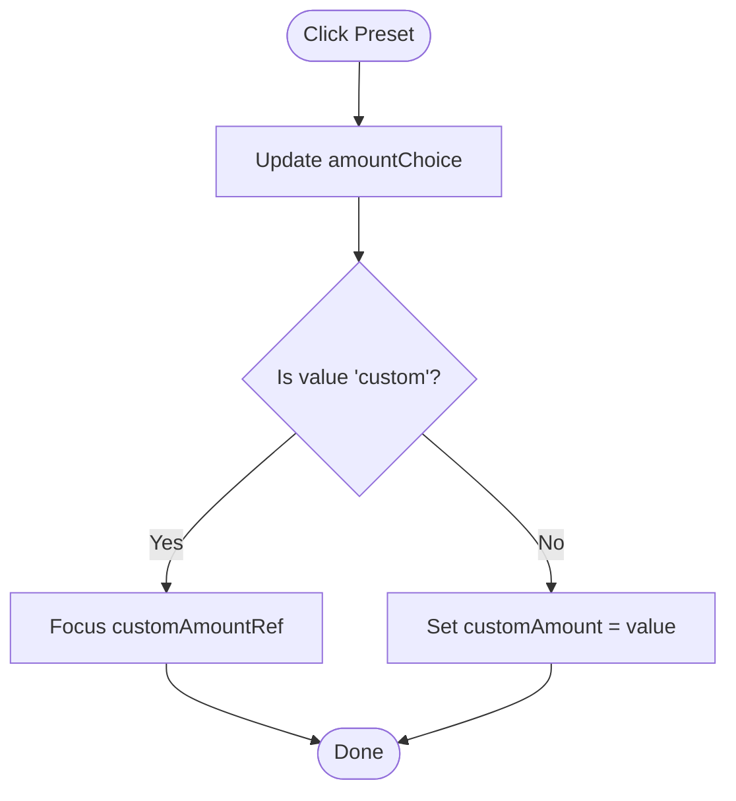
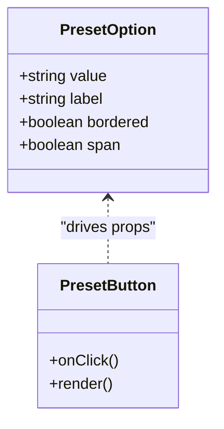
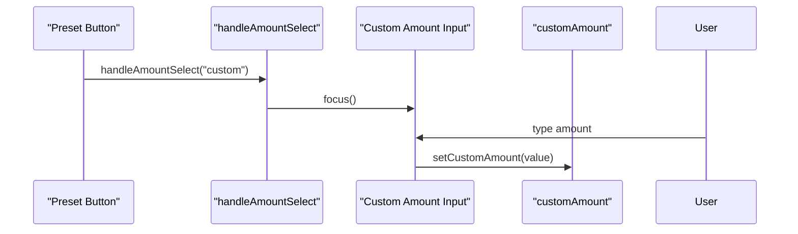
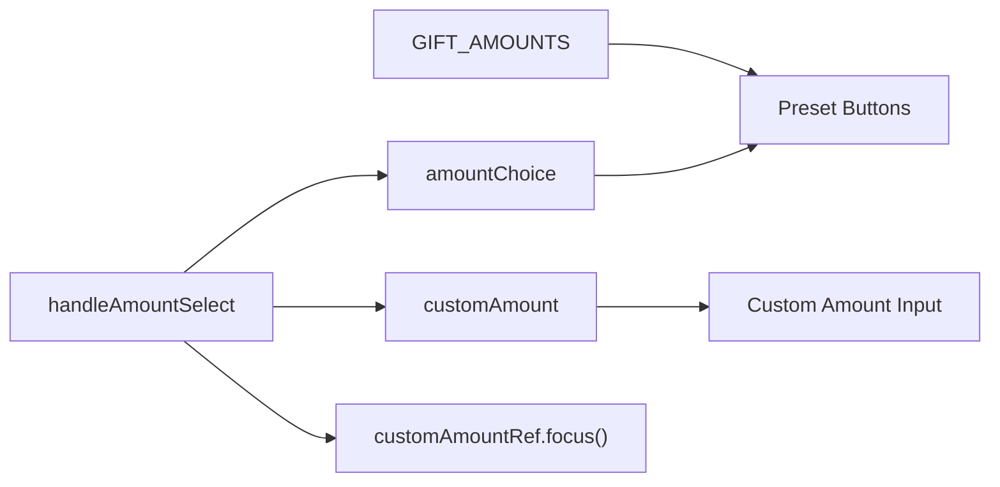

# Preset Amount & Custom Input

<cite>
**Referenced Files in This Document**
- [HomePage.tsx](file://components/pages/HomePage.tsx)
</cite>

## Table of Contents
1. [Introduction](#introduction)
2. [Project Structure](#project-structure)
3. [Core Components](#core-components)
4. [Architecture Overview](#architecture-overview)
5. [Detailed Component Analysis](#detailed-component-analysis)
6. [Dependency Analysis](#dependency-analysis)
7. [Performance Considerations](#performance-considerations)
8. [Troubleshooting Guide](#troubleshooting-guide)
9. [Conclusion](#conclusion)

## Introduction
This document explains the dual amount selection system that offers preset donation amounts and a custom input field. It covers the configuration array for presets, the selection handler logic, conditional rendering behavior, visual design patterns (bordered vs non-bordered buttons, span configurations, active state highlighting), focus management when switching to custom input, input synchronization, and real-time updates. The goal is to make the implementation clear for both developers and product stakeholders.

## Project Structure
The amount selection UI lives inside the home page component. The relevant code includes:
- A configuration array defining preset amounts and layout options
- State variables for selected amount and custom input value
- A selection handler that synchronizes state and manages focus
- A grid of preset buttons with conditional styling
- A custom amount input with currency prefix and suffix labels

**Diagram sources**
- [HomePage.tsx:6-12](file://components/pages/HomePage.tsx#L6-L12)
- [HomePage.tsx:16-24](file://components/pages/HomePage.tsx#L16-L24)
- [HomePage.tsx:49-58](file://components/pages/HomePage.tsx#L49-L58)
- [HomePage.tsx:345-363](file://components/pages/HomePage.tsx#L345-L363)
- [HomePage.tsx:368-390](file://components/pages/HomePage.tsx#L368-L390)

**Section sources**
- [HomePage.tsx:6-12](file://components/pages/HomePage.tsx#L6-L12)
- [HomePage.tsx:16-24](file://components/pages/HomePage.tsx#L16-L24)
- [HomePage.tsx:49-58](file://components/pages/HomePage.tsx#L49-L58)
- [HomePage.tsx:345-363](file://components/pages/HomePage.tsx#L345-L363)
- [HomePage.tsx:368-390](file://components/pages/HomePage.tsx#L368-L390)

## Core Components
- GIFT_AMOUNTS configuration array defines preset values, labels, border style, and span behavior.
- handleAmountSelect function updates the selected preset and synchronizes the custom input; it also focuses the custom input when “Custom Amount” is chosen.
- Preset buttons render in a responsive grid with conditional borders and active state highlighting.
- Custom amount input displays a dollar sign prefix and USD suffix, highlights briefly on programmatic updates, and stays synchronized with preset selections.

Key responsibilities:
- Preset configuration: declarative list of selectable amounts and their display properties.
- Selection logic: single source of truth for updating both preset choice and custom input value.
- Visual feedback: active state highlighting and optional button borders.
- Focus management: automatic focus on custom input when switching modes.
- Real-time sync: typing in the custom input updates state immediately.

**Section sources**
- [HomePage.tsx:6-12](file://components/pages/HomePage.tsx#L6-L12)
- [HomePage.tsx:49-58](file://components/pages/HomePage.tsx#L49-L58)
- [HomePage.tsx:345-363](file://components/pages/HomePage.tsx#L345-L363)
- [HomePage.tsx:368-390](file://components/pages/HomePage.tsx#L368-L390)

## Architecture Overview
The amount selection feature follows a simple state-driven pattern:
- Preset buttons trigger handleAmountSelect with the chosen value.
- handleAmountSelect updates amountChoice and either sets customAmount or focuses the custom input.
- The custom input’s onChange updates customAmount directly.
- Conditional styles reflect the current selection and mode.

**Diagram sources**
- [HomePage.tsx:49-58](file://components/pages/HomePage.tsx#L49-L58)
- [HomePage.tsx:345-363](file://components/pages/HomePage.tsx#L345-L363)
- [HomePage.tsx:368-390](file://components/pages/HomePage.tsx#L368-L390)

## Detailed Component Analysis

### GIFT_AMOUNTS Configuration
- Purpose: Define preset amounts and their UI behavior.
- Fields:
  - value: string identifier used for selection and synchronization.
  - label: displayed text for each preset.
  - bordered: boolean controlling whether the button has a visible border.
  - span: boolean controlling whether the button spans two columns in the grid.
- Presets include $25, $50, $100, $250, and a “Custom Amount” option.

Design implications:
- Bordered vs non-bordered buttons create visual rhythm and emphasis.
- Spanning the “Custom Amount” button across two columns emphasizes the alternative input path.

**Section sources**
- [HomePage.tsx:6-12](file://components/pages/HomePage.tsx#L6-L12)

### handleAmountSelect Logic
- Updates the selected preset via amountChoice.
- If the selected value is “custom”, focuses the custom input without changing customAmount.
- Otherwise, synchronizes customAmount to match the selected preset.

Behavioral notes:
- Ensures consistent state between preset selection and custom input.
- Improves accessibility by moving focus to the input when switching to custom mode.

**Diagram sources**
- [HomePage.tsx:49-58](file://components/pages/HomePage.tsx#L49-L58)

**Section sources**
- [HomePage.tsx:49-58](file://components/pages/HomePage.tsx#L49-L58)

### Preset Buttons Grid and Visual Design
- Layout: Responsive grid with three columns; spacing and rounded corners provide a modern card-like feel.
- Styling rules:
  - Bordered buttons: apply a subtle border based on the preset’s bordered flag.
  - Active state: when amountChoice matches the preset’s value, the button becomes highlighted with a solid background and white text.
  - Non-active state: uses a light background with primary-colored text and hover effects.
  - Span configuration: if span is true, the button spans two columns.

Accessibility and UX:
- Clear active state helps users understand which preset is selected.
- Hover states improve discoverability.
- Consistent typography and spacing maintain readability.

**Diagram sources**
- [HomePage.tsx:6-12](file://components/pages/HomePage.tsx#L6-L12)
- [HomePage.tsx:345-363](file://components/pages/HomePage.tsx#L345-L363)

**Section sources**
- [HomePage.tsx:345-363](file://components/pages/HomePage.tsx#L345-L363)

### Custom Amount Input and Real-Time Sync
- Structure: A container with a dollar sign prefix, an input field, and a USD suffix label.
- Behavior:
  - Controlled by customAmount state.
  - onChange updates customAmount immediately for real-time feedback.
  - When a preset is selected, customAmount is synchronized to match the preset.
  - When “Custom Amount” is selected, focus moves to the input for immediate typing.
  - Optional highlight effect can be applied programmatically to draw attention to the input.

Validation:
- Uses HTML number input type for basic numeric constraints.
- No explicit validation logic is present beyond browser defaults.

Synchronization patterns:
- Preset click → update customAmount.
- Custom input change → update customAmount.
- Programmatic actions (e.g., zakat calculation) can set customAmount and optionally highlight the input.

**Diagram sources**
- [HomePage.tsx:49-58](file://components/pages/HomePage.tsx#L49-L58)
- [HomePage.tsx:368-390](file://components/pages/HomePage.tsx#L368-L390)

**Section sources**
- [HomePage.tsx:368-390](file://components/pages/HomePage.tsx#L368-L390)

### Focus Management
- When “Custom Amount” is selected, the custom input receives focus automatically.
- This improves usability by allowing immediate typing without additional clicks.
- Focus is managed via a ref attached to the input element.

Best practices:
- Ensure focus only occurs after the DOM is ready (handled by React refs).
- Avoid focus traps; keep focus movement predictable.

**Section sources**
- [HomePage.tsx:49-58](file://components/pages/HomePage.tsx#L49-L58)

### Input Validation and Real-Time Updates
- Validation: Relies on the native number input behavior; no custom validation is implemented.
- Real-time updates: The input’s onChange updates state immediately, ensuring the UI reflects user input instantly.
- Synchronization: Selecting a preset updates the custom input value, keeping both sources of truth aligned.

Recommendations:
- Add min/max constraints if needed.
- Consider formatting currency values consistently.
- Provide inline error messages for invalid inputs.

**Section sources**
- [HomePage.tsx:368-390](file://components/pages/HomePage.tsx#L368-L390)

## Dependency Analysis
- The amount selection UI depends on:
  - GIFT_AMOUNTS configuration for rendering presets.
  - React state for amountChoice and customAmount.
  - A ref for focusing the custom input.
- Coupling:
  - Preset buttons depend on amountChoice for active state.
  - Custom input depends on customAmount for controlled value.
  - handleAmountSelect coordinates state changes and focus behavior.

**Diagram sources**
- [HomePage.tsx:6-12](file://components/pages/HomePage.tsx#L6-L12)
- [HomePage.tsx:16-24](file://components/pages/HomePage.tsx#L16-L24)
- [HomePage.tsx:49-58](file://components/pages/HomePage.tsx#L49-L58)
- [HomePage.tsx:345-363](file://components/pages/HomePage.tsx#L345-L363)
- [HomePage.tsx:368-390](file://components/pages/HomePage.tsx#L368-L390)

**Section sources**
- [HomePage.tsx:6-12](file://components/pages/HomePage.tsx#L6-L12)
- [HomePage.tsx:16-24](file://components/pages/HomePage.tsx#L16-L24)
- [HomePage.tsx:49-58](file://components/pages/HomePage.tsx#L49-L58)
- [HomePage.tsx:345-363](file://components/pages/HomePage.tsx#L345-L363)
- [HomePage.tsx:368-390](file://components/pages/HomePage.tsx#L368-L390)

## Performance Considerations
- Rendering: Preset buttons are mapped from a small static array; performance impact is negligible.
- State updates: Frequent onChange updates are lightweight; consider debouncing if integrating with external analytics or APIs.
- Focus management: Using refs avoids unnecessary re-renders.

[No sources needed since this section provides general guidance]

## Troubleshooting Guide
Common issues and resolutions:
- Custom input not focused after selecting “Custom Amount”:
  - Verify the ref is correctly attached to the input element.
  - Ensure handleAmountSelect is called with the correct “custom” value.
- Mismatch between preset selection and custom input value:
  - Confirm handleAmountSelect updates customAmount when a preset is chosen.
  - Check that preset onClick handlers pass the correct value.
- Visual state not reflecting selection:
  - Ensure amountChoice comparison matches the preset’s value.
  - Validate conditional classes for active state and borders.

**Section sources**
- [HomePage.tsx:49-58](file://components/pages/HomePage.tsx#L49-L58)
- [HomePage.tsx:345-363](file://components/pages/HomePage.tsx#L345-L363)
- [HomePage.tsx:368-390](file://components/pages/HomePage.tsx#L368-L390)

## Conclusion
The dual amount selection system combines a concise preset configuration with robust state-driven interactions. It provides clear visual feedback, smooth focus management, and real-time synchronization between presets and custom input. By following the documented patterns—using the GIFT_AMOUNTS array, centralizing selection logic in handleAmountSelect, and maintaining consistent styling—you can extend or customize the feature while preserving usability and accessibility.

[No sources needed since this section summarizes without analyzing specific files]