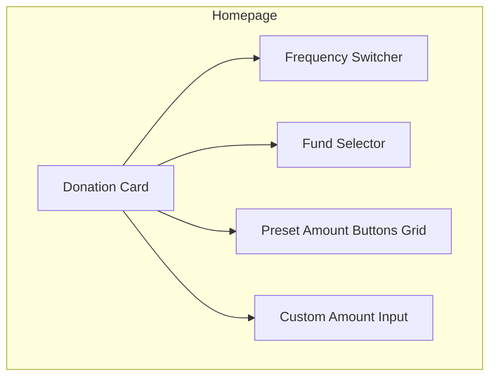
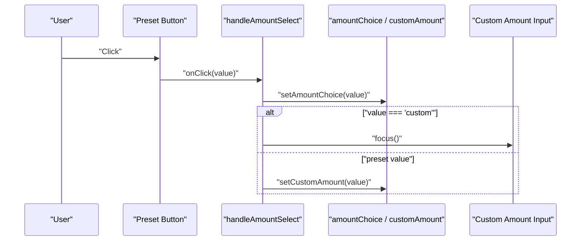
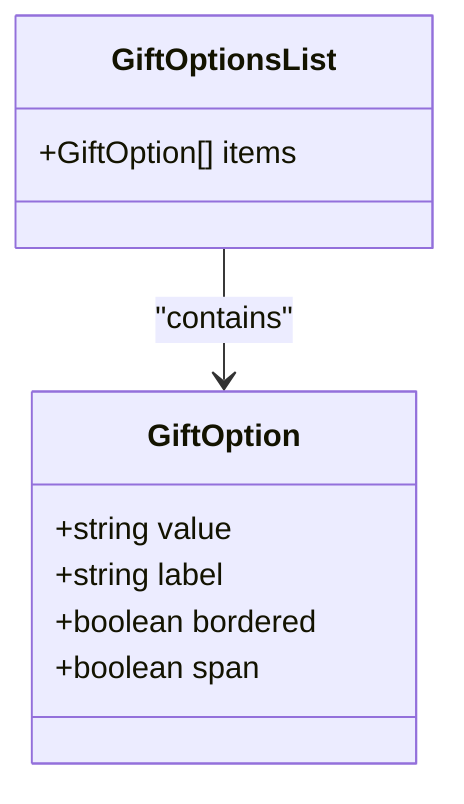
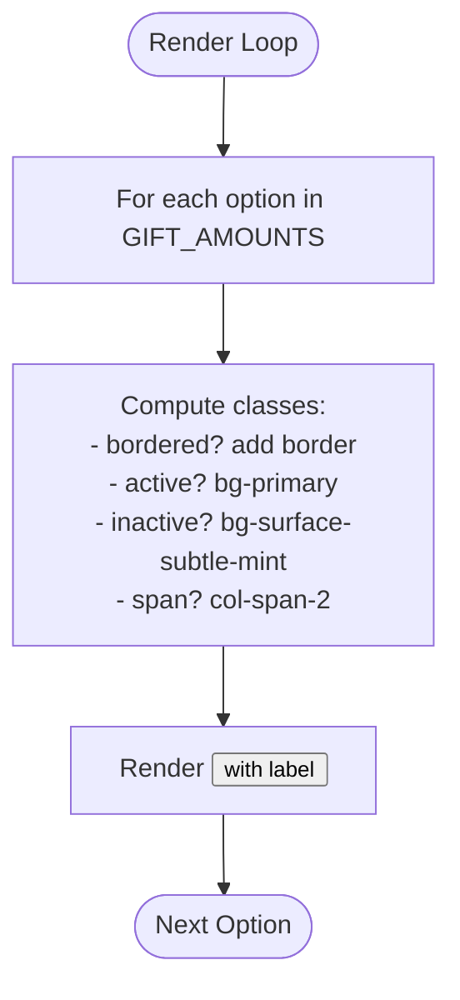
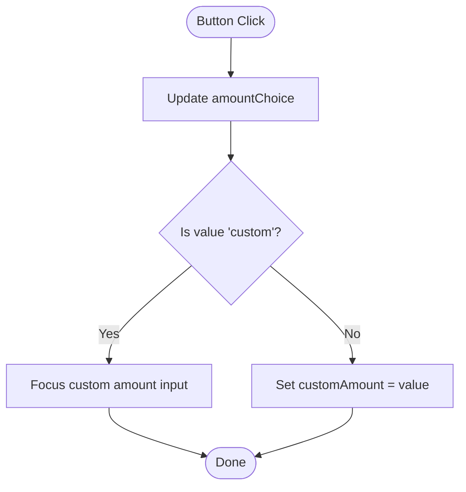
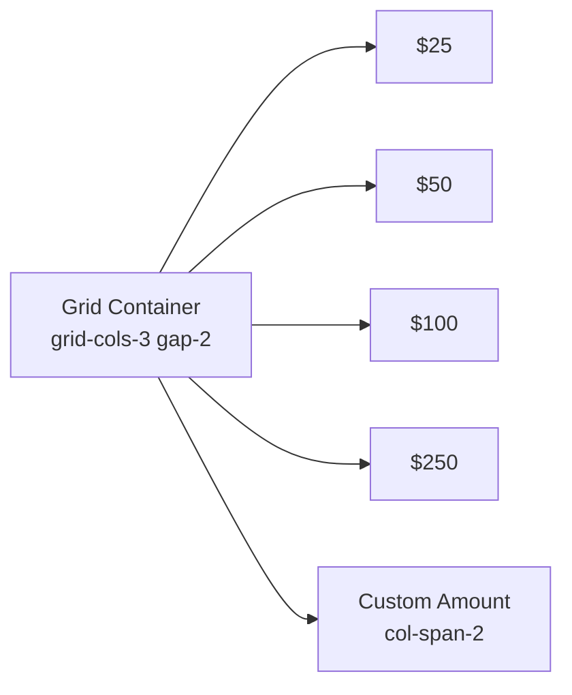
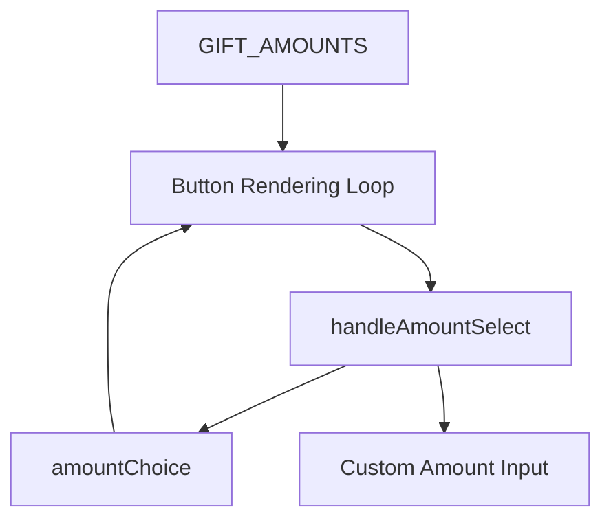

# Preset Amount Buttons

<cite>
**Referenced Files in This Document**
- [HomePage.tsx](file://components/pages/HomePage.tsx)
</cite>

## Table of Contents
1. [Introduction](#introduction)
2. [Project Structure](#project-structure)
3. [Core Components](#core-components)
4. [Architecture Overview](#architecture-overview)
5. [Detailed Component Analysis](#detailed-component-analysis)
6. [Dependency Analysis](#dependency-analysis)
7. [Performance Considerations](#performance-considerations)
8. [Troubleshooting Guide](#troubleshooting-guide)
9. [Conclusion](#conclusion)

## Introduction
This document explains the preset amount button system used for donation selection on the homepage. It covers the configuration array that defines the $25, $50, $100, and $250 options plus a custom amount entry; the conditional styling logic for borders and grid spanning; active state management via state comparison; and visual feedback through background color changes. It also includes code examples showing the rendering loop, event handling, and responsive grid layout.

## Project Structure
The preset amount buttons are implemented within the homepage component. The relevant section is the “Quick Floating Donation Engine Card” where:
- A 3-column grid renders preset amounts.
- Each option is driven by a configuration array.
- Clicking an option updates the selected amount and focuses the custom input when needed.

[No sources needed since this diagram shows conceptual workflow, not actual code structure]

## Core Components
- Configuration array: Defines preset values, labels, border visibility, and span behavior.
- State variables: Track the currently selected amount and the custom input value.
- Rendering loop: Maps over the configuration to render buttons with conditional styles.
- Event handler: Updates the selected amount and focuses the custom input for the custom option.
- Responsive grid: Uses Tailwind’s grid utilities to create a 3-column layout with optional spanning.

Key responsibilities:
- GIFT_AMOUNTS: Data source for presets and custom option.
- amountChoice: Active selection state.
- handleAmountSelect: Centralized click handler for all preset buttons.
- Grid container: Controls layout and spacing for the buttons.

**Section sources**
- [HomePage.tsx:6-12](file://components/pages/HomePage.tsx#L6-L12)
- [HomePage.tsx:21-22](file://components/pages/HomePage.tsx#L21-L22)
- [HomePage.tsx:49-58](file://components/pages/HomePage.tsx#L49-L58)
- [HomePage.tsx:345-363](file://components/pages/HomePage.tsx#L345-L363)

## Architecture Overview
The preset amount system follows a simple data-driven pattern:
- Data (GIFT_AMOUNTS) drives UI rendering.
- User interaction updates state (amountChoice).
- Conditional classes apply visual feedback based on state and data properties.

**Diagram sources**
- [HomePage.tsx:49-58](file://components/pages/HomePage.tsx#L49-L58)
- [HomePage.tsx:345-363](file://components/pages/HomePage.tsx#L345-L363)

## Detailed Component Analysis

### GIFT_AMOUNTS Configuration
The configuration array defines each preset option with four fields:
- value: The underlying amount or identifier used for state and form submission.
- label: The displayed text for the button.
- bordered: Boolean controlling whether a subtle border is applied.
- span: Boolean controlling whether the button spans two columns in the grid.

Example entries include $25, $50, $100, $250, and a custom amount entry.

**Diagram sources**
- [HomePage.tsx:6-12](file://components/pages/HomePage.tsx#L6-L12)

**Section sources**
- [HomePage.tsx:6-12](file://components/pages/HomePage.tsx#L6-L12)

### Button Rendering Loop and Conditional Styling
Each preset button is rendered by mapping over GIFT_AMOUNTS. The following conditional rules apply:
- Border: If option.bordered is true, a subtle border class is added.
- Active state: If amountChoice equals option.value, the button uses the primary background and white text; otherwise it uses the subtle mint background with primary text and hover effects.
- Spanning: If option.span is true, the button spans two columns using the grid utility.

**Diagram sources**
- [HomePage.tsx:345-363](file://components/pages/HomePage.tsx#L345-L363)

**Section sources**
- [HomePage.tsx:345-363](file://components/pages/HomePage.tsx#L345-L363)

### Active State Management
- amountChoice holds the currently selected preset value.
- When a user clicks a preset button, handleAmountSelect updates amountChoice.
- If the clicked value is "custom", focus shifts to the custom amount input instead of updating the numeric field.
- For preset values, customAmount is synchronized to the selected value.

**Diagram sources**
- [HomePage.tsx:49-58](file://components/pages/HomePage.tsx#L49-L58)

**Section sources**
- [HomePage.tsx:49-58](file://components/pages/HomePage.tsx#L49-L58)

### Visual Feedback Through Background Colors
- Inactive state: Buttons use a subtle mint background with primary text and hover transition to primary.
- Active state: Selected button switches to the primary background with white text and a shadow.
- Hover effect: Non-active buttons highlight on hover to indicate interactivity.

These behaviors are achieved through conditional Tailwind classes computed from amountChoice and option.bordered/span.

**Section sources**
- [HomePage.tsx:345-363](file://components/pages/HomePage.tsx#L345-L363)

### Responsive Grid Layout Implementation
- Container: A 3-column grid with consistent gaps.
- Custom Amount Button: Spans two columns when option.span is true, allowing it to stand out and align with the custom input below.
- Accessibility: Buttons include data attributes for testing and automation.

**Diagram sources**
- [HomePage.tsx:345-363](file://components/pages/HomePage.tsx#L345-L363)

**Section sources**
- [HomePage.tsx:345-363](file://components/pages/HomePage.tsx#L345-L363)

## Dependency Analysis
- HomePage.tsx contains both the configuration and the interactive logic for the preset amount buttons.
- The rendering loop depends on GIFT_AMOUNTS for data and amountChoice for active state.
- The event handler connects user interactions to state updates and input focus behavior.

**Diagram sources**
- [HomePage.tsx:6-12](file://components/pages/HomePage.tsx#L6-L12)
- [HomePage.tsx:21-22](file://components/pages/HomePage.tsx#L21-L22)
- [HomePage.tsx:49-58](file://components/pages/HomePage.tsx#L49-L58)
- [HomePage.tsx:345-363](file://components/pages/HomePage.tsx#L345-L363)

**Section sources**
- [HomePage.tsx:6-12](file://components/pages/HomePage.tsx#L6-L12)
- [HomePage.tsx:21-22](file://components/pages/HomePage.tsx#L21-L22)
- [HomePage.tsx:49-58](file://components/pages/HomePage.tsx#L49-L58)
- [HomePage.tsx:345-363](file://components/pages/HomePage.tsx#L345-L363)

## Performance Considerations
- Rendering efficiency: Mapping over a small, static array is negligible in cost.
- Re-renders: Updating amountChoice triggers re-render of the button set; consider memoization if additional heavy computations are introduced nearby.
- Focus management: Focusing the custom input on selecting "custom" improves UX without performance impact.

[No sources needed since this section provides general guidance]

## Troubleshooting Guide
Common issues and resolutions:
- Incorrect border appearance: Ensure option.bordered is correctly set in GIFT_AMOUNTS and that the conditional class is applied during rendering.
- Custom amount not focusing: Verify that handleAmountSelect checks for "custom" and calls focus on the custom input ref.
- Active state not reflecting: Confirm that amountChoice matches option.value for the intended active button.
- Custom button not spanning: Ensure option.span is true for the custom entry so the grid applies the two-column span.

**Section sources**
- [HomePage.tsx:6-12](file://components/pages/HomePage.tsx#L6-L12)
- [HomePage.tsx:49-58](file://components/pages/HomePage.tsx#L49-L58)
- [HomePage.tsx:345-363](file://components/pages/HomePage.tsx#L345-L363)

## Conclusion
The preset amount button system is a concise, data-driven component that leverages a configuration array to render interactive donation options. It uses conditional styling for borders and grid spanning, manages active state through a single state variable, and provides clear visual feedback via background color changes. The implementation is straightforward, accessible, and easily extensible for additional presets or layout adjustments.

[No sources needed since this section summarizes without analyzing specific files]