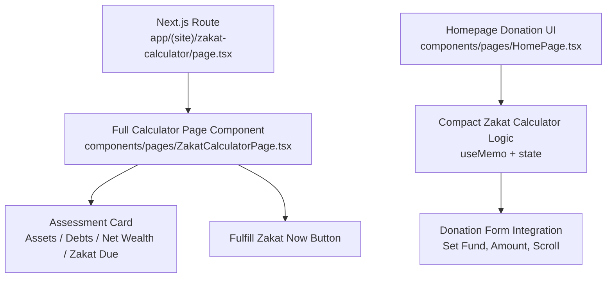
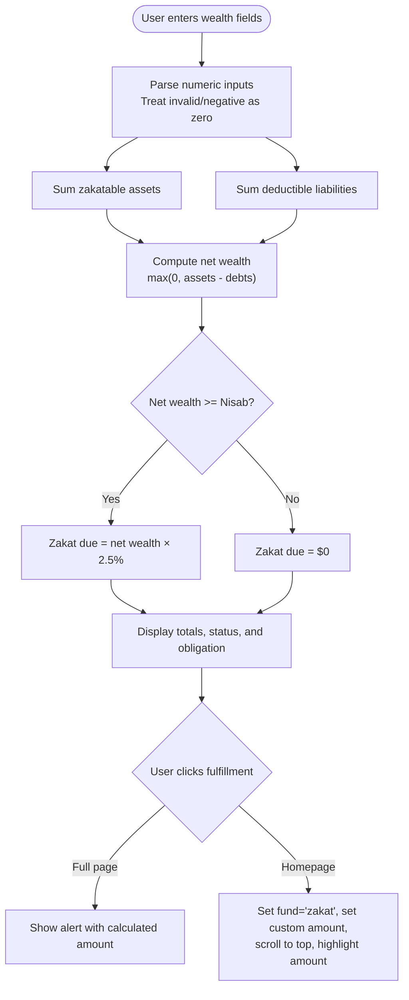
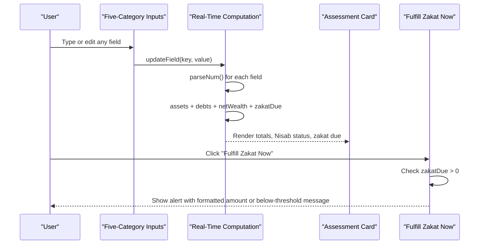
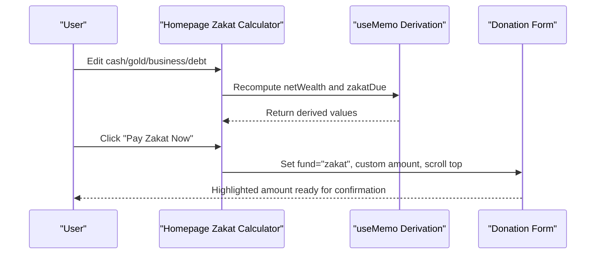
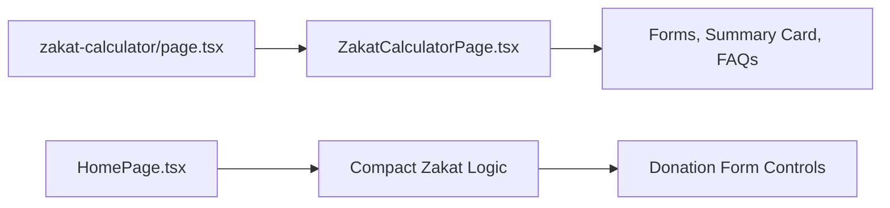

# Shariah-Compliant Zakat Calculator

<cite>
**Referenced Files in This Document**
- [zakat-calculator page](file://app/(site)/zakat-calculator/page.tsx)
- [ZakatCalculatorPage component](file://components/pages/ZakatCalculatorPage.tsx)
- [HomePage with compact zakat calculator](file://components/pages/HomePage.tsx)
</cite>

## Table of Contents
1. [Introduction](#introduction)
2. [Project Structure](#project-structure)
3. [Core Components](#core-components)
4. [Architecture Overview](#architecture-overview)
5. [Detailed Component Analysis](#detailed-component-analysis)
6. [Dependency Analysis](#dependency-analysis)
7. [Performance Considerations](#performance-considerations)
8. [Troubleshooting Guide](#troubleshooting-guide)
9. [Conclusion](#conclusion)

## Introduction
This document explains the Shariah-compliant zakat calculator feature implemented across the site. It covers:
- Wealth assessment fields for cash, gold, silver, business assets, property, rental income, and debt inputs.
- Real-time calculation logic that computes total assets, deductible liabilities, net wealth, Nisab threshold validation, and automatic 2.5% zakat due.
- The dedicated full-page calculator and the compact homepage calculator.
- State structure, field update handlers, reset behavior, formatting utilities, and donation flow integration.
- Compliance guidance, educational content about Islamic charitable giving principles, and how users transition from calculation to donation.

The implementation uses React client components within a Next.js application. The full calculator is rendered by a dedicated page component, while the homepage includes a simplified four-field zakat calculator integrated into the main donation experience.

## Project Structure
The zakat calculator spans two primary locations:
- A dedicated route page that renders the full five-category calculator.
- A compact calculator embedded in the homepage donation UI.

**Diagram sources**
- [zakat-calculator page:1-15](file://app/(site)/zakat-calculator/page.tsx#L1-L15)
- [ZakatCalculatorPage component:36-97](file://components/pages/ZakatCalculatorPage.tsx#L36-L97)
- [HomePage with compact zakat calculator:14-82](file://components/pages/HomePage.tsx#L14-L82)

**Section sources**
- [zakat-calculator page:1-15](file://app/(site)/zakat-calculator/page.tsx#L1-L15)
- [ZakatCalculatorPage component:1-1166](file://components/pages/ZakatCalculatorPage.tsx#L1-L1166)
- [HomePage with compact zakat calculator:1-200](file://components/pages/HomePage.tsx#L1-L200)

## Core Components
There are two related implementations:

1. Full-page zakat calculator
   - Five-category input matrix covering liquid cash, precious metals, business trade assets, real estate for resale and rental income, and short-term liabilities.
   - Live summary card showing total assets, total liabilities, net wealth, Nisab status, and zakat due at 2.5%.
   - Fulfillment action that informs the user and simulates transferring the calculated amount to the donation tray.

2. Homepage compact zakat calculator
   - Four-field model: cash, gold, business assets, and debt.
   - Uses `useMemo` to compute net wealth and zakat due based on a $520 USD Nisab threshold.
   - Integrates directly with the homepage donation form by setting fund type, custom amount, scrolling to the top, and highlighting the amount field.

Key shared concepts:
- Input parsing treats empty or negative values as zero.
- Money formatting displays US dollar amounts with two decimal places.
- Nisab validation determines whether zakat is obligatory (above threshold) or optional/suggested below threshold.
- Reset functionality clears all inputs and recomputes results.

**Section sources**
- [ZakatCalculatorPage component:6-97](file://components/pages/ZakatCalculatorPage.tsx#L6-L97)
- [HomePage with compact zakat calculator:14-82](file://components/pages/HomePage.tsx#L14-L82)

## Architecture Overview
The calculator architecture separates data entry, computation, presentation, and donation integration.

**Diagram sources**
- [ZakatCalculatorPage component:21-59](file://components/pages/ZakatCalculatorPage.tsx#L21-L59)
- [ZakatCalculatorPage component:84-97](file://components/pages/ZakatCalculatorPage.tsx#L84-L97)
- [HomePage with compact zakat calculator:32-82](file://components/pages/HomePage.tsx#L32-L82)

## Detailed Component Analysis

### Full-Page Zakat Calculator
The full-page calculator provides a comprehensive five-category assessment matrix and a sticky assessment card.

#### Wealth Assessment Fields
The state object tracks ten string-based input fields:
- Liquid cash and savings: `cashHome`, `cashBank`
- Precious metals: `goldVal`, `silverVal`
- Business trade assets: `inventory`, `stocks`
- Real estate for resale and rental income: `propResale`, `rentalIncome`
- Short-term liabilities: `debtsDue`, `billsDue`

These fields are initialized to empty strings and updated through a generic handler that spreads the previous state and assigns the new value to the targeted key.

#### Real-Time Calculation Logic
At render time, the component:
- Parses each field to a number using a helper that returns zero for invalid or negative values.
- Sums all zakatable asset fields into `assets`.
- Sums liability fields into `debts`.
- Computes `netWealth` as the maximum of zero and `assets - debts`.
- Applies the Nisab threshold constant `$581.75 USD` to determine if zakat is obligatory.
- Calculates `zakatDue` as 2.5% of `netWealth` when the threshold is met; otherwise zero.

The UI then shows:
- Total zakatable assets
- Total deductible liabilities
- Net wealth
- Nisab status text and icon
- Zakat due in a prominent callout

#### Nisab Threshold Validation
The component defines a constant for the silver Nisab benchmark in USD and derives:
- `nisabReached`: boolean indicating whether net wealth meets or exceeds the threshold.
- `nisabStatusText`: descriptive message such as “Nisab Reached (Zakat Obligatory)” or “Below Nisab ($581.75) — Optional Sadaqah”.
- Visual styling changes based on whether the threshold is reached.

Note: The documentation objective mentions a $520 USD threshold. In this full-page component, the active constant is $581.75 USD. The homepage compact calculator uses $520 USD.

#### Field Update Handler
The `updateField` function accepts a field key and a string value, updates the `fields` state immutably, and marks that a recomputation has occurred. This flag controls visual transitions in the Nisab status box.

#### Reset Functionality
The `resetFields` function resets all inputs to their empty defaults and ensures the transition class is applied after reset.

#### Fulfillment Action
The `fulfillZakat` function:
- Marks that recomputation has occurred.
- If zakat due is greater than zero, shows an alert stating the calculated amount has been transferred to the donation tray.
- If zakat due is zero, informs the user that net wealth is below the Nisab threshold and suggests voluntary sadaqah.

In the current implementation, there is no direct API call to a payment provider; it simulates transfer via an alert.

#### Formatting Utility
The `formatMoney` utility formats numbers as US dollars with two decimal places using `toLocaleString`.

**Diagram sources**
- [ZakatCalculatorPage component:42-59](file://components/pages/ZakatCalculatorPage.tsx#L42-L59)
- [ZakatCalculatorPage component:79-97](file://components/pages/ZakatCalculatorPage.tsx#L79-L97)

**Section sources**
- [ZakatCalculatorPage component:6-97](file://components/pages/ZakatCalculatorPage.tsx#L6-L97)
- [ZakatCalculatorPage component:340-806](file://components/pages/ZakatCalculatorPage.tsx#L340-L806)

### Homepage Compact Zakat Calculator
The homepage includes a smaller zakat calculator designed to integrate seamlessly with the donation form.

#### State Structure
The compact calculator maintains a `zakatFields` object with four keys:
- `cash`: liquid cash
- `gold`: gold value
- `biz`: business assets
- `debt`: deductible debt

#### useMemo Hook Implementation
The component uses `useMemo` to compute derived values whenever `zakatFields` changes:
- Converts each string field to a number using a local helper.
- Sums `gold`, `cash`, and `biz` into total assets.
- Subtracts `debt` and clamps the result at zero to produce `netWealth`.
- Compares `netWealth` against the homepage’s Nisab threshold of `$520 USD`.
- Calculates `zakatDue` as 2.5% of `netWealth`, rounded to two decimal places.

This memoization avoids recalculating derived values on unrelated re-renders, improving performance.

#### Field Validation Patterns
Input parsing uses `parseFloat(value) || 0`, which treats empty strings, non-numeric input, and negative values as zero. This keeps calculations stable even when users clear fields or enter unexpected characters.

#### Reset Functionality
A `resetZakatFields` function restores all four fields to empty strings.

#### Donation Flow Integration
The `payZakatNow` function:
- Checks whether `zakatDue` is greater than zero.
- If yes, sets the donation form’s fund to `zakat`, sets the custom amount to the rounded zakat due, scrolls to the top of the page, and briefly highlights the amount field.
- If no, shows an alert explaining that net zakatable wealth is below the $520 USD Nisab threshold or is currently zero.

This creates a seamless transition from calculator to donation without requiring a separate payment step in the current implementation.

**Diagram sources**
- [HomePage with compact zakat calculator:25-82](file://components/pages/HomePage.tsx#L25-L82)

**Section sources**
- [HomePage with compact zakat calculator:14-82](file://components/pages/HomePage.tsx#L14-L82)

### Compliance Guidance and Educational Content
The full-page calculator includes substantial compliance and educational sections:

- Governance and stewardship messaging emphasizes ring-fenced accounts, scholarly oversight, and independent audits.
- An FAQ section addresses:
  - Gold versus silver Nisab selection.
  - Retirement funds and pensions.
  - Personal jewelry rulings across different schools of jurisprudence.
  - Prepaying zakat for emergencies.
- Links to downloadable governance documents, fatwa statements, policy ledgers, and audit reports reinforce transparency.
- Contact information is provided for scholarly consultation regarding complex holdings.

These elements help users understand Islamic charitable giving principles and build confidence in the organization’s Shariah-compliant practices.

**Section sources**
- [ZakatCalculatorPage component:812-939](file://components/pages/ZakatCalculatorPage.tsx#L812-L939)
- [ZakatCalculatorPage component:941-1166](file://components/pages/ZakatCalculatorPage.tsx#L941-L1166)

## Dependency Analysis
The calculator components have minimal external dependencies beyond React and Next.js routing:

- The route page imports the full-page component and supplies metadata.
- The full-page component manages its own state, formatting, and UI interactions.
- The homepage component manages its own compact calculator state and integrates with the broader donation UI.

**Diagram sources**
- [zakat-calculator page:1-15](file://app/(site)/zakat-calculator/page.tsx#L1-L15)
- [ZakatCalculatorPage component:1-97](file://components/pages/ZakatCalculatorPage.tsx#L1-L97)
- [HomePage with compact zakat calculator:1-82](file://components/pages/HomePage.tsx#L1-L82)

**Section sources**
- [zakat-calculator page:1-15](file://app/(site)/zakat-calculator/page.tsx#L1-L15)
- [ZakatCalculatorPage component:1-97](file://components/pages/ZakatCalculatorPage.tsx#L1-L97)
- [HomePage with compact zakat calculator:1-82](file://components/pages/HomePage.tsx#L1-L82)

## Performance Considerations
- The full-page calculator performs synchronous arithmetic on every render. Since the number of fields is small, this is lightweight, but future growth could benefit from memoizing derived values.
- The homepage calculator explicitly uses `useMemo` to avoid unnecessary recomputation when unrelated state changes occur.
- Input parsing guards against NaN and negative values, preventing costly error handling during rendering.
- Formatting uses standard locale-aware number formatting, which is efficient for small datasets.

Recommendations:
- Consider extracting derived calculations into a custom hook for reuse between the full-page and homepage calculators.
- Add input validation feedback for non-numeric entries to improve UX before submission.
- If integrating with a payment provider, debounce the fulfillment action to prevent duplicate submissions.

[No sources needed since this section provides general guidance]

## Troubleshooting Guide
Common issues and resolutions:

- **Calculated zakat is zero despite positive inputs**
  - Verify that the net wealth exceeds the applicable Nisab threshold.
  - Full-page calculator uses $581.75 USD; homepage calculator uses $520 USD.
  - Ensure liabilities do not exceed assets, resulting in zero net wealth.

- **Formatting shows unexpected decimals**
  - Confirm that inputs are numeric and not empty strings.
  - The formatting utilities enforce two decimal places for display.

- **Reset does not clear fields**
  - Ensure the reset handler is bound to the correct button.
  - For the full-page calculator, confirm `resetFields` is called and that the state initializer matches the expected shape.

- **Donation integration does not prefill amount**
  - On the homepage, verify that `payZakatNow` runs only when `zakatDue > 0`.
  - Confirm that the donation form supports the `zakat` fund value and custom amount binding.

**Section sources**
- [ZakatCalculatorPage component:21-59](file://components/pages/ZakatCalculatorPage.tsx#L21-L59)
- [ZakatCalculatorPage component:79-97](file://components/pages/ZakatCalculatorPage.tsx#L79-L97)
- [HomePage with compact zakat calculator:32-82](file://components/pages/HomePage.tsx#L32-L82)

## Conclusion
The Shariah-compliant zakat calculator provides both a comprehensive full-page assessment tool and a streamlined homepage integration. It accurately models zakatable assets and deductible liabilities, applies Nisab threshold validation, and computes zakat due at 2.5%. The full-page component emphasizes compliance, transparency, and educational guidance, while the homepage component offers a fast path into the donation workflow. With careful attention to input parsing, formatting, and memoization, the implementation delivers a reliable and accessible user experience for fulfilling zakat obligations.

[No sources needed since this section summarizes without analyzing specific files]