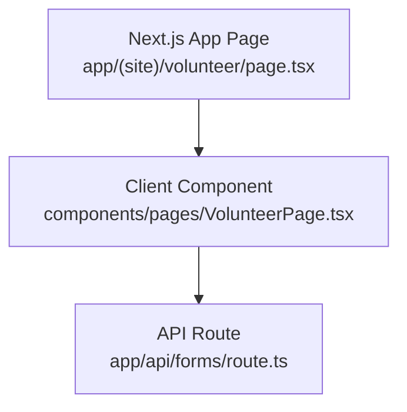
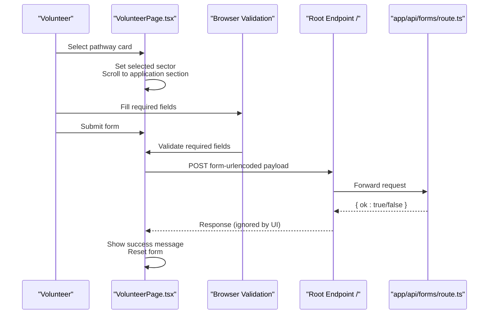
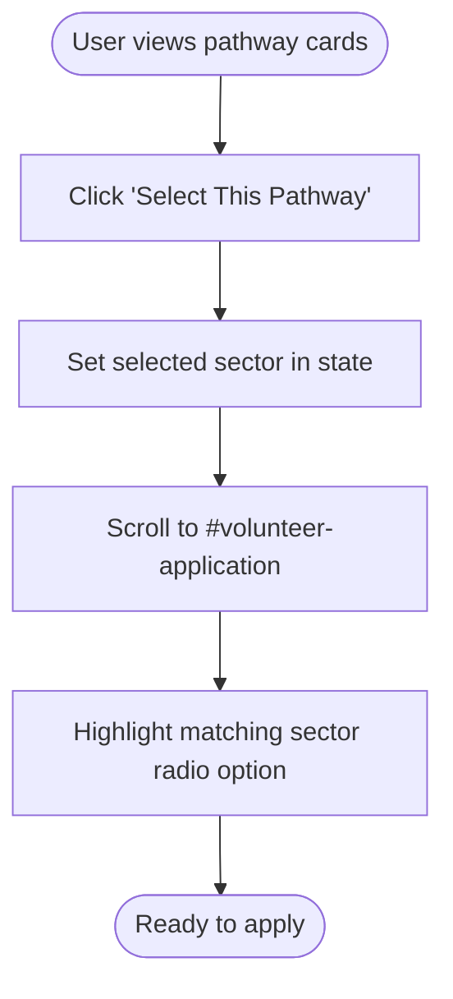
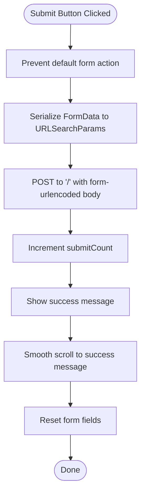
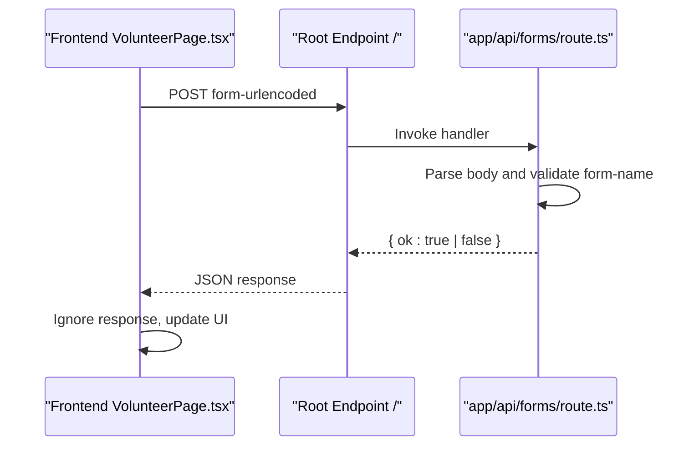
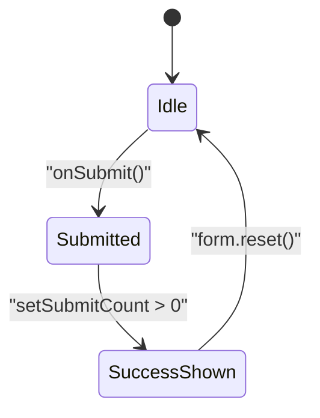
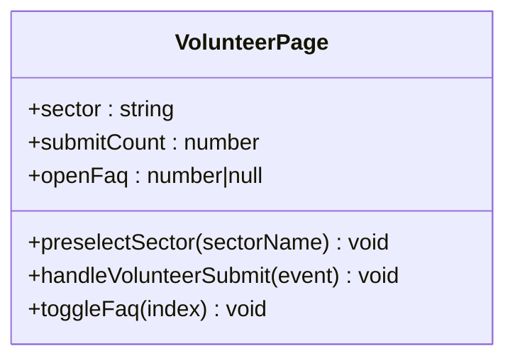
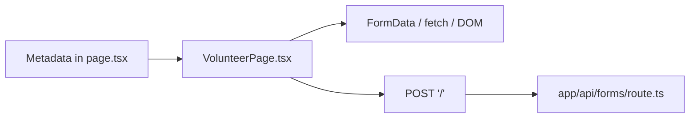

# Volunteer Recruitment Portal

<cite>
**Referenced Files in This Document**
- [page.tsx](file://app/(site)/volunteer/page.tsx)
- [VolunteerPage.tsx](file://components/pages/VolunteerPage.tsx)
- [route.ts](file://app/api/forms/route.ts)
</cite>

## Table of Contents
1. [Introduction](#introduction)
2. [Project Structure](#project-structure)
3. [Core Components](#core-components)
4. [Architecture Overview](#architecture-overview)
5. [Detailed Component Analysis](#detailed-component-analysis)
6. [Dependency Analysis](#dependency-analysis)
7. [Performance Considerations](#performance-considerations)
8. [Troubleshooting Guide](#troubleshooting-guide)
9. [Conclusion](#conclusion)

## Introduction
This document explains the volunteer recruitment portal feature implemented for the charity organization’s website. It focuses on:
- Pathway preselection that lets volunteers choose their area of interest before applying.
- The application form with required fields, browser-based validation, and submission handling.
- Success confirmation behavior after submission.
- Form state management and integration with the backend API route.
- Responsive design patterns, accessibility considerations, and how this feature supports the broader community engagement strategy.

The implementation is a Next.js client component page paired with a minimal server-side API endpoint that preserves the original fire-and-forget contract used by legacy hosting providers.

## Project Structure
The volunteer portal is composed of:
- A Next.js App Router page that renders the volunteer experience.
- A client-side React component implementing the pathway selection, form UI, state, and submission logic.
- An API route that accepts form submissions and returns a simple success response.

**Diagram sources**
- [page.tsx:1-14](file://app/(site)/volunteer/page.tsx#L1-L14)
- [VolunteerPage.tsx:1-58](file://components/pages/VolunteerPage.tsx#L1-L58)
- [route.ts:1-23](file://app/api/forms/route.ts#L1-L23)

**Section sources**
- [page.tsx:1-14](file://app/(site)/volunteer/page.tsx#L1-L14)
- [VolunteerPage.tsx:1-58](file://components/pages/VolunteerPage.tsx#L1-L58)
- [route.ts:1-23](file://app/api/forms/route.ts#L1-L23)

## Core Components
- Volunteer page shell: Provides metadata and renders the main client component.
- Volunteer client component: Implements pathway cards, sector preselection, the multi-section application form, availability selection, optional skills input, success message, FAQ accordion, and submission handling.
- Forms API route: Accepts POST requests containing form data, validates presence of a form identifier, and returns a JSON acknowledgment.

Key responsibilities:
- Pathway configuration and preselection are defined within the client component.
- Required fields use native HTML validation attributes.
- Submission serializes form data and posts it to the root endpoint while preserving the legacy Netlify-compatible payload structure.
- Success feedback is shown inline and auto-scrolls into view.

**Section sources**
- [page.tsx:1-14](file://app/(site)/volunteer/page.tsx#L1-L14)
- [VolunteerPage.tsx:5-58](file://components/pages/VolunteerPage.tsx#L5-L58)
- [route.ts:1-23](file://app/api/forms/route.ts#L1-L23)

## Architecture Overview
The volunteer portal follows a straightforward client-driven flow with a lightweight API contract:

**Diagram sources**
- [VolunteerPage.tsx:31-58](file://components/pages/VolunteerPage.tsx#L31-L58)
- [VolunteerPage.tsx:687-917](file://components/pages/VolunteerPage.tsx#L687-L917)
- [route.ts:9-22](file://app/api/forms/route.ts#L9-L22)

## Detailed Component Analysis

### Pathway Preselection System
The pathway system presents three operational pathways and allows users to select one before filling out the application.

- Configuration: A constant defines available sectors with display labels and icons.
- Interaction: Each pathway card has a “Select This Pathway” button that calls a function to set the selected sector and scroll to the application section.
- State: The selected sector is stored in component state and reflected in the radio group under the application form.

**Diagram sources**
- [VolunteerPage.tsx:5-14](file://components/pages/VolunteerPage.tsx#L5-L14)
- [VolunteerPage.tsx:31-38](file://components/pages/VolunteerPage.tsx#L31-L38)
- [VolunteerPage.tsx:787-805](file://components/pages/VolunteerPage.tsx#L787-L805)

**Section sources**
- [VolunteerPage.tsx:5-14](file://components/pages/VolunteerPage.tsx#L5-L14)
- [VolunteerPage.tsx:31-38](file://components/pages/VolunteerPage.tsx#L31-L38)
- [VolunteerPage.tsx:375-383](file://components/pages/VolunteerPage.tsx#L375-L383)
- [VolunteerPage.tsx:462-470](file://components/pages/VolunteerPage.tsx#L462-L470)
- [VolunteerPage.tsx:548-556](file://components/pages/VolunteerPage.tsx#L548-L556)
- [VolunteerPage.tsx:787-805](file://components/pages/VolunteerPage.tsx#L787-L805)

### Application Form: Fields, Validation, and Submission
The application form is divided into logical sections:
- Personal and contact information: Full name, phone/WhatsApp, email, age, city/district.
- Preferred humanitarian sector: Radio buttons bound to the selected sector.
- Availability windows: Checkboxes for scheduling preferences.
- Optional background/skills: Free-text field.

Validation approach:
- Required fields use native HTML `required` attributes.
- Age uses numeric min/max constraints.
- Email and phone use appropriate input types for better mobile keyboards and built-in validation.

Submission handling:
- Prevents default form submission.
- Serializes FormData into URL-encoded format.
- Posts to the root endpoint `/` with Content-Type application/x-www-form-urlencoded.
- On successful interaction, increments a counter to reveal the success message and scrolls it into view.
- Resets the form after submission.

**Diagram sources**
- [VolunteerPage.tsx:40-58](file://components/pages/VolunteerPage.tsx#L40-L58)
- [VolunteerPage.tsx:687-917](file://components/pages/VolunteerPage.tsx#L687-L917)

**Section sources**
- [VolunteerPage.tsx:40-58](file://components/pages/VolunteerPage.tsx#L40-L58)
- [VolunteerPage.tsx:687-917](file://components/pages/VolunteerPage.tsx#L687-L917)

### Backend API Integration
The API route provides a stable contract compatible with the existing frontend:
- Accepts POST requests at the root endpoint path.
- Parses the URL-encoded body and extracts the form-name field.
- Returns a JSON object indicating success or an error if the form-name is missing.
- The frontend intentionally ignores the response and proceeds with UX updates.

**Diagram sources**
- [VolunteerPage.tsx:40-58](file://components/pages/VolunteerPage.tsx#L40-L58)
- [route.ts:9-22](file://app/api/forms/route.ts#L9-L22)

**Section sources**
- [route.ts:1-23](file://app/api/forms/route.ts#L1-L23)
- [VolunteerPage.tsx:40-58](file://components/pages/VolunteerPage.tsx#L40-L58)

### Success Confirmation Flow
After submission:
- A success banner appears below the submit button.
- The banner includes a confirmation message and is automatically scrolled into view.
- The form resets to allow subsequent applications.

**Diagram sources**
- [VolunteerPage.tsx:22-29](file://components/pages/VolunteerPage.tsx#L22-L29)
- [VolunteerPage.tsx:56-58](file://components/pages/VolunteerPage.tsx#L56-L58)
- [VolunteerPage.tsx:879-895](file://components/pages/VolunteerPage.tsx#L879-L895)

**Section sources**
- [VolunteerPage.tsx:22-29](file://components/pages/VolunteerPage.tsx#L22-L29)
- [VolunteerPage.tsx:56-58](file://components/pages/VolunteerPage.tsx#L56-L58)
- [VolunteerPage.tsx:879-895](file://components/pages/VolunteerPage.tsx#L879-L895)

### Form State Management
State variables:
- Selected sector: Controls which radio option is checked and reflects pathway preselection.
- Submit count: Toggles visibility of the success message and triggers auto-scroll.
- Open FAQ index: Manages the FAQ accordion state.

Data flow:
- Pathway cards update the selected sector.
- Sector radio inputs reflect the current state.
- Submission updates submit count, revealing success feedback.

**Diagram sources**
- [VolunteerPage.tsx:16-38](file://components/pages/VolunteerPage.tsx#L16-L38)
- [VolunteerPage.tsx:60-62](file://components/pages/VolunteerPage.tsx#L60-L62)

**Section sources**
- [VolunteerPage.tsx:16-38](file://components/pages/VolunteerPage.tsx#L16-L38)
- [VolunteerPage.tsx:60-62](file://components/pages/VolunteerPage.tsx#L60-L62)

### Responsive Design Patterns
The volunteer page uses responsive layout techniques:
- Fluid container widths and padding adjustments across breakpoints.
- Grid layouts that adapt from single-column to multi-column arrangements.
- Touch-friendly controls with adequate spacing and focus rings.
- Large, readable typography and high-contrast color usage for clarity.

Examples include:
- Section containers that expand horizontally on larger screens.
- Two-column grids for personal details and four-column grids for sector options.
- Buttons and cards designed for both mobile and desktop interactions.

**Section sources**
- [VolunteerPage.tsx:66-94](file://components/pages/VolunteerPage.tsx#L66-L94)
- [VolunteerPage.tsx:100-204](file://components/pages/VolunteerPage.tsx#L100-L204)
- [VolunteerPage.tsx:273-562](file://components/pages/VolunteerPage.tsx#L273-L562)
- [VolunteerPage.tsx:672-917](file://components/pages/VolunteerPage.tsx#L672-L917)

### Accessibility Features
Accessibility considerations present in the implementation:
- Semantic headings and labels for form fields.
- Native HTML validation for required fields improves assistive technology support.
- Focus ring styles for interactive elements.
- Hidden form-name input ensures compatibility with legacy form handlers.
- Smooth scrolling to the application section and success message enhances navigation for keyboard and screen reader users.

Recommendations for further improvement:
- Add explicit aria-describedby messages for validation errors.
- Provide visible focus indicators consistent across components.
- Ensure all images have descriptive alt text; the codebase uses data-alt attributes but standard alt attributes should be verified.

**Section sources**
- [VolunteerPage.tsx:687-917](file://components/pages/VolunteerPage.tsx#L687-L917)
- [VolunteerPage.tsx:22-29](file://components/pages/VolunteerPage.tsx#L22-L29)

### Connection to Community Engagement Strategy
The volunteer portal aligns with the charity’s mission by:
- Encouraging youth participation in frontline humanitarian action.
- Providing clear pathways for food relief, medical camp support, and education initiatives.
- Emphasizing safety, ethics, and certification to build trust and long-term engagement.
- Offering orientation, mentorship, and official recognition to sustain volunteer commitment.

These elements reinforce the organization’s broader community engagement goals by making volunteering accessible, safe, and meaningful.

[No sources needed since this section synthesizes conceptual alignment without analyzing specific files]

## Dependency Analysis
The volunteer feature depends on:
- Next.js App Router for routing and metadata.
- React client component for interactivity and state.
- Browser APIs for form serialization and DOM manipulation.
- The root endpoint and API route for form processing.

**Diagram sources**
- [page.tsx:1-14](file://app/(site)/volunteer/page.tsx#L1-L14)
- [VolunteerPage.tsx:40-58](file://components/pages/VolunteerPage.tsx#L40-L58)
- [route.ts:9-22](file://app/api/forms/route.ts#L9-L22)

**Section sources**
- [page.tsx:1-14](file://app/(site)/volunteer/page.tsx#L1-L14)
- [VolunteerPage.tsx:40-58](file://components/pages/VolunteerPage.tsx#L40-L58)
- [route.ts:9-22](file://app/api/forms/route.ts#L9-L22)

## Performance Considerations
- Client-side rendering: The volunteer page is a client component, enabling immediate interactivity for pathway selection and form handling.
- Minimal network overhead: Submission posts once per user action; the response is ignored by the UI, keeping the flow fast.
- DOM operations: Smooth scrolling uses native APIs; consider debouncing repeated scrolls if additional interactions are added.
- Image assets: External images are loaded from CDN-like URLs; ensure caching headers are configured for optimal performance.

[No sources needed since this section provides general guidance]

## Troubleshooting Guide
Common issues and resolutions:
- Missing form-name: The API route returns an error if the form-name field is absent. Ensure the hidden input remains present in the form.
- Submission not triggering success: Verify that the form’s onSubmit handler is attached and that submitCount increments.
- Field validation errors: Confirm required fields are filled and that input types match expectations (email, tel, number).
- Pathway preselection not scrolling: Ensure the target element with id volunteer-application exists and is reachable.

Backend integration notes:
- The frontend posts to the root endpoint; confirm hosting environment forwards requests to the API route appropriately.
- The API route expects URL-encoded payloads; verify Content-Type header is set correctly.

**Section sources**
- [route.ts:9-22](file://app/api/forms/route.ts#L9-L22)
- [VolunteerPage.tsx:40-58](file://components/pages/VolunteerPage.tsx#L40-L58)
- [VolunteerPage.tsx:687-917](file://components/pages/VolunteerPage.tsx#L687-L917)

## Conclusion
The volunteer recruitment portal delivers a streamlined pathway selection experience, a validated application form, and a clear success confirmation flow. Its architecture leverages a client-side React component for interactivity and a minimal API route for robust form processing. The design emphasizes responsiveness and accessibility while supporting the charity’s community engagement strategy through structured pathways, safety assurances, and certification opportunities. Future enhancements can include richer validation messaging, analytics tracking, and deeper backend integration for application storage and workflow automation.

[No sources needed since this section summarizes without analyzing specific files]