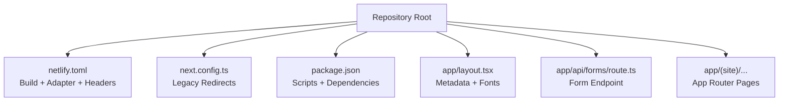
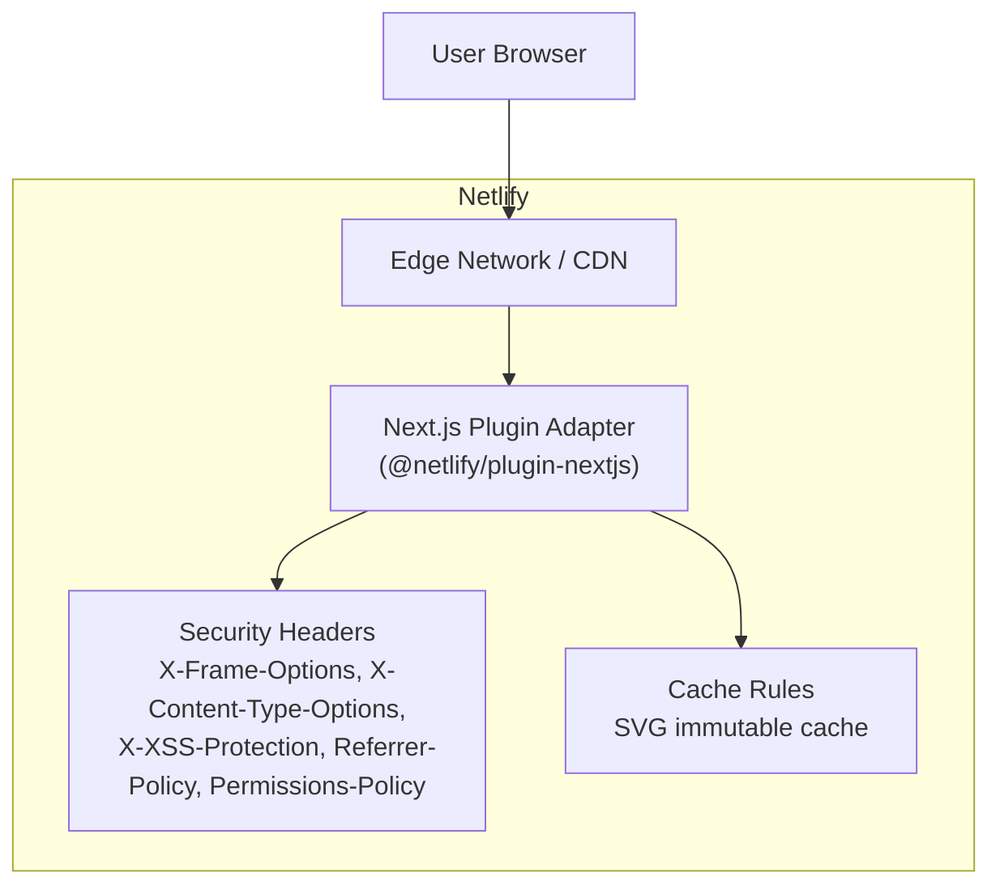
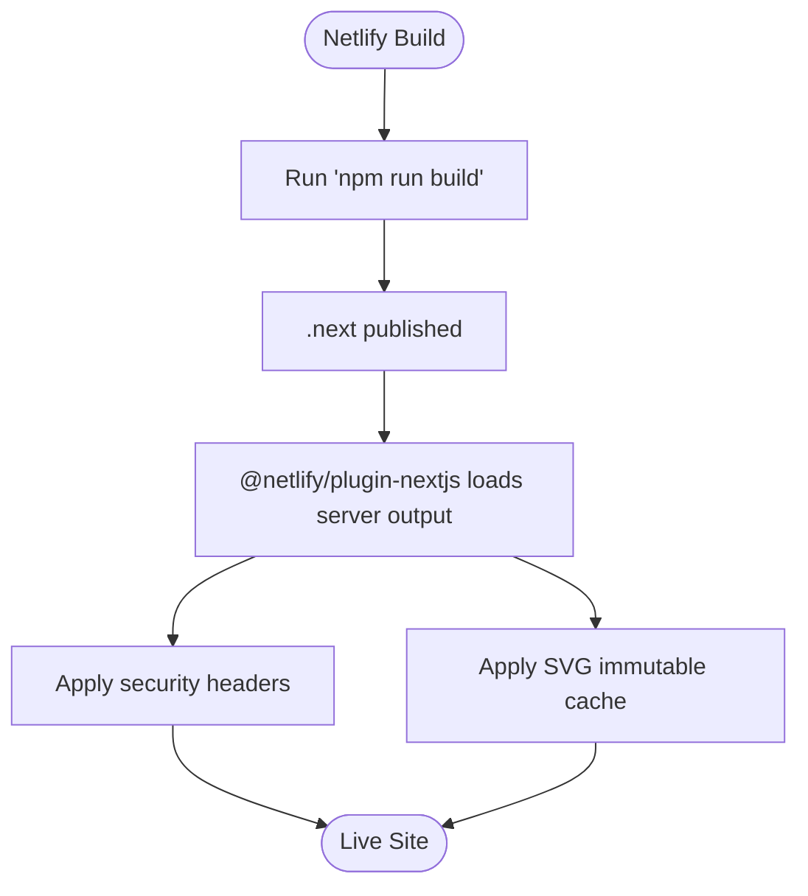
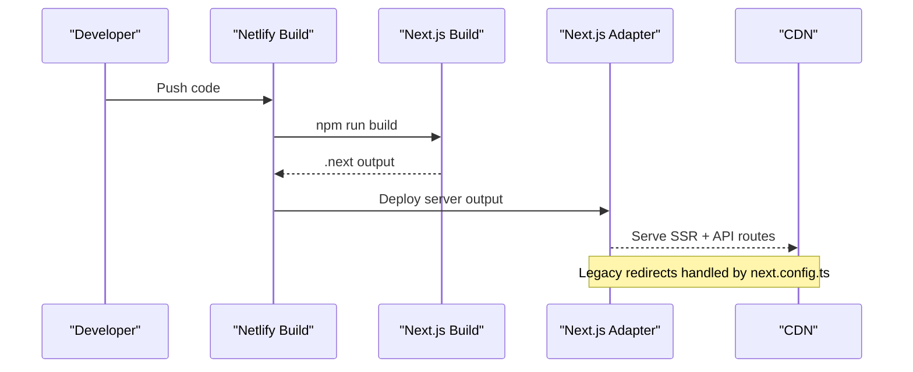
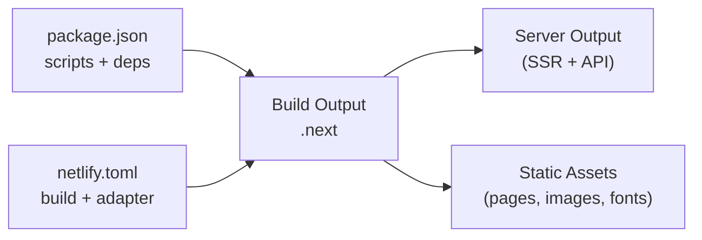

# Deployment & Production

<cite>
**Referenced Files in This Document**
- [netlify.toml](file://netlify.toml)
- [next.config.ts](file://next.config.ts)
- [package.json](file://package.json)
- [README.md](file://README.md)
- [app/layout.tsx](file://app/layout.tsx)
- [app/api/forms/route.ts](file://app/api/forms/route.ts)
</cite>

## Table of Contents
1. [Introduction](#introduction)
2. [Project Structure](#project-structure)
3. [Core Components](#core-components)
4. [Architecture Overview](#architecture-overview)
5. [Detailed Component Analysis](#detailed-component-analysis)
6. [Dependency Analysis](#dependency-analysis)
7. [Performance Considerations](#performance-considerations)
8. [Troubleshooting Guide](#troubleshooting-guide)
9. [Conclusion](#conclusion)

## Introduction
This document provides production deployment guidance for the GMCF charity portal on Netlify. It explains how the Next.js App Router build is configured, how the official Netlify adapter runs server-side routes, how security headers and caching are preserved, and how to deploy via CLI or Git-based continuous integration. It also covers environment variables, domain setup, SSL, monitoring, performance profiling, scaling, and CDN considerations.

## Project Structure
The repository is a Next.js 16 App Router application with TypeScript and Tailwind CSS. The root configuration files control the Netlify build, redirects, and runtime behavior:

- `netlify.toml`: Build command, publish directory, Next.js plugin adapter, security headers, and static asset cache rules.
- `next.config.ts`: Legacy URL redirects from `.html` paths to clean App Router routes.
- `package.json`: Scripts (`dev`, `build`, `start`) and dependencies including Next.js and React.
- `app/layout.tsx`: Root layout, metadata, fonts, and global head resources.
- `app/api/forms/route.ts`: Server route handling newsletter and volunteer form submissions.
- `README.md`: Local development instructions and Netlify deployment overview.

**Diagram sources**
- [netlify.toml:1-29](file://netlify.toml#L1-L29)
- [next.config.ts:1-32](file://next.config.ts#L1-L32)
- [package.json:1-29](file://package.json#L1-L29)
- [app/layout.tsx:1-61](file://app/layout.tsx#L1-L61)
- [app/api/forms/route.ts:1-23](file://app/api/forms/route.ts#L1-L23)

**Section sources**
- [netlify.toml:1-29](file://netlify.toml#L1-L29)
- [next.config.ts:1-32](file://next.config.ts#L1-L32)
- [package.json:1-29](file://package.json#L1-L29)
- [README.md:14-64](file://README.md#L14-L64)

## Core Components
- Netlify build and adapter:
  - Build command: `npm run build`.
  - Publish directory: `.next`.
  - Official adapter: `@netlify/plugin-nextjs`.
- Security headers:
  - Global headers applied to all routes.
  - Long-lived immutable cache for SVG assets under `/public`.
- Legacy URL redirects:
  - `.html` URLs redirect permanently to clean App Router paths.
- Form endpoint:
  - Accepts legacy-style form submissions and returns JSON responses.

**Section sources**
- [netlify.toml:1-29](file://netlify.toml#L1-L29)
- [next.config.ts:1-32](file://next.config.ts#L1-L32)
- [app/api/forms/route.ts:1-23](file://app/api/forms/route.ts#L1-L23)

## Architecture Overview
The production architecture uses Netlify’s Next.js adapter to serve both static assets and server-rendered routes. Static pages and API routes are built into `.next`, then deployed to Netlify’s edge network. Security headers are enforced at the platform level, and SVG assets are cached aggressively.

**Diagram sources**
- [netlify.toml:6-24](file://netlify.toml#L6-L24)

**Section sources**
- [netlify.toml:1-29](file://netlify.toml#L1-L29)

## Detailed Component Analysis

### Netlify Deployment Configuration
- Build settings:
  - Command: `npm run build`.
  - Publish: `.next`.
- Adapter:
  - `@netlify/plugin-nextjs` enables serverless execution of Next.js server output on Netlify Functions.
- Security headers:
  - Applied globally to all routes.
- Asset caching:
  - SVG files under `/public` are served with long-lived immutable cache headers.

**Diagram sources**
- [netlify.toml:1-24](file://netlify.toml#L1-L24)

**Section sources**
- [netlify.toml:1-29](file://netlify.toml#L1-L29)

### Build Process Optimization
- Next.js build produces optimized server output and static assets under `.next`.
- The adapter runs the server output on Netlify Functions, enabling server-side rendering and API routes without managing infrastructure.
- Legacy `.html` URLs are redirected to clean routes at build/runtime via `next.config.ts`.

**Diagram sources**
- [package.json:5-9](file://package.json#L5-L9)
- [next.config.ts:20-28](file://next.config.ts#L20-L28)
- [netlify.toml:1-8](file://netlify.toml#L1-L8)

**Section sources**
- [package.json:5-9](file://package.json#L5-L9)
- [next.config.ts:1-32](file://next.config.ts#L1-L32)
- [netlify.toml:1-8](file://netlify.toml#L1-L8)

### Security Headers Preservation
- Global headers include:
  - `X-Frame-Options: DENY`
  - `X-Content-Type-Options: nosniff`
  - `X-XSS-Protection: 1; mode=block`
  - `Referrer-Policy: strict-origin-when-cross-origin`
  - `Permissions-Policy: camera=(), microphone=(), geolocation()`
- These headers are carried over from the legacy static deployment and applied to all routes.

**Section sources**
- [netlify.toml:10-18](file://netlify.toml#L10-L18)

### Asset Bundling and Caching Strategy
- Static media under `/public` (e.g., SVGs) are served with:
  - `Cache-Control: public, max-age=31536000, immutable`
- This ensures long-term browser caching for stable assets while allowing versioned updates through filename changes.

**Section sources**
- [netlify.toml:20-24](file://netlify.toml#L20-L24)

### Environment Variables
- No environment variable usage was found in the current codebase.
- For future integrations (e.g., CRM, email provider, analytics), configure variables in the Netlify site settings under **Environment variables**.
- Recommended practices:
  - Use distinct values per branch (preview vs production).
  - Avoid committing secrets to source control.
  - Prefix client-accessible variables with `NEXT_PUBLIC_` if needed by the frontend.

[No sources needed since this section provides general guidance]

### Domain Setup and SSL Certificate Management
- Configure your custom domain in Netlify’s site settings.
- Enable automatic HTTPS; Netlify provisions and renews SSL certificates automatically.
- Ensure DNS records point to Netlify’s addresses for proper routing.

[No sources needed since this section provides general guidance]

### Monitoring Strategies and Error Tracking
- Integrate an error tracking service (e.g., Sentry) to capture runtime errors and user-facing issues.
- Add performance monitoring (e.g., web vitals collection) to track Core Web Vitals in production.
- Set up alerts for critical errors and performance regressions.

[No sources needed since this section provides general guidance]

### Performance Profiling Techniques
- Use Next.js built-in metrics and profiling tools during development and staging.
- Analyze bundle sizes and identify heavy dependencies.
- Monitor server response times and cold starts for API routes.

[No sources needed since this section provides general guidance]

### Scaling Considerations
- Netlify scales automatically for static assets and serverless functions.
- Keep API routes stateless and efficient to minimize cold start latency.
- Prefer pre-rendering where possible to reduce server load.

[No sources needed since this section provides general guidance]

### CDN Configuration
- Netlify serves assets via its global CDN.
- Leverage immutable cache headers for stable assets (already configured for SVGs).
- Consider adding similar cache policies for other static asset types (e.g., images, fonts) if not already managed by Next.js optimizations.

**Section sources**
- [netlify.toml:20-24](file://netlify.toml#L20-L24)

## Dependency Analysis
The project depends on Next.js and React, with scripts driving local development and production builds. Netlify reads `netlify.toml` to execute the build and apply the adapter.

**Diagram sources**
- [package.json:5-14](file://package.json#L5-L14)
- [netlify.toml:1-8](file://netlify.toml#L1-L8)

**Section sources**
- [package.json:1-29](file://package.json#L1-L29)
- [netlify.toml:1-8](file://netlify.toml#L1-L8)

## Performance Considerations
- Build optimization:
  - Use `npm run build` to generate optimized server output and static assets.
- Runtime optimization:
  - The Next.js adapter runs server output efficiently on Netlify Functions.
- Asset caching:
  - Immutable cache headers for SVGs improve repeat visit performance.
- Metadata and fonts:
  - Root layout defines metadata and self-hosted fonts via Next.js font tooling to reduce external requests.

**Section sources**
- [package.json:5-9](file://package.json#L5-L9)
- [netlify.toml:20-24](file://netlify.toml#L20-L24)
- [app/layout.tsx:21-35](file://app/layout.tsx#L21-L35)

## Troubleshooting Guide

### Common Deployment Issues
- Build failures:
  - Verify Node.js version compatibility and that `npm run build` succeeds locally.
- Missing adapter:
  - Ensure `@netlify/plugin-nextjs` is installed and referenced in `netlify.toml`.
- Legacy URL redirects not working:
  - Confirm `next.config.ts` contains redirects for `.html` paths to clean routes.

**Section sources**
- [netlify.toml:6-8](file://netlify.toml#L6-L8)
- [next.config.ts:7-18](file://next.config.ts#L7-L18)

### Form Endpoint Errors
- The form endpoint expects a `form-name` field; missing fields return a 400 status.
- Ensure clients send the expected payload format.

**Section sources**
- [app/api/forms/route.ts:9-21](file://app/api/forms/route.ts#L9-L21)

### Security Header Misconfiguration
- If headers are missing, verify `[[headers]]` blocks in `netlify.toml` are present and correctly scoped.

**Section sources**
- [netlify.toml:10-18](file://netlify.toml#L10-L18)

### Asset Caching Problems
- If SVGs are not cached, confirm the header rule targets `/*.svg` and includes immutable cache directives.

**Section sources**
- [netlify.toml:20-24](file://netlify.toml#L20-L24)

## Conclusion
The GMCF charity portal is configured for production on Netlify using the official Next.js adapter, with robust security headers and aggressive caching for static assets. The build process leverages Next.js optimizations, and legacy URLs are seamlessly redirected. For ongoing operations, integrate monitoring and error tracking, manage environment variables securely, and continue optimizing performance through caching and profiling.