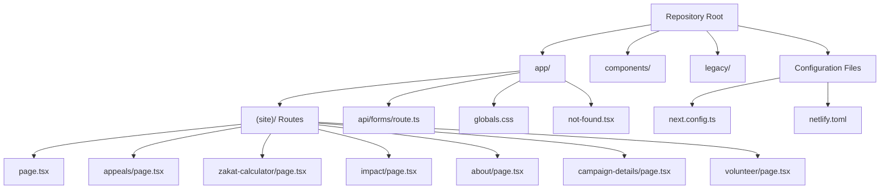
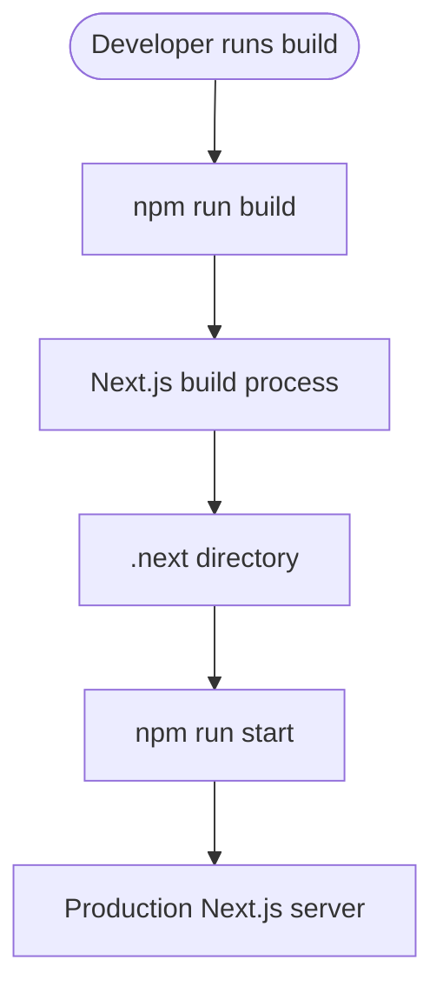
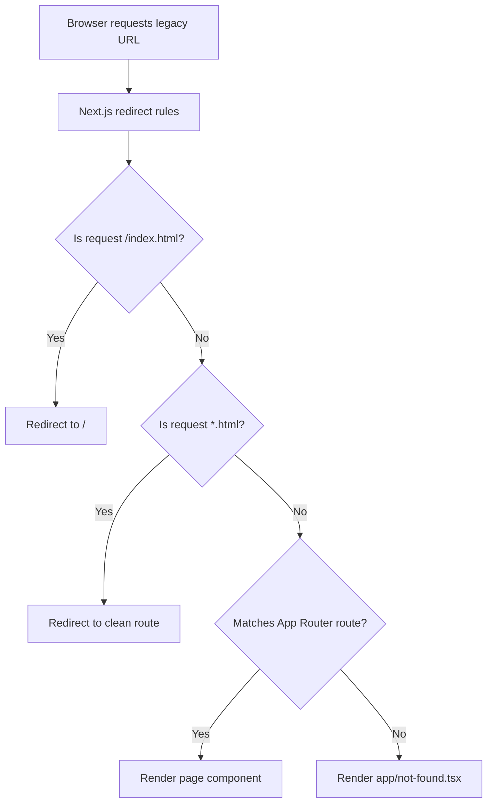
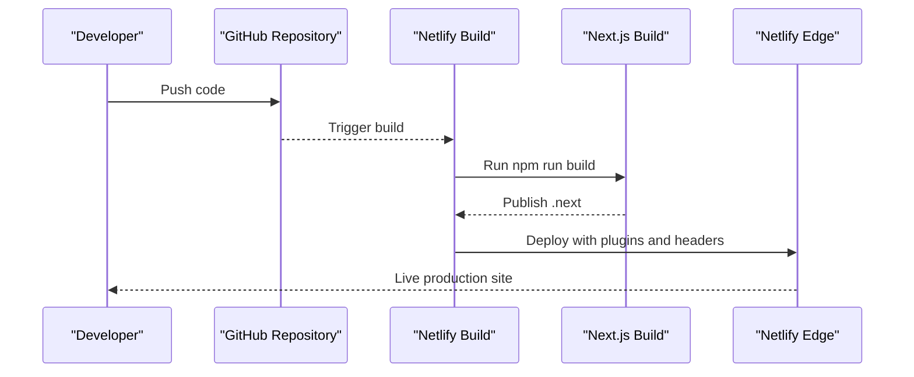

# Getting Started

<cite>
**Referenced Files in This Document**
- [README.md](file://README.md)
- [package.json](file://package.json)
- [next.config.ts](file://next.config.ts)
- [netlify.toml](file://netlify.toml)
- [legacy/netlify.toml](file://legacy/netlify.toml)
- [app/(site)/page.tsx](file://app/(site)/page.tsx)
- [app/(site)/appeals/page.tsx](file://app/(site)/appeals/page.tsx)
- [app/(site)/zakat-calculator/page.tsx](file://app/(site)/zakat-calculator/page.tsx)
- [app/(site)/impact/page.tsx](file://app/(site)/impact/page.tsx)
- [app/(site)/about/page.tsx](file://app/(site)/about/page.tsx)
- [app/(site)/campaign-details/page.tsx](file://app/(site)/campaign-details/page.tsx)
- [app/(site)/volunteer/page.tsx](file://app/(site)/volunteer/page.tsx)
</cite>

## Table of Contents
1. [Introduction](#introduction)
2. [Prerequisites](#prerequisites)
3. [Project Structure](#project-structure)
4. [Installation and Local Development](#installation-and-local-development)
5. [Build Process](#build-process)
6. [Legacy URL Redirect System](#legacy-url-redirect-system)
7. [Netlify Deployment](#netlify-deployment)
8. [Troubleshooting](#troubleshooting)
9. [Conclusion](#conclusion)

## Introduction
This guide helps you set up, run, build, and deploy the GMCF charity portal. The project is a Next.js 16 App Router application written in TypeScript with Tailwind CSS. It preserves the original static site’s design, copy, and interactive behaviour while providing clean routes, modern tooling, and production-ready deployment configuration.

The repository also keeps the original static site under `legacy/` for reference and legacy deployments.

**Section sources**
- [README.md:1-10](file://README.md#L1-L10)

## Prerequisites
Before starting, ensure your environment meets these requirements:

- **Node.js**: Use a recent LTS release compatible with Next.js 16 and TypeScript 5. If installation fails due to native dependencies or version mismatches, try switching to a newer LTS Node.js version.
- **npm**: Comes bundled with Node.js. Verify it with `npm --version`.
- **Git**: Required if you plan to deploy via GitHub integration.
- **Basic Next.js knowledge**: Understanding of pages/routes, builds, and local development servers will help.
- **Optional Netlify CLI**: Install globally if you prefer terminal-based deployments (`npm install -g netlify-cli`).

No additional global tools are required beyond npm and Git.

[No sources needed since this section provides general guidance]

## Project Structure
At a high level, the application follows the Next.js App Router layout:

- `app/`: Application routes, layouts, API endpoints, and global styles.
- `components/`: Reusable UI components and page-level React components.
- `legacy/`: Archived original static site files.
- Configuration files: `next.config.ts`, `netlify.toml`, `tailwind.config.ts`, `postcss.config.mjs`, `eslint.config.mjs`, `tsconfig.json`.



**Diagram sources**
- [README.md:14-65](file://README.md#L14-L65)
- [app/(site)/page.tsx:1-15](file://app/(site)/page.tsx#L1-L15)
- [app/(site)/appeals/page.tsx:1-14](file://app/(site)/appeals/page.tsx#L1-L14)
- [app/(site)/zakat-calculator/page.tsx:1-15](file://app/(site)/zakat-calculator/page.tsx#L1-L15)
- [app/(site)/impact/page.tsx:1-14](file://app/(site)/impact/page.tsx#L1-L14)
- [app/(site)/about/page.tsx:1-14](file://app/(site)/about/page.tsx#L1-L14)
- [app/(site)/campaign-details/page.tsx:1-14](file://app/(site)/campaign-details/page.tsx#L1-L14)
- [app/(site)/volunteer/page.tsx:1-14](file://app/(site)/volunteer/page.tsx#L1-L14)

**Section sources**
- [README.md:14-65](file://README.md#L14-L65)

## Installation and Local Development
Follow these steps to install dependencies and start the development server:

1. Open a terminal in the repository root.
2. Install dependencies:
   ```bash
   npm install
   ```
3. Start the development server:
   ```bash
   npm run dev
   ```
4. Open your browser and visit:
   ```text
   http://localhost:3000
   ```

Available scripts:

| Script | Purpose |
| --- | --- |
| `npm run dev` | Starts the Next.js development server on port 3000 by default. |
| `npm run build` | Builds the production bundle into `.next`. |
| `npm run start` | Starts the production server using the built output. |
| `npm run lint` | Runs ESLint checks. |

You can also type-check the project with:
```bash
npx tsc --noEmit
```

If port 3000 is already in use, stop the conflicting process or configure Next.js to use another port.

**Section sources**
- [README.md:119-135](file://README.md#L119-L135)
- [package.json:5-10](file://package.json#L5-L10)

## Build Process
The build command compiles the Next.js App Router application and prepares the production output.

Run:
```bash
npm run build
```

After building, preview the production build locally:
```bash
npm run start
```

Key points:

- The build script is defined as `next build`.
- The production server script is `next start`.
- The Netlify build command is also `npm run build`.
- The published directory for Netlify is `.next`, configured through `netlify.toml`.



**Diagram sources**
- [package.json:5-10](file://package.json#L5-L10)
- [netlify.toml:1-5](file://netlify.toml#L1-L5)

**Section sources**
- [README.md:128-135](file://README.md#L128-L135)
- [package.json:5-10](file://package.json#L5-L10)
- [netlify.toml:1-5](file://netlify.toml#L1-L5)

## Legacy URL Redirect System
The portal migrated from static HTML files to Next.js routes, but old URLs must continue working for bookmarks, search results, and external links.

### How Redirects Work
`next.config.ts` defines permanent redirects that map legacy `.html` URLs to clean App Router paths. The configuration includes:

- `/index.html` → `/`
- `/about.html` → `/about`
- `/appeals.html` → `/appeals`
- `/campaign-details.html` → `/campaign-details`
- `/impact.html` → `/impact`
- `/volunteer.html` → `/volunteer`
- `/zakat-calculator.html` → `/zakat-calculator`

These redirects are generated programmatically from a list of page slugs and applied at build time.



**Diagram sources**
- [next.config.ts:3-28](file://next.config.ts#L3-L28)
- [README.md:137-152](file://README.md#L137-L152)

### Mapped Routes
| Legacy URL | New Route | Page Component |
| --- | --- | --- |
| `/index.html` | `/` | `app/(site)/page.tsx` |
| `/appeals.html` | `/appeals` | `app/(site)/appeals/page.tsx` |
| `/zakat-calculator.html` | `/zakat-calculator` | `app/(site)/zakat-calculator/page.tsx` |
| `/impact.html` | `/impact` | `app/(site)/impact/page.tsx` |
| `/about.html` | `/about` | `app/(site)/about/page.tsx` |
| `/campaign-details.html` | `/campaign-details` | `app/(site)/campaign-details/page.tsx` |
| `/volunteer.html` | `/volunteer` | `app/(site)/volunteer/page.tsx` |

Unknown paths render the branded 404 page located at `app/not-found.tsx`.

**Section sources**
- [next.config.ts:3-28](file://next.config.ts#L3-L28)
- [README.md:137-152](file://README.md#L137-L152)
- [app/(site)/page.tsx:1-15](file://app/(site)/page.tsx#L1-L15)
- [app/(site)/appeals/page.tsx:1-14](file://app/(site)/appeals/page.tsx#L1-L14)
- [app/(site)/zakat-calculator/page.tsx:1-15](file://app/(site)/zakat-calculator/page.tsx#L1-L15)
- [app/(site)/impact/page.tsx:1-14](file://app/(site)/impact/page.tsx#L1-L14)
- [app/(site)/about/page.tsx:1-14](file://app/(site)/about/page.tsx#L1-L14)
- [app/(site)/campaign-details/page.tsx:1-14](file://app/(site)/campaign-details/page.tsx#L1-L14)
- [app/(site)/volunteer/page.tsx:1-14](file://app/(site)/volunteer/page.tsx#L1-L14)

## Netlify Deployment
The repository ships a production-ready Netlify configuration. It uses the official Next.js adapter, applies security headers, and caches static assets.

### Option 1: Netlify CLI
Use this method if you want to deploy directly from your terminal.

1. Install the Netlify CLI (if not installed):
   ```bash
   npm install -g netlify-cli
   ```
2. Preview the deployment:
   ```bash
   npx netlify deploy
   ```
3. Deploy to production:
   ```bash
   npx netlify deploy --prod
   ```

### Option 2: GitHub Integration
Use this method if you prefer continuous deployment from a Git repository.

1. Initialize Git and commit your changes:
   ```bash
   git init
   git add .
   git commit -m "feat: GMCF charity portal (Next.js + TypeScript)"
   ```
2. Push the repository to GitHub.
3. In Netlify, click **Add new site** → **Import an existing project** → select your repository.
4. Netlify reads `netlify.toml`, runs `npm run build`, applies the Next.js adapter, and redeployes on every push.

### What Netlify Does
- Build command: `npm run build`
- Publish directory: `.next`
- Plugin: `@netlify/plugin-nextjs`
- Security headers are applied to all routes
- SVG assets from `/public` receive long-term caching headers



**Diagram sources**
- [README.md:156-189](file://README.md#L156-L189)
- [netlify.toml:1-29](file://netlify.toml#L1-L29)

**Section sources**
- [README.md:156-189](file://README.md#L156-L189)
- [netlify.toml:1-29](file://netlify.toml#L1-L29)

## Troubleshooting
Common setup issues and how to resolve them:

### Dependency Installation Fails
- Ensure Node.js is installed and accessible.
- Try clearing the npm cache and reinstalling:
  ```bash
  npm cache clean --force
  rm -rf node_modules package-lock.json
  npm install
  ```
- If native modules fail, switch to a supported Node.js LTS version.

### Port 3000 Is Already In Use
- Stop the process using port 3000.
- Or run the dev server on another port by setting the `PORT` environment variable before starting the server.

### Build Fails Locally or on Netlify
- Confirm that `npm run build` succeeds locally first.
- Check for TypeScript errors with `npx tsc --noEmit`.
- Review ESLint output with `npm run lint`.
- On Netlify, check the build logs for dependency or configuration errors.

### Legacy URLs Return 404
- Make sure you are running the Next.js server, not just serving static files.
- Verify that `next.config.ts` contains the redirect rules.
- For legacy static deployments, the archived `legacy/netlify.toml` shows how the original static site was configured; however, the current portal handles redirects through Next.js.

### Forms Do Not Submit
- The forms post to `POST /api/forms`.
- Wire the handler to your CRM, email provider, or database as documented in the project overview.
- Test the endpoint separately before integrating frontend forms.

**Section sources**
- [README.md:112-116](file://README.md#L112-L116)
- [README.md:137-152](file://README.md#L137-L152)
- [legacy/netlify.toml:21-25](file://legacy/netlify.toml#L21-L25)

## Conclusion
You now have everything needed to install, develop, build, and deploy the GMCF charity portal. Use `npm run dev` for local work, `npm run build` and `npm run start` for production previews, and follow the Netlify instructions for automated deployments. Legacy `.html` URLs remain functional through Next.js redirects, ensuring no broken links during migration.

[No sources needed since this section summarizes without analyzing specific files]