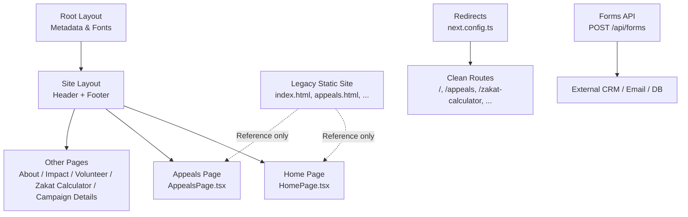
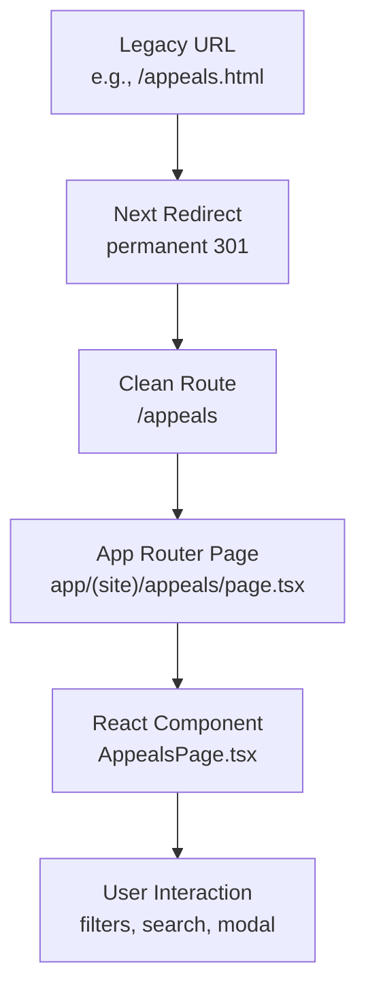
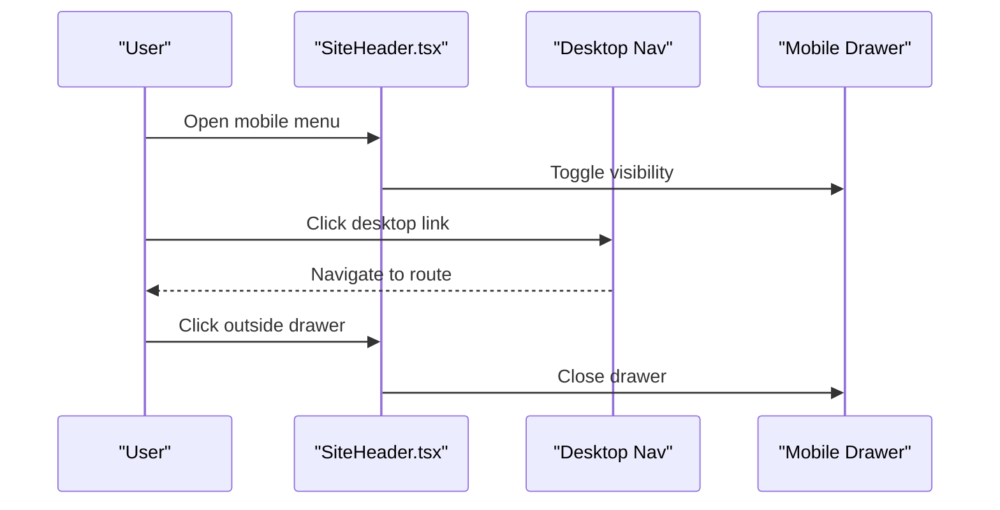
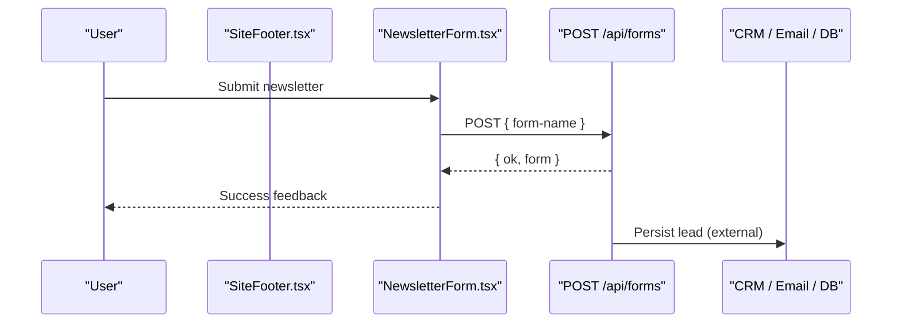
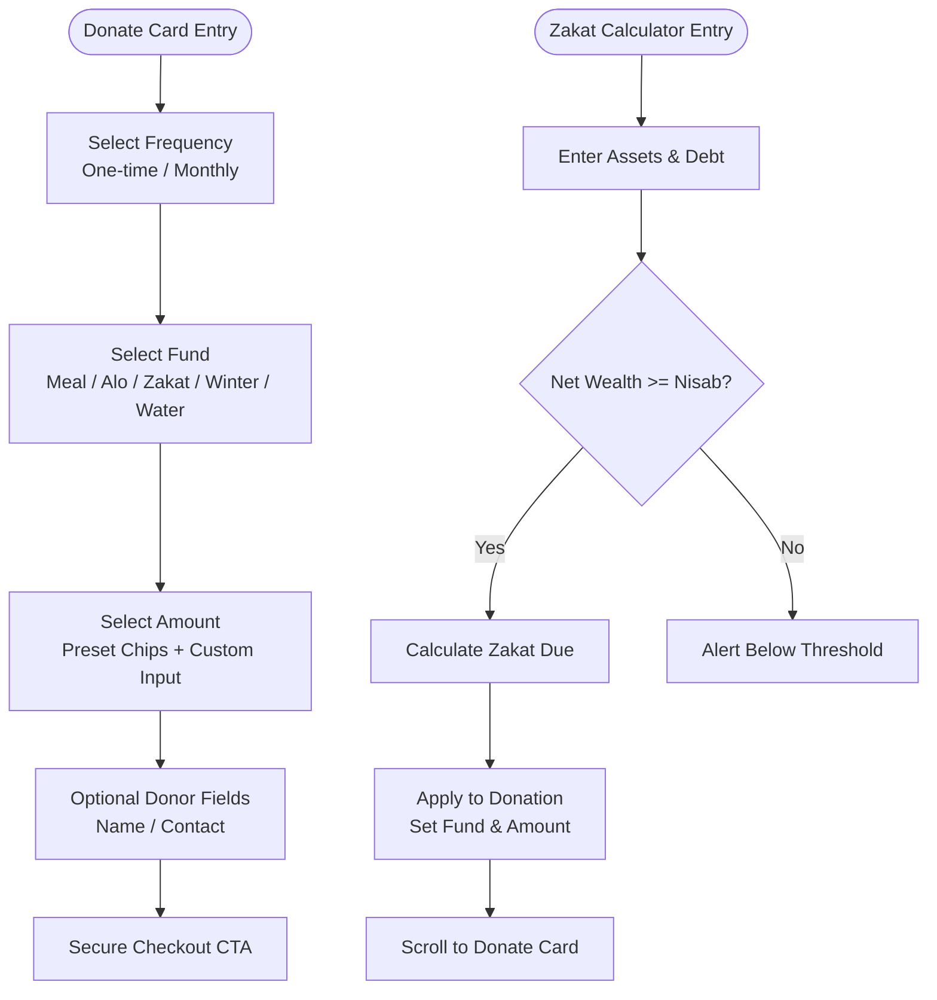
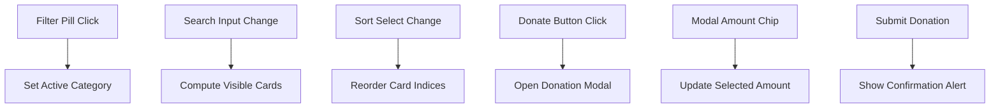
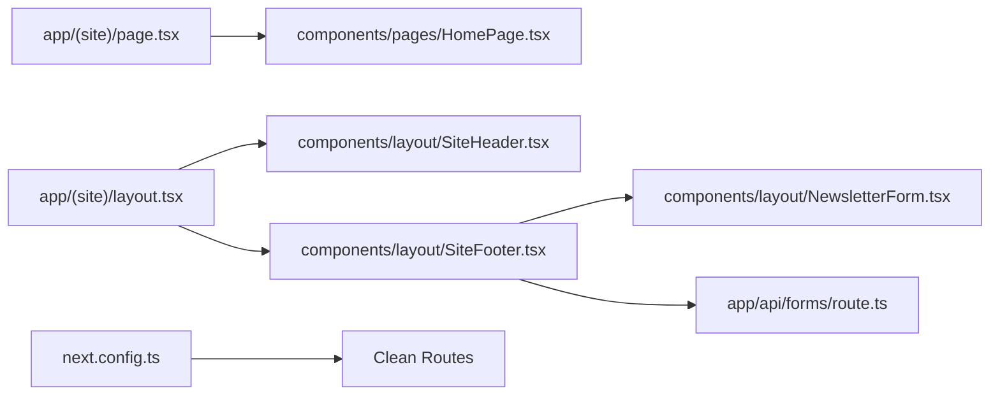

# Legacy Migration Guide

<cite>
**Referenced Files in This Document**
- [README.md](file://README.md)
- [next.config.ts](file://next.config.ts)
- [netlify.toml](file://netlify.toml)
- [app/layout.tsx](file://app/layout.tsx)
- [app/(site)/layout.tsx](file://app/(site)/layout.tsx)
- [app/(site)/page.tsx](file://app/(site)/page.tsx)
- [app/api/forms/route.ts](file://app/api/forms/route.ts)
- [components/layout/SiteHeader.tsx](file://components/layout/SiteHeader.tsx)
- [components/layout/SiteFooter.tsx](file://components/layout/SiteFooter.tsx)
- [components/pages/HomePage.tsx](file://components/pages/HomePage.tsx)
- [components/pages/AppealsPage.tsx](file://components/pages/AppealsPage.tsx)
- [legacy/index.html](file://legacy/index.html)
- [legacy/appeals.html](file://legacy/appeals.html)
- [legacy/netlify.toml](file://legacy/netlify.toml)
</cite>

## Table of Contents
1. [Introduction](#introduction)
2. [Project Structure](#project-structure)
3. [Core Components](#core-components)
4. [Architecture Overview](#architecture-overview)
5. [Detailed Component Analysis](#detailed-component-analysis)
6. [Dependency Analysis](#dependency-analysis)
7. [Performance Considerations](#performance-considerations)
8. [Troubleshooting Guide](#troubleshooting-guide)
9. [Conclusion](#conclusion)
10. [Appendices](#appendices)

## Introduction
This guide documents the one-to-one migration from the original static HTML charity portal to a Next.js App Router application. The goal was to preserve every interactive behavior, visual element, and user experience while modernizing the codebase with React components, TypeScript, Tailwind CSS, and clean routes.

Key outcomes:
- Every legacy page has a corresponding Next.js route and React component.
- All legacy `*.html` URLs permanently redirect to clean routes.
- Interactive behaviors (donation cards, Zakat calculator, appeal filters, modals, navigation drawer) are preserved as React state.
- The `legacy/` folder remains as an exact reference for comparing implementations.

**Section sources**
- [README.md:1-11](file://README.md#L1-L11)

## Project Structure
The repository is organized around Next.js conventions:
- `app/` contains the App Router pages, layouts, global styles, metadata, and API routes.
- `components/` holds reusable layout pieces and page-level client components.
- `legacy/` archives the original static site for reference.
- Configuration files (`next.config.ts`, `netlify.toml`, Tailwind, PostCSS, ESLint, TypeScript) define redirects, build settings, and design tokens.

**Diagram sources**
- [app/layout.tsx:1-61](file://app/layout.tsx#L1-L61)
- [app/(site)/layout.tsx:1-15](file://app/(site)/layout.tsx#L1-L15)
- [app/(site)/page.tsx:1-15](file://app/(site)/page.tsx#L1-L15)
- [next.config.ts:1-32](file://next.config.ts#L1-L32)
- [app/api/forms/route.ts:1-23](file://app/api/forms/route.ts#L1-L23)

**Section sources**
- [README.md:14-65](file://README.md#L14-L65)

## Core Components
- Root layout defines metadata, fonts, and Material Symbols links.
- Site layout wraps all public pages with the shared header and footer.
- Page route files render page-level components (for example, the homepage renders `HomePage`).
- Layout components encapsulate global UI:
  - `SiteHeader`: top meta strip, desktop nav, mobile drawer, active route highlighting.
  - `SiteFooter`: trust bar, links, newsletter form, legal footer.
- Page components implement interactive behaviors:
  - `HomePage`: quick donation card, Zakat calculator logic, impact stats, campaign previews.
  - `AppealsPage`: filter pills, search, sort, modal donation flow.

**Section sources**
- [app/layout.tsx:1-61](file://app/layout.tsx#L1-L61)
- [app/(site)/layout.tsx:1-15](file://app/(site)/layout.tsx#L1-L15)
- [app/(site)/page.tsx:1-15](file://app/(site)/page.tsx#L1-L15)
- [components/layout/SiteHeader.tsx:1-234](file://components/layout/SiteHeader.tsx#L1-L234)
- [components/layout/SiteFooter.tsx:1-233](file://components/layout/SiteFooter.tsx#L1-L233)
- [components/pages/HomePage.tsx:1-800](file://components/pages/HomePage.tsx#L1-L800)
- [components/pages/AppealsPage.tsx:1-800](file://components/pages/AppealsPage.tsx#L1-L800)

## Architecture Overview
The migration follows a strict one-to-one mapping:
- Each legacy HTML file maps to a clean Next.js route.
- Visuals and interactions are recreated using React components and Tailwind classes.
- Redirects ensure legacy bookmarks and external links continue working.

**Diagram sources**
- [next.config.ts:1-32](file://next.config.ts#L1-L32)
- [app/(site)/page.tsx:1-15](file://app/(site)/page.tsx#L1-L15)
- [components/pages/AppealsPage.tsx:1-800](file://components/pages/AppealsPage.tsx#L1-L800)

## Detailed Component Analysis

### One-to-One Page Mapping and Redirect Strategy
Every legacy page is mapped to a clean route and redirected permanently:

| Legacy URL | Clean Route | Notes |
| --- | --- | --- |
| `/index.html` | `/` | Homepage |
| `/appeals.html` | `/appeals` | Appeals & Causes |
| `/zakat-calculator.html` | `/zakat-calculator` | Zakat Fund & Calculator |
| `/impact.html` | `/impact` | Impact & Reports |
| `/about.html` | `/about` | About Us & Governance |
| `/campaign-details.html` | `/campaign-details` | Campaign Spotlight |
| `/volunteer.html` | `/volunteer` | Volunteer Portal |

Implementation:
- `next.config.ts` declares permanent redirects for `/index.html` and each `/:page.html`.
- Unknown paths render the branded 404 page.

**Section sources**
- [next.config.ts:1-32](file://next.config.ts#L1-L32)
- [README.md:137-152](file://README.md#L137-L152)

### Header and Navigation Preservation
The header preserves:
- International meta strip with helpline and Zakat link.
- Desktop navigation with active route highlighting.
- Mobile navigation drawer with click-outside-to-close behavior.
- Optional “simple” variant used by the legacy 404 page.

**Diagram sources**
- [components/layout/SiteHeader.tsx:1-234](file://components/layout/SiteHeader.tsx#L1-L234)

**Section sources**
- [components/layout/SiteHeader.tsx:1-234](file://components/layout/SiteHeader.tsx#L1-L234)

### Footer and Newsletter Form Integration
The footer preserves:
- Trust messaging and regulatory badges.
- Cross-links to key sections.
- Newsletter subscription form that posts to the forms API.

Form contract:
- Submissions post to `POST /api/forms`.
- The endpoint expects a `form-name` field and returns a JSON response.
- Persistence is intentionally delegated to the host system (CRM, email provider, or database).

**Diagram sources**
- [components/layout/SiteFooter.tsx:1-233](file://components/layout/SiteFooter.tsx#L1-L233)
- [app/api/forms/route.ts:1-23](file://app/api/forms/route.ts#L1-L23)

**Section sources**
- [components/layout/SiteFooter.tsx:1-233](file://components/layout/SiteFooter.tsx#L1-L233)
- [app/api/forms/route.ts:1-23](file://app/api/forms/route.ts#L1-L23)

### HomePage: Donation Card and Zakat Calculator
The homepage recreates:
- Quick donation card with frequency toggle, fund selection, preset amounts, custom amount input, and donor fields.
- Zakat calculator with asset/debt inputs, Nisab threshold check, live totals, and “apply to donation” flow.

**Diagram sources**
- [components/pages/HomePage.tsx:1-800](file://components/pages/HomePage.tsx#L1-L800)

**Section sources**
- [components/pages/HomePage.tsx:1-800](file://components/pages/HomePage.tsx#L1-L800)

### AppealsPage: Filters, Search, Sort, and Donation Modal
The appeals page recreates:
- Category filter pills with special styling for Zakat and default states.
- Live search across card text and categories.
- Sorting by urgency, funding level, target amount, or alphabetical order.
- Quick-donate modal with preset amounts and custom input.

**Diagram sources**
- [components/pages/AppealsPage.tsx:1-800](file://components/pages/AppealsPage.tsx#L1-L800)

**Section sources**
- [components/pages/AppealsPage.tsx:1-800](file://components/pages/AppealsPage.tsx#L1-L800)

### Converting Static HTML to React Components
Migration approach:
- Preserve markup structure and content exactly where possible.
- Convert inline scripts into React state and event handlers.
- Replace static class names with Tailwind utility classes while preserving design tokens.
- Keep typography scale and color palette identical to the legacy site.

Comparison workflow:
- Use `legacy/index.html` and `legacy/appeals.html` as references for original markup, styles, and behavior.
- Compare against `components/pages/HomePage.tsx` and `components/pages/AppealsPage.tsx` to verify parity.

**Section sources**
- [legacy/index.html:1-200](file://legacy/index.html#L1-L200)
- [legacy/appeals.html:1-200](file://legacy/appeals.html#L1-L200)
- [components/pages/HomePage.tsx:1-800](file://components/pages/HomePage.tsx#L1-L800)
- [components/pages/AppealsPage.tsx:1-800](file://components/pages/AppealsPage.tsx#L1-L800)

### JavaScript Behaviors, CSS Preservation, and Asset Management
- JavaScript behaviors:
  - Migrated from inline scripts to React hooks (`useState`, `useEffect`, `useRef`) and event handlers.
  - Examples include mobile drawer toggling, filter/search/sort logic, and modal open/close flows.
- CSS preservation:
  - Global typography scale and design tokens are preserved via Tailwind configuration and `app/globals.css`.
  - Material Symbols icons are loaded in the root layout head.
- Asset management:
  - Static assets are served from `public/`.
  - Netlify caching headers are configured for SVG assets.

**Section sources**
- [app/layout.tsx:1-61](file://app/layout.tsx#L1-L61)
- [netlify.toml:20-24](file://netlify.toml#L20-L24)

### Common Migration Challenges and Solutions
- Forms:
  - Challenge: Maintaining the legacy fire-and-forget submission contract.
  - Solution: `POST /api/forms` accepts `form-name` and returns JSON; persistence is delegated to external systems.
- Navigation:
  - Challenge: Preserving active route highlighting and mobile drawer behavior.
  - Solution: `SiteHeader` uses `usePathname` and local state to manage active links and drawer visibility.
- Interactive elements:
  - Challenge: Replicating inline script-driven modals, filters, and calculators.
  - Solution: Convert to React state and controlled components; keep UX identical.

**Section sources**
- [app/api/forms/route.ts:1-23](file://app/api/forms/route.ts#L1-L23)
- [components/layout/SiteHeader.tsx:1-234](file://components/layout/SiteHeader.tsx#L1-L234)
- [components/pages/HomePage.tsx:1-800](file://components/pages/HomePage.tsx#L1-L800)
- [components/pages/AppealsPage.tsx:1-800](file://components/pages/AppealsPage.tsx#L1-L800)

## Dependency Analysis
High-level dependencies:
- `app/(site)/page.tsx` imports `HomePage`.
- `app/(site)/layout.tsx` composes `SiteHeader` and `SiteFooter`.
- `SiteFooter` uses `NewsletterForm` and posts to `POST /api/forms`.
- `next.config.ts` provides redirects for legacy URLs.

**Diagram sources**
- [app/(site)/page.tsx:1-15](file://app/(site)/page.tsx#L1-L15)
- [app/(site)/layout.tsx:1-15](file://app/(site)/layout.tsx#L1-L15)
- [components/layout/SiteFooter.tsx:1-233](file://components/layout/SiteFooter.tsx#L1-L233)
- [app/api/forms/route.ts:1-23](file://app/api/forms/route.ts#L1-L23)
- [next.config.ts:1-32](file://next.config.ts#L1-L32)

**Section sources**
- [app/(site)/page.tsx:1-15](file://app/(site)/page.tsx#L1-L15)
- [app/(site)/layout.tsx:1-15](file://app/(site)/layout.tsx#L1-L15)
- [components/layout/SiteFooter.tsx:1-233](file://components/layout/SiteFooter.tsx#L1-L233)
- [app/api/forms/route.ts:1-23](file://app/api/forms/route.ts#L1-L23)
- [next.config.ts:1-32](file://next.config.ts#L1-L32)

## Performance Considerations
- Use Next.js App Router benefits such as component caching and partial prefetching enabled in `next.config.ts`.
- Prefer client-side interactivity within page components where necessary (marked with `'use client'`).
- Keep assets minimal and leverage CDN-hosted fonts and icons already present in the root layout.

[No sources needed since this section provides general guidance]

## Troubleshooting Guide
- Legacy URLs not redirecting:
  - Verify `next.config.ts` includes the expected `source` and `destination` entries.
- Forms not submitting:
  - Ensure the form posts to `POST /api/forms` and includes the required `form-name` field.
- Missing styles or fonts:
  - Confirm `app/layout.tsx` loads Material Symbols and that Tailwind configuration matches the legacy design tokens.
- Mobile drawer not closing:
  - Check that document click listeners are attached and remove themselves on cleanup.

**Section sources**
- [next.config.ts:1-32](file://next.config.ts#L1-L32)
- [app/api/forms/route.ts:1-23](file://app/api/forms/route.ts#L1-L23)
- [app/layout.tsx:1-61](file://app/layout.tsx#L1-L61)
- [components/layout/SiteHeader.tsx:1-234](file://components/layout/SiteHeader.tsx#L1-L234)

## Conclusion
The GMCF charity portal has been migrated one-to-one from static HTML to a modern Next.js application. Visual fidelity and interactive behavior are preserved, legacy URLs redirect cleanly, and the codebase is structured for maintainability. The `legacy/` folder remains available as a reference to compare old and new implementations.

[No sources needed since this section summarizes without analyzing specific files]

## Appendices

### Legacy Reference Usage
- Compare `legacy/index.html` with `components/pages/HomePage.tsx` to verify homepage parity.
- Compare `legacy/appeals.html` with `components/pages/AppealsPage.tsx` to verify appeals functionality.
- Review `legacy/netlify.toml` to understand previous deployment behavior and security headers.

**Section sources**
- [legacy/index.html:1-200](file://legacy/index.html#L1-L200)
- [legacy/appeals.html:1-200](file://legacy/appeals.html#L1-L200)
- [legacy/netlify.toml:1-25](file://legacy/netlify.toml#L1-L25)