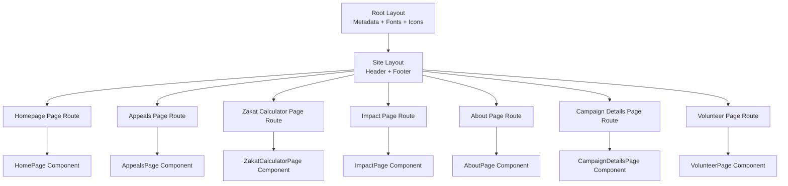
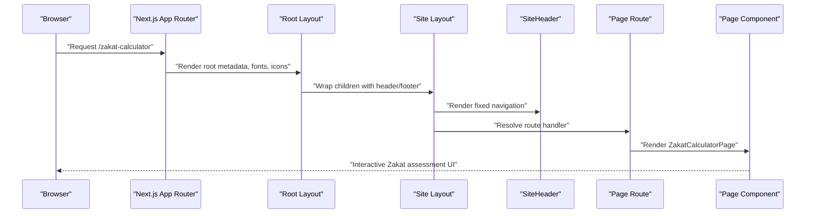
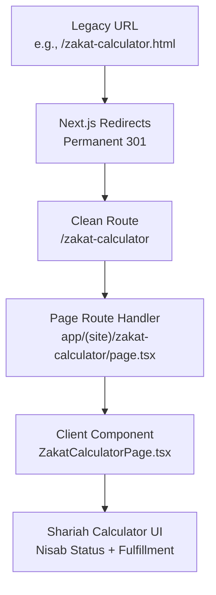
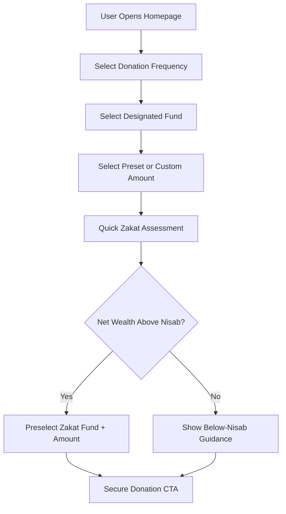
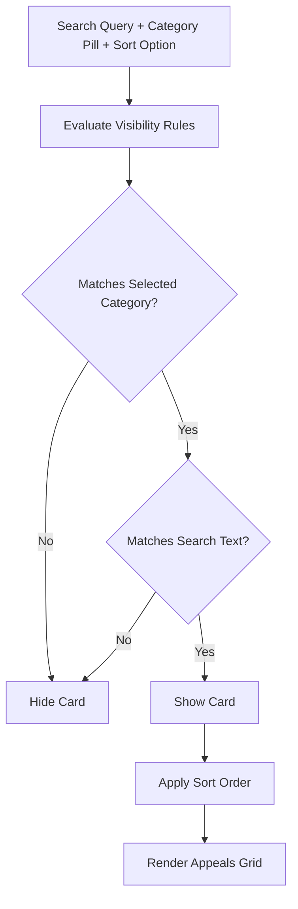
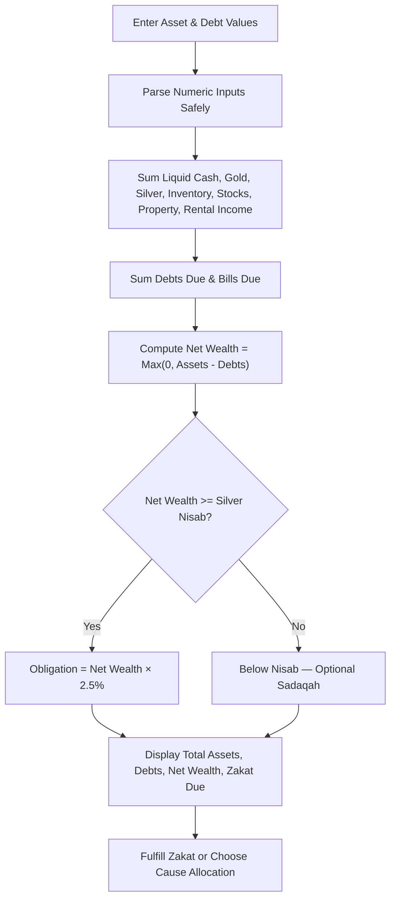
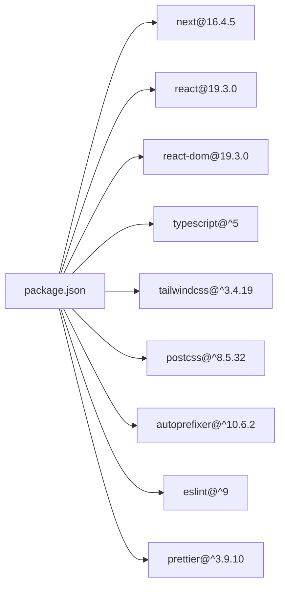

# Project Overview

<cite>
**Referenced Files in This Document**
- [README.md](file://README.md)
- [package.json](file://package.json)
- [next.config.ts](file://next.config.ts)
- [tailwind.config.ts](file://tailwind.config.ts)
- [app/layout.tsx](file://app/layout.tsx)
- [app/(site)/layout.tsx](file://app/(site)/layout.tsx)
- [app/(site)/page.tsx](file://app/(site)/page.tsx)
- [app/(site)/appeals/page.tsx](file://app/(site)/appeals/page.tsx)
- [app/(site)/zakat-calculator/page.tsx](file://app/(site)/zakat-calculator/page.tsx)
- [app/(site)/impact/page.tsx](file://app/(site)/impact/page.tsx)
- [app/(site)/about/page.tsx](file://app/(site)/about/page.tsx)
- [app/(site)/campaign-details/page.tsx](file://app/(site)/campaign-details/page.tsx)
- [app/(site)/volunteer/page.tsx](file://app/(site)/volunteer/page.tsx)
- [app/api/forms/route.ts](file://app/api/forms/route.ts)
- [components/layout/SiteHeader.tsx](file://components/layout/SiteHeader.tsx)
- [components/pages/HomePage.tsx](file://components/pages/HomePage.tsx)
- [components/pages/AppealsPage.tsx](file://components/pages/AppealsPage.tsx)
- [components/pages/ZakatCalculatorPage.tsx](file://components/pages/ZakatCalculatorPage.tsx)
- [components/pages/ImpactPage.tsx](file://components/pages/ImpactPage.tsx)
- [components/pages/AboutPage.tsx](file://components/pages/AboutPage.tsx)
- [components/pages/CampaignDetailsPage.tsx](file://components/pages/CampaignDetailsPage.tsx)
- [components/pages/VolunteerPage.tsx](file://components/pages/VolunteerPage.tsx)
</cite>

## Table of Contents
1. [Introduction](#introduction)
2. [Project Structure](#project-structure)
3. [Core Components](#core-components)
4. [Architecture Overview](#architecture-overview)
5. [Detailed Component Analysis](#detailed-component-analysis)
6. [Dependency Analysis](#dependency-analysis)
7. [Performance Considerations](#performance-considerations)
8. [Troubleshooting Guide](#troubleshooting-guide)
9. [Conclusion](#conclusion)

## Introduction
The Global Muslim Charitable Foundation (GMCF) web portal is a modern, institutional-grade humanitarian and Shariah-compliant charity website built with Next.js 16 using the App Router, React 19, TypeScript, Tailwind CSS, and Material Symbols. Its purpose is to provide a trustworthy digital platform for emergency relief, pediatric medical care, clean water initiatives, and Zakat-funded aid across Bangladesh and beyond.

This project migrated one-to-one from the original static HTML site archived under `legacy/`. Every page layout, visual design, copy tone, interactive behavior, and cross-page navigation has been preserved while upgrading to a scalable React component model. The migration approach replaces hand-written pages with typed Next.js route handlers and client-side components, keeping the same user experience but adding type safety, reusable layouts, and maintainable state management.

For beginners, this is a charity platform that helps donors calculate their Zakat, browse active appeals, read verified impact stories, learn about Shariah governance, and apply as a youth volunteer. For experienced developers, it demonstrates a clean static-to-Next.js migration pattern: legacy `.html` URLs are permanently redirected to clean routes, global fonts and icons are centralized, and each page is represented by a small route file delegating rendering to a dedicated page component.

**Section sources**
- [README.md:1-10](file://README.md#L1-L10)
- [README.md:69-115](file://README.md#L69-L115)
- [README.md:137-152](file://README.md#L137-L152)

## Project Structure
The repository follows a feature-aware Next.js App Router structure:

- `app/` contains the application shell, root metadata, global styles, API routes, and the `(site)` route group that shares the full site header and footer.
- `app/(site)/` defines the public pages: homepage, appeals, zakat calculator, impact, about, campaign details, and volunteer portal.
- `components/pages/` holds the large client-side page components that implement the original static-site interactions.
- `components/layout/` contains shared chrome such as the header, footer, and newsletter form.
- `legacy/` preserves the original static site for reference and optional deployment.
- Configuration files define redirects, Tailwind tokens, fonts, and build settings.

**Diagram sources**
- [app/layout.tsx:21-35](file://app/layout.tsx#L21-L35)
- [app/(site)/layout.tsx:1-15](file://app/(site)/layout.tsx#L1-L15)
- [app/(site)/page.tsx:1-15](file://app/(site)/page.tsx#L1-L15)
- [app/(site)/appeals/page.tsx:1-14](file://app/(site)/appeals/page.tsx#L1-L14)
- [app/(site)/zakat-calculator/page.tsx:1-15](file://app/(site)/zakat-calculator/page.tsx#L1-L15)
- [app/(site)/impact/page.tsx:1-14](file://app/(site)/impact/page.tsx#L1-L14)
- [app/(site)/about/page.tsx:1-14](file://app/(site)/about/page.tsx#L1-L14)
- [app/(site)/campaign-details/page.tsx:1-14](file://app/(site)/campaign-details/page.tsx#L1-L14)
- [app/(site)/volunteer/page.tsx:1-14](file://app/(site)/volunteer/page.tsx#L1-L14)

**Section sources**
- [README.md:14-65](file://README.md#L14-L65)
- [app/layout.tsx:1-61](file://app/layout.tsx#L1-L61)
- [app/(site)/layout.tsx:1-15](file://app/(site)/layout.tsx#L1-L15)

## Core Components
The portal’s core functionality centers around six main areas:

| Area | Purpose | Key Implementation |
|---|---|---|
| Homepage | Hero narrative, quick donation card, impact metrics, and appeal previews | `components/pages/HomePage.tsx` |
| Active Appeals | Filterable, searchable, sortable campaign cards with a quick-donation modal | `components/pages/AppealsPage.tsx` |
| Zakat Fund & Calculator | Live Nisab benchmark, five-category asset matrix, obligation summary, fulfillment flow | `components/pages/ZakatCalculatorPage.tsx` |
| Impact & Case Studies | Field dossiers, sponsorship tiers, Tamleek compliance explanation | `components/pages/ImpactPage.tsx` |
| About & Governance | Shariah pillars, advisory council, audit disclosures, registration information | `components/pages/AboutPage.tsx` |
| Volunteer Portal | Sector pathways, application form, success confirmation, FAQ accordion | `components/pages/VolunteerPage.tsx` |

Each page route in `app/(site)` is intentionally minimal: it declares metadata and renders the corresponding page component. This keeps routing concerns separate from UI state, which matches the one-to-one migration pattern from the original static pages.

**Section sources**
- [app/(site)/page.tsx:1-15](file://app/(site)/page.tsx#L1-L15)
- [app/(site)/appeals/page.tsx:1-14](file://app/(site)/appeals/page.tsx#L1-L14)
- [app/(site)/zakat-calculator/page.tsx:1-15](file://app/(site)/zakat-calculator/page.tsx#L1-L15)
- [app/(site)/impact/page.tsx:1-14](file://app/(site)/impact/page.tsx#L1-L14)
- [app/(site)/about/page.tsx:1-14](file://app/(site)/about/page.tsx#L1-L14)
- [app/(site)/campaign-details/page.tsx:1-14](file://app/(site)/campaign-details/page.tsx#L1-L14)
- [app/(site)/volunteer/page.tsx:1-14](file://app/(site)/volunteer/page.tsx#L1-L14)

## Architecture Overview
At runtime, the request flows through the Next.js App Router into a shared site layout, then into a page route, which delegates rendering to a client-side page component. Shared chrome is provided by `SiteHeader` and `SiteFooter`, while global typography, Material Symbols, and brand metadata live in the root layout.

**Diagram sources**
- [app/layout.tsx:21-61](file://app/layout.tsx#L21-L61)
- [app/(site)/layout.tsx:1-15](file://app/(site)/layout.tsx#L1-L15)
- [components/layout/SiteHeader.tsx:1-234](file://components/layout/SiteHeader.tsx#L1-L234)
- [app/(site)/zakat-calculator/page.tsx:1-15](file://app/(site)/zakat-calculator/page.tsx#L1-L15)
- [components/pages/ZakatCalculatorPage.tsx:1-120](file://components/pages/ZakatCalculatorPage.tsx#L1-L120)

## Detailed Component Analysis

### One-to-One Migration Pattern
The migration strategy is deliberately conservative: every legacy static page maps to a Next.js route and a React component without changing the intended user experience.

| Legacy Static Page | Modern Route | Modern Component | Migration Notes |
|---|---|---|---|
| `index.html` | `/` | `components/pages/HomePage.tsx` | Hero, quick donation card, impact ribbon, appeals preview |
| `appeals.html` | `/appeals` | `components/pages/AppealsPage.tsx` | Filters, search, sort, quick-donation modal |
| `zakat-calculator.html` | `/zakat-calculator` | `components/pages/ZakatCalculatorPage.tsx` | Five-category Zakat matrix, Nisab status, fulfillment flow |
| `impact.html` | `/impact` | `components/pages/ImpactPage.tsx` | Case dossiers, sponsor tiers, Tamleek pipeline |
| `about.html` | `/about` | `components/pages/AboutPage.tsx` | Shariah pillars, council, audit documents |
| `campaign-details.html` | `/campaign-details` | `components/pages/CampaignDetailsPage.tsx` | Tabs, gallery, meal counter, Zakat governance |
| `volunteer.html` | `/volunteer` | `components/pages/VolunteerPage.tsx` | Pathways, application form, success scroll |
| `404.html` | Branded fallback | `app/not-found.tsx` | Slim header/footer variant via simple header mode |

Legacy `.html` URLs continue working because `next.config.ts` defines permanent redirects from old paths to clean App Router routes. This protects bookmarks, external links, and search results during and after migration.

**Diagram sources**
- [next.config.ts:3-28](file://next.config.ts#L3-L28)
- [app/(site)/zakat-calculator/page.tsx:1-15](file://app/(site)/zakat-calculator/page.tsx#L1-L15)
- [components/pages/ZakatCalculatorPage.tsx:1-120](file://components/pages/ZakatCalculatorPage.tsx#L1-L120)

**Section sources**
- [README.md:8-10](file://README.md#L8-L10)
- [README.md:137-152](file://README.md#L137-L152)
- [next.config.ts:3-28](file://next.config.ts#L3-L28)

### Technology Stack
The stack balances accessibility for newcomers with modern engineering practices:

| Layer | Technology | Role |
|---|---|---|
| Framework | Next.js 16 | Routing, server/client boundaries, build pipeline |
| Runtime | React 19 | Client-side interactivity for calculators, modals, filters |
| Language | TypeScript | Type-safe props, state, and component contracts |
| Styling | Tailwind CSS | Utility-first styling with custom GMCF design tokens |
| Typography | Plus Jakarta Sans and Playfair Display | Body/UI and editorial headings via `next/font` |
| Icons | Google Material Symbols Outlined | Consistent icon system across the humanitarian portal |
| Deployment | Netlify | Build adapter, security headers, and legacy compatibility |

The package manifest confirms Next.js 16, React 19, TypeScript, Tailwind CSS, PostCSS, Autoprefixer, ESLint, and Prettier. The root layout injects Material Symbols and sets global metadata describing GMCF as a Shariah-compliant humanitarian portal.

**Section sources**
- [package.json:1-29](file://package.json#L1-L29)
- [app/layout.tsx:1-61](file://app/layout.tsx#L1-L61)
- [tailwind.config.ts:1-129](file://tailwind.config.ts#L1-L129)

### Homepage and Quick Donation Engine
The homepage combines narrative storytelling with an interactive donation engine. It manages donation frequency, fund selection, preset amounts, custom amount input, and a compact Zakat mini-assessment. When the user calculates Zakat due above the threshold, the interface scrolls to the donation section and preselects the appropriate fund and amount.

Key behaviors include:
- Frequency toggle between one-time and monthly giving.
- Fund selector covering food relief, pediatric care, general Zakat, winter warmth, and clean water.
- Preset amount chips plus a custom amount field.
- A short Zakat calculation using cash, gold, business assets, and debt inputs.
- Direct links to `/zakat-calculator` and `/appeals`.

**Diagram sources**
- [components/pages/HomePage.tsx:16-82](file://components/pages/HomePage.tsx#L16-L82)
- [components/pages/HomePage.tsx:264-447](file://components/pages/HomePage.tsx#L264-L447)

**Section sources**
- [components/pages/HomePage.tsx:1-120](file://components/pages/HomePage.tsx#L1-L120)
- [components/pages/HomePage.tsx:264-447](file://components/pages/HomePage.tsx#L264-L447)

### Active Appeals Page
The appeals page recreates the original static campaign listing with enhanced client-side filtering, search, sorting, and a quick-donation modal. Campaign metadata includes categories, progress percentages, urgency levels, titles, and locations. Users can filter by all campaigns, food security, pediatric surgery, clean water, winter blankets, or Zakat-eligible causes. Sorting supports urgent need, funding level, target amount, and alphabetical order.

Important implementation details:
- Category pills update visibility based on `data-categories`.
- Search matches against visible card text.
- Sort updates internal card ordering without re-fetching data.
- Quick-donation modal accepts preset amounts and custom input.
- Each appeal card links to `/campaign-details`.

**Diagram sources**
- [components/pages/AppealsPage.tsx:6-22](file://components/pages/AppealsPage.tsx#L6-L22)
- [components/pages/AppealsPage.tsx:63-152](file://components/pages/AppealsPage.tsx#L63-L152)
- [components/pages/AppealsPage.tsx:314-376](file://components/pages/AppealsPage.tsx#L314-L376)

**Section sources**
- [components/pages/AppealsPage.tsx:1-152](file://components/pages/AppealsPage.tsx#L1-L152)
- [components/pages/AppealsPage.tsx:314-376](file://components/pages/AppealsPage.tsx#L314-L376)

### Zakat Calculator Page
The Zakat calculator is the most complex interactive tool. It implements a five-category Shariah assessment matrix: liquid cash and savings, gold/silver bullion, business inventory and stocks, real estate for resale and rental income, and short-term liabilities. It computes total assets, deductible debts, net wealth, Nisab qualification, and the 2.5% Zakat obligation.

Key concepts:
- Silver Nisab benchmark is used to determine whether Zakat is obligatory.
- Assets and debts are parsed safely to avoid invalid numbers.
- Nisab status changes visually when the user recomputes values.
- Users can reset fields, select a cause allocation, and fulfill Zakat.
- The page emphasizes ring-fenced funds, zero overhead, and direct beneficiary ownership.

**Diagram sources**
- [components/pages/ZakatCalculatorPage.tsx:6-24](file://components/pages/ZakatCalculatorPage.tsx#L6-L24)
- [components/pages/ZakatCalculatorPage.tsx:36-105](file://components/pages/ZakatCalculatorPage.tsx#L36-L105)
- [components/pages/ZakatCalculatorPage.tsx:340-794](file://components/pages/ZakatCalculatorPage.tsx#L340-L794)

**Section sources**
- [components/pages/ZakatCalculatorPage.tsx:1-120](file://components/pages/ZakatCalculatorPage.tsx#L1-L120)
- [components/pages/ZakatCalculatorPage.tsx:340-794](file://components/pages/ZakatCalculatorPage.tsx#L340-L794)

### Impact Page
The impact page presents documented field case studies, sponsorship tiers, and a transparent Shariah verification pipeline. It uses category filters, modals for detailed dossiers, and a clear explanation of how Zakat moves from donor to verified Asnaf recipients through Tamleek transfer.

Highlights:
- Case filters cover child protection, healthcare, street food relief, and WASH.
- Sponsorship tiers allow users to select impact amounts.
- Governance sections explain field identification, Shariah board review, direct transfer, and audited reporting.
- CTAs link back to the zakat calculator and about/governance anchors.

**Section sources**
- [components/pages/ImpactPage.tsx:6-34](file://components/pages/ImpactPage.tsx#L6-L34)
- [components/pages/ImpactPage.tsx:147-198](file://components/pages/ImpactPage.tsx#L147-L198)
- [components/pages/ImpactPage.tsx:534-665](file://components/pages/ImpactPage.tsx#L534-L665)

### About Page
The about page communicates GMCF’s mission, four foundational pillars, Shariah advisory council, independent audits, and statutory registrations. It reinforces the organization’s commitment to zero administrative deductions from Zakat, direct beneficiary ownership, ground-truth verification, and radical stewardship.

Key messaging includes:
- 100% Zakat distribution ratio.
- Zero admin deductions from Zakat.
- Independent fatwa certification.
- GPS time-stamped audits.
- Separate endowment funding for operational costs.

**Section sources**
- [components/pages/AboutPage.tsx:10-80](file://components/pages/AboutPage.tsx#L10-L80)
- [components/pages/AboutPage.tsx:83-230](file://components/pages/AboutPage.tsx#L83-L230)
- [components/pages/AboutPage.tsx:233-431](file://components/pages/AboutPage.tsx#L233-L431)

### Campaign Details Page
The campaign details page focuses on “One Meal One Hope,” presenting story content, cost breakdown, field dispatch logs, and Zakat governance. It includes a dynamic photo gallery, tabbed content, meal pricing logic, and a checkout simulation.

Notable behaviors:
- Thumbnail selection updates the main image.
- Tabs switch between about, budget, updates, and Shariah content.
- Meal count is derived from donation amount divided by $2 per meal.
- Zakat governance explains Tamleek, ring-fenced accounts, and scholarly endorsement.

**Section sources**
- [components/pages/CampaignDetailsPage.tsx:6-52](file://components/pages/CampaignDetailsPage.tsx#L6-L52)
- [components/pages/CampaignDetailsPage.tsx:143-255](file://components/pages/CampaignDetailsPage.tsx#L143-L255)
- [components/pages/CampaignDetailsPage.tsx:257-754](file://components/pages/CampaignDetailsPage.tsx#L257-L754)

### Volunteer Page
The volunteer page provides pathway cards, sector preselection, an application form, success confirmation, and FAQ interaction. Submissions use a fire-and-forget POST contract compatible with the original static site.

Key features:
- Sector options include emergency relief, medical camps, street literacy, and media/logistics.
- Form submission posts to the root endpoint and scrolls to a success message.
- Pathway buttons preselect sectors and smooth-scroll to the application form.
- Safety, accreditation, and service-hour certification messaging reinforce trust.

**Section sources**
- [components/pages/VolunteerPage.tsx:5-62](file://components/pages/VolunteerPage.tsx#L5-L62)
- [components/pages/VolunteerPage.tsx:271-562](file://components/pages/VolunteerPage.tsx#L271-L562)
- [components/pages/VolunteerPage.tsx:564-800](file://components/pages/VolunteerPage.tsx#L564-L800)

### Shared Navigation and Layout
The shared header provides:
- International meta strip with helpline number and Zakat policy banner.
- Desktop navigation highlighting the active route.
- Mobile drawer with hamburger toggle.
- Currency selector and volunteer/donor portal shortcut.
- Simple variant support for the slim 404 header.

The site layout wraps every public page with the header and footer, ensuring consistent branding and navigation across the humanitarian portal.

**Section sources**
- [components/layout/SiteHeader.tsx:7-14](file://components/layout/SiteHeader.tsx#L7-L14)
- [components/layout/SiteHeader.tsx:24-43](file://components/layout/SiteHeader.tsx#L24-L43)
- [components/layout/SiteHeader.tsx:45-108](file://components/layout/SiteHeader.tsx#L45-L108)
- [components/layout/SiteHeader.tsx:110-191](file://components/layout/SiteHeader.tsx#L110-L191)
- [components/layout/SiteHeader.tsx:193-231](file://components/layout/SiteHeader.tsx#L193-L231)
- [app/(site)/layout.tsx:1-15](file://app/(site)/layout.tsx#L1-L15)

## Dependency Analysis
The project’s dependencies are intentionally focused on the Next.js ecosystem and styling toolchain. There is no heavy third-party UI library; instead, Material Symbols and Tailwind tokens carry the visual identity.

**Diagram sources**
- [package.json:1-29](file://package.json#L1-L29)

**Section sources**
- [package.json:1-29](file://package.json#L1-L29)

## Performance Considerations
Several configuration choices indicate performance awareness:

- `cacheComponents: true` enables component caching where applicable.
- `partialPrefetching: true` improves navigation responsiveness.
- `next/font` loads Plus Jakarta Sans and Playfair Display with swap behavior.
- Material Symbols are linked in the root head rather than bundled as heavy SVG assets.
- Tailwind content scanning targets only `app/**/*.{ts,tsx}` and `components/**/*.{ts,tsx}`, reducing unused styles.

For future optimization:
- Consider lazy-loading heavy page components if bundle size grows.
- Use Next.js image optimization for field photos instead of raw external URLs.
- Defer non-critical analytics or tracking scripts.
- Monitor client-side state complexity in large pages like appeals and zakat calculator.

[No sources needed since this section provides general guidance]

## Troubleshooting Guide
Common issues and resolutions:

| Issue | Likely Cause | Resolution |
|---|---|---|
| Legacy `.html` links return 404 | Redirects not applied or deployed incorrectly | Verify `next.config.ts` redirects and redeploy |
| Forms do not persist submissions | Host integration missing | Wire `POST /api/forms` to CRM, email provider, or database |
| Zakat calculation shows unexpected values | Invalid or negative numeric input | Ensure inputs are parsed safely and defaults to zero |
| Mobile menu does not close | Click-outside listener not triggered | Check header ref and document click handler |
| Styles look incorrect | Tailwind config or globals not loaded | Confirm `tailwind.config.ts` and `app/globals.css` are included |
| Icons missing | Material Symbols stylesheet not injected | Confirm root layout includes Material Symbols links |

Form handling is intentionally lightweight: the API route reads the form name, validates presence, and returns a JSON response. Persistence is delegated to the host environment so the UI behaves exactly as the original static site.

**Section sources**
- [next.config.ts:3-28](file://next.config.ts#L3-L28)
- [app/api/forms/route.ts:1-23](file://app/api/forms/route.ts#L1-L23)
- [components/layout/SiteHeader.tsx:34-43](file://components/layout/SiteHeader.tsx#L34-L43)
- [components/pages/ZakatCalculatorPage.tsx:21-24](file://components/pages/ZakatCalculatorPage.tsx#L21-L24)

## Conclusion
The GMCF web portal successfully modernizes a hand-written static charity site into a secure, type-safe, and maintainable Next.js application. It preserves the original visual design, copy, and interactive behavior while introducing structured routing, reusable layouts, and explicit TypeScript contracts.

For charity operators, the portal delivers a Shariah-compliant giving experience centered on transparency, Zakat integrity, and verified humanitarian impact. For developers, it demonstrates a disciplined one-to-one migration: legacy pages become clean routes, static markup becomes React components, and global assets are centralized without altering the user journey.

The result is a humanitarian portal that honors its mission while benefiting from modern web architecture.

[No sources needed since this section summarizes without analyzing specific files]