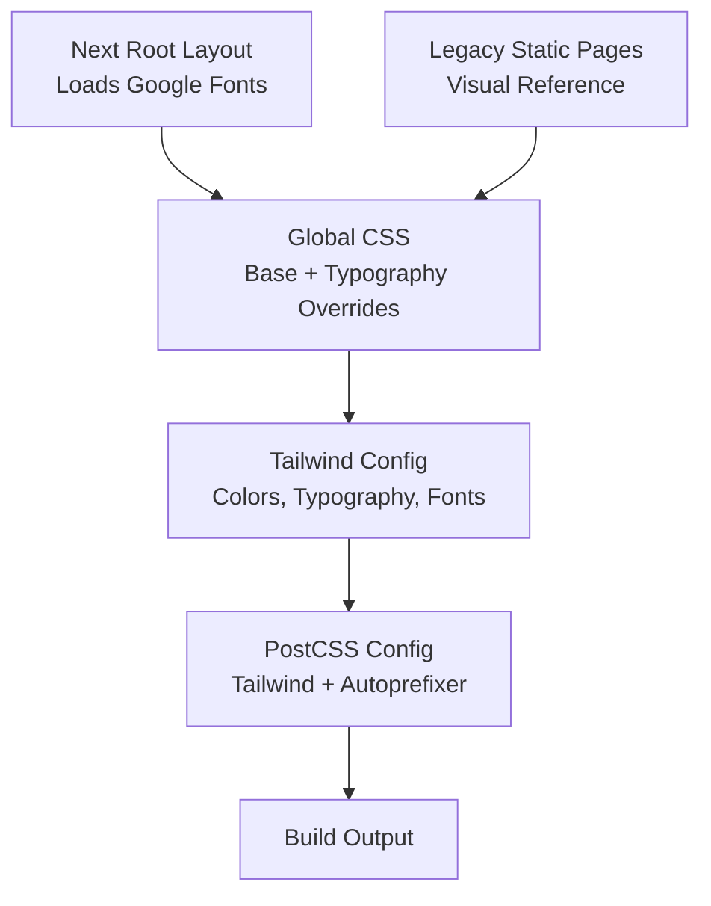
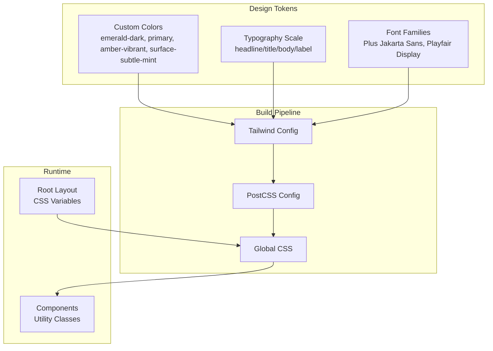
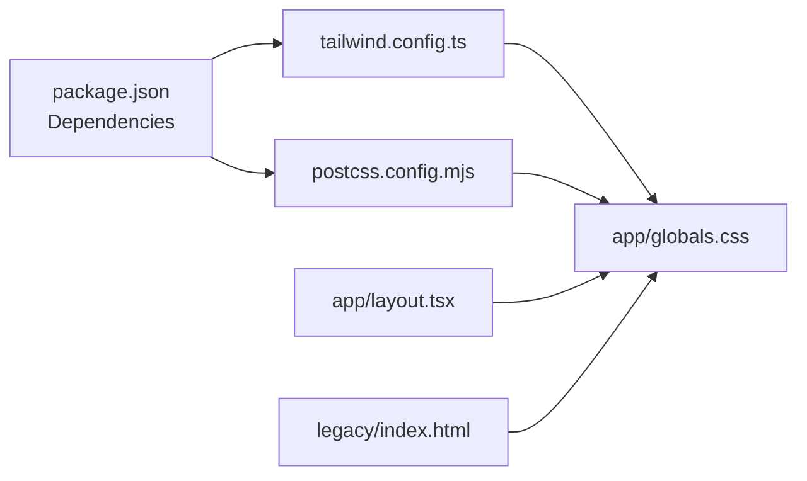

# Styling & Design System

<cite>
**Referenced Files in This Document**
- [tailwind.config.ts](file://tailwind.config.ts)
- [app/globals.css](file://app/globals.css)
- [app/layout.tsx](file://app/layout.tsx)
- [postcss.config.mjs](file://postcss.config.mjs)
- [package.json](file://package.json)
- [docs/DESIGN.md](file://docs/DESIGN.md)
- [components/layout/SiteFooter.tsx](file://components/layout/SiteFooter.tsx)
- [components/pages/NotFoundPage.tsx](file://components/pages/NotFoundPage.tsx)
- [legacy/index.html](file://legacy/index.html)
</cite>

## Table of Contents
1. [Introduction](#introduction)
2. [Project Structure](#project-structure)
3. [Core Components](#core-components)
4. [Architecture Overview](#architecture-overview)
5. [Detailed Component Analysis](#detailed-component-analysis)
6. [Dependency Analysis](#dependency-analysis)
7. [Performance Considerations](#performance-considerations)
8. [Troubleshooting Guide](#troubleshooting-guide)
9. [Conclusion](#conclusion)
10. [Appendices](#appendices)

## Introduction
This document explains the GMCF charity portal’s styling and design system built on Tailwind CSS. It covers custom design tokens, color palettes, typography with Plus Jakarta Sans and Playfair Display, spacing conventions, responsive patterns, accessibility considerations, and guidelines for extending the system while preserving the original static site’s visual design.

## Project Structure
The styling system is centered around:
- A Tailwind configuration that defines custom colors, typography scales, and font families.
- Global CSS that layers base styles, typography overrides, and legacy preservation rules.
- Next.js root layout that loads fonts via `next/font/google` and applies CSS variables to the HTML element.
- PostCSS configuration enabling Tailwind and Autoprefixer.
- Legacy static pages used as a reference for preserved visual behavior.

**Diagram sources**
- [app/layout.tsx:1-61](file://app/layout.tsx#L1-L61)
- [app/globals.css:1-189](file://app/globals.css#L1-L189)
- [tailwind.config.ts:1-129](file://tailwind.config.ts#L1-L129)
- [postcss.config.mjs:1-8](file://postcss.config.mjs#L1-L8)
- [legacy/index.html:1-23](file://legacy/index.html#L1-L23)

**Section sources**
- [app/layout.tsx:1-61](file://app/layout.tsx#L1-L61)
- [app/globals.css:1-189](file://app/globals.css#L1-L189)
- [tailwind.config.ts:1-129](file://tailwind.config.ts#L1-L129)
- [postcss.config.mjs:1-8](file://postcss.config.mjs#L1-L8)
- [package.json:1-29](file://package.json#L1-L29)

## Core Components
- Custom color palette anchored by institutional emerald-teal tones, warm amber accents, and subtle mint surfaces. Key tokens include `emerald-dark`, `primary`, `amber-vibrant`, and `surface-subtle-mint`.
- Typography scale organized into headline, title, body, and label tiers with explicit line-heights and letter-spacing.
- Font families mapped to CSS variables:
  - Sans: Plus Jakarta Sans via `--font-plus-jakarta`.
  - Serif: Playfair Display via `--font-playfair`.
- Global CSS layering:
  - Base resets and scroll behavior.
  - Typography overrides ensuring consistent rendering across components and legacy pages.
  - Utility classes for semantic typography (e.g., `.text-headline-xl`, `.font-body-md`).

**Section sources**
- [tailwind.config.ts:6-123](file://tailwind.config.ts#L6-L123)
- [app/globals.css:5-189](file://app/globals.css#L5-L189)
- [app/layout.tsx:6-19](file://app/layout.tsx#L6-L19)

## Architecture Overview
The design system follows a layered approach:
- Tailwind config centralizes design tokens.
- Global CSS enforces baseline behavior and typography consistency.
- Next.js root layout injects font variables and Material Symbols.
- Components consume tokens through Tailwind utility classes.

**Diagram sources**
- [tailwind.config.ts:6-123](file://tailwind.config.ts#L6-L123)
- [postcss.config.mjs:1-8](file://postcss.config.mjs#L1-L8)
- [app/globals.css:1-189](file://app/globals.css#L1-L189)
- [app/layout.tsx:1-61](file://app/layout.tsx#L1-L61)

## Detailed Component Analysis

### Color Palette and Tokens
- Primary brand tone: institutional teal/emerald (`primary`, `emerald-dark`) used for identity, navigation, and key UI elements.
- Accent tone: vibrant amber (`amber-vibrant`) for urgent CTAs and impact highlights.
- Surface tokens: clean white (`surface-clean`), subtle mint (`surface-subtle-mint`), and layered container variants for depth without heavy shadows.
- Neutral and contrast tokens: `on-surface`, `on-primary`, `border-subtle`, `text-muted` ensure accessible contrast and readability.

Usage examples in components:
- Footer uses `bg-emerald-dark`, `text-on-primary`, `bg-primary-container`, and `text-gold-warm` to establish high-contrast branding.
- Not Found page uses `bg-surface-subtle-mint`, `text-amber-vibrant`, and `text-emerald-dark` to communicate urgency and clarity.

Guidelines:
- Prefer semantic tokens over raw hex values.
- Use `hover:` states with token transitions (e.g., from `primary` to `emerald-dark`).
- Maintain contrast ratios per WCAG guidelines when pairing text and background tokens.

**Section sources**
- [tailwind.config.ts:8-66](file://tailwind.config.ts#L8-L66)
- [components/layout/SiteFooter.tsx:9-93](file://components/layout/SiteFooter.tsx#L9-L93)
- [components/pages/NotFoundPage.tsx:10-47](file://components/pages/NotFoundPage.tsx#L10-L47)

### Typography System
- Headlines use tight negative letter-spacing and strong weights for authority; sizes scale across breakpoints.
- Titles and bodies maintain comfortable line heights for long-form reading.
- Labels apply medium/semi-bold weights with tracking for scannability.
- Semantic classes mirror the scale (e.g., `.text-headline-xl`, `.font-title-lg`, `.text-body-sm`).

Implementation details:
- Tailwind config defines the type scale under `fontSize`.
- Global CSS provides responsive overrides and ensures h1/h2/h3 match the intended rhythm.
- Font families are bound to CSS variables injected by the root layout.

Accessibility notes:
- Ensure sufficient contrast between text tokens and backgrounds.
- Avoid overly tight letter-spacing on small labels.
- Keep minimum readable font sizes at or above 1rem for body content.

**Section sources**
- [tailwind.config.ts:67-118](file://tailwind.config.ts#L67-L118)
- [app/globals.css:26-173](file://app/globals.css#L26-L173)
- [app/layout.tsx:6-19](file://app/layout.tsx#L6-L19)

### Spacing Conventions
- The design system documentation outlines gutter and margin scales for structured layouts.
- In practice, components rely on Tailwind spacing utilities and token-driven surfaces rather than ad-hoc margins.
- For new sections, prefer using documented spacing tokens conceptually (gutter, space-xs through space-xl) and map them to Tailwind utilities consistently.

Best practices:
- Use consistent vertical rhythm with spacing utilities.
- Reserve large outer margins for desktop containers; keep mobile margins compact.
- Align component paddings with the documented spacing scale.

**Section sources**
- [docs/DESIGN.md:145-157](file://docs/DESIGN.md#L145-L157)

### Responsive Design Patterns and Mobile-First Approach
- Typography scales define base sizes for mobile and increase at tablet/desktop breakpoints.
- Global CSS includes media queries to adjust headline sizes progressively.
- Components should be authored mobile-first, adding larger breakpoints as needed.

Patterns observed:
- Headline sizes scale from ~34px on mobile to 48px on desktop.
- Body and label sizes remain readable across devices with appropriate line-heights.

Accessibility considerations:
- Ensure touch targets meet minimum size guidelines.
- Test readability at all breakpoints.
- Verify focus states and keyboard navigation.

**Section sources**
- [app/globals.css:45-100](file://app/globals.css#L45-L100)
- [tailwind.config.ts:67-118](file://tailwind.config.ts#L67-L118)

### CSS Layering Strategy and Global Styles Preservation
- Global CSS uses Tailwind layers (`base`, `components`, `utilities`) to structure styles.
- Base layer sets minimal resets and scroll behavior.
- Typography overrides enforce consistent rendering and preserve legacy page visuals.
- Legacy 404 typography is explicitly preserved to avoid regression.

Preservation strategy:
- Replicate critical global styles from legacy pages in `globals.css`.
- Use targeted overrides (e.g., `.not-found-page h1`) only when necessary.
- Prefer semantic class names tied to the design system.

**Section sources**
- [app/globals.css:1-20](file://app/globals.css#L1-L20)
- [app/globals.css:175-189](file://app/globals.css#L175-L189)
- [legacy/index.html:11-23](file://legacy/index.html#L11-L23)

### Guidelines for Extending the Design System
Adding new colors:
- Define semantic tokens in Tailwind config under `theme.extend.colors`.
- Provide both base and variant tokens (e.g., hover states).
- Update usage in components to reference tokens instead of hard-coded hex values.

Adding new fonts:
- Add a new Google font via `next/font/google` in the root layout.
- Assign a CSS variable (e.g., `--font-new-font`).
- Extend Tailwind `fontFamily` to map a semantic name to the variable.
- Create corresponding typography scale entries if needed.

Adding new design tokens:
- Document tokens in the design spec alongside their application rules.
- Mirror tokens in Tailwind config and global CSS where required.
- Update components gradually to adopt new tokens.

Consistency checks:
- Run linting and build processes to catch unused or conflicting styles.
- Validate contrast ratios and accessibility compliance.
- Review visual regressions against legacy pages.

**Section sources**
- [tailwind.config.ts:6-123](file://tailwind.config.ts#L6-L123)
- [app/layout.tsx:6-19](file://app/layout.tsx#L6-L19)
- [docs/DESIGN.md:168-243](file://docs/DESIGN.md#L168-L243)

### Common Styling Patterns and Component-Specific Approaches
- Buttons:
  - Primary CTA: solid primary/emerald with white text; hover transitions to darker shade.
  - Secondary/institutional: deep emerald with white text; hover to darker tone.
  - Ghost/outlined: transparent background with border in primary tone.
- Donation amount chips:
  - Default: neutral surface with subtle border.
  - Selected: mint surface, primary border, dark text, checkmark badge.
- Campaign cards:
  - White surface with subtle border and rounded geometry.
  - Progress bars using primary fill on light mint background.
- Inputs and forms:
  - Height optimized for mobile taps.
  - Focus state uses primary border and soft glow.

These patterns are reflected in component implementations and can be extended by reusing tokens and utility classes.

**Section sources**
- [docs/DESIGN.md:217-243](file://docs/DESIGN.md#L217-L243)
- [components/layout/SiteFooter.tsx:9-93](file://components/layout/SiteFooter.tsx#L9-L93)
- [components/pages/NotFoundPage.tsx:10-47](file://components/pages/NotFoundPage.tsx#L10-L47)

## Dependency Analysis
The styling pipeline depends on:
- Tailwind CSS for utility generation and theme extension.
- PostCSS for processing Tailwind and autoprefixing.
- Next.js root layout for font loading and CSS variable injection.
- Legacy pages as a visual contract to preserve during migration.

**Diagram sources**
- [package.json:11-27](file://package.json#L11-L27)
- [tailwind.config.ts:1-129](file://tailwind.config.ts#L1-L129)
- [postcss.config.mjs:1-8](file://postcss.config.mjs#L1-L8)
- [app/globals.css:1-189](file://app/globals.css#L1-L189)
- [app/layout.tsx:1-61](file://app/layout.tsx#L1-L61)
- [legacy/index.html:1-23](file://legacy/index.html#L1-L23)

**Section sources**
- [package.json:11-27](file://package.json#L11-L27)
- [tailwind.config.ts:1-129](file://tailwind.config.ts#L1-L129)
- [postcss.config.mjs:1-8](file://postcss.config.mjs#L1-L8)
- [app/globals.css:1-189](file://app/globals.css#L1-L189)
- [app/layout.tsx:1-61](file://app/layout.tsx#L1-L61)
- [legacy/index.html:1-23](file://legacy/index.html#L1-L23)

## Performance Considerations
- Use Tailwind’s purge/content configuration to minimize CSS output.
- Leverage `next/font/google` with subset and weight selection to reduce font payload.
- Prefer utility classes over custom CSS where possible to avoid duplication.
- Avoid excessive `!important` overrides; reserve them for legacy preservation.
- Test performance on low-end mobile devices and optimize images and assets accordingly.

[No sources needed since this section provides general guidance]

## Troubleshooting Guide
Common issues and resolutions:
- Typography mismatch after migration:
  - Verify that global CSS overrides align with the legacy pages.
  - Check that semantic typography classes are applied correctly.
- Colors not appearing as expected:
  - Confirm tokens are defined in Tailwind config and referenced in components.
  - Ensure no conflicting CSS rules override token-based styles.
- Font loading problems:
  - Validate CSS variables are set on the HTML element.
  - Confirm font subsets and weights are requested in the root layout.
- Accessibility failures:
  - Inspect contrast ratios between text and background tokens.
  - Ensure focus states are visible and keyboard navigation works.

**Section sources**
- [app/globals.css:175-189](file://app/globals.css#L175-L189)
- [tailwind.config.ts:6-123](file://tailwind.config.ts#L6-L123)
- [app/layout.tsx:6-19](file://app/layout.tsx#L6-L19)

## Conclusion
The GMCF styling and design system centers on a cohesive set of tokens, a robust typography scale, and a clear CSS layering strategy. By anchoring components to semantic tokens and preserving legacy visuals through targeted overrides, the migration maintains fidelity while enabling scalable growth. Following the extension guidelines ensures consistency, accessibility, and performance across the portal.

[No sources needed since this section summarizes without analyzing specific files]

## Appendices

### Appendix A: Token Reference Summary
- Colors:
  - Brand: `primary`, `emerald-dark`
  - Accent: `amber-vibrant`
  - Surfaces: `surface-clean`, `surface-subtle-mint`, container variants
  - Neutrals: `on-surface`, `text-muted`, `border-subtle`
- Typography:
  - Scales: headline, title, body, label
  - Fonts: Plus Jakarta Sans (sans), Playfair Display (serif)
- Spacing:
  - Gutter and margin scales documented in design spec

**Section sources**
- [tailwind.config.ts:8-118](file://tailwind.config.ts#L8-L118)
- [docs/DESIGN.md:145-157](file://docs/DESIGN.md#L145-L157)