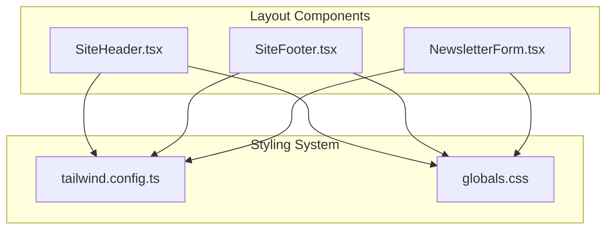
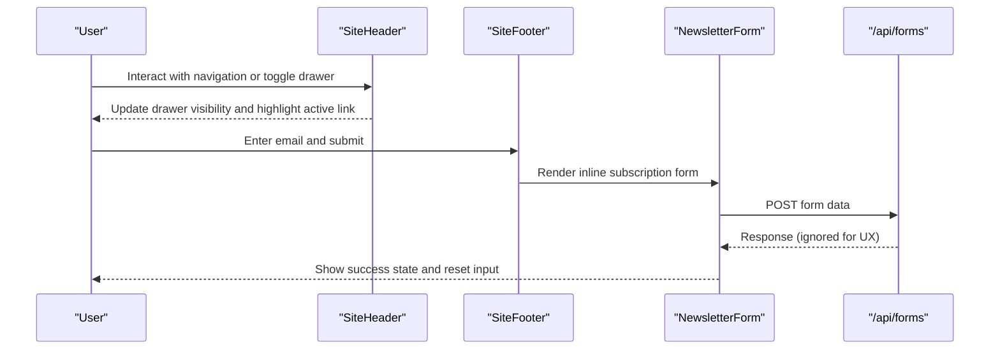
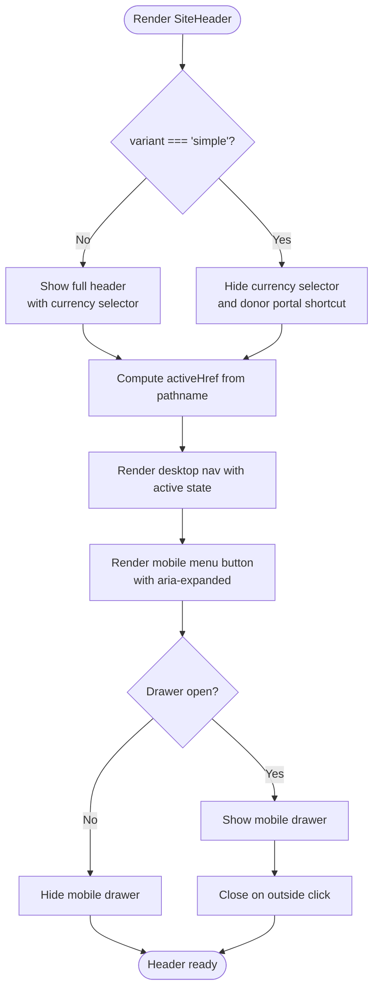
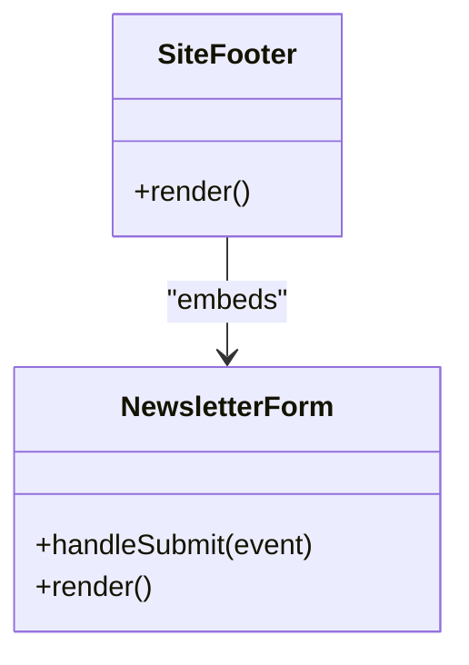
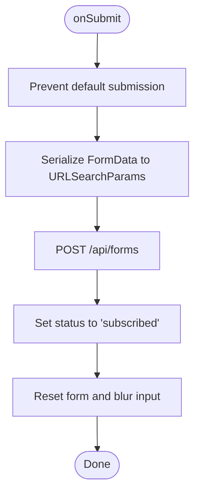
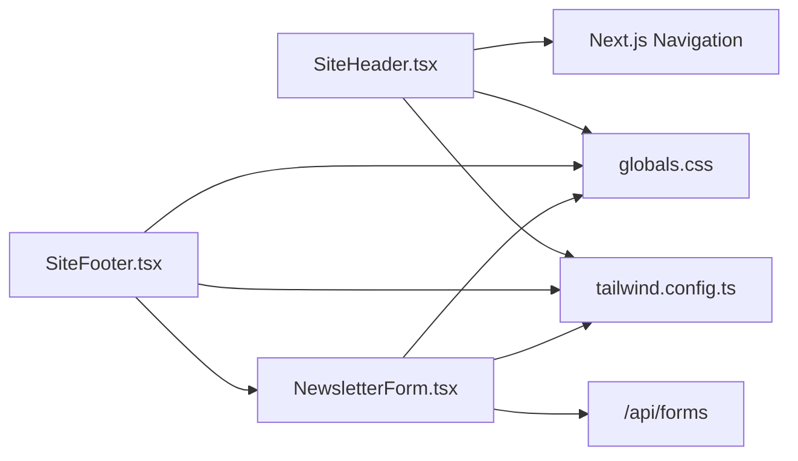

# UI Components

<cite>
**Referenced Files in This Document**
- [SiteHeader.tsx](file://components/layout/SiteHeader.tsx)
- [SiteFooter.tsx](file://components/layout/SiteFooter.tsx)
- [NewsletterForm.tsx](file://components/layout/NewsletterForm.tsx)
- [tailwind.config.ts](file://tailwind.config.ts)
- [globals.css](file://app/globals.css)
</cite>

## Table of Contents
1. [Introduction](#introduction)
2. [Project Structure](#project-structure)
3. [Core Components](#core-components)
4. [Architecture Overview](#architecture-overview)
5. [Detailed Component Analysis](#detailed-component-analysis)
6. [Dependency Analysis](#dependency-analysis)
7. [Performance Considerations](#performance-considerations)
8. [Troubleshooting Guide](#troubleshooting-guide)
9. [Conclusion](#conclusion)

## Introduction
This document explains the reusable layout and form components used across the GMCF charity portal: SiteHeader, SiteFooter, and NewsletterForm. It covers their responsibilities, props, events, accessibility features, responsive behavior, styling system, integration patterns, and performance considerations. The goal is to help developers integrate these components consistently while maintaining a trustworthy, accessible, and performant user experience.

## Project Structure
The components live under `components/layout` and are consumed by pages throughout the site. Styling is primarily handled through Tailwind CSS with a custom design token palette defined in the project configuration. Global typography and base styles are centralized in the application’s global stylesheet.

**Diagram sources**
- [SiteHeader.tsx:1-234](file://components/layout/SiteHeader.tsx#L1-L234)
- [SiteFooter.tsx:1-233](file://components/layout/SiteFooter.tsx#L1-L233)
- [NewsletterForm.tsx:1-72](file://components/layout/NewsletterForm.tsx#L1-L72)
- [tailwind.config.ts:1-129](file://tailwind.config.ts#L1-L129)
- [globals.css:1-189](file://app/globals.css#L1-L189)

**Section sources**
- [SiteHeader.tsx:1-234](file://components/layout/SiteHeader.tsx#L1-L234)
- [SiteFooter.tsx:1-233](file://components/layout/SiteFooter.tsx#L1-L233)
- [NewsletterForm.tsx:1-72](file://components/layout/NewsletterForm.tsx#L1-L72)
- [tailwind.config.ts:1-129](file://tailwind.config.ts#L1-L129)
- [globals.css:1-189](file://app/globals.css#L1-L189)

## Core Components
- SiteHeader: Fixed top navigation bar with an international meta strip, desktop navigation links, mobile drawer menu, currency selector (default variant), active route highlighting, and a donate call-to-action.
- SiteFooter: Trust banner, brand information, featured appeals list, global office details, newsletter subscription via NewsletterForm, and bottom legal links.
- NewsletterForm: Inline email subscription form that posts to `/api/forms`, provides optimistic success feedback, and resets after submission.

Key shared characteristics:
- Built with React Server Components where possible; client-side interactivity is isolated to “use client” components.
- Styled with Tailwind utility classes and a consistent color palette.
- Accessible attributes such as aria-label and aria-expanded are included for interactive controls.

**Section sources**
- [SiteHeader.tsx:16-23](file://components/layout/SiteHeader.tsx#L16-L23)
- [SiteHeader.tsx:45-231](file://components/layout/SiteHeader.tsx#L45-L231)
- [SiteFooter.tsx:5-230](file://components/layout/SiteFooter.tsx#L5-L230)
- [NewsletterForm.tsx:7-70](file://components/layout/NewsletterForm.tsx#L7-L70)

## Architecture Overview
The header and footer compose the page shell. The header manages its own state for the mobile drawer and derives the active route from Next.js routing. The footer embeds the newsletter form, which submits to a serverless API route. All three components rely on the Tailwind theme for colors, typography, and spacing.

**Diagram sources**
- [SiteHeader.tsx:24-43](file://components/layout/SiteHeader.tsx#L24-L43)
- [SiteHeader.tsx:129-147](file://components/layout/SiteHeader.tsx#L129-L147)
- [SiteHeader.tsx:193-230](file://components/layout/SiteHeader.tsx#L193-L230)
- [SiteFooter.tsx:174-184](file://components/layout/SiteFooter.tsx#L174-L184)
- [NewsletterForm.tsx:11-31](file://components/layout/NewsletterForm.tsx#L11-L31)

## Detailed Component Analysis

### SiteHeader
Responsibilities:
- Renders a fixed header with a top meta strip containing helpline info, Zakat calculator link, and optional currency selector.
- Provides desktop navigation links with active route highlighting.
- Implements a mobile drawer menu toggled by a button with proper ARIA attributes.
- Supports a “simple” variant that removes the currency selector and volunteer portal shortcut to match legacy layouts.

Props and variants:
- `variant`: `'default' | 'simple'`. Default shows full header; simple hides currency selector and donor portal shortcut.

Events and interactions:
- Mobile menu toggle button updates internal drawer state and closes when clicking outside the header.
- Drawer links close the drawer on click.

Active route logic:
- Uses Next.js pathname to determine the active link. Campaign detail routes highlight the Appeals link.

Accessibility:
- Toggle button includes `aria-label` and `aria-expanded`.
- Currency selector includes `aria-label`.
- Links use semantic `<Link>` elements.

Responsive behavior:
- Desktop nav visible at large breakpoints; mobile drawer shown below.
- Meta strip content adapts to screen size.

Customization options:
- Use `variant="simple"` to reduce header complexity.
- Extend or replace navigation items by modifying the component’s internal navigation array.

Integration example:
- Import and render `<SiteHeader />` in your page layout.
- Pass `variant="simple"` when you need a compact header.

**Diagram sources**
- [SiteHeader.tsx:24-43](file://components/layout/SiteHeader.tsx#L24-L43)
- [SiteHeader.tsx:45-108](file://components/layout/SiteHeader.tsx#L45-L108)
- [SiteHeader.tsx:110-191](file://components/layout/SiteHeader.tsx#L110-L191)
- [SiteHeader.tsx:193-230](file://components/layout/SiteHeader.tsx#L193-L230)

**Section sources**
- [SiteHeader.tsx:16-23](file://components/layout/SiteHeader.tsx#L16-L23)
- [SiteHeader.tsx:24-43](file://components/layout/SiteHeader.tsx#L24-L43)
- [SiteHeader.tsx:45-231](file://components/layout/SiteHeader.tsx#L45-L231)

### SiteFooter
Responsibilities:
- Displays a trust banner emphasizing Zakat guarantee and transparency.
- Lists featured appeals with icons and links.
- Shows global headquarters contact details.
- Embeds NewsletterForm for field bulletins.
- Provides bottom navigation links and copyright notice.

Structure:
- Top trust bar with action buttons.
- Four-column grid on large screens: Brand & registration, Featured appeals, Global offices, Newsletter & updates.
- Bottom section with legal links.

Accessibility:
- Semantic headings and lists for structure.
- Links are descriptive and include icon indicators.

Customization options:
- Add or remove appeal links in the list.
- Update contact details and legal text directly in the component.

Integration example:
- Import and render `<SiteFooter />` at the root layout or page level.

**Diagram sources**
- [SiteFooter.tsx:1-233](file://components/layout/SiteFooter.tsx#L1-L233)
- [NewsletterForm.tsx:1-72](file://components/layout/NewsletterForm.tsx#L1-L72)

**Section sources**
- [SiteFooter.tsx:5-230](file://components/layout/SiteFooter.tsx#L5-L230)

### NewsletterForm
Responsibilities:
- Collects email addresses for newsletter subscriptions.
- Submits data to `/api/forms` using `application/x-www-form-urlencoded`.
- Provides optimistic success feedback without blocking the user.
- Resets the form and blurs the input after submission.

Props and slots:
- No external props; fully self-contained.
- No slots; the form UI is defined within the component.

Validation:
- HTML5 validation via `required` on the email input.
- No additional client-side regex validation beyond browser defaults.

Submission handling:
- Prevents default form submission.
- Serializes form fields into URLSearchParams.
- Sends a POST request to `/api/forms`.
- On success or failure, sets status to “subscribed” and clears the form.

Success feedback:
- Button text changes to “Subscribed!” and background color shifts to indicate completion.
- A small privacy note is displayed beneath the input.

Integration example:
- Render inside SiteFooter or any other container needing a compact email subscription form.

**Diagram sources**
- [NewsletterForm.tsx:11-31](file://components/layout/NewsletterForm.tsx#L11-L31)
- [NewsletterForm.tsx:33-70](file://components/layout/NewsletterForm.tsx#L33-L70)

**Section sources**
- [NewsletterForm.tsx:1-72](file://components/layout/NewsletterForm.tsx#L1-L72)

## Dependency Analysis
- SiteHeader depends on Next.js navigation (`usePathname`) and Link components.
- SiteFooter imports NewsletterForm.
- NewsletterForm calls `/api/forms` at runtime.
- All components consume Tailwind utilities and custom tokens defined in the Tailwind config.
- Global typography and base styles are applied via globals.css.

**Diagram sources**
- [SiteHeader.tsx:1-5](file://components/layout/SiteHeader.tsx#L1-L5)
- [SiteFooter.tsx:1-3](file://components/layout/SiteFooter.tsx#L1-L3)
- [NewsletterForm.tsx:1-3](file://components/layout/NewsletterForm.tsx#L1-L3)
- [tailwind.config.ts:1-129](file://tailwind.config.ts#L1-L129)
- [globals.css:1-189](file://app/globals.css#L1-L189)

**Section sources**
- [SiteHeader.tsx:1-5](file://components/layout/SiteHeader.tsx#L1-L5)
- [SiteFooter.tsx:1-3](file://components/layout/SiteFooter.tsx#L1-L3)
- [NewsletterForm.tsx:1-3](file://components/layout/NewsletterForm.tsx#L1-L3)
- [tailwind.config.ts:1-129](file://tailwind.config.ts#L1-L129)
- [globals.css:1-189](file://app/globals.css#L1-L189)

## Performance Considerations
- Client-only boundaries: Only components requiring interactivity are marked “use client,” minimizing client bundle size for static parts.
- Lightweight state: Both header drawer and newsletter form use minimal local state, avoiding unnecessary re-renders.
- Efficient event handling: Drawer toggle uses event propagation control to prevent unintended closures.
- Optimistic UX: NewsletterForm updates UI immediately after submission, improving perceived performance even if the API response is ignored.
- Tailwind purging: Content paths are scoped to app and components directories, reducing unused CSS.

[No sources needed since this section provides general guidance]

## Troubleshooting Guide
- Mobile drawer does not close:
  - Ensure the toggle button has the correct id and that the document click listener is attached.
  - Verify that clicks inside the drawer do not propagate to the document.
- Active route not highlighted:
  - Confirm that the current pathname matches one of the navigation href values.
  - Campaign detail routes should highlight the Appeals link.
- Newsletter form appears submitted but no email received:
  - Check that `/api/forms` exists and accepts POST requests with `application/x-www-form-urlencoded`.
  - Inspect network tab for fetch errors; the component intentionally ignores failures for UX.
- Styles not applying:
  - Verify Tailwind content paths include the components directory.
  - Ensure globals.css is imported in the app layout and that custom tokens are present in tailwind.config.ts.

**Section sources**
- [SiteHeader.tsx:34-43](file://components/layout/SiteHeader.tsx#L34-L43)
- [SiteHeader.tsx:129-147](file://components/layout/SiteHeader.tsx#L129-L147)
- [SiteHeader.tsx:193-230](file://components/layout/SiteHeader.tsx#L193-L230)
- [NewsletterForm.tsx:11-31](file://components/layout/NewsletterForm.tsx#L11-L31)
- [tailwind.config.ts:1-129](file://tailwind.config.ts#L1-L129)
- [globals.css:1-189](file://app/globals.css#L1-L189)

## Conclusion
SiteHeader, SiteFooter, and NewsletterForm provide a cohesive, accessible, and responsive foundation for the GMCF charity portal. They leverage Next.js routing, Tailwind CSS design tokens, and minimal client-side state to deliver a fast, trustworthy interface. By following the integration examples and customization notes, teams can extend these components confidently while preserving consistency and performance.

[No sources needed since this section summarizes without analyzing specific files]